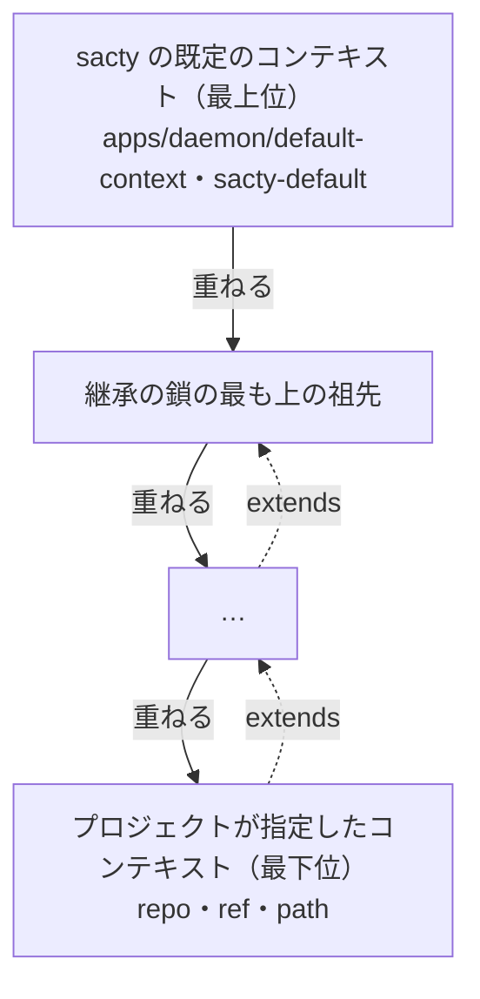
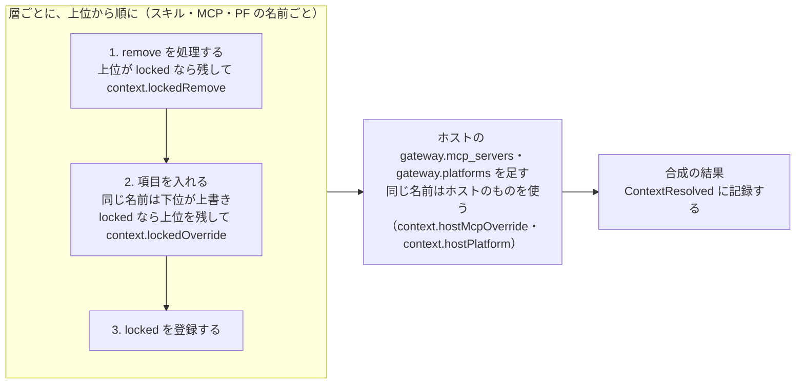
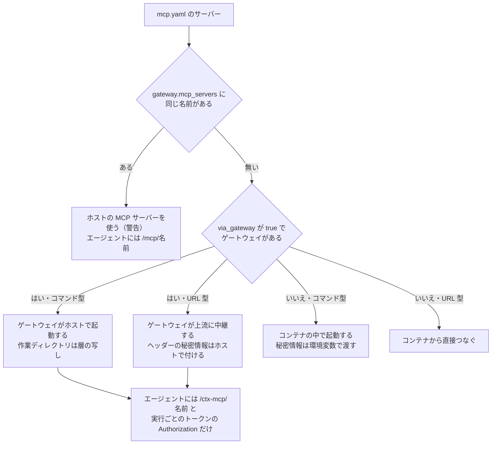

**日本語** | [English](context.en.md)

# コンテキストの合成

工程のエージェントとオーケストレーターに渡す規則・スキル・MCP サーバー・外部 PF・エージェントの設定を、コンテキストと呼ぶ。
sacty はコンテキストを層を重ねて合成し、実行のたびに Claude Code・Codex の設定の場所に置く。
層は、sacty の既定のコンテキストと、プロジェクトに指定したコンテキストリポジトリ（と、その継承の鎖）。

関係する ADR: [コンテキストの mcp.yaml の command の MCP サーバーを、既定でホストで起動してゲートウェイ経由にする](../adr/20261014-0927-context-command-mcp-on-host.md)、[既定のコンテキストに文章を書くためのスキルを同梱し、「。」の後の改行は日本語だけにする](../adr/20261015-0844-default-writing-skill.md)、[コンテキストに、ローカルのディレクトリの今の中身とモノレポの中のディレクトリを使えるようにし、extends に相対パスを足す](../adr/20261022-0626-context-local-path-and-monorepo.md)、[コンテキストのリポジトリのサブモジュールを取得し、組織で別に管理するスキルなどを写さずに使えるようにする](../adr/20261022-1503-context-submodules.md)

## 層

層は上位から重ね、下位の層が `extends` で上位の層を指す。

- 層の順は、上位から次のとおり。
  1. sacty の既定のコンテキスト（`apps/daemon/default-context/`）。
     取得せずに同梱のものを読む。
     名前は `sacty-default` で、コミットの代わりに中身の SHA-256 を記録する。
  2. コンテキストリポジトリの継承の鎖の最も上の祖先 → …
  3. プロジェクトが指定したリポジトリ（最下位）
- プロジェクトの指定（`ContextSource`）
  - `repo`：git の URL かローカルのパス（500 文字まで）。
    ローカルのパスは、絶対パスか `~/` で始まるもの（`~` はホームのディレクトリ）。
  - `ref`：ブランチやタグ。省けば、git の URL は既定のブランチ、ローカルのパスはディレクトリの今の中身。
  - `path`：リポジトリの中のディレクトリ（モノレポの一部を層にする）。リポジトリの根からの相対パスで、`.`・`..` の部分は書けない（`input.invalidContextPath`）。省けばリポジトリの根。
- 層は `<repo>//<path>#<ref>`（`path`・`ref` はあるときだけ）で表す。
  作業履歴（`ContextResolved` の `layers`）には `repo`・`ref`・`path`・`commit` を記録する。
- 継承：`sacty-context.yaml` の `extends` に、次のどれかを書く。
  - `<URL>[#<ref>]`：ほかのリポジトリ（最後の `#` で分ける）。
  - `{ repo, ref, path }`：ほかのリポジトリの中のディレクトリ（`ref`・`path` は任意）。
  - `./`・`../` で始まる相対パス：同じリポジトリ・同じ `ref` の中の、その層のディレクトリから見たディレクトリ。
    リポジトリの外を指したら `context.extendsOutside` で止める。
  - git で取得した層（`ref` のあるローカルのパスを含む）は、ローカルのパスを継承できない（`context.localExtendsFromRemote`）。
    ローカルのパスを書けるのは、プロジェクトの指定と、`ref` の無いローカルのパスの層（今の中身を読む層）の `extends` だけ。
  - 同じ層（`repo`・`path`・`ref`）が2度出たら `context.cycle` で止める。
  - 深さが `MAX_CONTEXT_DEPTH`（10）に達したら `context.tooDeep` で止める。
- 取得はキャッシュしない。合成のたびに一時ディレクトリ（`sacty-context-*`）に置き、使い終わったら消す。
  - git の URL と、`ref` のあるローカルのパス：`git clone --depth 1 [--branch <ref>]` する。
    同じ合成の中では、同じ `repo#ref` を1回だけ取得し、中のディレクトリの違う層は同じ取得（同じコミット）を使う。
  - `ref` の無いローカルのパス：取得せず、層のディレクトリ（`<repo>/<path>`）を `.git` を除いて写す。
    写すのとハッシュは非同期に行い、ファイルは少しずつ読む。中止（上限の時間）されたら途中で止め、`context.copyAborted` で止める。
    git で管理していなくても、コミットしていない変更があってもよい。
    リンクはたどらずにリンクのまま写す。
    コミットの代わりに、写した中身すべての SHA-256 を記録する。
  - サブモジュール
    - git で取得した層：層に関わるサブモジュールを `git submodule update --init [--recursive] --depth 1 -- <パス>` で取得する。
      - 層のディレクトリの中にあるもの：入れ子も含めて取得する（`--recursive`）。
      - 層のディレクトリを含むもの（層がサブモジュールの中にある）：そのサブモジュールだけを取得し、その中で層への相対パスで選び直す（その中の、層に関わらない入れ子は取得しない）。
    - 取得するのは、取得したコミットが指すサブモジュールのコミットなので、記録するのは取得したリポジトリのコミットだけ。
      層に関わらないサブモジュール（モノレポのアプリのものなど）は取得しない。
      同じ取得の同じ層のディレクトリでは1回だけ取得する。
    - ローカルのパス（file のプロトコル）のサブモジュールは取得しない（`protocol.file.allow=never`）。
      取得したコミットの中身で、ホストのディレクトリを読ませないため（`extends` のローカルのパスと同じ）。
    - 認証は、リポジトリと同じ環境変数で取得する。
      gh のトークン（`http.https://<ホスト>/.extraheader`）を渡すのは、リポジトリが HTTPS の URL のときだけで、効くのは同じホストの HTTPS の URL のサブモジュールだけ。
      SSH の URL・ほかのホストのサブモジュールは、ホストの git の認証（SSH なら `SSH_AUTH_SOCK`）を使う。
      取得できなければ `context.fetchFailed` で止める（git の誤りの文をそのまま渡す）。
    - `ref` の無いローカルのパス：層のディレクトリの下のサブモジュール（入れ子も）が取り込まれていなければ（サブモジュールの `.git` が無ければ）、`context.submoduleNotCheckedOut` で止める。
      ホストのディレクトリは変えないので、sacty からは取り込まない。
      git で管理していないディレクトリ（`git ls-files` が失敗する）には、サブモジュールは無いものとする。
    - サブモジュールの中身も、ほかのファイルと同じく、シンボリックリンクがあれば止める。
  - 層のディレクトリが無い・途中にシンボリックリンクがあるときは `context.pathMissing` で止める。
  - git に渡す環境は `GIT_TERMINAL_PROMPT=0` とホストの `PATH`・`HOME`・`SSH_AUTH_SOCK`・`TMPDIR`・`LANG` と認証だけ。
- 認証
  - HTTPS の URL で、次のどちらかに当たれば、gh のトークンを `http.https://<ホスト>/.extraheader` の設定（環境変数 `GIT_CONFIG_*`）で渡す。
    - そのホストの GitHub のアカウントをプロジェクトで選んでいる。
    - プロジェクトの対象に同じホストがある。
  - アカウントが要るのに選んでいなければ止める（`github.accountRequired`）。
  - SSH・ローカルのパス・ほかのサーバーは、ホストの git の認証を使う。
  - トークンは誤りの文から伏せる。

コード: `apps/daemon/src/context.ts`（`loadLayers`・`loadDefaultContext`・`resolveContext`・`parseExtends`・`extendsRef`・`localContextDir`・`layerDir`・`copyLocalLayer`・`hashTree`・`assertSubmodulesCheckedOut`・`gitlinks`・`submoduleInLayer`・`GitContextFetcher`・`MAX_CONTEXT_DEPTH`・`DEFAULT_CONTEXT_REPO`）、`apps/daemon/src/service.ts`（`gitAuth`・`githubToken`）、`apps/daemon/src/gh.ts`（`gitAuthEnv`）、`packages/core/src/projects.ts`（`ContextSource`・`ContextPath`・`contextLabel`）

## 既定のレビュー用スキル

既定のコンテキストには、レビューを観点ごとに分担する `review-dispatch` と `review-execution` がある。
既定のスキルは、あらゆる言語・分野のリポジトリと sacty の外の使い方に渡るので、sacty に限った書き方をしない。

親は担当を起動する前に、対象のプロジェクトで定められたフォーマッター・リンター・型チェック・テスト・ビルドの検証を、対象を変更しない方法で1回実行する。
結果は作業領域の外に要約とログとして保存し、各担当へ同じ要約を渡す。
横断の観点 X-1 は常に起動し、検証または CI の結果があれば X-2 が失敗・警告・未実行の検証を分析する。
再レビューでは新しい対象に対して検証し直す。

既定の Codex 設定では、同時に開く担当の上限は `max_threads = 16`、担当からの追加起動を防ぐ深さは `max_depth = 1` とする。

担当を起動するサブエージェントの段階（`lite`・`entry`・`standard`・`advanced`・`ultimate`）は、観点カタログの「観点ごとの段階」で観点ごとに決める。
親は、その段階の名前のサブエージェント（設定の場所の `agents/` に sacty が置く定義。下の「実行のときに置くファイル」）を指定して起動する。
定義が無い段階は親と同じモデルで起動し、起動表の「段階」に「親と同じ」と書く。

### PR のレビューと投稿

PR のレビュー（流れ `pr-review`）と、既定の `git` の PR への投稿は、次のように動く。

- 依頼した側（呼び出したツールやプロンプト）が出力の形と投稿のしかたを決めていれば、それに従い、エージェントは自分で投稿しない。
  sacty の PR のレビューのタスクは、指示で出力の形を決め、投稿は sacty がする（[タスクと工程](tasks-and-steps.md#pr-のレビューだけのタスク)）。
- 決めていない（人が対話で投稿を頼んだ）ときだけ、`git` の手順で 1 件の `COMMENT` のレビューとして投稿する。
  - 指摘の頭は `[要修正]`・`[提案]`。
  - 判定は「修正が必要」「提案あり（マージは可）」「指摘なし」の3つ。
  - 差分の中に付けられる行が無い指摘は、確かめる相手（対話で依頼した人）がいれば、投稿の前に扱いを確かめる。
    いなければ止まらずに総評に書く。
- 既存のレビュー
  - 親はレビューの前に、PR にすでにあるレビュー（他のレビュアーの指摘と作者の返答）の状況を確かめる。
    依頼した側が渡したものを使い、渡されていなければ PR から読めるときだけ取得する。
  - 既存の指摘と同じ箇所・同じ問題は、`must` でも繰り返さない。
    理由「既存のレビューで指摘済み」で不採用にし、判定にも数えない。
  - 省いた件数を総評に短く書く。
  - 既存の指摘は担当に渡さず、集約の記録の `existing_reviews` に件数を残す。
- PR の本文や依頼文で示された文書（Git の外に書いた設計書など）
  - 親がタイトル・説明・差分から、レビューの対象か根拠かを分ける。
  - どちらも親が全文を取得して、作業領域の外に写しを置く。
  - 対象にした文書は、主対象の種類の判断と担当の対象に含める（差分の外でも範囲から外さない）。
  - 取得できない文書は「レビューの範囲」に書く。
    主対象にした文書が読めなければ、レビューを完了できなかったものとして扱う。
  - 分けた結果は集約の記録の `linked_docs` に残す。

コード: `apps/daemon/default-context/skills/review/review-dispatch/SKILL.md`、`apps/daemon/default-context/skills/review/review-dispatch/references/pr-review.md`、`apps/daemon/default-context/skills/review/review-dispatch/references/linked-docs.md`、`apps/daemon/default-context/skills/git/references/pr-review-posting.md`、`apps/daemon/default-context/skills/review/review-dispatch/references/verification-run.md`、`apps/daemon/default-context/skills/review/review-execution/references/X-2.md`、`apps/daemon/default-context/agents/codex/config.toml`

## 既定の文章用スキル

既定のコンテキストには、人が読む文章（PR の本文、レビューのコメント、Issue・PR へのコメント、要求要件・設計、調査の結果、報告）の書き方を決める `writing` がある。
従う順は、依頼した人の指示、対象のリポジトリの文章の決まり（AGENTS.md・CONTRIBUTING・docs の方針など）、このスキルの順。
日本語では「。」の後で改行し、英語ではピリオドの後で改行しない。
コードブロック・表のセル・コミットメッセージの1行目など、改行で表示が崩れる所では改行しない。
既定の `git`・`review-dispatch`・`review-execution` は、文章を書く所でこのスキルを参照する。

コード: `apps/daemon/default-context/skills/writing/SKILL.md`、`apps/daemon/default-context/skills/writing/references/layout.md`、`apps/daemon/default-context/skills/writing/references/sentences.md`

## 既定の要求要件用スキル

既定のコンテキストには、要求要件の受け入れ条件を EARS（Easy Approach to Requirements Syntax）の文型で書く `ears-requirements` がある（PBI-122）。
文型は、常時・イベント駆動・状態駆動・望まない振る舞い・オプションと、その組み合わせ（日本語と英語）。
1文に1つの要求を書き、ID（`R-1` など）を付け、応答は第三者が合否を決められる形にする。
従う順は、依頼した人の指示、対象のリポジトリの要求要件の決まり、このスキルの順。

要求要件の工程の指示は、受け入れ条件を EARS の形式で書き、このスキルがあれば従うよう求める（[タスクと工程](tasks-and-steps.md)）。
プロジェクトのコンテキストでスキルを消していても形式がわかるよう、文型・ID・異常系の書き方は指示にも書く。
既定のスキルは、あらゆる言語・分野のリポジトリと sacty の外の使い方に渡るので、sacty に限った書き方をしない。

関係する ADR: [要求要件の受け入れ条件を EARS 形式で書かせ、既定のスキル ears-requirements を同梱する](../adr/20261017-0130-ears-requirements.md)

コード: `apps/daemon/default-context/skills/ears-requirements/SKILL.md`、`apps/daemon/default-context/skills/ears-requirements/references/patterns.md`、`apps/daemon/src/prompts.ts`（`earsLines`）

## 既定のメモリー用スキル

既定のコンテキストには、監査が登録したメモリーを読むためのスキル `memory` がある（PBI-126）。
スキルには次のことを書く。

- 置き場所（`/sacty-memory/project`・`/sacty-memory/repository`）
- 読み方：索引から関係するものだけを開く。
- 従う順：人の指示 → コンテキストとリポジトリの決まり → リポジトリの実物 → メモリー

メモリーをマウントした実行の指示にも、同じ読み方を書く（[メモリー](memory.md)）。
既定のスキルは、あらゆる言語・分野のリポジトリに渡るので、sacty に限った書き方をしない。

コード: `apps/daemon/default-context/skills/memory/SKILL.md`、`apps/daemon/src/memory.ts`（`memoryPromptLines`）

## 既定の工程の選択用スキル

既定のコンテキストには、オーケストレーターが工程の組み合わせを選び、決められた形の JSON で答えるための `plan-steps` がある（PBI-146）。
スキルには次のことを書く。

- 候補の比べ方：目的・成果物・変更対象・規模の順。
  無条件の既定や受け皿にしない。
- 理由の書き方
- 答えの JSON の決まり：見出しと項目の名前はそのまま、形の例の注釈を写さない、要らない項目はキーごと省く。
- 答えの検査（`references/json-check.md`）：答えは出す前にファイルに書き、`jq`（無ければ `python3`・`node`）で構文と形（見出しと必須の項目）を検査する。
  通るまで直してから、本文の最後に 1 回だけ出す。

オーケストレーターの指示は、このスキルに従うよう求める。
プロジェクトのコンテキストでスキルを消していても最低限がわかるよう、検査して通るまで直すこと・1 回だけ出すことを指示にも書く（[タスクと工程](tasks-and-steps.md#オーケストレーター)）。
sacty の工程の選び方を扱うスキルなので sacty の名前を書いてよいが、特定の言語のツールチェーンには寄せない。

関係する ADR: [オーケストレーターにもコンテキストを渡し、工程の選択を既定のスキル plan-steps にして答えの JSON を検査させる](../adr/20261019-1512-orchestrator-plan-steps-skill.md)

コード: `apps/daemon/default-context/skills/plan-steps/SKILL.md`、`apps/daemon/default-context/skills/plan-steps/references/json-check.md`、`apps/daemon/src/prompts.ts`（`planAnswerLines`・`PLAN_SKILL`）

## 既定の図用スキル

既定のコンテキストには、draw.io の図（`.drawio`。PNG・SVG・PDF への書き出しを含む）を作る `drawio` がある。

- 中身は draw.io の公式のスキル（`jgraph/drawio-mcp` の `plugins/claude-code/skills/drawio/SKILL.md`。Codex 用も同じ中身。Apache-2.0）。
  手を加えずに、ライセンス（`LICENSE`）とともに置く。
- 取り込んだ版は `jgraph/drawio-mcp` の `307725c331847c15bf5ddeef64a9c8434a30fadf` で、SKILL.md の SHA-256 をテストで確かめる。
- スキルは、図を Mermaid か draw.io の XML で書き、Mermaid の変換・ELK のレイアウト・書き出しにイメージの `drawio`（[エージェントの実行](agent-execution.md#イメージ)）を使う。
  `drawio` が無ければ、XML で `.drawio` を作る。
- Mermaid・XML の詳しい書き方は、スキルが実行のときに `raw.githubusercontent.com` から取得する（届かなければ、SKILL.md の内容だけで書く）。

関係する ADR: [エージェントのイメージに作業用の CLI と draw.io の CLI を入れ、draw.io の公式のスキルを既定のスキルにする](../adr/20261022-0115-agent-image-tools-and-drawio.md)

コード: `apps/daemon/default-context/skills/drawio/SKILL.md`、`apps/daemon/default-context/skills/drawio/LICENSE`、`apps/daemon/src/default-skills.test.ts`

## コンテキストリポジトリのファイル

読むのは `sacty-context.yaml`・`mcp.yaml`・`platforms.yaml`・`rules.md`・`rules/`・`skills/`・`agents/` だけ（`README.md` は読まない）。

- これらの中に通常のファイル・ディレクトリでないもの（シンボリックリンクなど）があれば止める（`context.notPlainFile`）。
- YAML が無ければ既定値を使う。
- 読めなければ `context.fileUnreadable`、形が違えば `context.fileInvalid`（どの層のどのファイルのどの項目か）で止める。

| ファイル | 中身 |
| --- | --- |
| `rules.md` か `rules/*.md` | 規則。`rules.md` があればそれだけ、無ければ `rules/` の直下の `*.md` を名前の順に連結する。層ごとに `<!-- sacty context: <層> -->` を付けて上位から連結する |
| `skills/` | `SKILL.md` のあるディレクトリが1つのスキル（名前はディレクトリ名）。無いディレクトリはグループとして中を探す。同じ層で名前が重なれば先のものを使い警告する |
| `mcp.yaml` | `servers.<名前>`（`^[A-Za-z0-9_-]+$`）。コマンド型（`command`・`args`・`env`・`via_gateway`（既定 `true`））か URL 型（`url`・`headers`・`via_gateway`（既定 `true`））。共通で `startup_timeout_sec`（1〜3600）・`tool_timeout_sec`（1〜86400）。値は文字列か `{ secret, prefix }`。文字列に `${` は書けない |
| `platforms.yaml` | `platforms.<名前>`。項目は `gateway.platforms` と同じ（[ゲートウェイ](gateway.md)） |
| `sacty-context.yaml` | `extends`、`locked`・`remove`（それぞれ `skills`・`mcp`・`platforms` の名前の一覧） |
| `agents/codex/config.toml`・`agents/claude/settings.json` | エージェントの設定。`agents/codex/`・`agents/claude/` の下のほかのファイルはパスごとに写す |

コード: `apps/daemon/src/context.ts`（`CONTEXT_ENTRIES`・`assertPlainEntries`・`readYaml`・`layerRules`・`layerSkills`・`McpFile`・`McpServer`・`McpValue`・`PlatformsFile`・`ContextManifest`・`AGENT_SETTINGS_FILES`）

## 合成の規則

合成の流れは次のとおり（詳しい規則は下の箇条書き）。

- スキル・MCP・PF は、名前ごとに、層を上位から順に処理する。
  1つの層では、次の順に処理する。
  1. その層の `remove` を処理する。
     上位が `locked` なら残して、警告 `context.lockedRemove` を出す。
  2. その層の項目を入れる。
     同じ名前は下位が上書きする。
     `locked` の名前なら上位のものを残して、警告 `context.lockedOverride` を出す。
  3. その層の `locked` を登録する。
- エージェントの設定は、表はキーごとに重ね、それ以外（配列を含む）は下位の値で置き換える。
  Claude の `permissions.allow`・`deny`・`ask` だけは重複を除いて合わせる。
- sacty が決める項目は使わずに警告する（`context.reservedSetting`）。
  - Codex の `mcp_servers`・`model_provider`・`model_providers`・`approval_policy`・`sandbox_mode`・`profile` など
  - Claude の `apiKeyHelper` など
  - Claude の `env` の認証・接続先・設定の場所の変数と `SACTY_` で始まる名前
- `agents/` の下の `auth.json`・`AGENTS.md`・`CLAUDE.md`・`.credentials.json`・`.claude.json`・`mcp.json`・`skills` も写さずに警告する。
- 段階のサブエージェントの定義（`agents/claude/agents/<段階>.md`・`agents/codex/agents/<段階>.toml`。[設定](configuration.md#エージェントの既定と上書き)の `claude_<段階>`・`codex_<段階>`）は sacty が作る。
  - 層にあれば、その段階を置くかどうかによらず写さずに警告する（`context.reservedTierFile`）。
    残すと、スキルが段階の名前で起動したときに層の定義が使われるためである。
  - Codex はファイルの中の `name` をロールの名前にする。
    そのため、`agents/codex/agents/*.toml` の `name` が段階のものも、ファイル名によらず写さずに警告する（`codexRoleName`）。
    - `name` は前後の空白を除いて比べ、空なら名前とみなさない。
    - 読むのは層のエージェントの設定のディレクトリの中の、リンクでない通常のファイル（256KB まで）だけ。
      `config_file` が外・絶対パス・通常でないファイルを指すときは、読まずに宣言を残す。
      読めないファイルはそのまま写す。
  - 次のものも、sacty が決める項目として使わずに警告する（`context.reservedSetting`。`agents` のほかの項目は残す）。
    - Codex の `config.toml` の `agents.<段階>`（カスタムエージェントの宣言。自動で探す `agents/<段階>.toml` より先に登録される）
    - `config_file` が指す定義の `name` が段階の `agents.<名前>`
- ホストの MCP サーバー（`gateway.mcp_servers`）を足す。
  層の MCP と同じ名前なら、ホストのものを使い警告する（`context.hostMcpOverride`）。
- PF は、ホストの `gateway.platforms` と合わせる。
  同じ名前ならホストのものを使い警告する（`context.hostPlatform`）。
- 警告は工程を止めない。
  合成の結果（層・警告・PF の要約）は、工程の実行ごとに `ContextResolved` に記録する。
- 取得の失敗と形の誤りは、実行の失敗にして一時停止する。

コード: `apps/daemon/src/context.ts`（`composeContext`・`mergeNamed`・`mergeSettings`・`RESERVED_SETTINGS`・`RESERVED_FILES`・`routeMcp`）、`apps/daemon/src/platforms.ts`（`mergePlatforms`）、`apps/daemon/src/service.ts`（`runContext`）

## 実行のときに置くファイル

設定の場所（Claude Code は `/tmp/sacty-claude-config`、Codex は `/.codex`）に、層のエージェントのファイル → スキル（`skills/<名前>/…`）→ sacty が作るファイルの順に置く（同じパスは後のものが上書き）。
層のエージェントのファイルとスキルのディレクトリの `.git`（サブモジュールの、git の管理の情報を指すファイル）は置かない（`apps/daemon/src/context.ts` の `filesUnder`・`layerAgentFiles`）。

| runtime | sacty が作るファイル |
| --- | --- |
| Claude Code | `CLAUDE.md`（規則）、`settings.json`（合成した設定）、`mcp.json`（`{ "mcpServers": … }`。コマンド型は `command`・`args`・`env`、URL 型は `type: "http"`・`url`・`headers`）、`agents/<段階>.md`（段階のサブエージェントの定義。frontmatter の `name`・`description`・`model`・`effort`） |
| Codex | `AGENTS.md`（規則と、スキルの一覧 `- <名前>：<description>（<場所>）`）、`config.toml`（合成した設定と `[mcp_servers."<名前>"]`。URL 型は `url`・`http_headers`・`env_http_headers`）、`agents/<段階>.toml`（段階のサブエージェントの定義。`name`・`description`・`developer_instructions`・`model`・`model_reasoning_effort`） |

### 段階のサブエージェントの定義

段階のサブエージェントの定義（PBI-119）は、次の条件に合う段階を、接頭辞を外した名前で置く（`selectTiers`・`tierFiles`）。

- 使えるエージェントの `claude_<段階>`・`codex_<段階>` である。
  使えるエージェントとは、`config/agents.yaml` の既定に `config.yaml` の `agents` を重ね、接続先と単価があるもの（[設定](configuration.md#エージェントの既定と上書き)）。
- 工程のエージェントと同じ runtime である。
- 認証・接続先（`auth`・`endpoint`・`via_gateway`）が同じである。

違うものは置かず、`agents.tierConnectionDiffers` を注意に残す（接続先は runtime ごとの `providers` から作るので、同じ runtime の段階はいつも同じになる）。

- stub の工程には置かない。
- `reasoning_effort` の無い段階（既定の `claude_lite` など）は、それを書かない定義（ツールの既定）になる。
- 置いた段階（段階・エージェントの名前・モデル・リーズニングエフォート）は `ContextResolved` の `tiers` に記録する。
- プレビューにも同じファイルを出す。
  プレビューの親は、その runtime の `default_agent`、無ければ `step_agents`・`guardian_agent` のうち最初のもの。
- `ContextResolved` は、コンテキストを渡すたびに、その実行の `runId` で記録する（`contextResolved`）。
  工程の実行だけでなく、オーケストレーター（PBI-146）・マージの後の監視・外部作業・書き出しの実行でも記録する。
- 段階を置いた実行の費用は推定（`estimated`）として記録する。
  担当が親と違うモデルで動きうるが、費用は親の結果の使用量 × 親の単価でしか出せないためである（[エージェントの実行](agent-execution.md#認証)）。

### MCP の渡し方

MCP サーバーの動く場所と、エージェントに渡すものは、次のように決まる。

- MCP の秘密情報は、ファイルには `SACTY_MCP_SECRET_<番号>` の環境変数として書き、値はコンテナの環境変数で渡す（ホストで取り出す）。
- 層の `mcp.yaml`・`platforms.yaml` の秘密情報は、ほかの秘密情報とまとめて取り出してある（[秘密情報](secrets.md#起動のときのまとめての取り出し)）。
  取り出すのは、デーモンの起動のとき・取り出し直したとき・プロジェクトを保存したとき。
  取り出していないもの（その後に層に足されたものなど）は、使うときに取り出す。
- 層の MCP サーバーは、`via_gateway` が `true`（既定）なら、ゲートウェイ経由に置き換える。
  エージェントには `http://host.docker.internal:<ポート>/ctx-mcp/<名前>` と、実行ごとのトークンの `Authorization` だけを渡す（`routeMcp`）。
  - URL 型：元の URL とヘッダーはゲートウェイが持つ（ヘッダーの秘密情報はホストで取り出す）。
  - コマンド型：ゲートウェイがホストで起動する（下の「ホストで起動するコマンド型の MCP サーバー」）。
    `env` の秘密情報はホストで起動するときに取り出し、コンテナには渡さない。
  - `via_gateway: false` なら、コンテナの中で起動する（URL 型はコンテナから直接つなぐ）。
    秘密情報の値は環境変数でコンテナに渡す。
  - ゲートウェイが無いときは、どちらもコンテナの中で起動する・直接つなぐ。
- ホストの MCP サーバー（`gateway.mcp_servers`）は `/mcp/<名前>` として渡す（[ゲートウェイ](gateway.md)）。
- MCP の時間切れ
  - Codex：`config.toml` に同じ名前で書く。
  - Claude Code：`tool_timeout_sec` をサーバーごとの `timeout`（ミリ秒）にする。
    `startup_timeout_sec` をどれかに書いたときだけ、全体の環境変数 `MCP_TIMEOUT` を、各サーバーの値（書いていないサーバーは 30 秒）の最大にする。
  - どれかがその実行の上限（`config.yaml` の `run_timeout` の役割の上限。既定 30 分。PBI-150）以上なら警告する（`context.mcpTimeoutOverRun`）。

コード: `apps/daemon/src/context.ts`（`planContext`・`codexServer`・`timeoutWarnings`・`routeMcp`・`McpServer`・`CLAUDE_MCP_CONFIG`・`CLAUDE_MCP_STARTUP_DEFAULT_SEC`・`GATEWAY_TOKEN_SECRET`）、`apps/daemon/src/service.ts`（`contextContainerDir`・`mcpRouting`）

## ホストで起動するコマンド型の MCP サーバー

`via_gateway`（既定 `true`）のコマンド型の MCP サーバーは、ゲートウェイがホストで起動する。
起動・準備・再起動・中継・プロセスの記録は、ホストの MCP サーバー（[ゲートウェイ](gateway.md)）と同じ仕組みを使う。
コンテキストリポジトリを編集できる人は、ホストでコマンドを動かせる。

- 名前の分離
  - ゲートウェイの中の名前（`ctx-<SHA-256 の先頭24桁>`）は、プロジェクトと中身（`mcp.yaml` の名前・`command`・`args`・`env`・時間切れ・層のリポジトリ・ref・commit）から作る。
  - 実行のトークンごとに、その実行のプロジェクトの名前にだけ結びつける。
    ほかのプロジェクトの実行からは、名前を知っていても使えない（404）。
  - 同じ名前で中身が違っても混ざらない。
- 使い回し：同じプロジェクトで同じ中身なら、実行をまたいで同じプロセスを使う。
  中身（層の commit を含む）が変われば、新しい名前で起動する。
- 作業ディレクトリ
  - そのサーバーを書いた層のディレクトリ（`path` があればリポジトリの中のそのディレクトリ）の写し（`SACTY_HOME/context-mcp/layers/<プロジェクトと層の識別>-<乱数>`。`.git` は写さない）。
    層の識別は、`repo`・`ref`・`path`・`commit` から作る。
  - 取得した層は実行の後に消えるので、確保のときに写し、使うものが無くなったら消す。
  - 相対パスのコマンドは作業ディレクトリから、ほかは `PATH` から探す。
    無ければ起動する前に理由（`context.mcpHostCommandMissing`）にする。
- 確保と解放
  - 実行の前に、その実行が使うサーバーをまとめて確保する。
    すべて用意できてから確定する。
    途中で失敗したら、その確保で写した層を消して、持っている状態を変えない。
    用意したコンテキストも消す。
  - 準備は `max(120 秒, startup_timeout_sec)` まで待つ（`CONTEXT_MCP_READY_SEC`）。
    準備ができなければ、どのサーバーか（`mcp.yaml` の名前と層）をコンテキストの警告に残して実行する（書き出しでは、その接続先への書き出しを止める）。
  - 実行が終わったら解放する。
- 止める
  - 使っている実行が無くなったものは、同じプロジェクト・同じ名前で新しい中身が使われたら（古くなったら）すぐに止める。
    そうでなければ、最後に使ってから30分で止める（60秒ごとに確かめる）。
  - 止める・写しを消す途中の失敗は、確保・解放の失敗にせず、ログに残して後でやり直す。
  - デーモンの終了ですべて止めて写しを消す。
    デーモンの起動のときに前回の写し（`context-mcp/layers`）を消す（残ったプロセスは、ホストの MCP サーバーと同じ片付けで止める）。
- 理由（画面・作業履歴・エージェントへの 503）には、`mcp.yaml` の名前・層・プロジェクトの名前を出し、ゲートウェイの中の名前は出さない。
  - 項目は `context.mcpHostUnavailable`・`context.mcpHostReadyTimeout`・`context.mcpHostCommandMissing` の `name`・`from`・`project`。
  - `project` の無い前の記録は、プロジェクトを出さずに表示する。
  - 同じ層・同じ名前のサーバーが複数のプロジェクトにあっても、どれかわかる。
- ログ（起動・準備できない・止める・後片付け）にも、`mcp.yaml` の名前・プロジェクトの名前と ID・層を出し、ゲートウェイの中の名前を添える（[ゲートウェイ](gateway.md)の「ホストの MCP サーバー」）。
- 理由・ログに出す層は、リポジトリの URL に認証情報（`https://<ユーザー>:<トークン>@…`）があれば `***` に伏せる（`shownLayer`）。
- プロジェクトの名前は、確保のときのものを出す。
  ゲートウェイの中の名前はプロジェクトの ID から作るので、名前を変えても起動し直さない。

コード: `apps/daemon/src/context-mcp.ts`（`ContextMcpServers`・`lease`・`prepare`・`sweep`・`copyLayer`・`forceRemove`・`shownLayer`・`CONTEXT_MCP_READY_SEC`）、`apps/daemon/src/context.ts`（`routeMcp`・`HostedContextMcp`）、`apps/daemon/src/host-mcp.ts`（`assertCommand`・`CommandNotFoundError`・`HostMcpContext`・`mcpLogName`）、`apps/daemon/src/service.ts`（`runContext`・`mcpRouting`）、`apps/daemon/src/main.ts`

## 雛形（sacty context init）

`README.md`・`rules.md`・`skills/README.md`・`mcp.yaml`・`platforms.yaml`・`sacty-context.yaml`・`agents/codex/config.toml` を作る。
中身は説明のコメントだけで、既定のコンテキストを変えない。
`README.md` には、段階のサブエージェントの定義は sacty が作るので置いても使わないことを書く。

- 同じパスか `rules` があれば、`--force` が無い限り何も書かずに止まる。
- 途中のディレクトリがディレクトリでなければ `--force` でも止まる。

コード: `apps/daemon/src/context-template.ts`（`CONTEXT_TEMPLATE_FILES`・`initContextRepo`）

## プレビュー

- 窓口
  - `GET /api/projects/:id/context-preview?runtime=`：保存した設定
  - `POST /api/projects/:id/context-preview`（`{ runtime, definition? }`）：編集中の設定
  - `runtime` の既定は `claude-code`。
  - 実行と同じ合成を行うが、ファイルは書かず、作業履歴にも残さない。
  - 取得・設定の誤りは 200 で `{ error }` を返す。
- 結果に入るもの
  - 層
  - 置くファイル（1ファイル 256KB、合計 8MB まで。バイナリは中身を出さない）
  - MCP（どこにつなぐか：`direct`・`gateway`・`host`・`hostCommand`）。
    `hostCommand` はホストで起動するコマンド型で、コマンド・引数・`env` の参照・どの層の写しで動くかを出す。
  - スキル・規則・効果（`locked`・`remove`）
  - 秘密情報の参照（参照の名前だけを出す）
  - 環境変数・使える PF の要約・警告
- `sacty context preview <プロジェクト>`：`SACTY_HOME/daemon.json` の接続先に問い合わせる。
  - プロジェクトは ID か名前。
  - オプションは `--runtime`（`claude-code`｜`codex`）・`--json`（API の結果のまま）・`--no-content`（ファイルの中身を省く）。
  - 誤りなら終了コード 1。
- プロジェクトを保存するときも、コンテキストを指定していれば同じ合成を試し、誤りを返す（保存はする）。

コード: `apps/daemon/src/server.ts`（`PreviewRequest`）、`apps/daemon/src/service.ts`（`projectContextPreview`・`checkProjectContext`・`ContextPreviewView`）、`apps/daemon/src/context.ts`（`previewContext`・`ContextPreview`・`PREVIEW_FILE_MAX_BYTES`・`PREVIEW_TOTAL_MAX_BYTES`）、`packages/cli/src/context-preview.ts`（`fetchContextPreview`・`previewOutput`）
