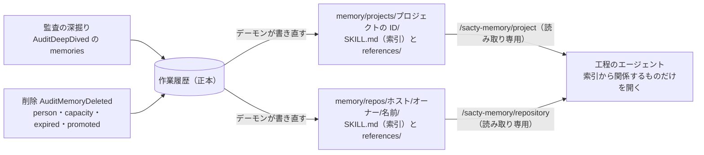
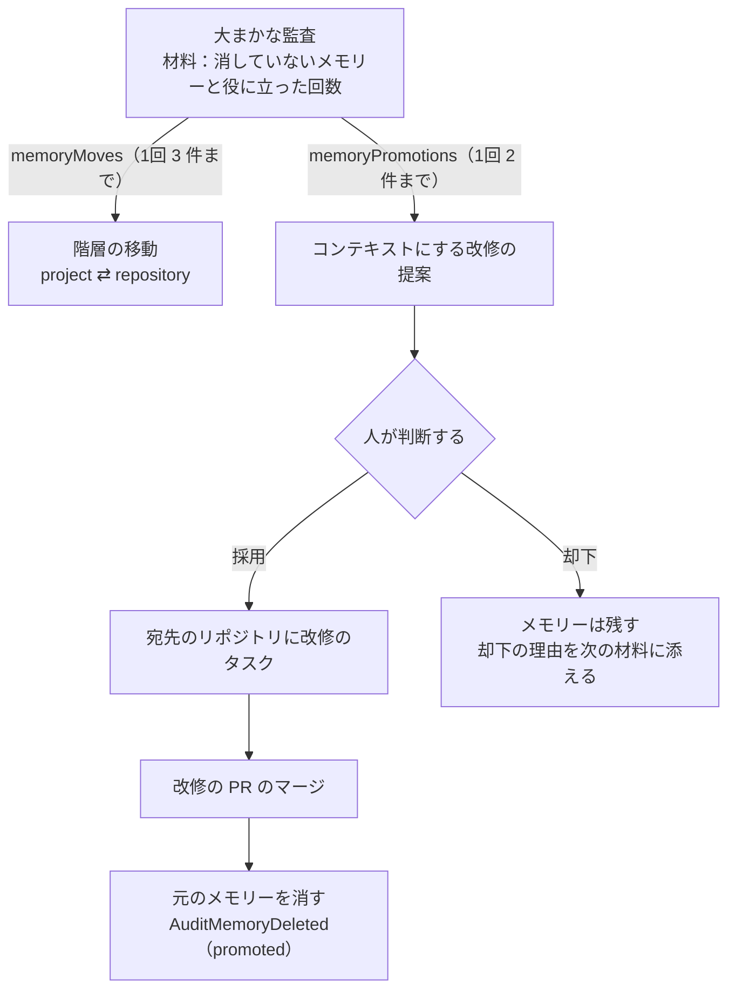

**日本語** | [English](memory.en.md)

# メモリー

完了したタスクの監査が、次のタスクにも役立つ知見をメモリーとして登録する。
工程のエージェントは、タスクのプロジェクトと対象リポジトリのメモリーを、索引から関係するものだけ読む。
登録するのは監査だけで、人は誤ったメモリーを消せる。

関係する ADR: [監査が登録したメモリーを、作業履歴を正本にして、スキルの索引の形で書き出す](../adr/20261018-0130-audit-memory.md)

メモリーの登録から、エージェントが読むまでの流れは次のとおり。

## 階層と置き場所

- 階層はプロジェクトとリポジトリの2つ（グローバルの階層は持たない）。
  どちらも `SACTY_HOME/memory` の下に置く。

| 階層 | 置き場所 | 中身 |
| --- | --- | --- |
| プロジェクト | `memory/projects/<プロジェクトの ID>/` | そのプロジェクトのタスクで得た知見 |
| リポジトリ | `memory/repos/<ホスト>/<オーナー>/<名前>/` | そのリポジトリそのものに関する知見。プロジェクトの外に置き、プロジェクトの設定を変えても使い続ける |

- リポジトリの階層の鍵は、`.git` の無い GitHub のリポジトリの URL を小文字にそろえたもの（clone の URL・SSH の形も読む）。
  GitHub のリポジトリでないもの（ローカルのパスなど）には、リポジトリの階層を作らない。
- パスの区切りに使えない名前（`..` を含むなど）は、ハッシュ（`_` と SHA-256 の先頭 16 文字）にする。
- 各階層は、索引の `SKILL.md` と、1件ずつの中身の `references/<メモリーの ID>.md` でできている。
  - 索引の各行は `- [題](references/<ID>.md)：概要（有効な最終利用日：YYYY-MM-DD）` だけ。
    中身は書かない。
  - 中身のファイルは、題・概要・有効な最終利用日・登録した日と、中身（Markdown）。
  - 有効な最終利用日は、監査がタスクで役に立ったと判断したときに新しくなる（[有効な最終利用日の更新](#有効な最終利用日の更新)）。
    日付は UTC。

コード: `apps/daemon/src/memory.ts`（`memoryLayerDir`・`repositoryMemoryKey`・`renderMemoryIndex`・`renderMemoryReference`・`indexLine`）

## 正本と書き出し

正本は作業履歴。
デーモンは、登録を深掘りの結果（`AuditDeepDived` の `memories`）に、削除を `AuditMemoryDeleted`（`memoryId`・`reason`）に記録する。
どちらも、メモリーを登録した監査のタスクの作業履歴に追記する。
`reason` は次のどれか。

| 値 | 消した理由 |
| --- | --- |
| `person` | 人が消した |
| `capacity` | 件数の上限 |
| `expired` | 残す日数を過ぎた |
| `promoted` | コンテキストにする改修の PR がマージされた |

- 書き出すのはデーモンだけ。
  登録・削除を記録した後、その階層を作業履歴から書き直す。
  メモリーが無くなった階層は、ディレクトリごと消す。
  - ディレクトリは置き換えず、中のファイルを、同じディレクトリの一時ファイルに書いてから置き換える。
    実行中のコンテナがマウントしている場所を保ち、書きかけを読ませないためである。
  - 中身が同じなら書かない。
  - 書けなくても記録は残り、警告を出す。
- 起動のとき、残す日数を過ぎたものと件数の上限を超えた分を消してから、すべての階層を作業履歴に合わせて書き直す。
  記録の無い階層のディレクトリは消す（記録の後・書き出しの前に止まっても直る）。
- 書き出す場所（`memoryRoot`）が無ければ、メモリーを書き出さず、深掘りにも登録を求めない。

コード: `apps/daemon/src/memory.ts`（`liveMemories`・`writeMemoryLayer`・`syncMemoryLayers`）、`apps/daemon/src/service.ts`（`writeMemories`・`syncMemories`）、`packages/core/src/events.ts`（`AuditMemoryRecord`・`MEMORY_DELETE_REASONS`）、`packages/core/src/projection.ts`（`TaskAuditMemory`）

## 監査からの登録

- 深掘りの指示に、タスクのプロジェクトと対象リポジトリの既存のメモリー（ID・階層・題・概要と、中身を読める場所）と、登録の決まりを入れる。
  - 登録するのは、次の同じ種類のタスクでも役立つ具体的な知見。
    このタスクだけの事情・一度きりの出来事は登録しない。
  - 既存と同じ知見なら `sameAs` に ID を書かせ、登録しない。
  - `scope` は、リポジトリそのものに関すること（ビルド・テスト・規約・構成）なら `repository`、プロジェクトやコンテキストに固有のことなら `project`。
    `repository` には、プロジェクト・組織・コンテキストに固有の名前や事情を書かせない。
    GitHub の対象リポジトリが無ければ `project` だけ。
  - 秘密情報・個人の情報を書かせない。
- sacty は出力の `memories` を、次のように読む。
  - 1回の深掘りで最大 2 つ（`AUDIT_MAX_MEMORIES`）。
  - 題（200 文字）・概要（300 文字）は1行にし、中身は 4000 文字まで。
  - 次のものは捨てる。
    - 題・概要・中身のどれかが無いもの
    - 既存の ID を `sameAs` にしたもの
    - `repository` でも対象リポジトリが無いもの
  - `repository` の宛先は sacty が対象リポジトリにする（出力の宛先は使わない）。
- 出力は、監査の出力と同じく、記録の前に秘密情報を伏せる。
  JSON をデコードした後の題・概要・中身にも、前後の空白を除く・1行にする・切り詰める前に同じ伏せを当てる。
  引用符・バックスラッシュ・改行を含む値は、JSON の文字列のままではエスケープされて一致しないためである。
  ID は sacty が決める。
- 同じプロジェクトの深掘りは1つずつ実行するので、プロジェクトの階層の重複は、登録の時点の一覧で確かめられる。
  リポジトリの階層は、ほかのプロジェクトの深掘りと同時に登録されることがあり、そのときは同じ知見が2件になりうる。
- 階層ごとの件数の上限は 30（`MEMORY_MAX_PER_LAYER`）。
  登録で超えたら、有効な最終利用日の古いもの（同じなら登録の古いもの）から `capacity` で消す。

コード: `apps/daemon/src/audit-prompts.ts`（`buildAuditDivePrompt`・`extractAuditDive`・`AUDIT_MAX_MEMORIES`）、`apps/daemon/src/service.ts`（`knownMemories`・`trimMemories`・`runAuditAgent`）、`apps/daemon/src/memory.ts`（`overCapacity`・`MEMORY_MAX_PER_LAYER`）

## 有効な最終利用日の更新

- 大まかな監査の前に、sacty はタスクの各実行のセッションログ（標準出力の JSONL）から、メモリーを開いた回数を数える。
  - 数える対象は、タスクのプロジェクトと対象リポジトリの消していないメモリーのうち、中身のファイルの場所（`/sacty-memory/<階層>/references/<ID>.md`）が出てきたもの。
    索引の相対リンク（`references/<ID>.md`）だけでは数えない。
  - 数えるのはタスクの実行のログだけで、監査の実行（監査の記録の `runId`・セッションの記録の役割が `audit`・`audit-dive` のもの）は除く。
    大まかな監査の途中でデーモンを止めると、監査の記録は残らずにセッションの記録だけが残るためである。
  - ログが無い実行は数えない。
    ほかの理由で読めなかったログも数えず、タスクと実行の ID とエラーのコードを警告する（ログの中身は出さない）。
- 大まかな監査の指示に、開いたメモリー（ID・題・概要・開いた回数）と判断の決まりを入れ、役に立ったものの ID を `usefulMemories` で出させる。
  役に立ったものとは、その知見に沿って進め、遠回りや差し戻しを避けられたもの。
  開いたものにない ID は捨てる。
- `AuditSurveyed` に、開いたメモリー（`openedMemories`）と役に立ったメモリー（`usefulMemories`）を記録する。
  記録した後、役に立ったメモリーの階層を書き直す。
- 有効な最終利用日は、役に立ったと判断されたタスクの完了日（`AuditQueued` の時刻）の最新と、登録した時刻の遅い方。
  古いタスクの監査が後から終わっても、前に戻らない。
  開いていない・役に立たなかったメモリーの日付は変えない。
- 監査の欄に、役に立ったメモリー（題・階層）と、登録したメモリーの有効な最終利用日を出す。

コード: `apps/daemon/src/memory.ts`（`countOpenedMemories`・`usefulDates`・`lastUsefulAt`）、`apps/daemon/src/service.ts`（`openedMemories`）、`apps/daemon/src/audit-prompts.ts`（`buildAuditSurveyPrompt`・`extractAuditSurvey`）、`apps/daemon/src/ledger-audits.ts`（`LedgerAuditService`）

## 昇格

大まかな監査（メモリーを書き出す場所があるとき）に、昇格を判断する材料を入れる。

- タスクのプロジェクトと対象リポジトリの、消していないメモリー
  - ID・階層・題・概要・有効な最終利用日・役に立った回数・コンテキストにする提案中か・却下の理由・中身の場所
  - 役に立った回数は、役に立ったと判断したタスクの数。
- コンテキストにする提案の宛先の候補（改修の提案の宛先の候補から、sacty の既定のコンテキストを除いたもの）

監査が出す昇格は、階層の移動とコンテキストへの昇格の2種類。

| 種類 | 出力 | 1回の上限 |
| --- | --- | --- |
| 階層の移動 | `memoryMoves` | 3（`AUDIT_MAX_MEMORY_MOVES`） |
| コンテキストへの昇格 | `memoryPromotions` | 2（`AUDIT_MAX_MEMORY_PROMOTIONS`） |

監査が出す昇格の流れは次のとおり。

### 階層の移動

置き場所が合っていないメモリーを、タスクのプロジェクトか対象リポジトリの階層に移す。
リポジトリそのものに関すること（ほかのプロジェクトのタスクでも役立つもの）は `repository` へ、プロジェクトやコンテキストに固有のことは `project` へ移す。
`repository` には、プロジェクト・組織・コンテキストに固有の名前や事情を含むものを移させない。

- 読むとき：材料にあるメモリーだけ、今と違う階層だけ、同じメモリーは1回だけ。
  対象リポジトリが無ければ `repository` に移さない。
- 記録するとき
  - メモリーが消えていない・まだタスクの階層にある・今と違う階層であることを確かめ直す。
    大まかな監査は同じプロジェクトで同時に動くことがあるためである。
  - `AuditSurveyed` の `memoryMoves` に、移した先（`project` ならプロジェクトの ID、`repository` ならリポジトリ）を記録する。
- メモリーの置き場所は、すべてのタスクの移した記録を、大まかな監査の記録を追記した順（`seq`）に当てて決める（最後に移した先）。
  時刻では決めない（同じ時刻の記録が、タスクを作った順にならないように）。
  有効な最終利用日・登録したタスク・ID は変わらない。
- 記録した後、移した先が件数の上限を超えたら、登録のときと同じく、有効な最終利用日の古いものから `capacity` で消す。
  そのうえで、移す前と後の階層と、消した階層を書き直す。

### コンテキストへの昇格

何度も役に立ち（役に立った回数 2 回以上を目安）、これからも守るべき決まりになったメモリーについて、監査は改修を提案する。
改修は、メモリーをコンテキスト（スキル・規約）か対象リポジトリ（AGENTS.md など）に書くもの。

- 読むとき：提案中でないメモリーだけ、宛先は候補の番号のものだけ、題の無いものは捨てる。
- 記録するとき
  - メモリーが消えていない・まだタスクの階層にある・提案中でないことを確かめ直す。
  - `AuditSurveyed` の `promotions` に原因として記録する（原因の鍵は `memory:<メモリーの ID>`）。
  - 提案は `memoryId` に元のメモリーの ID を、`memoryOriginal` に元のメモリーの題・概要・中身を持つ。
    提案の本文とは別の項目で、どちらも上限まで欠けない。
  - 元のメモリーは、今の秘密情報の値で伏せてから写す（登録の後に秘密情報になった値も伏せる）。
  - 改修のタスクの本文には、提案の本文と元のメモリーを並べる。
- 原因の題は元のメモリーの題、説明は空で記録する。
  画面とレポートでは「メモリーをコンテキストにする：<題>」と定型の説明を、画面の言語で出す。
- 採用・却下はほかの改修の提案と同じ。
  採用すると宛先のリポジトリに改修のタスクを作り、PR まで進む（コンテキストの変更は人の PR のレビューを通る）。
- 判断待ち・採用済みの提案があるメモリーは「提案中」として、同じ提案を重ねない。
  却下されたメモリーは、却下の理由を材料に添え、残す。
- 深掘りに渡す既存の原因の一覧には、コンテキストにする提案を入れない。

### 元のメモリーを消す

採用した提案の改修のタスクの PR がマージされたら、元のメモリーを `AuditMemoryDeleted`（`reason: "promoted"`）で消す。
PR を見守る確認のたび・掃除のたび・起動のときに確かめる。

監査の欄に、移したメモリー（題・移した先）と、コンテキストにして消した印を出す。

コード: `apps/daemon/src/audit-prompts.ts`（`buildAuditSurveyPrompt`・`extractAuditSurvey`・`AUDIT_MAX_MEMORY_MOVES`・`AUDIT_MAX_MEMORY_PROMOTIONS`）、`apps/daemon/src/service.ts`（`promotionInput`・`surveyPromotionRecord`・`retirePromotedMemories`・`knownAuditCauses`）、`apps/daemon/src/memory.ts`（`memoryPlacements`・`usefulCounts`・`promotedMemories`）、`packages/core/src/events.ts`（`MemoryMove`・`AuditProposalRecord`）

## 掃除

- 有効な最終利用日から、sacty の設定の `memoryRetentionDays`（1〜3650。設定していなければ 90 日。`DEFAULT_MEMORY_RETENTION_DAYS`）を超えたメモリーを消す。
  ちょうどその日数のものは残す。
- 消したことは、メモリーを登録したタスクの作業履歴に `AuditMemoryDeleted`（`reason: "expired"`）で記録し、その階層を書き直す。
- デーモンは、起動のときと、1時間ごと（`MEMORY_CLEANUP_INTERVAL_MS`）に掃除する。
  止めている間に期限を過ぎたものは、次に起動したときに消す。
  止めるときは、作業履歴を閉じる前に掃除を止める。
- 掃除と監査の記録はどちらもデーモンの中で同期で行うので、記録の途中に挟まらない。
  監査の実行中に、読んでいるメモリーが消えることはある（その監査が役に立ったと判断しても、消したメモリーは戻らない）。
- 書き出す場所（`memoryRoot`）が無ければ、掃除しない。

コード: `apps/daemon/src/memory.ts`（`expiredMemories`・`MEMORY_CLEANUP_INTERVAL_MS`）、`apps/daemon/src/service.ts`（`cleanupMemories`・`syncMemories`）、`apps/daemon/src/main.ts`、`packages/core/src/projects.ts`（`SactySettings`・`DEFAULT_MEMORY_RETENTION_DAYS`）

## エージェントに渡す

- 工程（統合レビューを除く）の実行には、タスクのプロジェクトの階層を `/sacty-memory/project`、対象リポジトリの階層を `/sacty-memory/repository` に、読み取り専用でマウントする。
  - 索引の無い階層はマウントしない。
  - Claude Code には `--add-dir` で読める場所に足す。
- マウントしたときは、指示の先頭に読み方を足す。
  - 索引を読み、関係するものだけを `references/` から開く。
  - 人の指示・コンテキストの規則とスキル・対象のリポジトリの AGENTS.md などと食い違うときは、そちらに従う。
- 監査（大まかな監査・深掘り）にも同じ場所にマウントする（重複を確かめるため）。
  読み方の指示は足さない。
- 次のものには渡さない。
  - ゴールガーディアン（変更の申し出の判定・最終レビュー・統合レビュー・PR の指摘の差し戻し先の判定（役割 `rework`））
  - オーケストレーター
  - 質問への答え
  - 書き出し
- 差し戻した後の手直しは工程の役で実行し直すので、そこには渡る。
- ほかのプロジェクトのプロジェクトの階層、ほかのリポジトリの階層は渡さない。

コード: `apps/daemon/src/service.ts`（`withMemory`・`MEMORY_STEP_ROLES`）、`apps/daemon/src/memory.ts`（`taskMemoryLayers`・`existingLayerDir`・`memoryPromptLines`）

## 既定のスキル

既定のコンテキストに、メモリーを読むためのスキル `memory` がある。
スキルには次のことを書く。

- 置き場所
- 読み方：索引から関係するものだけを開く。
  有効な最終利用日の古いものはリポジトリの実物で確かめる。
- 従う順：人の指示 → コンテキストとリポジトリの決まり → リポジトリの実物 → メモリー

コード: `apps/daemon/default-context/skills/memory/SKILL.md`

## 人が消す

- 監査の欄に、その監査が登録したメモリー（題・階層・リポジトリ・概要・中身）を出す。
  消していないものには「消す」が出て、確定のボタンを押すと消す（`POST /api/audits/memories/:id/delete`）。
- 人は登録できない。
- 消したものは印（人が消した・上限で消した・期限で消した・コンテキストにした）だけを出し、中身と「消す」は出さない。
  消したものを、もう一度は消せない（409）。
- 消した後は、メモリーの今の置き場所（監査が移していれば、移した先）の階層を書き直す。

コード: `apps/daemon/src/service.ts`（`deleteAuditMemory`）、`apps/daemon/src/ledger-audits.ts`（`LedgerAuditService`）、`apps/daemon/src/server.ts`（`createApp`）、`apps/web/src/components/audit.tsx`（`TaskAuditCard`）
