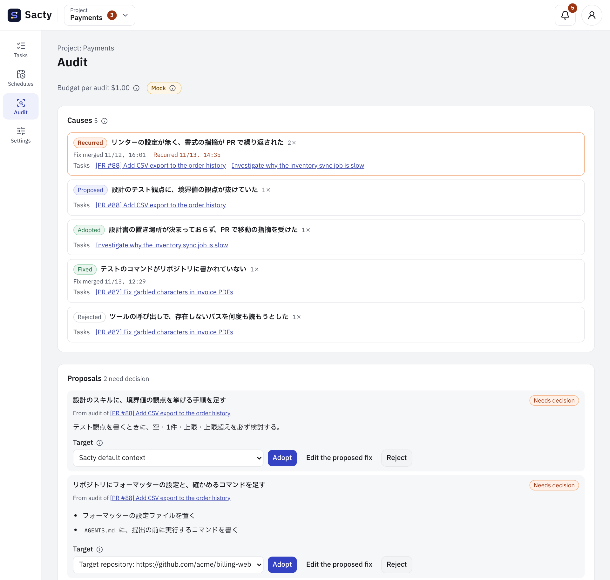

<!-- Code: apps/web/src/components/audit.tsx, apps/web/src/components/audit-screen.tsx, packages/core/src/flaky-tests.ts, apps/web/src/lib/audit-report.ts, apps/web/src/i18n/messages/audit.ts, apps/daemon/src/audits.ts, apps/daemon/src/ledger-audits.ts, apps/daemon/src/audit-prompts.ts, apps/daemon/src/service.ts, apps/daemon/src/memory.ts, apps/daemon/default-context/skills/memory/SKILL.md, packages/core/src/audit.ts -->

[日本語](audit.md) | **English**

# Viewing audits

An audit examines the whole process of a completed task, from the step choices to completion. It looks for the causes of changes requested, remarks, and the agents' trial and error, and proposes fixes that prevent them (context, skills, agent rules, linters, tests, and so on). When you adopt a proposal, sacty creates a fix task. What you do is decide whether to adopt or reject each proposal ([Adopting and rejecting proposals](#adopting-and-rejecting-proposals)).

## How an audit runs

When a task completes, sacty starts its audit automatically. For a PR review task, it starts when the review is posted (even while the verdict is not "no findings" and the task is "Waiting on the PR"; [After the review is posted](intake.en.md#after-the-review-is-posted)). No setup is needed.

An audit proceeds as follows.


1. **Survey**: an AI agent reads the task's whole activity and each run's session log, and flags up to 3 steps where changes were requested or there was trial and error (steps of concern).
2. **Deep dive**: for each flagged step, in its own session, the agent finds the causes and proposes fixes for each cause.
3. After the deep dives, the audit is done. A task where nothing went wrong finishes without a deep dive.

Audits run as follows.

- Audits run one by one in the same queue as other runs (they count toward the limit on parallel runs).
- Choose the AI for audits with `audit_agent` in config.yaml. If omitted, `default_agent` is used ([config.yaml settings](config.en.md)).
- Tasks that completed in an earlier version without audits are not audited.
- An audit in progress when sacty stops continues at the next start.

If an audit cannot run, it becomes "Audit failed" and the reason is shown.

- If the AI's JSON output is broken and cannot be read, the reason says at which line and column of the JSON it breaks. Common breakage such as double quotes inside strings is repaired by sacty when reading, so it alone does not fail the audit.
- Even when an audit fails, the survey and finished deep dives so far and the cost used are kept.

## Adopting and rejecting proposals

Proposals appear in [the Audit tab in task details](#the-audit-tab-in-task-details) and on the project's [audit page](#the-audit-page). A proposal that needs a decision shows a target choice and "Adopt", "Reject", and "Edit the proposed fix". A decided proposal cannot be changed.

To adopt a proposal, do the following.

1. Choose the target from the following three. The target the audit chose is selected first.
   - The target repository
   - A context (the project layer or an upper layer)
   - The sacty default context (Sacty's prompts and the default skills)
2. Press "Adopt".

When you adopt, sacty creates a fix task for the chosen target's repository. The task goes through the usual flow (requirements, design, implementation, PR). If the target is the sacty default context, sacty creates no task in your project and only records the adoption. Use the proposal text as a fix for sacty itself.

To reject a proposal, do the following.

1. Press "Reject". A reason field opens.
2. Write the reason and press "Confirm rejection". The reason is required.

sacty passes the reason for rejecting to later audits so they do not repeat the same proposal.

### Rejecting unneeded proposals in bulk

On the [audit page](#the-audit-page) you can select several proposals that need a decision and reject them together with one reason. You can select only proposals that are shown on the page. One bulk rejection takes up to 2,000 proposals.

1. Press a cause's row to open it.
2. Select the checkbox of each proposal you want to reject. "Select all needing a decision" on a cause selects the proposals it shows right now. You can open another cause and keep selecting. The count appears above the list as "N selected".
3. Press "Reject selected". A confirmation dialog shows the count and the titles of the selected proposals, grouped by cause. Scroll inside the dialog to check every title.
4. Write the reason and press "Confirm rejection". The reason is required, and the same reason is recorded for every selected proposal. "Cancel" or Escape closes the dialog without recording anything, and the selection stays.

Rejecting in bulk cannot be undone. A proposal rejected this way is treated like one rejected by itself: the cause's state, the number needing a decision, and the dashboard counts and adoption rate change in the same way.

- The proposal shows "1 of N rejected in bulk", and so does its row in the task's activity.
- If some proposals could not be rejected (already decided by another operation, the original task cancelled, and so on), the page says "Rejected N; M could not be rejected" and lists their titles and reasons. The ones that were rejected are recorded.
- Later audits get the proposals rejected in bulk as one line per operation, with the number rejected, the first 3 titles, and the reason. Titles from the 4th on are not passed, so a similar proposal may be made again. Rejecting one by one works as before.

### Adopting with an edit to the proposed fix

When the cause is right but you do not want the proposed fix as it is, press "Edit the proposed fix", choose a kind, write the text, and then adopt. If you adopt without writing it, sacty uses the audit's proposal as it is.

| Kind | What happens |
| --- | --- |
| Supplement (keep the proposal) | Your text is added after the audit's proposal, under "人が足した補足：" |
| Replace (fix it your way) | Your text becomes the instruction for the fix, and the audit's proposal is kept after it |

Your text (the edit) is handled as follows.

- With either kind, it goes into the fix task's details (the cause's detail is attached in the same way as when you do not edit).
- The text is limited to 4,000 characters. It stays on the audit page and in reports with its kind.
- It is also passed to later audits, so they do not repeat proposals that need the same edit.

## The Audit tab in task details

Completed tasks (and PR review tasks that have posted their review) have an "Audit" tab in their details (if not audited yet, it says so). The tab shows the following.

| Item | What it shows |
| --- | --- |
| State | Waiting for audit, Surveying, Deep dive, Audited, Audit failed, or Paused by budget |
| Cost | The cost and cap of the audit. Audits have their own budget, separate from the task's |
| Survey | A summary and the counts of evidence (changes requested, PR remarks, AI review remarks, pauses, retries, failed tool calls, escalations). Remarks from sacty's own AI review are counted separately from your remarks |
| Steps of concern | The steps the survey flagged, and the deep-dive result for each |
| Causes and proposals | Causes, evidence, and proposals. "Activity" and "Log" in the evidence move to that row and run log. A cause found again after its fix shows "Recurred" |

- An audit paused by its budget resumes when you enter a new cap (more than the amount used) in this tab.
- The memories the audit registered also appear in this tab ([Memories](#memories)).

## The audit page

"Audit" in the side menu opens the audit page of the project you are viewing (`/projects/<ID>/audit`). The audit page looks like this (the image uses the audit mock data and shows the upper part of the page, with one cause open and its proposals selected).



The page shows the following.

- **Causes and proposals**: a cause is the same cause grouped across tasks.
  - If the same cause is found again after its fix task's PR is merged, it becomes Recurred.
  - Causes are ordered Recurred, Proposed, Adopted, Fixed, Rejected, and by how many times found within the same state. The page shows the top 20, and "Show more" adds 20 at a time. A note reads "Showing M of N".
  - You can filter by "All", "Needs decision", or "Recurred only". The filter and the number shown stay in the URL, so reloading opens the same view.
  - A cause is a collapsed row showing its state, title, how many times it was found, and the number of proposals needing a decision. Recurred stands out.
  - Press a row to open it. It shows the tasks (up to 5, then "N more") and the cause's proposals (those needing a decision first, up to 10, then "N more"). You adopt, edit, or reject proposals one at a time inside the open cause. Each proposal also shows which task's audit it came from.
  - The open causes, the filter, and the number shown are kept after you decide a proposal.
  - You can select proposals that need a decision and reject them together ([Rejecting unneeded proposals in bulk](#rejecting-unneeded-proposals-in-bulk)).
- **Audited tasks**: state, remarks, cost, and when the audit finished.
- **Report**: choose a start and end date and press "Export report" to download a Markdown file with the causes, proposals, and decisions of audits finished in the period. Headings follow the UI language; audit text is not translated. Times are UTC.

Audit results are not combined across projects.

## Dashboard

The "Audit" card on the dashboard shows the following ([Dashboard](dashboard.en.md)). Press a project name to open its audit page.

- Per project, the causes, recurred and needing-decision counts, and the adoption rate of proposals
- Per week, the changes requested and PR remarks per task

## Checking the screens with mock data

To check only the screens, start sacty with `SACTY_AUDIT_MOCK=1`. sacty runs no real audits and shows mock data. Adopting, rejecting (including in bulk), and resuming are kept only in the daemon's memory and reset when you restart sacty.

```sh
SACTY_AUDIT_MOCK=1 npx sacty up
```

## Memories

When a deep dive finds knowledge that will help later tasks (how to run the tests, pitfalls in the conventions, and so on), the audit registers it as a memory. Only the audit registers memories. No setup is needed. You can check the registered memories and delete wrong ones.

### Checking and deleting memories

- The Audit tab in the task details shows the memories that audit registered.
- Delete a wrong memory with "Delete" → "Confirm delete". A deleted memory cannot be restored.
- You cannot add memories by hand.
- sacty rewrites the files under `memory/` from the activity log. Hand edits are reverted at the next startup.

### Where memories are stored and how they are used

- Memories have two layers, project and repository.
  - They live in the data directory (default `~/.sacty`) under `memory/projects/<project ID>/` and `memory/repos/<host>/<owner>/<name>/`.
  - Repository memories stay in use for tasks on the same repository even after you change project settings.
- In later tasks, step agents read the index (title, summary, last useful date) of the memories of the task's project and target repository, and open only the relevant ones. They never read other projects' memories. Integration review and deciding where to send PR comments back to get none.
- A memory is a reference and ranks below the following. When a procedure written in a memory conflicts with them, the agent does not use the procedure and follows them instead.
  - The step instructions (the scope of the rework, what to write and not to write, how decided judgements are handled, and so on)
  - Your instructions
  - The context's rules and skills
  - The repository's AGENTS.md and so on
- The audit also avoids registering procedures that change the step instructions.

### What is not registered as a memory

The audit does not register an answer you decided in a task (scope, numbers, whether something exists, whether a screen is needed, and so on) as a fact that applies to other tasks, because it would mix into the next task's request and decide that task's requirements in advance.

- sacty checks before registering. The following are not registered.
  - A memory that speaks of the requester as the subject ("the requester answered ...")
  - A memory that copies the request body, comments, or resume notes you wrote
- The title and reason of a memory that was not registered are kept in the deep-dive record in the task's Activity.
- A reworded answer cannot be found. If an answer is left in a memory, delete it in the Audit tab.

### When memories are deleted or moved

Each memory has a last useful date (the last day the memory helped). sacty deletes old memories automatically based on this date.

- When a task opens a memory and that task's audit judges it helpful, sacty updates the last useful date from that task's completion date (a newer date stays as it is). The Audit tab's "Memories that helped" lists the ones that helped in that task.
- Whether a memory was opened is counted from the session logs of the task's runs. Runs whose logs are missing or unreadable are not counted. If a memory that should be helping never gets a newer date, check the daemon log for "メモリーを開いたかを数えるログを読めませんでした" and the `runs/` folder in the data directory.
- Memories whose last useful date is older than "Days to keep memories" in the Sacty settings (1 to 3650; 90 if empty) are deleted automatically. Those that expire while sacty is stopped are deleted at the next startup.
- Each layer holds up to 30 memories. Beyond that, the ones with the oldest last useful date are deleted.

The audit may also move memories or propose turning them into context.

- The audit moves memories that are in the wrong layer between project and repository. They show under "Moved memories" on the Audit tab.
- For memories that helped many times, the audit proposes a fix that writes them into the context (skills, conventions) or the target repository (AGENTS.md and so on); the cause title starts with "Make memory context:".
  - As with other proposals, adopting creates a fix task, and merging its PR puts it into the context.
  - Once merged, the original memory is deleted as "Made context".
  - If you reject it, the memory stays and the reason is passed to the next audit.

## Budget

The default cap per audit is `budget.default_per_audit_usd` in config.yaml (default $1) ([config.yaml settings](config.en.md)). To resume an audit paused by its budget, see [The Audit tab in task details](#the-audit-tab-in-task-details).

## The flaky test ledger

In earlier versions, tests the final review accepted as flaky and unrelated to the diff were counted in a per-project ledger and shown on the audit page.
The current version does not run the final review ([Review of the implementation PR](tasks.en.md#review-of-the-implementation-pr)), so no new entries are added to the ledger, and it is not shown on the audit page.
Records from earlier versions are kept.

## Returning to an older version

A database with audit records (`Audit…`) and fix tasks cannot be read by an older version without audits. Stop the daemon and back up the data directory before updating, and use the backup to go back ([Back up before updating and returning to an older version](getting-started.en.md#back-up-before-updating-and-returning-to-an-older-version)). PRs and other work from fix tasks created after the backup remain, so check them and do not redo the same fix.

## Related pages

- [Working with tasks](tasks.en.md)
- [Dashboard](dashboard.en.md)
