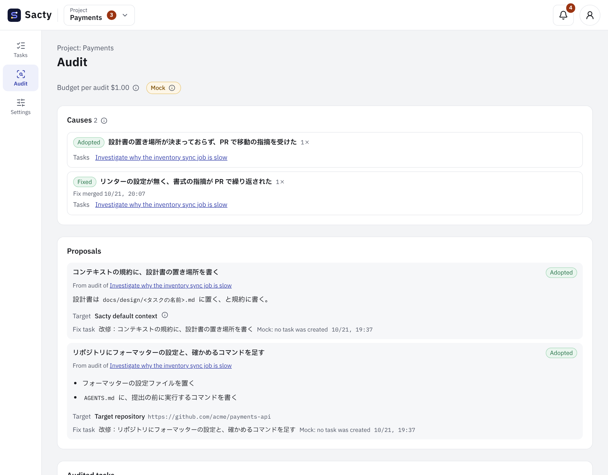

<!-- Code: apps/web/src/components/audit.tsx, apps/web/src/components/audit-screen.tsx, apps/web/src/lib/audit-report.ts, apps/web/src/i18n/messages/audit.ts, apps/daemon/src/audits.ts, apps/daemon/src/ledger-audits.ts, apps/daemon/src/audit-prompts.ts, apps/daemon/src/service.ts, apps/daemon/src/memory.ts, apps/daemon/default-context/skills/memory/SKILL.md, packages/core/src/audit.ts -->

[日本語](audit.md) | **English**

# Viewing audits

An audit examines the whole process of a completed task, from the step choices to completion. It looks for the causes of changes requested, remarks, and the agents' trial and error, and proposes fixes that prevent them (context, skills, agent rules, linters, tests, and so on). When you adopt a proposal, sacty creates a fix task.

## How an audit runs

When a task completes, sacty starts its audit automatically. No setup is needed.

An audit proceeds as follows.


1. **Survey**: an AI agent reads the task's whole activity and each run's session log, and flags up to 3 steps where changes were requested or there was trial and error (steps of concern).
2. **Deep dive**: for each flagged step, in its own session, the agent finds the causes and proposes fixes for each cause.
3. After the deep dives, the audit is done. A task where nothing went wrong finishes without a deep dive.

- Audits run one by one in the same queue as other runs (they count toward the limit on parallel runs).
- Choose the AI for audits with `audit_agent` in config.yaml. If omitted, the Goal Guardian's AI is used ([config.yaml settings](config.en.md)).
- Tasks that completed before audits were added are not audited.
- If an audit cannot run, it becomes "Audit failed" with the reason.
- An audit in progress when sacty stops continues at the next start.

To check only the screens, start sacty with `SACTY_AUDIT_MOCK=1`. sacty runs no real audits and shows mock data. Adopting, rejecting, and resuming are kept only in the daemon's memory and reset when you restart sacty.

```sh
SACTY_AUDIT_MOCK=1 npx sacty up
```

## The Audit tab in task details

Audited tasks have an "Audit" tab in their details.

| Item | What it shows |
| --- | --- |
| State | Waiting for audit, Surveying, Deep dive, Audited, Audit failed, or Paused by budget |
| Cost | The cost and cap of the audit. Audits have their own budget, separate from the task's |
| Survey | A summary and the counts of evidence (changes requested, PR remarks, pauses, retries, failed tool calls, escalations) |
| Steps of concern | The steps the survey flagged, and the deep-dive result for each |
| Causes and proposals | Causes, evidence, and proposals. "Activity" and "Log" in the evidence move to that row and run log. A cause found again after its fix shows "Recurred" |

An audit paused by its budget resumes when you enter a new cap (more than the amount used) in the card.

## Adopting and rejecting proposals

A proposal that needs a decision shows a target choice and "Adopt", "Reject", and "Edit the proposed fix".

- Choose the target from the following three. The target the audit chose is selected first.
  - The target repository
  - A context (the project layer or an upper layer)
  - The sacty default context (the goal guardian's prompts and the default skills)
- When you press "Adopt", sacty creates a fix task for the chosen target's repository. The task goes through the usual flow (requirements, design, implementation, PR).
- If the target is the sacty default context, no task is created in your project; only the adoption is recorded. Use the proposal text as a fix for sacty itself.
- "Reject" opens a reason field. The reason is required. sacty passes it to later audits so they do not repeat the same proposal.
- A decided proposal cannot be changed.

### Adopting with an edit to the proposed fix

When the cause is right but you do not want the proposed fix as it is, press "Edit the proposed fix", choose a kind, write the text, and then adopt. If you adopt without writing it, sacty uses the audit's proposal as it is.

| Kind | What happens |
| --- | --- |
| Supplement (keep the proposal) | Your text is added after the audit's proposal, under "人が足した補足：" |
| Replace (fix it your way) | Your text becomes the instruction for the fix, and the audit's proposal is kept after it |

- Either way, it goes into the fix task's details (the cause's detail is attached as before).
- The text is limited to 4,000 characters. It stays on the audit page and in reports with its kind.
- It is also passed to later audits, so they do not repeat proposals that need the same edit.

## The audit page

The audit page looks like this (the image uses the audit mock data).



"Audit" in the side menu opens the audit page of the project you are viewing (`/projects/<ID>/audit`).

- **Causes**: the same cause grouped across tasks.
  - If the same cause is found again after its fix task's PR is merged, it becomes Recurred.
  - Each shows its state (Recurred, Proposed, Adopted, Fixed, Rejected), how many times it was found, and the tasks.
  - Recurred causes come first and stand out.
- **Proposals**: those needing a decision come first. Each shows which task's audit it came from, and you can adopt or reject it here too.
- **Audited tasks**: state, remarks, cost, and when the audit finished.
- **Report**: choose a start and end date and press "Export report" to download a Markdown file with the causes, proposals, and decisions of audits finished in the period. Headings follow the UI language; audit text is not translated. Times are UTC.

Audit results are not combined across projects.

## Dashboard

The "Audit" card on the dashboard shows the following ([Dashboard](dashboard.en.md)). Press a project name to open its audit page.

- Per project, the causes, recurred and needing-decision counts, and the adoption rate of proposals
- Per week, the changes requested and PR remarks per task

## Memories

When a deep dive finds knowledge that will help later tasks (how to run the tests, pitfalls in the conventions, and so on), the audit registers it as a memory. Only the audit registers memories. No setup is needed.

- Memories have two layers, project and repository.
  - They live in the data directory (default `~/.sacty`) under `memory/projects/<project ID>/` and `memory/repos/<host>/<owner>/<name>/`.
  - Repository memories stay in use for tasks on the same repository even after you change project settings.
- In later tasks, step agents read the index (title, summary, last useful date) of the memories of the task's project and target repository, and open only the relevant ones. They never read other projects' memories. The Goal Guardian gets none.
- Memories rank below your instructions, the context's rules and skills, and the repository's AGENTS.md and so on; when they conflict, those win.
- The last useful date is the last day the memory helped.
  - When a task opens a memory and that task's audit judges it helpful, sacty updates the date from that task's completion date (a newer date stays as it is).
  - The Audit tab's "Memories that helped" lists the ones that helped in that task.
- Whether a memory was opened is counted from the session logs of the task's runs. Runs whose logs are missing or unreadable are not counted. If a memory that should be helping never gets a newer date, check the daemon log for "メモリーを開いたかを数えるログを読めませんでした" and the `runs/` folder in the data directory.
- Memories whose last useful date is older than "Days to keep memories" in the Sacty settings (1 to 3650; 90 if empty) are deleted automatically. Those that expire while sacty is stopped are deleted at the next startup.
- Each layer holds up to 30 memories. Beyond that, the ones with the oldest last useful date are deleted.
- The audit moves memories that are in the wrong layer between project and repository. They show under "Moved memories" on the Audit tab.
- For memories that helped many times, the audit proposes a fix that writes them into the context (skills, conventions) or the target repository (AGENTS.md and so on); the cause title starts with "Make memory context:".
  - As with other proposals, adopting creates a fix task, and merging its PR puts it into the context.
  - Once merged, the original memory is deleted as "Made context".
  - If you reject it, the memory stays and the reason is passed to the next audit.
- The Audit tab in the task details shows the memories that audit registered. Delete a wrong memory with "Delete" → "Confirm delete". A deleted memory cannot be restored. You cannot add memories by hand.
- sacty rewrites the files under `memory/` from the activity log. Hand edits are reverted at the next startup.

## Budget

The default cap per audit is `budget.default_per_audit_usd` in config.yaml (default $1) ([config.yaml settings](config.en.md)).

## Returning to an older version

A database with audit records (`Audit…`) and fix tasks cannot be read by an older version without audits. Stop the daemon and back up the data directory before updating, and use the backup to go back ([Back up before updating and returning to an older version](tasks.en.md#back-up-before-updating-and-returning-to-an-older-version)). PRs and other work from fix tasks created after the backup remain, so check them and do not redo the same fix.

## Related pages

- [Working on tasks](tasks.en.md)
- [Dashboard](dashboard.en.md)
