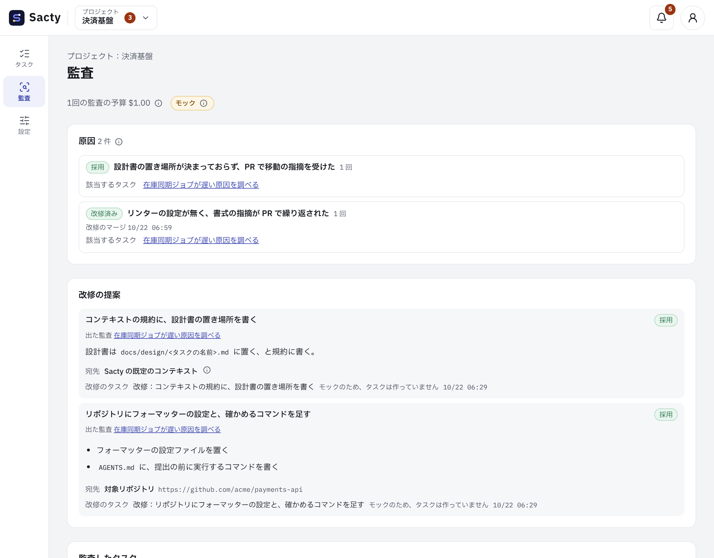

<!-- 対応するコード: apps/web/src/components/audit.tsx、apps/web/src/components/audit-screen.tsx、apps/web/src/lib/audit-report.ts、apps/web/src/i18n/messages/audit.ts、apps/daemon/src/audits.ts、apps/daemon/src/ledger-audits.ts、apps/daemon/src/audit-prompts.ts、apps/daemon/src/service.ts、apps/daemon/src/memory.ts、apps/daemon/default-context/skills/memory/SKILL.md、packages/core/src/audit.ts -->

**日本語** | [English](audit.en.md)

# 監査を見る

監査は、完了したタスクの過程を、工程の判断から完了まで調べます。
差し戻し・指摘・エージェントの試行錯誤の原因を探し、それを防ぐための改修（コンテキスト・スキル・エージェントのルール・リンター・テストなど）を提案します。
提案を採用すると、sacty は改修のタスクを作ります。

## 監査の流れ

タスクが完了すると、sacty は自動で監査を始めます。
設定は要りません。

監査は次のように進みます。


1. **大まかな監査**：AI エージェントが、タスク全体の作業履歴と各実行のセッションログを読み、差し戻しや試行錯誤があった工程（懸念のある工程）を最大 3 つ挙げます。
2. **深掘り**：挙げた工程ごとに、エージェントが別のセッションで原因を特定し、原因ごとに改修の提案を出します。
3. 深掘りを終えると、監査済みになります。
   何も起きていなかったタスクは、深掘りせずに終わります。

- 監査は、ほかのタスクの実行と同じ待ち行列で順に動きます（同時に実行する数の上限に数えます）。
- 監査に使う AI は、config.yaml の `audit_agent` で選べます。
  書かなければ、ゴールガーディアンと同じ AI です（[config.yaml の設定](config.md)）。
- 監査を入れる前に完了していたタスクは、監査しません。
- 監査を実行できなかったときは「監査の失敗」になり、理由を出します。
- sacty を止めたときに途中だった監査は、次に起動したときに続けます。

画面だけを確かめたいときは、`SACTY_AUDIT_MOCK=1` を付けて起動します。
sacty は実際の監査を動かさずに、モックのデータを出します。
採用・却下・再開はデーモンのメモリにだけ残り、sacty を起動し直すと戻ります。

```sh
SACTY_AUDIT_MOCK=1 npx sacty up
```

## タスクの詳細の監査のタブ

完了したタスクの詳細に「監査」のタブが出ます（まだ監査していなければ、その旨が出ます）。

| 項目 | 出すもの |
| --- | --- |
| 状態 | 監査待ち・大まかな監査中・深掘り中・監査済み・監査の失敗・予算で一時停止 |
| 費用 | 監査に使った費用と上限です。監査の予算は、タスクの予算とは別です |
| 大まかな監査 | 経緯の要約と、根拠になった出来事（人の差し戻し・PR の指摘・一時停止・やり直し・ツール呼び出しの失敗・エスカレーション）の件数 |
| 懸念のある工程 | 大まかな監査が挙げた工程と、工程ごとの深掘りの結果 |
| 原因と改修の提案 | 原因・根拠・提案。根拠の「作業履歴」「ログ」から、その行と実行のログへ移れます。改修の後にまた見つかった原因には「再発」が付きます |

予算で一時停止した監査は、欄の中で新しい上限（使った額より大きい額）を入れると再開します。

## 提案を採用・却下する

判断待ちの提案には、宛先の選択と「採用する」「却下する」「改善案に手を入れる」が出ます。

- 宛先は、次の3つから選びます。
  監査が選んだ宛先が初めから選ばれています。
  - 対象リポジトリ
  - コンテキスト（プロジェクトの層、または上位の層）
  - sacty の既定のコンテキスト（ゴールガーディアンのプロンプトと既定のスキル）
- 「採用する」を押すと、sacty は選んだ宛先のリポジトリを対象にした改修のタスクを作ります。
  タスクは通常の流れ（要求要件・設計・実装・PR）で進みます。
- sacty の既定のコンテキストが宛先のときは、あなたのプロジェクトにはタスクを作らず、採用したことだけを残します。
  sacty 自体の改修として、提案の文を使ってください。
- 「却下する」を押すと理由の入力が出ます。
  理由は必須です。
  sacty は理由を以後の監査に渡し、同じ提案を繰り返さないために使います。
- 一度判断した提案は、変えられません。

### 改善案に手を入れて採用する

原因は合っているが改善案はそのままにしたくないときは、「改善案に手を入れる」を押して、種類と中身を書いてから採用します。
書かずに採用すれば、監査の改善案をそのまま使います。

| 種類 | 何が起きるか |
| --- | --- |
| 補足する（改善案は残す） | 監査の改善案の後に、書いた内容を「人が足した補足：」として足します |
| 差し替える（人の案で改修） | 書いた内容を改修の指示にし、監査の改善案は記録として後に添えます |

- どちらも、改修のタスクの説明に入ります（原因の説明も、これまでと同じように付きます）。
- 手入れは 4,000 文字までです。
  監査の画面とレポートにも、種類とともに残ります。
- 手入れは以後の監査にも渡し、同じ手入れが要る提案を繰り返さないために使います。

## 監査の画面

監査の画面は、次のように表示されます（画像は監査のモックのデータです）。



サイドメニューの「監査」から、表示しているプロジェクトの監査の画面（`/projects/<ID>/audit`）を開きます。

- **原因**：タスクをまたいで同じ原因をまとめたものです。
  - 改修のタスクの PR をマージした後に、同じ原因がまた見つかると「再発」になります。
  - 状態（再発・提案あり・採用・改修済み・却下）、見つかった回数、該当するタスクを出します。
  - 再発を先に、目立たせて出します。
- **改修の提案**：判断待ちを先に出します。
  どのタスクの監査で出た提案かも出し、ここからも採用・却下できます。
- **監査したタスク**：状態・差し戻しと指摘の件数・費用・監査の完了の時刻です。
- **レポート**：開始日と終了日を選んで「レポートを出力する」を押すと、期間に完了した監査の原因・提案・判断を Markdown のファイルでダウンロードします。
  見出しは画面の言語で、監査の結果の文は訳しません。
  日時は UTC です。

監査の結果は、プロジェクトをまたいでまとめません。

## ダッシュボード

ダッシュボードの「監査」の欄に、次のものを出します（[ダッシュボード](dashboard.md)）。
プロジェクトの名前を押すと、その監査の画面に移ります。

- プロジェクトごとの原因・再発・判断待ちの件数と、提案の採用率
- 週ごとの、タスクあたりの差し戻し・指摘の件数

## メモリー

深掘りで、次のタスクにも役立つ知見（テストの走らせ方・規約の落とし穴など）が見つかると、監査はそれをメモリーとして登録します。
登録するのは監査だけです。
設定は要りません。

- メモリーは、プロジェクトとリポジトリの2つの階層に分かれます。
  - データディレクトリ（既定 `~/.sacty`）の `memory/projects/<プロジェクトの ID>/` と `memory/repos/<ホスト>/<オーナー>/<名前>/` に置きます。
  - リポジトリのメモリーは、プロジェクトの設定を変えても、同じリポジトリを扱うタスクで使い続けます。
- 次のタスクの工程のエージェントは、そのタスクのプロジェクトと対象リポジトリのメモリーの索引（題・概要・有効な最終利用日）を読み、関係するものだけを開きます。
  ほかのプロジェクトのメモリーは読みません。
  ゴールガーディアンには渡しません。
- メモリーは、あなたの指示・コンテキストの規則とスキル・リポジトリの AGENTS.md などより優先度が低く、食い違うときはそちらに従います。
- 有効な最終利用日は、メモリーが役に立った最後の日です。
  - タスクで開いたメモリーを、そのタスクの監査が「役に立った」と判断すると、sacty はそのタスクの完了日を基に更新します（すでに新しい日付なら変わりません）。
  - 監査のタブの「役に立ったメモリー」に、そのタスクで役に立ったものが出ます。
- 開いたかどうかは、タスクの実行のセッションログから数えます。
  ログが無い・読めない実行は数えません。
  役に立っているはずのメモリーの日付が更新されないときは、デーモンのログの「メモリーを開いたかを数えるログを読めませんでした」と、データディレクトリの `runs/` を確かめてください。
- 有効な最終利用日から「Sacty の設定」の「メモリーを残す日数」（1〜3650。空なら 90 日）を過ぎたメモリーは、自動で消します。
  sacty を止めている間に過ぎたものは、次に起動したときに消します。
- 1つの階層に置くのは 30 件までです。
  超えると、有効な最終利用日の古いものから消します。
- 監査は、置き場所が合っていないメモリーを、プロジェクトとリポジトリの間で移します。
  監査のタブの「移したメモリー」に出ます。
- 何度も役に立ったメモリーは、監査がコンテキスト（スキル・規約）か対象リポジトリ（AGENTS.md など）に書く改修を提案します（原因の題は「メモリーをコンテキストにする：…」）。
  - ほかの提案と同じく、採用すると改修のタスクができ、PR のマージでコンテキストに入ります。
  - マージされると、元のメモリーは「コンテキストにした」として消えます。
  - 却下すると、メモリーは残り、却下の理由は次の監査に渡ります。
- タスクの詳細の監査のタブに、その監査が登録したメモリーが出ます。
  誤ったメモリーは「消す」→「消すことを確定する」で消せます。
  消したメモリーは戻せません。
  メモリーを手で足すことはできません。
- `memory/` の中のファイルは、sacty が作業履歴から書き直します。
  手で書き換えても、次に起動したときに戻ります。

## 予算

1回の監査の予算の既定の上限は、config.yaml の `budget.default_per_audit_usd`（既定 $1）です（[config.yaml の設定](config.md)）。

## 旧版に戻すとき

監査の記録（`Audit…`）と改修のタスクを保存したデータベースは、監査に対応していない旧版では読み込めません。
更新の前にデーモンを止めてデータディレクトリをバックアップし、戻すときはバックアップを使ってください（[更新前のバックアップと旧版への復帰](tasks.md#更新前のバックアップと旧版への復帰)）。
バックアップの後に作った改修のタスクの PR などは残るので、同じ改修をやり直さないよう確かめてください。

## 関係するページ

- [タスクを進める](tasks.md)
- [ダッシュボード](dashboard.md)
