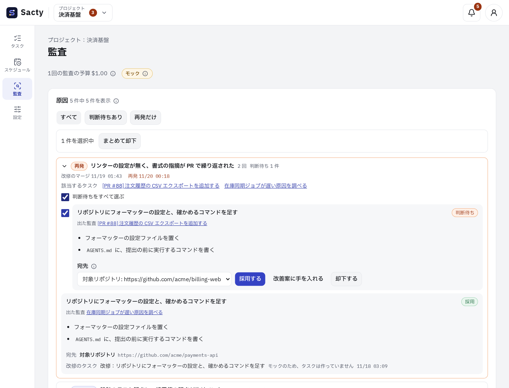

<!-- 対応するコード: apps/web/src/components/audit.tsx、apps/web/src/components/audit-screen.tsx、packages/core/src/flaky-tests.ts、apps/web/src/lib/audit-report.ts、apps/web/src/i18n/messages/audit.ts、apps/daemon/src/audits.ts、apps/daemon/src/ledger-audits.ts、apps/daemon/src/audit-prompts.ts、apps/daemon/src/service.ts、apps/daemon/src/memory.ts、apps/daemon/default-context/skills/memory/SKILL.md、packages/core/src/audit.ts -->

**日本語** | [English](audit.en.md)

# 監査を見る

監査は、完了したタスクの過程を、工程の判断から完了まで調べます。
差し戻し・指摘・エージェントの試行錯誤の原因を探し、それを防ぐための改修（コンテキスト・スキル・エージェントのルール・リンター・テストなど）を提案します。
提案を採用すると、sacty は改修のタスクを作ります。
あなたがすることは、出た提案を採用するか却下するかの判断です（[提案を採用・却下する](#提案を採用却下する)）。

## 監査の流れ

タスクが完了すると、sacty は自動で監査を始めます。
PR のレビューのタスクは、レビューを投稿した時点で始めます（判定が「指摘なし」でなく、「PR の対応待ち」の間も。[レビューを投稿した後](intake.md#レビューを投稿した後)）。
設定は要りません。

監査は次のように進みます。


1. **大まかな監査**：AI エージェントが、タスク全体の作業履歴と各実行のセッションログを読み、差し戻しや試行錯誤があった工程（懸念のある工程）を最大 3 つ挙げます。
2. **深掘り**：挙げた工程ごとに、エージェントが別のセッションで原因を特定し、原因ごとに改修の提案を出します。
3. 深掘りを終えると、監査済みになります。
   何も起きていなかったタスクは、深掘りせずに終わります。

監査の動き方は、次のとおりです。

- 監査は、ほかのタスクの実行と同じ待ち行列で順に動きます（同時に実行する数の上限に数えます）。
- 監査に使う AI は、config.yaml の `audit_agent` で選べます。
  書かなければ `default_agent` です（[config.yaml の設定](config.md)）。
- 監査の機能が無い以前の版で完了していたタスクは、監査しません。
- sacty を止めたときに途中だった監査は、次に起動したときに続けます。

監査を実行できなかったときは、「監査の失敗」になり、理由が出ます。

- AI の出力の JSON が崩れていて読めなかったときは、JSON の何行目の何文字目で壊れているかが、理由に出ます。
  文字列の中の二重引用符など、よくある崩れは sacty が直して読むので、それだけでは失敗になりません。
- 失敗しても、それまでに出た大まかな監査の結果・終えた深掘りの結果と、使った費用は残ります。

## 提案を採用・却下する

改修の提案は、[タスクの詳細の監査のタブ](#タスクの詳細の監査のタブ) と、プロジェクトの [監査の画面](#監査の画面) に出ます。
判断待ちの提案には、宛先の選択と「採用する」「却下する」「改善案に手を入れる」が出ます。
一度判断した提案は、変えられません。

採用するときは、次のようにします。

1. 宛先を、次の3つから選びます。
   監査が選んだ宛先が、初めから選ばれています。
   - 対象リポジトリ
   - コンテキスト（プロジェクトの層、または上位の層）
   - sacty の既定のコンテキスト（sacty のプロンプトと既定のスキル）
2. 「採用する」を押します。

採用すると、sacty は、選んだ宛先のリポジトリを対象にした改修のタスクを作ります。
タスクは通常の流れ（要求要件・設計・実装・PR）で進みます。
宛先が sacty の既定のコンテキストのときは、sacty はあなたのプロジェクトにタスクを作らず、採用したことだけを残します。
sacty 自体の改修として、提案の文を使ってください。

却下するときは、次のようにします。

1. 「却下する」を押します。
   理由の入力が出ます。
2. 理由を書いて、「却下を確定する」を押します。
   理由は必須です。

sacty は、却下の理由を以後の監査に渡し、同じ提案を繰り返さないために使います。

### 要らない提案をまとめて却下する

[監査の画面](#監査の画面)では、判断待ちの提案を複数選んで、1 つの理由でまとめて却下できます。
選べるのは、画面に出ている判断待ちの提案だけです。
1 回に却下できるのは、2,000 件までです。

1. 原因の行を押して開きます。
2. 却下したい提案のチェックボックスを選びます。
   原因ごとの「判断待ちをすべて選ぶ」を選ぶと、いま出している判断待ちの提案をまとめて選べます。
   別の原因を開いて、続けて選べます。
   選んでいる件数は、一覧の上に「N 件を選択中」と出ます。
3. 「まとめて却下」を押します。
   確認のダイアログに、件数と、選んだ提案の題（原因ごと）が出ます。
   題は、ダイアログの中でスクロールして、全件を確かめられます。
4. 理由を書いて、「却下を確定する」を押します。
   理由は必須で、選んだ全件に同じ理由を記録します。
   「やめる」か Escape を押すと、何も記録せずに閉じます。選択は残ります。

まとめて却下は、取り消せません。
却下した提案は、1 件ずつ却下したときと同じ扱いです。
原因の状態・判断待ちの件数・ダッシュボードの件数と採用率も、同じように変わります。

- 提案には「まとめて却下（全 N 件）の 1 件」と出ます。タスクの作業履歴の行にも、同じ印が付きます。
- 一部の提案が却下できなかったとき（ほかの操作で判断済み・元のタスクが中止済みなど）は、「N 件を却下し、M 件は却下できませんでした」と、できなかった提案の題と理由が出ます。
  却下できた分は記録されます。
- 以後の監査には、まとめて却下した提案を、1 回の操作につき 1 行にまとめて渡します。
  行には、却下した件数と、先頭の 3 件の題、理由を書きます。4 件目以降の題は渡さないので、同じ趣旨の提案が出し直されることがあります。
  1 件ずつの却下は、これまでどおりです。

### 改善案に手を入れて採用する

原因は合っているが改善案はそのままにしたくないときは、「改善案に手を入れる」を押して、種類と中身を書いてから採用します。
書かずに採用すれば、監査の改善案をそのまま使います。

| 種類 | 何が起きるか |
| --- | --- |
| 補足する（改善案は残す） | 監査の改善案の後に、書いた内容を「人が足した補足：」として足します |
| 差し替える（人の案で改修） | 書いた内容を改修の指示にし、監査の改善案は記録として後に添えます |

書いた内容（手入れ）は、次のように扱います。

- どちらの種類も、改修のタスクの説明に入ります（原因の説明も、手を入れないときと同じように付きます）。
- 手入れは 4,000 文字までです。
  監査の画面とレポートにも、種類とともに残ります。
- 手入れは以後の監査にも渡し、同じ手入れが要る提案を繰り返さないために使います。

## タスクの詳細の監査のタブ

完了したタスク（と、レビューを投稿した PR のレビューのタスク）の詳細に「監査」のタブが出ます（まだ監査していなければ、その旨が出ます）。
タブには、次のものが出ます。

| 項目 | 出すもの |
| --- | --- |
| 状態 | 監査待ち・大まかな監査中・深掘り中・監査済み・監査の失敗・予算で一時停止 |
| 費用 | 監査に使った費用と上限です。監査の予算は、タスクの予算とは別です |
| 大まかな監査 | 経緯の要約と、根拠になった出来事（人の差し戻し・PR の指摘・AI のレビューの指摘・一時停止・やり直し・ツール呼び出しの失敗・エスカレーション）の件数。sacty 自身の AI のレビューの指摘は、あなたの指摘と分けて数えます |
| 懸念のある工程 | 大まかな監査が挙げた工程と、工程ごとの深掘りの結果 |
| 原因と改修の提案 | 原因・根拠・提案。根拠の「作業履歴」「ログ」から、その行と実行のログへ移れます。改修の後にまた見つかった原因には「再発」が付きます |

- 予算で一時停止した監査は、このタブで新しい上限（使った額より大きい額）を入れると再開します。
- 監査が登録したメモリーも、このタブに出ます（[メモリー](#メモリー)）。

## 監査の画面

サイドメニューの「監査」から、表示しているプロジェクトの監査の画面（`/projects/<ID>/audit`）を開きます。
監査の画面は、次のように表示されます（画像は監査のモックのデータで、画面の上のほうの、原因を 1 つ開いて、提案を選んだところまでです）。



画面には、次のものが出ます。

- **原因と改修の提案**：原因は、タスクをまたいで同じ原因をまとめたものです。
  - 改修のタスクの PR をマージした後に、同じ原因がまた見つかると「再発」になります。
  - 並びは、再発・提案あり・採用・改修済み・却下の順で、同じ状態なら見つかった回数の多い順です。上位 20 件を出し、「さらに表示」で 20 件ずつ足します。「N 件中 M 件を表示」と出ます。
  - 絞り込みは「すべて」「判断待ちあり」「再発だけ」から選びます。選んだ絞り込みと、出している件数は URL に残るので、リロードしても同じ表示で開きます。
  - 原因は、畳んだ行で出ます。行には、状態・題・見つかった回数・判断待ちの提案の数が出ます。再発は目立たせます。
  - 行を押すと開き、該当するタスク（5 件まで。残りは「ほか N 件」）と、その原因の提案（判断待ちを先に。10 件まで。残りは「ほか N 件」）が出ます。
    提案の採用・手入れ・却下は、開いた中で 1 件ずつ行います。どのタスクの監査で出た提案かも出します。
  - 開いている原因・絞り込み・出している件数は、判断した後も保たれます。
  - 判断待ちの提案を選んで、まとめて却下できます（[要らない提案をまとめて却下する](#要らない提案をまとめて却下する)）。
- **監査したタスク**：状態・差し戻しと指摘の件数・費用・監査の完了の時刻です。
- **レポート**：開始日と終了日を選んで「レポートを出力する」を押すと、期間に完了した監査の原因・提案・判断を Markdown のファイルでダウンロードします。
  見出しは画面の言語で、監査の結果の文は訳しません。
  日時は UTC です。

監査の結果は、プロジェクトをまたいでまとめません。

## ダッシュボード

ダッシュボードの「監査」の欄に、次のものを出します（[ダッシュボード](dashboard.md)）。
プロジェクトの名前を押すと、その監査の画面に移ります。

- プロジェクトごとの原因・再発・判断待ちの件数と、提案の採用率
- 週ごとの、タスクあたりの差し戻し・指摘の件数

## モックのデータで画面を確かめる

画面だけを確かめたいときは、`SACTY_AUDIT_MOCK=1` を付けて起動します。
sacty は実際の監査を動かさずに、モックのデータを出します。
採用・却下（まとめて却下を含む）・再開はデーモンのメモリにだけ残り、sacty を起動し直すと戻ります。

```sh
SACTY_AUDIT_MOCK=1 npx sacty up
```

## メモリー

深掘りで、次のタスクにも役立つ知見（テストの走らせ方・規約の落とし穴など）が見つかると、監査はそれをメモリーとして登録します。
登録するのは監査だけです。
設定は要りません。
あなたは、登録されたメモリーを確かめて、誤ったものを消せます。

### メモリーを確かめる・消す

- タスクの詳細の監査のタブに、その監査が登録したメモリーが出ます。
- 誤ったメモリーは「消す」→「消すことを確定する」で消せます。
  消したメモリーは戻せません。
- メモリーを手で足すことはできません。
- `memory/` の中のファイルは、sacty が作業履歴から書き直します。
  手で書き換えても、次に起動したときに戻ります。

### メモリーの置き場所と使われ方

- メモリーは、プロジェクトとリポジトリの2つの階層に分かれます。
  - データディレクトリ（既定 `~/.sacty`）の `memory/projects/<プロジェクトの ID>/` と `memory/repos/<ホスト>/<オーナー>/<名前>/` に置きます。
  - リポジトリのメモリーは、プロジェクトの設定を変えても、同じリポジトリを扱うタスクで使い続けます。
- 次のタスクの工程のエージェントは、そのタスクのプロジェクトと対象リポジトリのメモリーの索引（題・概要・有効な最終利用日）を読み、関係するものだけを開きます。
  ほかのプロジェクトのメモリーは読みません。
  統合レビュー・PR の指摘の戻し先の判断には渡しません。
- メモリーは参考で、次のものより優先度が低くなります。
  メモリーに書かれた手順がこれらと食い違うときは、エージェントは手順を使わず、これらに従います。
  - 工程の指示（直す範囲・書くこと・書かないこと・判断の結果の扱いなど）
  - あなたの指示
  - コンテキストの規則とスキル
  - リポジトリの AGENTS.md など
- 監査も、工程の指示を変える手順をメモリーに登録しないようにします。

### メモリーに登録しないもの

監査は、そのタスクであなたが決めた答え（範囲・数値・有無・画面の要否など）を、ほかのタスクにも当てはまる事実としてメモリーに登録しません。
次のタスクの依頼に混ざって、そのタスクの要求を先に決めてしまうためです。

- 登録の前に、sacty が検査します。
  次のものは登録しません。
  - 「依頼者は〜と答えた」のように、依頼者を主語に書いたもの
  - あなたが書いた依頼の本文・コメント・再開の補足を、そのまま写したもの
- 登録しなかったメモリーの題と理由は、タスクの作業履歴の深掘りの記録に残ります。
- 言い換えた答えは見つけられません。
  メモリーに答えが残っていたら、監査のタブで消してください。

### メモリーが消える・移るとき

メモリーには、有効な最終利用日（メモリーが役に立った最後の日）があります。
sacty は、この日付を基に、古いメモリーを自動で消します。

- タスクで開いたメモリーを、そのタスクの監査が「役に立った」と判断すると、sacty は有効な最終利用日を、そのタスクの完了日を基に更新します（すでに新しい日付なら変わりません）。
  監査のタブの「役に立ったメモリー」に、そのタスクで役に立ったものが出ます。
- 開いたかどうかは、タスクの実行のセッションログから数えます。
  ログが無い・読めない実行は数えません。
  役に立っているはずのメモリーの日付が更新されないときは、デーモンのログの「メモリーを開いたかを数えるログを読めませんでした」と、データディレクトリの `runs/` を確かめてください。
- 有効な最終利用日から「Sacty の設定」の「メモリーを残す日数」（1〜3650。空なら 90 日）を過ぎたメモリーは、自動で消します。
  sacty を止めている間に過ぎたものは、次に起動したときに消します。
- 1つの階層に置くのは 30 件までです。
  超えると、有効な最終利用日の古いものから消します。

監査がメモリーを移したり、コンテキストにする提案を出したりすることもあります。

- 監査は、置き場所が合っていないメモリーを、プロジェクトとリポジトリの間で移します。
  監査のタブの「移したメモリー」に出ます。
- 何度も役に立ったメモリーは、監査がコンテキスト（スキル・規約）か対象リポジトリ（AGENTS.md など）に書く改修を提案します（原因の題は「メモリーをコンテキストにする：…」）。
  - ほかの提案と同じく、採用すると改修のタスクができ、PR のマージでコンテキストに入ります。
  - マージされると、元のメモリーは「コンテキストにした」として消えます。
  - 却下すると、メモリーは残り、却下の理由は次の監査に渡ります。

## 予算

1回の監査の予算の既定の上限は、config.yaml の `budget.default_per_audit_usd`（既定 $1）です（[config.yaml の設定](config.md)）。
予算で一時停止した監査の再開の仕方は、[タスクの詳細の監査のタブ](#タスクの詳細の監査のタブ) にあります。

## 不安定なテストの台帳

以前の版では、最終レビューが差分と無関係で不安定と認めたテストを、プロジェクトごとの台帳に集計して、監査の画面に出していました。
今の版は最終レビューをしないので（[実装の PR のレビュー](tasks.md#実装の-pr-のレビュー)）、台帳に新しい記録はできず、監査の画面にも出しません。
以前の版の記録は消さずに残ります。

## 旧版に戻すとき

監査の記録（`Audit…`）と改修のタスクを保存したデータベースは、監査に対応していない旧版では読み込めません。
更新の前にデーモンを止めてデータディレクトリをバックアップし、戻すときはバックアップを使ってください（[更新前のバックアップと旧版への復帰](getting-started.md#更新前のバックアップと旧版への復帰)）。
バックアップの後に作った改修のタスクの PR などは残るので、同じ改修をやり直さないよう確かめてください。

## 関係するページ

- [タスクを進める](tasks.md)
- [ダッシュボード](dashboard.md)
