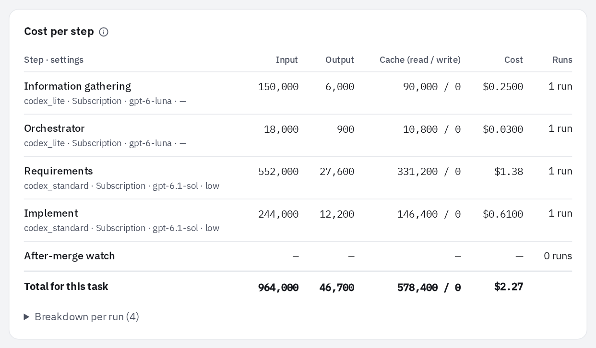

<!-- Code: apps/daemon/src/config.ts (ConfigFile, ProviderFile, ProviderAuth, AgentFile, loadConfig, CONFIG_TEMPLATE), config/agents.yaml, packages/core/src/events.ts (StepKey, DEFAULT_BUDGET_USD) -->

[日本語](config.md) | **English**

# config.yaml settings

These are the settings for all of sacty, written in `~/.sacty/config.yaml` (`$SACTY_HOME/config.yaml` if you change `SACTY_HOME`). Create the template with `npx sacty config init` ([CLI](cli.en.md#sacty-config-init)).

Per-project settings (targets, GitHub accounts, the context repository, and so on) do not go in config.yaml. Write them in [Project settings](project-settings.en.md) in the web UI.

## Settings

You can write the following settings in config.yaml. Where a setting has a detailed description, the "Meaning" column links to it.

| Setting | Meaning | Default |
| --- | --- | --- |
| `providers` | The connection (authentication) per tool and the prices of the models you can use ([Connections and prices](#connections-and-prices-providers)). Only `codex` and `claude` | None |
| `default_agent` | The AI that runs the steps (an agent name; [Default agents](#default-agents)) | `codex_standard` (`claude_standard` if it cannot be used) |
| `audit_agent` | The AI used for audits of completed tasks ([Audits](audit.en.md)) | `default_agent` |
| `agent_fallback.cooldown_minutes` | How long an agent that failed is not used and the fallback agent is used instead (minutes; an integer from 1 to 1440; until the reset time instead, at a usage limit whose reset time sacty could read; [Switching agents on failure](#switching-agents-on-failure)) | `60` |
| `step_agents` | The AI to use for each step (including the after-merge watch), the Orchestrator and information gathering ([Models per step](#models-per-step)) | `default_agent` if omitted (also for Integration review; the Orchestrator's AI for information gathering) |
| `agents` | Overrides of and additions to sacty's default agents ([Overriding agents](#overriding-agents)). Optional | None (sacty's defaults are used) |
| `budget.default_per_task_usd` | Budget per task (US dollars. A number greater than 0) | `1` |
| `budget.per_plan_usd` | Budget per step plan (US dollars. A number greater than 0. [Budget](#budget)) | None (`budget.default_per_task_usd`) |
| `budget.default_per_audit_usd` | Budget per audit (US dollars. A number greater than 0. Separate from the task budget. [Audits](audit.en.md#budget)) | `1` |
| `image` | The image used to run agents | `sacty-agent:1.29.0` |
| `image_build` | The base image and npm settings for `sacty image build` ([Container images](images.en.md)) | None |
| `images` | Images per language ([Container images](images.en.md#per-language-images)) | None |
| `onepassword.account` | The 1Password account to use ([Secrets](secrets.en.md#1password)) | None |
| `gateway` | The gateway on the host ([Gateway](gateway.en.md)) | None |
| `web.auth` | Web UI sign-in. With `false`, you can use the web UI without opening the sign-in URL (for the risk and how to switch, see [CLI](cli.en.md#sacty-up)). Read only when `sacty up` starts | `true` |
| `run_timeout` | Limit of one agent run (minutes; 1 to 720; [Run time limit](#run-time-limit-run_timeout)) | `agent_minutes: 30`, `test_minutes: 20` |
| `update_check` | Checks daily for a newer sacty release and shows it in the web UI ([Updating sacty](getting-started.en.md#updating-sacty)). Set `false` where the internet is not reachable (GitHub is not contacted) | `true` |

You set the following two in "Sacty settings" in the web UI, not in config.yaml.
Open "Sacty settings" from the bottom of the side menu or from the menu of the person icon at the top right (`/settings`).
It is separate from the per-project "Project settings". Save your changes with "Save" (you are asked to confirm if you leave the screen with unsaved changes).

- The intake interval: set for each kind of intake ([Intake](intake.en.md#intake-intervals)).
- The days to keep memories ([Viewing audits](audit.en.md#memories))

If a setting is wrong, the web UI shows which setting (for example `providers.codex.auth.secret`) is wrong and why.

For how to fix settings from earlier versions (`guardian_agent`, `github:`, and others), see [Moving from earlier versions](#moving-from-earlier-versions).

## Connections and prices (providers)

The models and reasoning efforts of the AIs that run steps come from the defaults sacty recommends ([Default agents](#default-agents)). In config.yaml, you only need to write the connection (authentication) of the tool you use and the prices of the models you can use (`available_models`).

```yaml
providers:
  codex:
    auth:
      mode: api-key
      secret: openai-api-key   # Save the value with npx sacty secret set openai-api-key
    available_models:          # The prices are examples. Match your contract
      gpt-6-luna: { input: 0.25, cached_input: 0.025, output: 2 }
      gpt-6.1-sol: { input: 1.25, cached_input: 0.125, output: 10 }
      gpt-6.1-terra: { input: 1, cached_input: 0.05, output: 5 }
      gpt-6-astra: { input: 10, cached_input: 1, output: 50 }
```

Only two names can be written in `providers`: `codex` for Codex and `claude` for Claude Code. You can write one of them or both.

| Setting | Meaning | Default |
| --- | --- | --- |
| `auth` | The authentication method ([Authentication](#authentication)). Required | None |
| `via_gateway` | Route AI calls through the gateway on the host (`bedrock` and `openai-compatible` of `codex` only. [Gateway](gateway.en.md#relaying-ai-calls)) | `false` |
| `available_models` | The models you can use and their unit prices per million tokens (US dollars; [How to write prices](#how-to-write-prices)). For each model name, `input`, `cached_input`, and `output` are required; `cache_write` is optional | None (`cache_write` is `0`) |

### How to write prices

When you write the unit prices (`available_models`), keep the following two points in mind.

- Keep the unit prices in line with the latest prices of the models you use. If your contract has different prices, write those.
- Make the example prices close to what you are actually charged. A price higher than the real one makes the cost of runs whose agent CLI does not report a cost ([How costs are determined](#how-costs-are-determined)) look large, so the budget cap is reached early and the task pauses.

An agent whose model has no price in `available_models` cannot be used.

- sacty does not offer that agent for steps or in the task details.
- The web UI shows a warning saying which model has no price (with the names of the agents that use that model). When a sacty update changes the default models, add the prices of the models shown in the warning to `available_models`.
- It is not a settings error. However, the following cases are errors.
  - You write an agent that cannot be used in `default_agent`, `audit_agent`, or `step_agents`
  - You do not write `default_agent` and neither `codex_standard` nor `claude_standard` can be used (for example, when `providers` is not written)

### How costs are determined

The cost of a run depends on whether the agent's CLI reported a cost.

- If the CLI reported an amount, that amount is the cost of the run (the cost of the whole run that Claude Code reports). A Claude Code run uses the amount the CLI reports, so even if your contract prices differ from that amount, the reported amount is the cost.
- If there is no report, sacty calculates the cost from the unit prices in `available_models` and the token counts.
  - For a run that reports usage per model (Claude Code), the part used by another model inside the run, such as a subagent, is calculated with that model's price (a model with no price in `available_models` uses the step agent's price).
  - For a run that does not report usage per model (such as Codex), the whole usage is calculated with the step agent's price.

The prices you write in `available_models` apply to runs without a report and to other models used inside a run.

For every run, the activity log of the task shows whether sacty used the CLI's report or calculated from the usage, in the line that starts with "Cost …". A run of an agent whose CLI does not report a cost, such as Codex, shows "was converted from token usage because the agent CLI did not report a cost".

With a subscription you are not actually billed. sacty treats the reported amount (or, if there is none, the value converted at the same unit prices) as the cost and uses it to check the budget.

## Authentication

The authentication methods you write in `auth` of `providers`, and what you need for each, are as follows.

| Tool | Authentication method (`auth.mode`) | What you need |
| --- | --- | --- |
| Claude Code (`claude`) | `subscription` | A token created with `claude setup-token` (`secret` is required) |
| Claude Code (`claude`) | `api-key` | An Anthropic API key |
| Claude Code (`claude`) | `bedrock` | A Bedrock API key and `region`. The model is an inference profile ID |
| Codex (`codex`) | `subscription` | Sign-in with ChatGPT (`auth_file`. Default `~/.codex/auth.json`) |
| Codex (`codex`) | `api-key` | An OpenAI API key |
| Codex (`codex`) | `bedrock` | A Bedrock API key and `region`. `endpoint` is `runtime` (the default. The model is an inference profile ID, for example `global.openai.gpt-6-sol`) or `mantle` (the model is, for example, `openai.gpt-6-sol`) |
| Codex (`codex`) | `openai-compatible` | The `base_url` and API key of an OpenAI-compatible endpoint ([Gateway](gateway.en.md#openai-compatible-endpoints)) |

- For tokens and API keys, write only a name (or a 1Password reference) in `secret`, and keep the value in the Keychain or 1Password ([Secrets](secrets.en.md)).
- sacty passes only the environment variables of the chosen authentication method to the container (host variables such as `ANTHROPIC_API_KEY` are not inherited).

When you use Bedrock (`mode: bedrock`), keep the following two points in mind.

- With Bedrock the model names differ. Change `model` with [Overriding agents](#overriding-agents) and write the price for that name in `available_models`. Tiers you do not override have no price, so they cannot be used and the web UI shows a warning.
- `endpoint` is used only by Codex. Writing it for `bedrock` of `claude` is an error.

The following is an example of using Codex with Bedrock.

```yaml
providers:
  codex:
    auth:
      mode: bedrock
      secret: bedrock-api-key
      region: us-east-2
      endpoint: runtime
    via_gateway: true
    available_models:
      global.openai.gpt-6-sol: { input: 1.25, cached_input: 0.125, output: 10 }
agents:
  codex_standard:
    model: global.openai.gpt-6-sol
default_agent: codex_standard
```

## Default agents

An agent is a named combination of a tool, a model, and a reasoning effort. sacty has default agents for each tier ([Agent tiers](#agent-tiers)). When models are renewed, the defaults are renewed with a sacty update.

| Name | Tool | Model | Reasoning effort |
| --- | --- | --- | --- |
| `codex_lite` | Codex | `gpt-6-luna` | `low` |
| `codex_entry` | Codex | `gpt-6.1-terra` | `low` |
| `codex_standard` | Codex | `gpt-6.1-terra` | `medium` |
| `codex_advanced` | Codex | `gpt-6.1-sol` | `medium` |
| `codex_expert` | Codex | `gpt-6.1-sol` | `high` |
| `codex_ultimate` | Codex | `gpt-6-astra` | `low` |
| `claude_lite` | Claude Code | `claude-haiku-5-5` | (the tool's default) |
| `claude_entry` | Claude Code | `claude-sonnet-5-5` | `low` |
| `claude_standard` | Claude Code | `claude-sonnet-5-5` | `medium` |
| `claude_advanced` | Claude Code | `claude-opus-5-5` | `medium` |
| `claude_expert` | Claude Code | `claude-opus-5-5` | `high` |
| `claude_ultimate` | Claude Code | `claude-fable-5-1` | `low` |

- If you do not write `default_agent`, `codex_standard` is used. When `codex_standard` cannot be used (no `providers.codex`, or no price), `claude_standard` is used.
- The default agents of a tool that is not in `providers` cannot be used. You are just not using that tool, so no warning is shown.

## Overriding agents

You do not have to write `agents`. When you write it, an agent with the same name as a default is overridden only in the settings you write (the settings you do not write keep their defaults). You can also add agents under new names.

```yaml
agents:
  codex_ultimate:
    reasoning_effort: xhigh   # The model stays the default
  my-reviewer:                # A new name (needs runtime and model)
    runtime: claude-code
    model: claude-opus-5-5
    reasoning_effort: high
```

| Setting | Meaning | Default |
| --- | --- | --- |
| `runtime` | `claude-code`, `codex`, or `stub` (for trying things out. It does not call a real AI). Required for a new name | The default agent's |
| `model` | The model. Required for a new name (its price is looked up in `available_models`) | The default agent's |
| `reasoning_effort` | The reasoning effort (`model_reasoning_effort` for Codex, `--effort` for Claude Code). Lowercase letters, digits, `_`, and `-`, starting with a lowercase letter | The default agent's (or the tool's default) |
| `price_per_mtok_usd` | `runtime: stub` only. The unit price per million tokens (US dollars), written the same way as in `available_models` | `0` |
| `stub` | The output of `runtime: stub` | None |
| `fallback` | The names of the agents used instead when a run fails (for any reason, such as a usage limit or an authentication error). One name or a list (tried from the top; [Switching agents on failure](#switching-agents-on-failure)) | None (no switching) |

- Agents cannot contain authentication, connections, or prices (`auth`, `provider`, `via_gateway`, `price_per_mtok_usd`). Write them in `providers` (except `price_per_mtok_usd` of `runtime: stub`).
- An agent under a new name also cannot be used, with a warning in the web UI, when its tool has no `providers` entry or its model has no price.

## Models per step

To change the model used for each step, choose an agent for each step and the Orchestrator in `step_agents`.

```yaml
default_agent: codex_standard
audit_agent: codex_advanced
step_agents:          # default_agent if omitted (also for Integration review)
  orchestrator: codex_lite
  requirements: codex_advanced
  design: codex_advanced
```

You can write the following keys in `step_agents`.

| Key | Target |
| --- | --- |
| `orchestrator` | Orchestrator |
| `gather` | Information gathering at the start of a task (the AI of `orchestrator` if omitted) |
| `investigate` | Investigate |
| `review` | Review |
| `requirements` | Requirements |
| `design` | Design |
| `split` | Task split |
| `integrate` | Integration review |
| `reproduce` | Reproduce |
| `implement` | Implement |
| `document` | Document |
| `operation` | Operation |
| `deployment` | The check in the after-merge watch step ([After-merge watch](deployment-watch.en.md)) |

- Writing a name that does not exist or an agent that cannot be used in `default_agent`, `audit_agent`, or `step_agents` is an error.
- The agent for Integration review (`integrate`) is decided here. It cannot be changed per task.
- When a person specifies a step's agent for a task, the specified agent takes precedence over `step_agents` for that task. A person specifies it at the following times.
  - At task creation ([Set the task image and the agent for each step](tasks.en.md#set-the-task-image-and-the-agent-for-each-step))
  - In the task details, when resuming a paused task, or when requesting changes ([Changing a step's agent](tasks.en.md#changing-a-steps-agent))

## Agent tiers

If you sort your agents into tiers, skills (such as the default `review`) start a subagent (a reviewer) by tier name for each viewpoint. The reviewer of the same tier runs in both Claude Code and Codex. When a new model generation comes out, a sacty update renews the tiers' default models too.

sacty has the tier agents by default under the names `claude_<tier>` and `codex_<tier>` ([Default agents](#default-agents)). The tiers are `lite`, `entry`, `standard`, `advanced`, `expert`, and `ultimate`.

| Tier | Meaning | Intended use |
| --- | --- | --- |
| `lite` | Fastest and cheapest | Mechanical checks such as wording and links |
| `entry` | Enough for everyday work | Wording and fit for the reader, checks against conventions and rules, and analysis of verification results |
| `standard` | Standard | The default for viewpoints that read the target and judge it |
| `advanced` | Hard reasoning | Correctness, security, concurrency, and design consistency, and defect hunting not bound to a viewpoint |
| `expert` | Deeper reasoning | (Not used by default; only when a person chooses it) |
| `ultimate` | The top tier | (Not used by default; only when a person chooses it) |

You can configure the tier agents as follows.

- To change a tier's model, write `model` under the same name with [Overriding agents](#overriding-agents). It is an error when the prefix of a tier name does not match its `runtime` (for example `claude_lite` with `runtime: codex`).
- A tier agent is an ordinary agent too, so you can write it in `step_agents` to use it for a step.

When a step runs, sacty places the tiers as follows.

- It places the tiers of that tool (`claude_*` for Claude Code, `codex_*` for Codex) in the config location as subagent definitions named without the prefix. The location is `agents/<tier>.md` for Claude Code and `agents/<tier>.toml` for Codex.
- It places only the tiers that can be used (with a connection and a model price in `providers`). If no tier can be used, subagents run with the same model as the step agent.
- You can see the placed tiers in the details of "Context prepared" in the Activity and in the context preview of the project settings.
- Subagents run in the same process as the step agent. The connection is per tool in `providers`, so the tiers of the same tool have the same connection as the step agent.
- Definitions of the same name in the context repository (`agents/claude/agents/<tier>.md`, `agents/codex/agents/<tier>.toml`, and `[agents.<tier>]` in Codex's `config.toml`) are not used (a warning is left).

The cost of a run that placed tiers is handled as follows.

- The cost is decided in the same way as for other runs ([How costs are determined](#how-costs-are-determined)). For Claude Code, the reported amount and the usage include the reviewers' usage.
- The cost of a run that placed tiers is recorded as an estimate and marked "Estimate" on the screen.
- The price of a tier's model in `available_models` is used when that tier runs a step through `step_agents`, and when the part used by reviewers is calculated for a run without a report.

## Switching agents on failure

When you write `fallback` (the name of the agent to use instead) on an agent, sacty switches to that agent when a run fails. For example, you can use Claude Code as the main agent and switch to Codex when it reaches its usage limit or fails to authenticate.

```yaml
default_agent: claude_standard
agents:
  claude_standard:
    fallback: codex_standard
  claude_advanced:
    fallback: [codex_advanced, codex_standard]   # with a list, tried from the top
agent_fallback:
  cooldown_minutes: 60   # how long an agent that failed is not used (minutes; 1-1440)
```

The following rules apply to `fallback`.

- Fallback agents apply to every agent in `default_agent`, `audit_agent`, `step_agents`, and the agents chosen in task details.
- Writing a name that does not exist, or the agent itself, in `fallback` is an error.
- When a fallback agent cannot be used (for example, there is no `providers` for its tool), the web UI shows a warning and sacty does not switch to that agent.

What happens when an agent's run fails depends on the kind of run.

| Run | On failure |
| --- | --- |
| Steps, the integration review, information gathering, the Orchestrator's choice of steps, reading tickets, and deciding where to send PR comments back to | Whatever the reason (usage limits, authentication errors, other errors), the task is not paused, and the same step runs again with the fallback agent |
| Exports, the after-merge watch, audits, and answers to questions | sacty does not switch for that run, and handles the failure the same way as when there is no fallback agent (the task pauses, the check is recorded as not confirmed, and so on). At a usage limit, the fallback agent is used from the next run |

sacty records the switch in the activity log with the reason (shown as "reached its usage limit", "failed to authenticate", or "failed").

After a switch, sacty behaves as follows.

- For `cooldown_minutes`, the failed agent is not used and the fallback agent is used instead. At a usage limit, when the failure message gives the reset time and sacty can read it with certainty, the fallback is used until that time instead of for `cooldown_minutes`. sacty reads only Claude Code's `resets 3:45pm (Asia/Tokyo)` form with a time zone name and the old epoch-seconds form. Forms without a time zone name (such as Codex's `try again at …`) and messages without a time cannot be read, so sacty tries the original agent every `cooldown_minutes`. Where the fallback is used depends on the reason for the failure.
  - Usage limit: the fallback is used for other tasks too.
  - Other failures: the fallback is used only for that task (other tasks run with the original agent).
- After the deadline (`cooldown_minutes`, or the reset time when sacty read one), the original agent is used again. When sacty restarts, the original agent is tried first as well. The exception is the continuation after an implementation ended unfinished: it starts with the agent that ran the previous run (even after the period, so that it continues the same conversation). If that agent is not usable, sacty uses the agent chosen for the step, and its fallbacks.
- When the Orchestrator switches to a fallback agent (a different tool), sacty passes the conversation of the previous agent's session read-only so the new agent can take over. This is because a different tool cannot resume the session itself. The same handover happens when it switches back to the original agent.

The task is paused in the following cases.

- An agent without `fallback` fails.
- The fallback agent also fails (all agents in the list have been tried).
  - An agent already tried is not used again even after `cooldown_minutes`.
  - Resuming tries again from the chosen agent in order. Agents that this task had stopped using after a failure are tried again too (other tasks' marks and usage-limit marks are unchanged).
- The agent's container could not be confirmed as stopped (sacty does not switch). This is because the original container may still be running.

Whether a run failed is judged as follows.

- It is judged from the agent's exit code and output. It is not judged from logs on standard error.
- If the agent's final result is empty but an earlier result has content, that result is used as the answer. If no result has any content, sacty treats the run as failed instead of producing an empty deliverable (a switch to a fallback agent, or a pause).
- Switching when the run ended normally but its answer was not in the right form applies only to information gathering, the Orchestrator's choice of steps, and reading tickets.

## Budget

Each task has a budget (a cost cap). When the amount used reaches the cap, sacty pauses the task.

You set the budget as follows.

- The default budget per task is `budget.default_per_task_usd` (default $1).
- To set a budget per step plan (such as `standard` or `split`, which the Orchestrator chooses), write the plan names and amounts in `budget.per_plan_usd`.

```yaml
budget:
  default_per_task_usd: 1
  per_plan_usd:
    standard: 30
    split: 100
```

The following rules apply to `budget.per_plan_usd`.

- The plan names are `standard`, `skip-design`, `skip-requirements`, `direct`, `bugfix`, `investigate`, `design-only`, `review`, `split`, `document`, `operation`, `security-check`, and `security-fix`. Any other name is a configuration error.
- When the Orchestrator chooses that plan, sacty sets the task's budget cap to that amount.
- Plans not listed keep `budget.default_per_task_usd`.
- If you raised the cap when resuming before the steps were chosen, the raised cap is kept.

The amounts in the example are a guide. The actual cost changes with the size of the request, so check the "Costs" tab in the task details and decide the amounts.

When the amount used approaches or reaches the budget, the following happens.

- At 80% of the budget, sacty records a notice in the activity log.
- When the cap is reached, the task is paused (the work is kept). To resume, enter a new cumulative cap in the web UI ([Pause, resume, and cancel](tasks.en.md#pause-resume-and-cancel)).

You can check the amount used in the task details.

- The amount used and the cap appear under "Cost" in the properties in the right column and on the "Costs" tab.
- The breakdown per step appears in "Cost per step" on the "Costs" tab.
- When the amount includes costs converted with the unit prices, such as subscription runs, it is marked "Estimate" (not an actual charge; [How costs are determined](#how-costs-are-determined)).



The cost of a run that was stopped partway appears as follows.

- When a run is stopped by a timeout or the like, sacty reads the usage from what had been written by then, records it as the cost, and counts it in the budget check. Usage inside subagents and the like cannot be read, so the value is a lower bound, shown as "$0.3100 or more" on the screen and in the activity log.
- A run for which nothing could be read (Codex gives usage only when a turn ends, so a timeout usually leaves nothing) is shown as "Unknown", not 0. The number of runs with unknown cost appears in "Cost" and below "Cost per step".

Besides the budget, a task is also paused on a subscription usage limit or an authentication error. Resuming runs the stopped step again. If you write a fallback agent, sacty switches to it and continues ([Switching agents on failure](#switching-agents-on-failure)). However, an Operation step that has started cannot be resumed and stays paused.

## Run time limit (run_timeout)

`run_timeout` sets the limit of one agent run. When a run passes the limit, sacty stops the container and pauses the task.

Write the following settings in `run_timeout`. The values are in minutes, from 1 to 720.

| Setting | Meaning | Default |
| --- | --- | --- |
| `agent_minutes` | Limit of one agent run | `30` |
| `test_minutes` | The minutes added to `agent_minutes` for the reproduction (`reproduce`) and the PR review (`review`), which run tests | `20` |
| `roles` | Per-role overrides (for example `implement: 90`, `rework: 45`). When a role has an override, its limit is just that value | None |

- Changed settings apply from the next run.
- When you resume the paused task, the run continues the session of the stopped run ([Troubleshooting](troubleshooting.en.md#when-a-run-stops-at-its-time-limit)).

## Moving from earlier versions

If you keep using a config.yaml from an earlier version, change it to the current format. There are two kinds of things to fix: settings that are now errors, and settings that are no longer used.

The following ways of writing settings are now settings errors. sacty does not convert them automatically, so rewrite them.

- Move `auth` and `via_gateway` of agents to `providers.codex` or `providers.claude` of that tool.
- Move `price_per_mtok_usd` of agents to `providers.<tool>.available_models` as per-model prices.
- Rewrite named `providers` (OpenAI-compatible endpoints) and `provider` of agents as the `auth` of `providers.codex` (`mode: openai-compatible`, `base_url`, `secret`).
- Delete the `pr` key (the "Open PR" step) of `step_agents`. That step no longer exists, so the key cannot be written.

The following settings are no longer used. Writing them is not a settings error.

- `guardian_agent`: sacty ignores it and shows a warning on the screen (sacty still starts). Write the integration review agent in `step_agents.integrate` and the audit agent in `audit_agent`, and delete `guardian_agent` (without them, both use `default_agent`).
- `github:` (`poll_interval_sec`): sacty does not read it even if it is written. You can delete it.

You can delete agents from `agents` when the default models are enough. When you delete them, change `default_agent` and the others to the names of default agents.

## Related pages

- [Secrets](secrets.en.md)
- [Gateway](gateway.en.md)
- [Container images](images.en.md)
