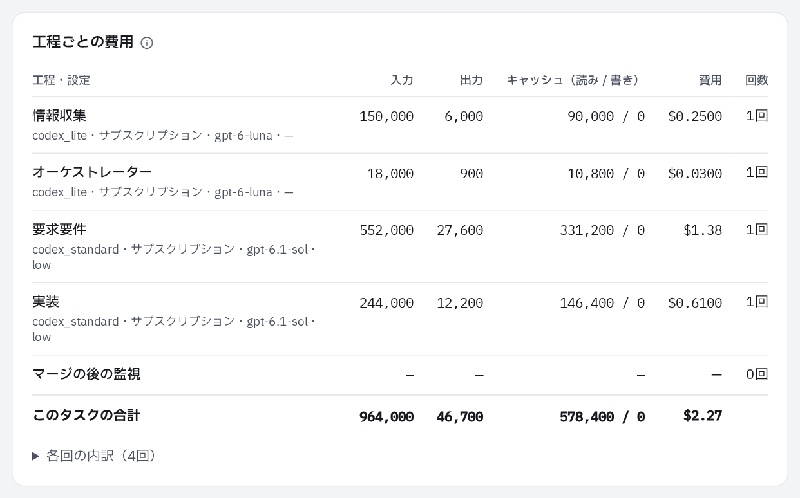

<!-- 対応するコード: apps/daemon/src/config.ts（ConfigFile・ProviderFile・ProviderAuth・AgentFile・loadConfig・CONFIG_TEMPLATE）、config/agents.yaml、packages/core/src/events.ts（StepKey・DEFAULT_BUDGET_USD） -->

**日本語** | [English](config.en.md)

# config.yaml の設定

`~/.sacty/config.yaml`（`SACTY_HOME` を変えたら `$SACTY_HOME/config.yaml`）に書く、sacty 全体の設定です。
雛形は `npx sacty config init` で作ります（[CLI](cli.md#sacty-config-init)）。

プロジェクトごとの設定（対象・GitHub のアカウント・コンテキストリポジトリなど）は、config.yaml には書かず、画面の [プロジェクトの設定](project-settings.md) に書きます。

## 項目の一覧

config.yaml に書ける項目は、次のとおりです。
詳しい説明がある項目は、「意味」の欄から、その説明へリンクしています。

| 項目 | 意味 | 既定値 |
| --- | --- | --- |
| `providers` | ツールごとの接続先（認証）と、使えるモデルの単価（[接続先と単価](#接続先と単価providers)）。`codex` と `claude` だけ | なし |
| `default_agent` | 工程を実行する AI（エージェントの名前。[既定のエージェント](#既定のエージェント)） | `codex_standard`（使えなければ `claude_standard`） |
| `audit_agent` | 完了したタスクの監査に使う AI（[監査](audit.md)） | `default_agent` |
| `agent_fallback.cooldown_minutes` | 失敗したエージェントを使わず、代わりのエージェントを使う時間（分。1〜1440 の整数。利用制限で明ける時刻を読み取れたときは、その時刻まで。[失敗したときの切り替え](#失敗したときの切り替え)） | `60` |
| `step_agents` | 工程（マージの後の監視を含む）・オーケストレーター・情報収集ごとに使う AI（[工程ごとのモデル](#工程ごとのモデル)） | 書かなければ `default_agent`（統合レビューも。情報収集はオーケストレーターの AI） |
| `agents` | sacty の既定のエージェントの上書き・追加（[エージェントの上書き](#エージェントの上書き)）。任意 | なし（sacty の既定を使う） |
| `budget.default_per_task_usd` | 1タスクあたりの予算（米ドル。0 より大きい数） | `1` |
| `budget.per_plan_usd` | 工程の組み合わせごとの予算（米ドル。0 より大きい数。[予算](#予算)） | なし（`budget.default_per_task_usd`） |
| `budget.default_per_audit_usd` | 1回の監査の予算（米ドル。0 より大きい数。タスクの予算とは別。[監査](audit.md#予算)） | `1` |
| `image` | エージェントの実行に使うイメージ | `sacty-agent:1.29.0` |
| `image_build` | `sacty image build` の元のイメージと npm の設定（[コンテナイメージ](images.md)） | なし |
| `images` | 言語ごとのイメージ（[コンテナイメージ](images.md#言語ごとのイメージ)） | なし |
| `onepassword.account` | 使う 1Password のアカウント（[秘密情報](secrets.md#1password)） | なし |
| `gateway` | ホストのゲートウェイ（[ゲートウェイ](gateway.md)） | なし |
| `web.auth` | 画面の認証。`false` にすると、入り口の URL を開かなくても画面を使える（危険と切り替え方は [CLI](cli.md#sacty-up)）。`sacty up` の起動のときだけ読む | `true` |
| `run_timeout` | エージェントの1回の実行の上限（分。1〜720。[実行の上限](#実行の上限run_timeout)） | `agent_minutes: 30`・`test_minutes: 20` |
| `update_check` | sacty の新しいリリースを1日ごとに確かめ、あれば画面に出す（[sacty を更新する](getting-started.md#sacty-を更新する)）。インターネットに出られない環境では `false` にする（GitHub に問い合わせない） | `true` |

次の2つは、config.yaml には書かず、画面の「Sacty の設定」で決めます。

- 取り込みの間隔：取り込みの種類ごとに決めます（[取り込み](intake.md#取り込みの間隔)）。
- メモリーを残す日数（[監査を見る](audit.md#メモリー)）

設定に誤りがあると、sacty はどの項目（例 `providers.codex.auth.secret`）の何が誤りかを画面に出します。

以前の版の項目（`guardian_agent`・`github:` など）の直し方は、[以前の版から移す](#以前の版から移す) にあります。

## 接続先と単価（providers）

工程を動かす AI のモデルとリーズニングエフォートは、sacty が推奨する既定（[既定のエージェント](#既定のエージェント)）を使います。
config.yaml には、使うツールの接続先（認証）と、使えるモデルの単価（`available_models`）だけを書けば動きます。

```yaml
providers:
  codex:
    auth:
      mode: api-key
      secret: openai-api-key   # 値は npx sacty secret set openai-api-key で保存する
    available_models:          # 単価は例。契約の単価に合わせる
      gpt-6-luna: { input: 0.25, cached_input: 0.025, output: 2 }
      gpt-6.1-sol: { input: 1.25, cached_input: 0.125, output: 10 }
      gpt-6.1-terra: { input: 1, cached_input: 0.05, output: 5 }
      gpt-6-astra: { input: 10, cached_input: 1, output: 50 }
```

`providers` に書けるのは、Codex の `codex` と Claude Code の `claude` の2つだけです。
片方だけでも、両方でもかまいません。

| 項目 | 意味 | 既定値 |
| --- | --- | --- |
| `auth` | 認証方式（[認証方式](#認証方式)）。必須 | なし |
| `via_gateway` | AI の呼び出しを、ホストのゲートウェイ経由にする（`codex` の `bedrock`・`openai-compatible` だけ。[ゲートウェイ](gateway.md#ai-の呼び出しを中継する)） | `false` |
| `available_models` | 使えるモデルと、100万トークンあたりの単価（米ドル。[単価の書き方](#単価の書き方)）。モデルの名前ごとに `input`・`cached_input`・`output` は必須、`cache_write` は任意 | なし（`cache_write` は `0`） |

### 単価の書き方

単価（`available_models`）を書くときは、次の2つに気をつけてください。

- 単価は、利用するモデルの最新の単価に合わせてください。
  契約で単価が違う場合は、その単価を書きます。
- 単価の例は、実際の請求に近い値にしてください。
  実際より高い単価を書くと、エージェントの CLI が費用を報告しない実行（[費用の決まり方](#費用の決まり方)）の費用が大きく見積もられ、予算の上限に早く達して一時停止します。

`available_models` に単価の無いモデルのエージェントは、使えない扱いになります。

- sacty は、そのエージェントを、工程・タスクの詳細の選択肢に出しません。
- 画面の警告に、どのモデルの単価が無いか（そのモデルを使うエージェントの名前）を出します。
  sacty を更新して既定のモデルが変わったら、警告に出たモデルの単価を `available_models` に足してください。
- 設定の誤りにはしません。
  ただし、次のときは誤りになります。
  - `default_agent`・`audit_agent`・`step_agents` に、使えないエージェントを書いたとき
  - `default_agent` を書かず、`codex_standard`・`claude_standard` のどちらも使えないとき（`providers` を書いていないときなど）

### 費用の決まり方

実行の費用は、エージェントの CLI が費用を報告したかどうかで決まります。

- CLI が報告した額があれば、その額が実行の費用です（Claude Code が報告する、実行の全体の費用）。
  Claude Code の実行は、CLI が報告した額を使うので、契約の単価がその額と違っても、報告された額が費用になります。
- 報告が無いときは、`available_models` の単価とトークン数から計算します。
  - モデルごとの使用量が分かる実行（Claude Code）では、サブエージェントなど、実行の中で別のモデルが使われた分を、そのモデルの単価で計算します（`available_models` に単価が無いモデルは、工程のエージェントの単価で計算します）。
  - モデルごとの使用量が分からない実行（Codex など）では、全体の使用量を、工程のエージェントの単価で計算します。

`available_models` に書いた単価は、報告が無い実行と、実行の中の別のモデルの換算に効きます。

どの実行も、CLI の報告額を使ったか、使用量を単価で計算したかが、タスクの作業履歴の「費用 … は、…」の行で分かります。
Codex のように CLI が費用を報告しないエージェントの実行は、「CLI が費用を報告しなかったので、使用量を単価で換算した額」と出ます。

サブスクリプションでは、実際の請求は発生しません。
sacty は、報告された額（無ければ同じ単価で換算した値）を費用として扱い、予算の判定に使います。

## 認証方式

`providers` の `auth` に書く認証方式と、方式ごとに用意するものは、次のとおりです。

| ツール | 認証方式（`auth.mode`） | 用意するもの |
| --- | --- | --- |
| Claude Code（`claude`） | `subscription` | `claude setup-token` で作ったトークン（`secret` は必須） |
| Claude Code（`claude`） | `api-key` | Anthropic の API キー |
| Claude Code（`claude`） | `bedrock` | Bedrock の API キーと `region`。モデルは推論プロファイル ID |
| Codex（`codex`） | `subscription` | ChatGPT でのログイン（`auth_file`。既定 `~/.codex/auth.json`） |
| Codex（`codex`） | `api-key` | OpenAI の API キー |
| Codex（`codex`） | `bedrock` | Bedrock の API キーと `region`。`endpoint` は `runtime`（既定。モデルは推論プロファイル ID、例 `global.openai.gpt-6-sol`）か `mantle`（モデルは例 `openai.gpt-6-sol`） |
| Codex（`codex`） | `openai-compatible` | OpenAI 互換の接続先の `base_url` と API キー（[ゲートウェイ](gateway.md#openai-互換の接続先)） |

- トークンや API キーは `secret` に名前（または 1Password の参照）だけを書き、値はキーチェーンか 1Password に置きます（[秘密情報](secrets.md)）。
- sacty はコンテナに、選んだ認証方式の環境変数だけを渡します（ホストの `ANTHROPIC_API_KEY` などは引き継ぎません）。

Bedrock（`mode: bedrock`）を使うときは、次の2つに気をつけてください。

- Bedrock ではモデルの名前が変わります。
  [エージェントの上書き](#エージェントの上書き)で `model` を書き換え、その名前の単価を `available_models` に書いてください。
  上書きしていない段階は単価が無いので、使えない扱いになり、画面に警告が出ます。
- `endpoint` は Codex だけで使います。
  `claude` の `bedrock` に書くと誤りになります。

次は、Codex を Bedrock で使う例です。

```yaml
providers:
  codex:
    auth:
      mode: bedrock
      secret: bedrock-api-key
      region: us-east-2
      endpoint: runtime
    via_gateway: true
    available_models:
      global.openai.gpt-6-sol: { input: 1.25, cached_input: 0.125, output: 10 }
agents:
  codex_standard:
    model: global.openai.gpt-6-sol
default_agent: codex_standard
```

## 既定のエージェント

エージェントは、ツール・モデル・リーズニングエフォートの組み合わせに、名前を付けたものです。
sacty は、段階（[エージェントの段階](#エージェントの段階)）ごとのエージェントを既定で持っています。
モデルが新しくなったら、sacty の更新で既定も新しくなります。

| 名前 | ツール | モデル | リーズニングエフォート |
| --- | --- | --- | --- |
| `codex_lite` | Codex | `gpt-6-luna` | `low` |
| `codex_entry` | Codex | `gpt-6.1-terra` | `low` |
| `codex_standard` | Codex | `gpt-6.1-terra` | `medium` |
| `codex_advanced` | Codex | `gpt-6.1-sol` | `medium` |
| `codex_expert` | Codex | `gpt-6.1-sol` | `high` |
| `codex_ultimate` | Codex | `gpt-6-astra` | `low` |
| `claude_lite` | Claude Code | `claude-haiku-5-5` | （ツールの既定） |
| `claude_entry` | Claude Code | `claude-sonnet-5-5` | `low` |
| `claude_standard` | Claude Code | `claude-sonnet-5-5` | `medium` |
| `claude_advanced` | Claude Code | `claude-opus-5-5` | `medium` |
| `claude_expert` | Claude Code | `claude-opus-5-5` | `high` |
| `claude_ultimate` | Claude Code | `claude-fable-5-1` | `low` |

- `default_agent` を書かなければ、`codex_standard` を使います。
  `codex_standard` が使えない（`providers.codex` が無い・単価が無い）ときは `claude_standard` を使います。
- `providers` に無いツールの既定のエージェントは、使えない扱いになります。
  そのツールを使っていないだけなので、警告は出しません。

## エージェントの上書き

`agents` は書かなくてかまいません。
書いたときは、既定と同じ名前のエージェントを、書いた項目だけ上書きします（書いていない項目は既定のままです）。
新しい名前で足すこともできます。

```yaml
agents:
  codex_ultimate:
    reasoning_effort: xhigh   # モデルは既定のまま
  my-reviewer:                # 新しい名前（runtime・model が要る）
    runtime: claude-code
    model: claude-opus-5-5
    reasoning_effort: high
```

| 項目 | 意味 | 既定値 |
| --- | --- | --- |
| `runtime` | `claude-code`・`codex`・`stub`（動作確認用。実際の AI は呼ばない）。新しい名前では必須 | 既定のエージェントのもの |
| `model` | モデル。新しい名前では必須（単価を `available_models` から引くため） | 既定のエージェントのもの |
| `reasoning_effort` | リーズニングエフォート（Codex の `model_reasoning_effort`、Claude Code の `--effort`）。英小文字で始まる、英小文字・数字・`_`・`-` | 既定のエージェントのもの（無ければツールの既定） |
| `price_per_mtok_usd` | `runtime: stub` だけ。100万トークンあたりの単価（米ドル）。書き方は `available_models` と同じ | `0` |
| `stub` | `runtime: stub` の出力 | なし |
| `fallback` | 実行が失敗したとき（利用制限・認証エラーなど、理由は問いません）に代わりに使うエージェントの名前。1つか並び（上から順に試す。[失敗したときの切り替え](#失敗したときの切り替え)） | なし（切り替えない） |

- エージェントには、認証・接続先・単価（`auth`・`provider`・`via_gateway`・`price_per_mtok_usd`）を書けません。
  これらは `providers` に書きます（`runtime: stub` の `price_per_mtok_usd` を除く）。
- 新しい名前のエージェントも、そのツールの `providers` が無いか、モデルの単価が無ければ使えない扱いになり、画面に警告を出します。

## 工程ごとのモデル

工程ごとに使うモデルを変えるには、`step_agents` で、工程とオーケストレーターごとにエージェントを選びます。

```yaml
default_agent: codex_standard
audit_agent: codex_advanced
step_agents:          # 書かなければ default_agent（統合レビューも）
  orchestrator: codex_lite
  requirements: codex_advanced
  design: codex_advanced
```

`step_agents` に書けるキーは次のとおりです。

| キー | 対象 |
| --- | --- |
| `orchestrator` | オーケストレーター |
| `gather` | タスクの開始時の情報収集（書かなければ `orchestrator` の AI） |
| `investigate` | 調査 |
| `review` | レビュー |
| `requirements` | 要求要件 |
| `design` | 設計 |
| `split` | タスク分割 |
| `integrate` | 統合レビュー |
| `reproduce` | 再現 |
| `implement` | 実装 |
| `document` | 文書作成 |
| `operation` | 作業 |
| `deployment` | マージの後の監視の工程の確認（[マージの後の監視](deployment-watch.md)） |

- `default_agent`・`audit_agent`・`step_agents` に、無い名前や使えないエージェントを書くと誤りになります。
- 統合レビュー（`integrate`）のエージェントは、ここで決まります。タスクごとには変えられません。
- 人がタスクごとに工程のエージェントを指定したときは、そのタスクでは、指定したエージェントを `step_agents` より優先します。
  人が指定するのは、次のときです。
  - タスクの作成時（[タスクのイメージと工程ごとのエージェントを指定する](tasks.md#タスクのイメージと工程ごとのエージェントを指定する)）
  - タスクの詳細・一時停止したタスクの再開・差し戻し（[工程のエージェントを変える](tasks.md#工程のエージェントを変える)）

## エージェントの段階

エージェントを「段階」で分けておくと、スキル（既定の `review` など）が観点ごとに段階の名前でサブエージェント（担当）を起動します。
Claude Code と Codex のどちらでも、同じ段階の担当が動きます。
モデルの世代が変わったら、sacty の更新で段階の既定のモデルも新しくなります。

段階のエージェントは、`claude_<段階>`・`codex_<段階>` の名前で sacty が既定で持っています（[既定のエージェント](#既定のエージェント)）。
段階は `lite`・`entry`・`standard`・`advanced`・`expert`・`ultimate` の 6 つです。

| 段階 | 意味 | 想定する使い方 |
| --- | --- | --- |
| `lite` | 最も速く安い | 表記・リンクなどの機械的な確認 |
| `entry` | 日常の作業に十分 | 文言・読み手の適合、規約や決まりとの照合、検証の結果の分析 |
| `standard` | 標準 | 対象を読んで判断する観点の既定 |
| `advanced` | 難しい推論 | 正しさ・セキュリティ・並行・設計の整合、観点に縛られない欠陥探索 |
| `expert` | より深い推論 | （既定では使いません。人が選んだときだけ使います） |
| `ultimate` | 最上位 | （既定では使いません。人が選んだときだけ使います） |

段階のエージェントは、次のように設定できます。

- 段階のモデルを変えるときは、[エージェントの上書き](#エージェントの上書き)で同じ名前に `model` を書きます。
  段階の名前の接頭辞と `runtime` が合わないと誤りになります（例 `claude_lite` に `runtime: codex`）。
- 段階のエージェントも普通のエージェントなので、`step_agents` に書いて工程に使えます。

工程を動かすとき、sacty は段階を、次のように置きます。

- そのツールの段階（Claude Code なら `claude_*`、Codex なら `codex_*`）を、接頭辞を外した名前のサブエージェントの定義として、設定の場所に置きます。
  置く場所は、Claude Code は `agents/<段階>.md`、Codex は `agents/<段階>.toml` です。
- 置くのは、使える段階（`providers` に接続先とモデルの単価がある段階）だけです。
  使える段階が無ければ、サブエージェントは工程のエージェントと同じモデルで動きます。
- 置いた段階は、作業履歴の「コンテキストを用意」の詳細と、プロジェクトの設定のコンテキストのプレビューで確かめられます。
- サブエージェントは工程のエージェントと同じプロセスで動きます。
  接続先はツールごとの `providers` なので、同じツールの段階は工程のエージェントと同じ接続先になります。
- コンテキストリポジトリに同じ名前の定義（`agents/claude/agents/<段階>.md`・`agents/codex/agents/<段階>.toml`、Codex の `config.toml` の `[agents.<段階>]`）があっても使いません（警告を残します）。

段階を置いた実行の費用は、次のように扱います。

- 費用の決まり方は、ほかの実行と同じです（[費用の決まり方](#費用の決まり方)）。
  担当が使った分は、Claude Code の報告額と使用量に含まれます。
- 段階を置いた実行の費用は概算として記録し、画面では「概算」の印を付けます。
- 段階のモデルの `available_models` の単価は、その段階を `step_agents` で工程に使ったときと、報告が無い実行で担当が使った分を計算するときに使います。

## 失敗したときの切り替え

エージェントに `fallback`（代わりのエージェントの名前）を書くと、実行が失敗したときに、sacty が代わりのエージェントに切り替えます。
たとえば、Claude Code をメインに使い、利用制限に達したときや認証に失敗したときに Codex に切り替えられます。

```yaml
default_agent: claude_standard
agents:
  claude_standard:
    fallback: codex_standard
  claude_advanced:
    fallback: [codex_advanced, codex_standard]   # 並べると、上から順に試す
agent_fallback:
  cooldown_minutes: 60   # 失敗したエージェントを使わない時間（分。1〜1440）
```

`fallback` には、次の決まりがあります。

- 代わりのエージェントは、`default_agent`・`audit_agent`・`step_agents` やタスクの詳細で選んだエージェントの、どれにも効きます。
- `fallback` に無い名前や、そのエージェント自身を書くと誤りになります。
- 代わりのエージェントが使えない（そのツールの `providers` が無いなど）ときは、画面に警告を出し、そのエージェントには切り替えません。

エージェントの実行が失敗したときの動きは、実行の種類で違います。

| 実行 | 失敗したとき |
| --- | --- |
| 工程・統合レビュー・情報収集・オーケストレーターの工程の選択・チケットの読み取り・PR の指摘の戻し先の判断 | 理由を問わず（利用制限・認証エラー・そのほかのエラー）、タスクを止めずに、代わりのエージェントで同じ工程をやり直す |
| 書き出し・マージの後の監視・監査・質問への答え | その回は切り替えず、代わりのエージェントが無いときと同じに扱う（止まる・確かめられなかったことにするなど）。利用制限のときは、次の実行から代わりのエージェントを使う |

sacty は、切り替えたことを、理由とともに作業履歴に記録します（「利用制限に達したので」「認証に失敗したので」「失敗したので」のように出ます）。

切り替えた後は、次のように動きます。

- `cooldown_minutes` の間は、失敗したエージェントを使わず、代わりのエージェントを使います。
  利用制限では、失敗の文に上限が明ける時刻があり、sacty が確かに読み取れたときは、`cooldown_minutes` ではなく、その時刻まで代わりを使います。
  読み取れるのは、時間帯の名前つきの Claude Code の `resets 3:45pm (Asia/Tokyo)` の形と、古い形のエポックの秒だけです。
  時間帯の名前の無い形（Codex の `try again at …` など）や、時刻が無い文は読み取れないので、`cooldown_minutes` ごとに元のエージェントを試します。
  代わりを使う範囲は、失敗の理由で違います。
  - 利用制限：ほかのタスクでも代わりを使います。
  - それ以外の失敗：そのタスクでだけ代わりを使います（ほかのタスクは元のエージェントで動きます）。
- 期限（`cooldown_minutes`、読み取った時刻のときはその時刻）が過ぎたら、元のエージェントに戻ります。
  sacty を起動し直したときも、元のエージェントから試します。
  ただし、実装が未完了で終わった後の続きは、直前の実行を動かしたエージェントで始めます（期限が過ぎていても。同じ会話の続きから進めるためです）。そのエージェントが使えないときは、工程に選ばれたエージェントと、その代わりを使います。
- オーケストレーターを代わりのエージェント（別のツール）に切り替えたときは、前のエージェントのセッションのやり取りを読み取り専用で渡して引き継ぎます。
  セッションそのものは、別のツールでは再開できないためです。
  元のエージェントに戻ったときも同じように引き継ぎます。

次のときは、タスクを一時停止します。

- `fallback` を書いていないエージェントが失敗したとき。
- 代わりのエージェントも失敗したとき（並べたものをすべて試し終えたとき）。
  - `cooldown_minutes` が過ぎていても、試し終えたエージェントには戻りません。
  - 再開すると、もう一度、選んだエージェントから順に試します。
- エージェントのコンテナが止まったことを確かめられなかったとき（切り替えません）。
  元のコンテナが動いたままかもしれないためです。

失敗かどうかは、次のように判断します。

- エージェントの終了コードと出力で判断します。
  標準エラー出力に出たログでは判断しません。
- エージェントの最後の結果が空でも、その前に中身のある結果があれば、それを答えにします。
  中身のある結果がどこにも無いときは、空の成果物にせず、失敗として扱います（代わりのエージェントへの切り替えか、一時停止になります）。
- 実行が正常に終わった後に答えの形が正しくなかったときに切り替えるのは、情報収集・オーケストレーターの工程の選択・チケットの読み取りだけです。

## 予算

タスクには予算（費用の上限）があります。
使った額が上限に達すると、sacty はタスクを一時停止します。

予算は、次のように決めます。

- 1タスクあたりの予算の既定値は `budget.default_per_task_usd`（既定 $1）です。
- 工程の組み合わせ（オーケストレーターが選ぶ `standard`・`split` など）ごとに予算を決めるときは、`budget.per_plan_usd` に組み合わせの名前と金額を書きます。

```yaml
budget:
  default_per_task_usd: 1
  per_plan_usd:
    standard: 30
    split: 100
```

`budget.per_plan_usd` の決まりは、次のとおりです。

- 組み合わせの名前は `standard`・`skip-design`・`skip-requirements`・`direct`・`bugfix`・`investigate`・`design-only`・`review`・`split`・`document`・`operation`・`security-check`・`security-fix` です。
  ほかの名前を書くと、設定の誤りになります。
- オーケストレーターがその組み合わせを選んだときに、sacty はタスクの予算の上限をその金額にします。
- 書いていない組み合わせは `budget.default_per_task_usd` のままです。
- 工程を選ぶ前に、再開で上限を上げていたときは、上げた上限のままにします。

例の金額は目安です。
実際の費用は依頼の大きさで変わるので、タスクの詳細の「費用」タブで確かめて、金額を決めてください。

使った額が予算に近づいたとき・達したときは、次のようになります。

- 予算の 80% で、sacty は作業履歴に通知を記録します。
- 上限に達したら、タスクを一時停止します（作業は残します）。
  再開するときは、累計の新しい上限を画面で入力します（[一時停止・再開・中止](tasks.md#一時停止再開中止)）。

使った額は、タスクの詳細で確かめられます。

- 使った額と上限は、右の列のプロパティの「費用」と、「費用」タブに出ます。
- 工程ごとの内訳は、「費用」タブの「工程ごとの費用」に出ます。
- サブスクリプションの実行など、単価で換算した費用を含むときは「概算」の印が付きます（実際の請求ではありません。[費用の決まり方](#費用の決まり方)）。



途中で止めた実行の費用は、次のように出ます。

- 時間切れなどで止めた実行は、止めるまでに出力された分から使用量を拾い、費用に記録して予算の判定に入れます。
  サブエージェントの内側の使用量などは読めないので、実際より小さい下限で、画面と作業履歴には「$0.3100以上」のように出ます。
- 何も読めなかった実行（Codex は、番が終わるまで使用量を出さないため、時間切れではふつう読めません）は、0 ではなく「不明」と出ます。
  費用が不明な実行の回数は、「費用」の欄と「工程ごとの費用」の下に出ます。

予算のほかに、サブスクリプションの利用上限や認証エラーでも、タスクは一時停止します。
再開すると、止まった工程を実行し直します。
代わりのエージェントを書けば、切り替えて続けます（[失敗したときの切り替え](#失敗したときの切り替え)）。
ただし、開始済みの「作業」の工程は再開できず、停止したままになります。

## 実行の上限（run_timeout）

`run_timeout` で、エージェントの1回の実行の上限を決めます。
上限を過ぎると、sacty はコンテナを止め、タスクを一時停止します。

`run_timeout` には、次の項目を書きます。
値は分で、1〜720 の範囲です。

| 項目 | 意味 | 既定値 |
| --- | --- | --- |
| `agent_minutes` | エージェントの1回の実行の上限 | `30` |
| `test_minutes` | テストを実行する再現（`reproduce`）と PR のレビュー（`review`）で、`agent_minutes` に足す分 | `20` |
| `roles` | 役割ごとの上書き（例：`implement: 90`・`rework: 45`）。上書きがあれば、上限はその分だけになる | なし |

- 変えた設定は、次の実行から効きます。
- 一時停止したタスクを再開すると、止めた実行のセッションの続きから進みます（[困ったとき](troubleshooting.md#実行の時間の上限で止まったとき)）。

## 以前の版から移す

以前の版の config.yaml を使い続けるときは、今の書き方に直してください。
直すものは、誤りになる書き方と、今は使わない項目の2種類です。

次の書き方は、設定の誤りになります。
sacty は自動では読み替えないので、書き直してください。

- エージェントの `auth`・`via_gateway` は、そのツールの `providers.codex`・`providers.claude` に移します。
- エージェントの `price_per_mtok_usd` は、モデルごとの単価として `providers.<ツール>.available_models` に移します。
- 名前を付けた `providers`（OpenAI 互換の接続先）と、エージェントの `provider` は、`providers.codex` の `auth`（`mode: openai-compatible`・`base_url`・`secret`）に書き直します。
- `step_agents` の `pr`（PR作成）は、消します。
  今は、この工程が無いので書けません。

次の項目は、今は使いません。
書いてあっても、設定の誤りにはなりません。

- `guardian_agent`：sacty は読み捨てて、画面に警告を出します（起動は失敗しません）。
  統合レビューのエージェントは `step_agents.integrate`、監査のエージェントは `audit_agent` に書き、`guardian_agent` は消してください（書かなければ、どちらも `default_agent` です）。
- `github:`（`poll_interval_sec`）：書いてあっても、sacty は読みません。
  消してかまいません。

既定と同じモデルで足りるエージェントは、`agents` から消してかまいません。
消したときは、`default_agent` などを既定のエージェントの名前に直します。

## 関係するページ

- [秘密情報](secrets.md)
- [ゲートウェイ](gateway.md)
- [コンテナイメージ](images.md)
