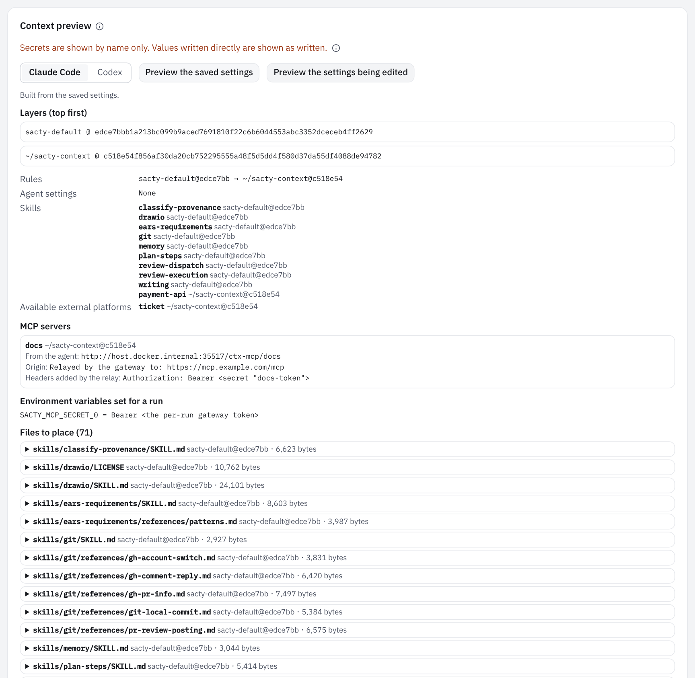

<!-- Code: apps/daemon/src/context-mcp.ts (ContextMcpServers), apps/daemon/src/context.ts (ContextManifest, McpServer, McpTimeouts, PlatformsFile, ImagesFile, composeContext, RESERVED_SETTINGS, RESERVED_FILES), apps/daemon/src/context-template.ts, apps/daemon/src/platforms.ts, packages/cli/src/index.ts (contextInit, contextPreview), packages/cli/src/context-preview.ts -->

[日本語](context.md) | **English**

# Context repository

A context repository is a repository that holds, in one place, the rules, skills, and other items passed to agents. You can put the following in it (see [Files to put in it](#files-to-put-in-it) for the contents of each file).

- Rules (what agents must follow) and skills (frequently used procedures)
- MCP servers
- External platforms (platforms that agents can call through their APIs)
- Settings for the agents (Claude Code and Codex)
- Agent images available only to that project

When you specify it in the project settings (optional), sacty layers the context repository on top of its default context and passes the result to step agents, information gathering, and the Orchestrator.

- The default context is the skills and other items that ship with sacty ([Default skills](#default-skills)). It is the top layer.
- The context repository is the layer below it. If it inherits from another context repository, the parent is layered in between ([sacty-context.yaml](#sacty-contextyaml)).
- When skills or MCP servers have the same name, the one in the layer below (the lower layer) overrides the one in the layer above (the upper layer) ([Files to put in it](#files-to-put-in-it)).

If you are creating one for the first time, follow these steps.

1. Create the template ([Creating the template](#creating-the-template)).
2. Write the rules, skills, MCP servers, and so on in the template's files ([Files to put in it](#files-to-put-in-it)).
3. Specify it in "Context repository" in the project settings ([Where to put it](#where-to-put-it)).
4. Check the layered result in "Context preview" ([Checking the composed result](#checking-the-composed-result)).

## Creating the template

The following command creates a template of a context repository.

```sh
npx sacty context init sacty-context   # create the template in the given directory (the current directory if omitted)
```

- This creates `README.md`, `rules.md`, `skills/README.md`, `mcp.yaml`, `platforms.yaml`, `sacty-context.yaml`, and `agents/codex/config.toml`.
- Each file contains an explanation of what to write there. As created, the files change nothing in the default context.
- If a file with the same name (or `rules/`) already exists, the command stops without overwriting it. To overwrite, add `--force`.

When you have written the files, specify them in "Context repository" in the project settings in the web UI ([Project settings](project-settings.en.md#context-repository), [Where to put it](#where-to-put-it)).

- To use them as a local directory, specify that directory as is (no commit is needed).
- To use them with a git URL, manage them with git, commit, and push, then specify that repository. Changes that are not pushed are not used.

## Where to put it

You can put the context in a git repository, in a local directory, or in a directory inside a monorepo. Depending on the location, fill in the "Context repository" fields in the project settings ("Repository", "Branch or tag", and "Directory") as follows.

| Location | "Repository" | "Branch or tag" | "Directory" | Contents used |
| --- | --- | --- | --- | --- |
| A git repository | A git URL (e.g. `git@github.com:acme/sacty-context.git`) | Optional (the default branch if empty) | Empty | The commit of that branch or tag |
| A local directory | An absolute path or a path starting with `~/` (e.g. `/Users/acme/sacty-context`) | Empty | Empty | The current contents of the directory |
| A commit of a local git repository | An absolute path or a path starting with `~/` | A branch or tag | Empty | The commit of that branch or tag |
| A directory inside a monorepo | Any of the other three rows | As in that row | A path relative to the repository root (e.g. `contexts/team`) | The contents of that directory |

The rules for each location are as follows.

- A local directory can be used even if it isn't managed with git or has uncommitted changes. sacty reads its contents at that moment on every run (`.git` is not read). The Activity records a hash of the contents instead of a commit.
- Write a local directory as an absolute path or a path starting with `~/`. A relative path (such as `./sacty-context`) points to a different place depending on the directory where the daemon was started, so it is not treated as a local directory.
- In a monorepo, the directory written in "Directory" takes the place of the root of the context repository. Put `rules.md`, `skills/`, `mcp.yaml`, and so on in that directory. Paths that point outside the repository (those containing `..`) and paths with a symbolic link along the way can't be used.

## Files to put in it

You can put the following files in a context repository. "How layers combine" is the rule for combining with the upper layers (the default context and the parents it inherits from).

| File | Contents | How layers combine |
| --- | --- | --- |
| `rules.md` (or `rules/*.md`) | Rules. Passed to Claude Code as CLAUDE.md and to Codex as AGENTS.md. If `rules.md` exists, `rules/` is not read | Concatenated in order from the upper layer |
| `skills/<name>/SKILL.md` | Skills. A directory without SKILL.md is a group (`skills/<group>/<name>/SKILL.md` is also the skill named `<name>`) | A lower layer overrides by name |
| `mcp.yaml` | MCP servers ([mcp.yaml](#mcpyaml)) | A lower layer overrides by name |
| `platforms.yaml` | External platforms available only to this project ([platforms.yaml](#platformsyaml)) | A lower layer overrides by name |
| `images.yaml` | Agent images available only to this project ([images.yaml](#imagesyaml)) | A lower layer overrides by name |
| `agents/codex/`, `agents/claude/` | Files copied into Codex's `CODEX_HOME` and Claude Code's `CLAUDE_CONFIG_DIR` | A lower layer overrides the same path. `config.toml` and `settings.json` are merged key by key |
| `sacty-context.yaml` | Inheritance, locking, and removal ([sacty-context.yaml](#sacty-contextyaml)) | |

- `README.md` is not passed to agents.
- Symbolic links cannot be used (sacty stops and shows the reason).

### Rules for agent settings

The settings you put in `agents/codex/` and `agents/claude/` follow these rules.

- `permissions.allow`, `deny`, and `ask` in `agents/claude/settings.json` are combined with the upper layers rather than replaced.
- Give Codex rules (`agents/codex/rules/*.rules`) a name other than `sacty.rules` so that they do not remove the default rules.
- The agent's `model` (sacty's default, or the override in `agents` of `config.yaml`) takes precedence over the model in the context repository's settings.

Items that sacty decides are not used even if you write them (a warning is recorded).

- `agents/codex/config.toml`: `mcp_servers`, `model_provider`, `model_providers`, `forced_login_method`, `forced_chatgpt_workspace_id`, `chatgpt_base_url`, `approval_policy`, `sandbox_mode`, `sandbox_workspace_write`, `profile`, `profiles`
- `agents/claude/settings.json`
  - `apiKeyHelper`, `awsAuthRefresh`, `awsCredentialExport`, `forceLoginMethod`, `forceLoginOrgUUID`
  - The authentication and endpoint variables in `env` (`ANTHROPIC_API_KEY`, `ANTHROPIC_BASE_URL`, `CLAUDE_CODE_OAUTH_TOKEN`, `AWS_BEARER_TOKEN_BEDROCK`, and so on)
  - Variables in `env` starting with `SACTY_`
- Files: Codex's `auth.json`, `AGENTS.md`, and `skills/`; Claude Code's `.credentials.json`, `.claude.json`, `CLAUDE.md`, `mcp.json`, and `skills/`

Tier subagent definitions are not used either, even if placed (not even when no tier can be used; a warning is recorded). This is because sacty generates them from the [agent tiers](config.en.md#agent-tiers).

- This covers `agents/claude/agents/<tier>.md`, `agents/codex/agents/<tier>.toml`, and `[agents.<tier>]` in Codex's `config.toml`. The tiers are `lite`, `entry`, `standard`, `advanced`, `expert`, and `ultimate`.
- A Codex `agents/*.toml` whose `name` inside is a tier is not used either, whatever its file name.

### Bringing items in with submodules

Skills and other items your organization manages in a separate repository can be placed as git submodules instead of copying them into the context repository. sacty fetches the submodules too when it fetches the context.

```sh
git submodule add git@github.com:acme/org-skills.git skills/org   # skills/org/<name>/SKILL.md becomes a skill
git commit -m "Bring in the organization's skills"
```

- sacty fetches the submodule commits that the context repository's commit points to. To use updates to the organization's skills, update the submodule and commit (for example, `git submodule update --remote skills/org`).
- In a monorepo, only the submodules related to the directory specified in "Directory" (those inside it and those containing it) are fetched.

Authentication for the submodule repositories depends on their URLs.

- If the context repository has an HTTPS URL and the submodule has an HTTPS URL on the same host (including a relative URL such as `../org-skills.git`), it is fetched with the GitHub account selected in the project.
- An SSH URL (such as `git@github.com:…` in the example) uses the host's SSH authentication.
- An HTTPS URL on another host uses the host's git authentication.

When local paths are involved, the following rules apply.

- A submodule pointing to a local path (such as `/Users/acme/org-skills`) can't be used in a context fetched with git. Specify a git URL.
- For a local directory without a branch or tag, sacty doesn't check out submodules. Run `git submodule update --init --recursive` in that directory to check them out beforehand. If a submodule isn't checked out, sacty stops and shows the reason.

## sacty-context.yaml

In `sacty-context.yaml`, you write the inheritance from a parent context repository, and the locking and removal of skills and other items.

```yaml
extends: git@github.com:acme/sacty-context.git#main   # parent (upper layer) context repository. Specify a ref with URL#ref (forms below)
locked:            # skills, MCP servers, external platforms, and images that lower layers cannot override or remove
  skills: [review]
  mcp: [docs]
  platforms: [ticket]
  images: [node-pw]
remove:            # remove skills, MCP servers, external platforms, and images inherited from upper layers
  skills: []
  mcp: []
  platforms: []
  images: []
```

| Item | Meaning |
| --- | --- |
| `extends` | The parent (upper layer) context repository ([How to write extends](#how-to-write-extends)) |
| `locked` | Items that lower layers cannot override or remove |
| `remove` | Items to remove from those inherited from upper layers |

In `locked` and `remove`, write the names of skills (`skills`), MCP servers (`mcp`), external platforms (`platforms`), and images (`images`).

For example, with the following inheritance, the layers are stacked on top of the default context, from the top down.


Locking and removal work like this.


If a lower layer tries to override or remove a locked item, sacty records a warning and uses the upper layer's item.

### How to write extends

Write one of the following in `extends`.

```yaml
extends: git@github.com:acme/sacty-context.git#main   # another repository (#ref is optional)
```

```yaml
extends: ../base   # a directory in the same repository (a path relative to this layer's directory)
```

```yaml
extends:           # a directory inside another repository (ref and path are optional)
  repo: git@github.com:acme/monorepo.git
  ref: main
  path: contexts/base
```

The following rules apply to what you can write.

- A relative path starting with `./` or `../` points inside the same branch or tag of the same repository (for a local directory, inside the same directory). Use it in a monorepo when a team's directory inherits a shared directory. It can't point outside the repository.
- Only a local path context without a branch or tag can write a local path (an absolute path or one starting with `~/`) in `extends`.
- In the `extends` of a context fetched with git (including a local git repository with a branch or tag), you can write the following.
  - Another repository: `https://`, `http://`, `ssh://`, and `git://` URLs, and the `git@example.com:acme/base.git` form
  - A relative path inside the same repository: one starting with `./` or `../`

  If it tries to inherit a local path, sacty stops and shows the reason (`file://` and relative paths such as `sibling/repo.git` also stop).
- Inheritance goes up to 10 layers. If the same repository, directory, and ref appear twice (a cycle), sacty stops and shows the reason.

## mcp.yaml

In `mcp.yaml`, you write the MCP servers passed to agents. Write each server in one of two forms: `url` (HTTP) or `command` (a command, over stdio).

```yaml
servers:
  docs:
    url: https://mcp.example.com/mcp
    headers:
      Authorization: { secret: docs-token, prefix: "Bearer " }
  local-tool:
    command: npx
    args: ["-y", "example-mcp-server"]
    env:
      API_TOKEN: { secret: op://Work/Tool/token }
```

| Item | Form | Meaning |
| --- | --- | --- |
| `url` | HTTP | The URL of the MCP server. Required |
| `headers` | HTTP | Headers sent to the MCP server |
| `command` | Command | The command to start. Required |
| `args` | Command | Arguments of the command |
| `env` | Command | Environment variables passed to the command |
| `via_gateway` | Both | Whether to use the server through sacty's gateway (default `true`; see [Where MCP servers run](#where-mcp-servers-run)) |
| `startup_timeout_sec`, `tool_timeout_sec` | Both | Limits for waiting for startup and for a tool call ([MCP server timeouts](#mcp-server-timeouts)) |

The rules for writing it are as follows.

- Server names can contain alphanumerics, `_`, and `-`.
- Do not write secret values. Write `{ secret: name }` instead (a Keychain name or a 1Password reference; `prefix` is put before the value).
- You cannot write `${` in strings (Claude Code expands it as an environment variable).

sacty fetches the secrets in `mcp.yaml` and `platforms.yaml` together with the other secrets when `sacty up` starts and when you save project settings. Ones added later are fetched when used ([Secrets](secrets.en.md#secrets-added-to-a-context-later)).

### Where MCP servers run

Both HTTP servers and `command` servers are used through sacty's gateway by default.

- The gateway relays `url` servers and starts `command` servers on the host ([HTTP MCP servers](#http-mcp-servers), [Command MCP servers (run on the host)](#command-mcp-servers-run-on-the-host)).
- Step agents receive only the gateway URL (`/ctx-mcp/<name>`) and a per-run token.
- It becomes an HTTP MCP server in both Claude Code's `mcp.json` and Codex's `config.toml`.

To run a server inside the container (for HTTP, connect directly from the container), write `via_gateway: false` for that server. That server is started and connected inside the container. sacty passes the secret values to the container as environment variables.

The following figure shows where MCP servers run.


If a server in `mcp.yaml` has the same name as one in `gateway.mcp_servers` in `config.yaml`, sacty uses the one in `gateway.mcp_servers` and records a warning in the Activity (the one in `mcp.yaml` is not started).

### HTTP MCP servers

By default, the gateway relays `url` servers.

- Secrets in authentication headers are fetched on the host, and the gateway adds them to requests to the upstream (the `url` server) (they are not passed to the container).
- The gateway sends upstream only the headers needed for MCP Streamable HTTP. Authentication and other headers added by the agent are not sent.
- Responses (SSE) are returned to the agent as they are.
- Redirects are not followed.

### Command MCP servers (run on the host)

By default, the gateway starts `command` servers on the host that runs sacty (the same mechanism as `gateway.mcp_servers`). Secrets in `env` are fetched on the host and set only when the server is started; they are not passed to the container.

```yaml
servers:
  issue-tracker:                 # started on the host (default)
    command: npx
    args: ["-y", "example-issue-mcp", "--config", "./mcp/issue.json"]
    env:
      API_TOKEN: { secret: op://Work/Issue/token }
  browser:                       # started inside the container
    command: npx
    args: ["-y", "@playwright/mcp"]
    via_gateway: false
```

Because the server starts on the host, its command and working directory are determined as follows.

- Command: looked up in the host's `PATH` (a command containing `/`, such as `./bin/server`, is looked up from the working directory).
  - If it is not found (`npx`, `uvx`, and so on are not installed on the host), the run still proceeds. In the notes of the "Context prepared" entry in the Activity, sacty records which command of which MCP server it is, and what to do (install it on the host, or write `via_gateway: false`).
  - sacty restarts the server every minute, so it becomes usable once you install the command on the host.
- Working directory: a copy of the repository of the layer that defines the server (under `SACTY_HOME/context-mcp/layers`; `.git` is not copied).
  - Relative paths in `args` and elsewhere are resolved from the root of that repository (not the container's workspace).
  - A server defined in a parent layer of the inheritance runs in a copy of the parent repository.

sacty starts and stops the servers as follows.

- Preparation: before a run, sacty waits for the servers that run uses to start (MCP initialization).
  - The limit is 120 seconds (or `startup_timeout_sec` if it is longer than that).
  - If a server is not ready, the run proceeds, and the notes of the "Context prepared" entry in the Activity record which MCP server it is (its name in `mcp.yaml`, the layer, and the project name). Exports of results to that server are not performed, and the reason is recorded.
- Isolation: servers are started per project and can be used only with the run tokens of that task's project (the same as platforms in `platforms.yaml`).
  - Runs of other projects cannot use them, even if they know the name.
  - Even with the same contents, different projects get separate processes.
- Reuse: within the same project, if the contents (name, `command`, `args`, `env`, timeouts, and the layer's repository and commit) are the same, the same process is used across runs (including concurrent runs). If the contents change (including when you push to the context repository and the commit changes), a new process is started for the next run.
- Stopping: sacty stops a server that no run uses any more (the layer copy is also deleted).
  - It stops the server immediately once new contents for the same project and the same name are used. Otherwise, it stops the server 30 minutes after it was last used.
  - Stopping `sacty up` stops all of them.
  - Servers left behind when the daemon crashed are cleaned up on the next start (using the same record as `gateway.mcp_servers`, `SACTY_HOME/host-mcp/processes`).

You can check how the servers behave in the following places.

- "Context preview" in the project settings shows the following.
  - The URL visible to agents (`/ctx-mcp/<name>`)
  - The command started on the host, `env` (only reference names for secrets), and the layer of the working directory
- Logs: lines like `[gateway] context MCP "<mcp.yaml name>" (project "<project name>" [<ID>], context "<layer>", internal ctx-…)` in the daemon log show the server's start, the reason it is not ready, and its stop. The `internal` name is the name inside the gateway and does not appear in the settings.

Servers used by every project, such as those that authenticate in a browser, can be written in `gateway.mcp_servers` in `config.yaml` ([Gateway](gateway.en.md#host-mcp-servers)).

### Trust assumptions

`command` servers run on the host that runs sacty, as the same user and with the same environment variables (`PATH`, `HOME`, and so on) as the daemon. In other words, anyone who can edit the context repository (including the parent repositories it inherits from) can run arbitrary commands on the host that runs sacty. sacty assumes that you trust the context repository as much as `config.yaml`, and it has no allowlist of commands and no human approval.

So keep the following in mind.

- Make sure only people who may edit `config.yaml` can change the context repository (and the parents in `extends`) (branch protection, required reviews, and so on).
- Run servers you do not want on the host inside the container with `via_gateway: false`.
- If the result of an MCP tool contains secrets, they are passed to the agent (sacty does not mask them).

### MCP server timeouts

For each server, you can write the following two limits (both optional, integers). If you omit them, the agent's defaults apply.

- `startup_timeout_sec`: the limit for waiting for startup (initialization and the tool list) (1 to 3600 seconds)
- `tool_timeout_sec`: the limit for waiting for a tool call (1 to 86400 seconds)

```yaml
servers:
  build-tool:
    command: npx
    args: ["-y", "example-build-mcp"]
    startup_timeout_sec: 60     # takes a while to start
    tool_timeout_sec: 900       # has tools that take 15 minutes
```

A whole agent run has a limit from its start. The default is 30 minutes from the start, and you can change it with `run_timeout` in `config.yaml` ([config.yaml settings](config.en.md#run-time-limit-run_timeout)). After that, sacty stops the container. Setting MCP timeouts longer than that has no effect, because the whole run stops first. If you set either startup or tool calls to that run's limit or more (by default, 30 minutes or more), sacty records a warning in the Activity when it prepares the context (it is not treated as a configuration error).

sacty passes the values you write to the agents (Codex and Claude Code) as follows.

- Codex: passed to `mcp_servers.<name>` in `config.toml` under the same names (`startup_timeout_sec`, `tool_timeout_sec`).
- Claude Code
  - Tool calls are passed as the per-server `timeout` in `mcp.json` (milliseconds; it takes precedence over the environment variable `MCP_TOOL_TIMEOUT`).
  - There is no per-server setting for the startup limit, so it becomes the global environment variable `MCP_TIMEOUT`. Its value is the largest of the values you wrote and, for servers where you wrote none, Claude Code's default (30 seconds). This is so that the wait for servers without a value is never made shorter than the default. So if there are servers without a value, values shorter than the default have no effect.
  - If no server has a value, `MCP_TIMEOUT` is not passed.

For servers used through the gateway, the gateway's relay does not cut off before the values you wrote.

- HTTP servers through the gateway: the gateway extends its limit for waiting on upstream (5 minutes by default) up to the larger of the values you wrote.
- `command` servers run on the host: as with `gateway.mcp_servers`, the gateway's relay (10 minutes by default for tool calls and 60 seconds for the list) does not cut off before the values you wrote.

You can write the same two settings in `gateway.mcp_servers` too ([Gateway](gateway.en.md#host-mcp-servers)).

## platforms.yaml

When each project needs different external platforms, write them in `platforms.yaml`.

```yaml
platforms:
  ticket:                                     # agents call it at $SACTY_PF_URL/ticket/…
    upstream: https://ticket.internal.example.com
    description: Ticket management
    auth:
      header: Authorization
      prefix: "Bearer "
      secret: op://Work/Ticket/token          # write secrets as a name or a 1Password reference (not the value)
    allow:
      - GET /api/v1/tickets/**
```

The items you can write are the same as `gateway.platforms` in `config.yaml` (`upstream`, `description`, `auth`, `allow`; see [Gateway](gateway.en.md#organization-platform-pf-apis)).

The platforms you write can be used only by that project.

- Step agents are told only about the platforms available to that task's project, through the list and descriptions of `$SACTY_PF_URL`. The available platforms are the host's platforms (those in `gateway.platforms` in `config.yaml`) and the platforms composed from that project's context.
- Platforms in a context can be used only with the run tokens of that project's tasks. Tasks of other projects cannot use them, even if they know the name (the gateway rejects them with 404).
- You can also choose a platform from the project's context as the connection for ticket intake and result export. sacty fetches the context to look for it only when the name is not among the host's platforms.

When another platform has the same name, the following decides which one is used.

- Layers combine the same way as `mcp.yaml`. A lower layer overrides by name, and `locked.platforms` and `remove.platforms` in `sacty-context.yaml` can lock and remove items (a warning is recorded when they apply).
- `gateway.platforms` in `config.yaml` is available to every project. If the same name exists, the one in `config.yaml` is used and a warning is recorded in the "Context prepared" entry of the Activity.

Only the host's gateway fetches and adds authentication values, at the time it uses them.

- They are not shown to agents or in context files, the Activity, logs, or the web UI.
- If authentication cannot be prepared, for example because a secret is not found, sacty returns an error to the agent that names the layer and the platform (502).
- For platforms written in a context repository, the host adds the secrets written there and sends them to the upstream and token endpoint written there. As with `mcp.yaml`, make sure only trusted people can change the context repository ([Trust assumptions](#trust-assumptions)).

You can check what you wrote as follows.

- "Available external platforms" in the project settings in the web UI shows the name, where each platform is defined, its description, and the APIs it allows (secret names and values are not shown). They are also shown in the "Context prepared" entry of the Activity.
- Format errors (no `allow`, both `secret` and `token` in `auth`, and so on) stop the step, showing which item (`platforms.<name>.…`) in which layer's `platforms.yaml` is wrong.

## images.yaml

When features or repositories need different tools (Playwright browsers, language tools, and so on), you can write the images this project uses in the context repository. Like `images` in each person's `config.yaml`, the Orchestrator can then choose them as the task image.

```yaml
images:
  node-pw:
    description: Node.js 26・Playwright（Chromium）。ブラウザでの動作確認ができる
    base_image: node:26-bookworm-slim
    env:
      PLAYWRIGHT_BROWSERS_PATH: /opt/ms-playwright   # where browsers are looked up when tasks run
    run:
      - npx -y playwright@1.61.1 install-deps chromium
      - PLAYWRIGHT_BROWSERS_PATH=/opt/ms-playwright npx -y playwright@1.61.1 install chromium
```

The format is the same as `images` in `config.yaml` ([Per-language images](images.en.md#per-language-images)). The following rules apply to names.

- You cannot write the name of the image to build (`image`). sacty decides the name `sacty-ctx-<mark>-<project>-<name>:<hash>` from the project and the content of the definition (`<mark>` is decided per `SACTY_HOME`).
- The name `default` cannot be used.

sacty builds the images as follows.

- sacty builds them in the background after you start it with `sacty up` ([Context images](images.en.md#context-images)). `sacty image build` does not build them.
- If `images` in `config.yaml` has the same name, sacty uses the one in `config.yaml` (it does not build the context one, and records a warning).
- The npm registry, authentication, and so on for building come from `image_build` in each person's `config.yaml`.

Keep the following in mind when you write it.

- `run` runs as root when the image is built. Make sure only people you trust as much as `config.yaml` can change the context repository ([Trust assumptions](#trust-assumptions)). It stays in the image, so do not write secrets in it.
- Playwright installs browsers into the cache location (`XDG_CACHE_HOME`) by default. When tasks run, `XDG_CACHE_HOME` points to a per-task location, so the browsers in the image are not found. As in the example, set `PLAYWRIGHT_BROWSERS_PATH` to the same location both in `env` and in the install command.

## Checking the composed result

You can check the result of layering the context repository on the default context (the composed result) in "Context preview" in the project settings (for both saved settings and settings being edited). Press "Preview the saved settings" to see the result like this.



The result shows the files placed in Claude Code's and Codex's configuration directories at run time, along with the layers, warnings, MCP endpoints, and so on. Only reference names are shown for secrets.

From the CLI, you can get the same output by querying the running sacty (`sacty up`) ([CLI](cli.en.md#sacty-context-preview)).

```sh
npx sacty context preview payments --runtime codex
```

When you save the project settings, sacty runs the same checks and tells you about errors in `mcp.yaml`, `platforms.yaml`, and so on (the settings are still saved).

## Default skills

The default context contains the following skills.

### Review skills

Before starting the reviewers, the default review skills run the formatting, lint, type check, tests, and other checks defined by the target repository in check mode, and share the results with the reviewers. If verification or CI has results, they also start a reviewer that analyzes the failures and warnings. The verification logs are saved outside the review's workspace, and the PR quotes only the parts needed for the comments.

### Writing skill

The default writing skill `writing` sets how agents write PR descriptions, review comments, and reports, and documents such as user guides and procedures.

- It changes how it writes by whether the reader knows the background of the matter.
  - Text for approving, deciding, or replying (PR descriptions, comments, requirements, designs, reports, and so on) is kept to what the reader needs, because the reader knows the background.
  - Documents read later (user guides, procedures, READMEs, and so on) start with what the document is and who it is for, order the sections the way the reader proceeds, and give what the reader does as numbered steps, because the reader does not know the background.
- It uses figures only where they convey a relationship such as structure or flow, and writes a list or a table where a figure cannot be shown. It limits screenshots to places where what to look at is hard to convey in words, and when it cannot capture a screen, it writes the screen's name and what to look at in words.
- In Japanese text, it adds a line break after each "。" and writes the line breaks in the way the destination (GitHub comments, Markdown files, Confluence, and so on) expects.
- It puts structured information in lists and tables.
- It does not translate English word for word, keeps loanwords established in katakana (such as エンドポイント for endpoint) as they are, and uses phrasing common in Japanese.
- When it asks you to confirm or decide something, it adds a short note on the concern if you do not.
- Requirements and designs start with the scope (what is in and out of scope).

If the target repository has writing rules (AGENTS.md, CONTRIBUTING, and so on), those take precedence.

### Requirements skill

The default requirements skill `ears-requirements` has the acceptance criteria of requirements written in the EARS (Easy Approach to Requirements Syntax) patterns. The Requirements step writes its acceptance criteria with this skill.

- Each requirement is one sentence in a fixed pattern such as `When <trigger>, the <system> shall <response>.` with an ID such as `R-1`.
- The acceptance criteria are listed under a heading per pattern (ubiquitous, event-driven, and so on), in a table with columns such as Trigger, System, and Response, one requirement per row.

If the target repository has rules for requirements, those take precedence.

### Plan-selection skill

The default plan-selection skill `plan-steps` sets how the Orchestrator chooses the plan of steps for a task. Before output, the Orchestrator checks the answer JSON with a tool such as `jq` and fixes it until the check passes. If the answer JSON is broken (such as a missing closing brace), the task stops even when the steps themselves were chosen. This check reduces such stops.

### Diagram skill

The default diagram skill `drawio` is draw.io's official skill. Agents use it when making diagrams (`.drawio`, including export to PNG, SVG, and PDF). Converting diagrams written in Mermaid and exporting them uses the draw.io CLI in the image ([Container images](images.en.md#the-drawio-cli)).

## Related pages

- [Gateway](gateway.en.md)
- [Project settings](project-settings.en.md)
