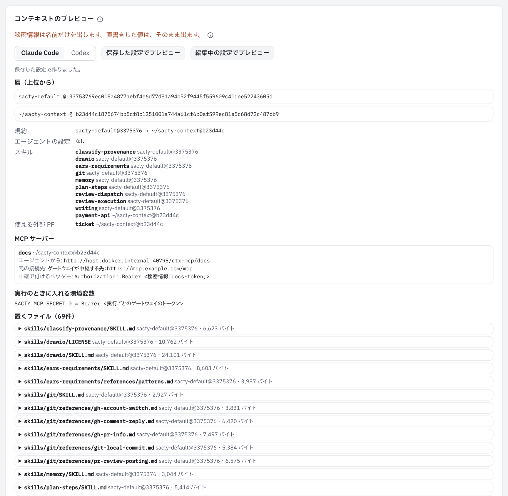

<!-- 対応するコード: apps/daemon/src/context-mcp.ts（ContextMcpServers）、apps/daemon/src/context.ts（ContextManifest・McpServer・McpTimeouts・PlatformsFile・ImagesFile・composeContext・RESERVED_SETTINGS・RESERVED_FILES）、apps/daemon/src/context-template.ts、apps/daemon/src/platforms.ts、packages/cli/src/index.ts（contextInit・contextPreview）、packages/cli/src/context-preview.ts -->

**日本語** | [English](context.en.md)

# コンテキストリポジトリ

コンテキストリポジトリは、エージェントに渡す規則やスキルなどを、まとめて置くリポジトリです。
次のものを置けます（ファイルごとの内容は [置くファイル](#置くファイル)）。

- 規則（エージェントに守らせること）と、スキル（よく使う手順）
- MCP サーバー
- 外部 PF（エージェントが API で呼べるプラットフォーム）
- エージェント（Claude Code・Codex）の設定
- そのプロジェクトだけで使えるエージェントのイメージ

プロジェクトの設定で指定すると（任意）、sacty は、既定のコンテキストの上にコンテキストリポジトリを重ねて、工程エージェント・情報収集・オーケストレーターに渡します。

- 既定のコンテキストは、sacty に入っているスキルなどです（[既定のスキル](#既定のスキル)）。
  これが、一番上の層になります。
- コンテキストリポジトリは、その下の層になります。
  ほかのコンテキストリポジトリを継承していれば、継承の親が、間の層として重なります（[sacty-context.yaml](#sacty-contextyaml)）。
- 同じ名前のスキルや MCP サーバーは、下の層（下位の層）のものが、上の層（上位の層）のものを上書きします（[置くファイル](#置くファイル)）。

はじめて作るときは、次の順に進めます。

1. 雛形を作ります（[雛形を作る](#雛形を作る)）。
2. 雛形のファイルに、規則・スキル・MCP サーバーなどを書きます（[置くファイル](#置くファイル)）。
3. プロジェクトの設定の「コンテキストリポジトリ」に指定します（[置き場所](#置き場所)）。
4. 重ねた結果を、「コンテキストのプレビュー」で確かめます（[合成の結果を確かめる](#合成の結果を確かめる)）。

## 雛形を作る

次のコマンドで、コンテキストリポジトリの雛形を作れます。

```sh
npx sacty context init sacty-context   # 指定したディレクトリ（省略すれば今のディレクトリ）に雛形を作る
```

- `README.md`・`rules.md`・`skills/README.md`・`mcp.yaml`・`platforms.yaml`・`sacty-context.yaml`・`agents/codex/config.toml` ができます。
- 各ファイルには、何を書く場所かの説明が入っています。
  そのままでは既定のコンテキストを何も変えません。
- 同じ名前のファイル（または `rules/`）がすでにあれば、上書きせずに止まります。
  上書きする場合は `--force` を付けてください。

ファイルを書いたら、画面のプロジェクトの設定の「コンテキストリポジトリ」に指定します（[プロジェクトの設定](project-settings.md#コンテキストリポジトリ)・[置き場所](#置き場所)）。

- ローカルのディレクトリとして使うときは、そのディレクトリをそのまま指定します（コミットは要りません）。
- git の URL で使うときは、git で管理してコミットし、push してから、そのリポジトリを指定します。
  push していない変更は使われません。

## 置き場所

コンテキストは、git のリポジトリにも、ローカルのディレクトリにも、モノレポの中のディレクトリにも置けます。
置き場所に合わせて、プロジェクトの設定の「コンテキストリポジトリ」の欄（「リポジトリ」「ブランチ・タグ」「ディレクトリ」）に、次のように書きます。

| 置き場所 | 「リポジトリ」 | 「ブランチ・タグ」 | 「ディレクトリ」 | 使う中身 |
| --- | --- | --- | --- | --- |
| git のリポジトリ | git の URL（例 `git@github.com:acme/sacty-context.git`） | 任意（空なら既定のブランチ） | 空 | そのブランチ・タグのコミット |
| ローカルのディレクトリ | 絶対パスか `~/` で始まるパス（例 `/Users/acme/sacty-context`） | 空 | 空 | ディレクトリの今の中身 |
| ローカルの git のリポジトリのコミット | 絶対パスか `~/` で始まるパス | ブランチ・タグ | 空 | そのブランチ・タグのコミット |
| モノレポの中のディレクトリ | ほかの3つの行のどれか | その行のとおり | リポジトリの根からの相対パス（例 `contexts/team`） | そのディレクトリの中身 |

置き場所ごとの決まりは、次のとおりです。

- ローカルのディレクトリは、git で管理していなくても、コミットしていない変更があっても使えます。
  sacty は、実行のたびに、その時点の中身を読みます（`.git` は読みません）。
  作業履歴には、コミットの代わりに中身のハッシュを残します。
- ローカルのディレクトリは、絶対パスか `~/` で始まるパスで書いてください。
  相対パス（`./sacty-context` など）は、デーモンを起動したディレクトリによって指す先が変わるため、ローカルのディレクトリとしては扱いません。
- モノレポでは、「ディレクトリ」に書いたディレクトリが、コンテキストリポジトリの根の代わりになります。
  そのディレクトリに `rules.md`・`skills/`・`mcp.yaml` などを置きます。
  リポジトリの外を指すパス（`..` を含むもの）や、途中にシンボリックリンクのあるパスは使えません。

## 置くファイル

コンテキストリポジトリに置けるファイルは、次のとおりです。
「重ね方」は、上位の層（既定のコンテキストと、継承の親）と重ねるときの決まりです。

| ファイル | 内容 | 重ね方 |
| --- | --- | --- |
| `rules.md`（または `rules/*.md`） | 規則。Claude Code には CLAUDE.md、Codex には AGENTS.md として渡す。`rules.md` があれば `rules/` は読まない | 上位の層から順に連結する |
| `skills/<名前>/SKILL.md` | スキル。SKILL.md の無いディレクトリはグループ（`skills/<グループ>/<名前>/SKILL.md` も名前 `<名前>` のスキル） | 名前ごとに下位が上書きする |
| `mcp.yaml` | MCP サーバー（[mcp.yaml](#mcpyaml)） | 名前ごとに下位が上書きする |
| `platforms.yaml` | このプロジェクトだけで使える外部 PF（[platforms.yaml](#platformsyaml)） | 名前ごとに下位が上書きする |
| `images.yaml` | このプロジェクトだけで使えるエージェントのイメージ（[images.yaml](#imagesyaml)） | 名前ごとに下位が上書きする |
| `agents/codex/`・`agents/claude/` | Codex の `CODEX_HOME`・Claude Code の `CLAUDE_CONFIG_DIR` に写すファイル | 同じパスは下位が上書きする。`config.toml`・`settings.json` はキーごとに重ねる |
| `sacty-context.yaml` | 継承と、上書き禁止・取り除き（[sacty-context.yaml](#sacty-contextyaml)） | |

- `README.md` はエージェントに渡しません。
- シンボリックリンクは使えません（理由を示して止まります）。

### エージェントの設定の決まり

`agents/codex/`・`agents/claude/` に置く設定には、次の決まりがあります。

- `agents/claude/settings.json` の `permissions.allow`・`deny`・`ask` は、置き換えずに上位の層と合わせます。
- Codex のルール（`agents/codex/rules/*.rules`）は、既定のルールを消さないように `sacty.rules` 以外の名前にしてください。
- モデルは、エージェントの `model`（sacty の既定か、`config.yaml` の `agents` の上書き）が、コンテキストリポジトリの設定より優先します。

sacty が決める項目は、書いても使いません（警告を残します）。

- `agents/codex/config.toml`：`mcp_servers`・`model_provider`・`model_providers`・`forced_login_method`・`forced_chatgpt_workspace_id`・`chatgpt_base_url`・`approval_policy`・`sandbox_mode`・`sandbox_workspace_write`・`profile`・`profiles`
- `agents/claude/settings.json`
  - `apiKeyHelper`・`awsAuthRefresh`・`awsCredentialExport`・`forceLoginMethod`・`forceLoginOrgUUID`
  - `env` の認証・接続先の変数（`ANTHROPIC_API_KEY`・`ANTHROPIC_BASE_URL`・`CLAUDE_CODE_OAUTH_TOKEN`・`AWS_BEARER_TOKEN_BEDROCK` など）
  - `env` の、`SACTY_` で始まる変数
- ファイル：Codex の `auth.json`・`AGENTS.md`・`skills/`、Claude Code の `.credentials.json`・`.claude.json`・`CLAUDE.md`・`mcp.json`・`skills/`

段階のサブエージェントの定義も、置いても使いません（使える段階が無くても使いません。警告を残します）。
[エージェントの段階](config.md#エージェントの段階)から、sacty が作るためです。

- 対象は `agents/claude/agents/<段階>.md`・`agents/codex/agents/<段階>.toml` と、Codex の `config.toml` の `[agents.<段階>]` です。
  段階は `lite`・`entry`・`standard`・`advanced`・`expert`・`ultimate` です。
- Codex の `agents/*.toml` は、ファイル名が違っても、中の `name` が段階なら使いません。

### サブモジュールで取り込む

組織で別のリポジトリに管理しているスキルなどは、コンテキストリポジトリに写さず、git のサブモジュールとして置けます。
sacty は、コンテキストを取得するときにサブモジュールも取得します。

```sh
git submodule add git@github.com:acme/org-skills.git skills/org   # skills/org/<名前>/SKILL.md がスキルになります
git commit -m "組織のスキルを取り込む"
```

- 取得するのは、コンテキストリポジトリのコミットが指すサブモジュールのコミットです。
  組織のスキルの更新を使うときは、サブモジュールを更新してコミットしてください（`git submodule update --remote skills/org` など）。
- モノレポでは、「ディレクトリ」に指定したディレクトリに関わるサブモジュール（その中にあるものと、そのディレクトリを含むもの）だけを取得します。

サブモジュールのリポジトリの認証は、URL によって決まります。

- コンテキストリポジトリが HTTPS の URL で、サブモジュールも同じホストの HTTPS の URL（`../org-skills.git` のような相対の URL を含みます）なら、プロジェクトで選んだ GitHub のアカウントで取得します。
- SSH の URL（例の `git@github.com:…` など）は、ホストの SSH の認証を使います。
- ほかのホストの HTTPS の URL は、ホストの git の認証を使います。

ローカルのパスが関わるときは、次の決まりがあります。

- ローカルのパスを指すサブモジュール（`/Users/acme/org-skills` など）は、git で取得したコンテキストでは使えません。
  git の URL を指定してください。
- ブランチ・タグを指定していないローカルのディレクトリでは、sacty はサブモジュールを取り込みません。
  そのディレクトリで `git submodule update --init --recursive` を実行して取り込んでおいてください。
  取り込んでいないサブモジュールがあれば、sacty は理由を示して止まります。

## sacty-context.yaml

`sacty-context.yaml` には、親のコンテキストリポジトリの継承と、スキルなどの上書き禁止・取り除きを書きます。

```yaml
extends: git@github.com:acme/sacty-context.git#main   # 親（上位の層）のコンテキストリポジトリ。URL#ref で ref を指定できる（書き方は下）
locked:            # 下位の層で上書き・取り除きできないスキル・MCP サーバー・外部 PF・イメージ
  skills: [review]
  mcp: [docs]
  platforms: [ticket]
  images: [node-pw]
remove:            # 上位の層から引き継いだスキル・MCP サーバー・外部 PF・イメージを取り除く
  skills: []
  mcp: []
  platforms: []
  images: []
```

| 項目 | 意味 |
| --- | --- |
| `extends` | 親（上位の層）のコンテキストリポジトリ（[extends の書き方](#extends-の書き方)） |
| `locked` | 下位の層で上書き・取り除きできないもの |
| `remove` | 上位の層から引き継いだもののうち、取り除くもの |

`locked`・`remove` には、スキル（`skills`）・MCP サーバー（`mcp`）・外部 PF（`platforms`）・イメージ（`images`）の名前を書きます。

例えば、次のように継承すると、既定のコンテキストの上に、上の層から順に重なります。


上書き禁止と取り除きは、次のように効きます。


上書き禁止の項目を下位で上書き・取り除きしようとしたときは、sacty は警告を残して上位のものを使います。

### extends の書き方

`extends` には、次のどれかを書きます。

```yaml
extends: git@github.com:acme/sacty-context.git#main   # ほかのリポジトリ（#ref は任意）
```

```yaml
extends: ../base   # 同じリポジトリの中のディレクトリ（この層のディレクトリから見た相対パス）
```

```yaml
extends:           # ほかのリポジトリの中のディレクトリ（ref・path は任意）
  repo: git@github.com:acme/monorepo.git
  ref: main
  path: contexts/base
```

書けるものには、次の決まりがあります。

- `./`・`../` で始まる相対パスは、同じリポジトリの同じブランチ・タグ（ローカルのディレクトリなら同じディレクトリ）の中を指します。
  モノレポの中で、チームごとのディレクトリが共通のディレクトリを継承するときに使います。
  リポジトリの外は指せません。
- ローカルのパス（絶対パスか `~/` で始まるもの）を `extends` に書けるのは、ブランチ・タグを指定していないローカルのパスのコンテキストだけです。
- git で取得したコンテキスト（ブランチ・タグを指定したローカルの git のリポジトリを含む）の `extends` には、次のものを書けます。
  - 別のリポジトリ：`https://`・`http://`・`ssh://`・`git://` の URL と、`git@example.com:acme/base.git` の形
  - 同じリポジトリの中の相対パス：`./`・`../` で始まるもの

  ローカルのパスを継承しようとしたら、理由を示して止まります（`file://` や `sibling/repo.git` のような相対パスも止まります）。
- 継承は10層までです。
  同じリポジトリ・ディレクトリ・ref が2度出てきたら（循環）、理由を示して止まります。

## mcp.yaml

`mcp.yaml` には、エージェントに渡す MCP サーバーを書きます。
サーバーは、`url`（HTTP）か `command`（コマンド。stdio）のどちらかの形で書きます。

```yaml
servers:
  docs:
    url: https://mcp.example.com/mcp
    headers:
      Authorization: { secret: docs-token, prefix: "Bearer " }
  local-tool:
    command: npx
    args: ["-y", "example-mcp-server"]
    env:
      API_TOKEN: { secret: op://Work/Tool/token }
```

| 項目 | 形 | 意味 |
| --- | --- | --- |
| `url` | HTTP | MCP サーバーの URL。必須 |
| `headers` | HTTP | MCP サーバーに送るヘッダー |
| `command` | コマンド | 起動するコマンド。必須 |
| `args` | コマンド | コマンドの引数 |
| `env` | コマンド | コマンドに渡す環境変数 |
| `via_gateway` | どちらも | sacty のゲートウェイ経由で使うか（既定 `true`。[MCP サーバーが動く場所](#mcp-サーバーが動く場所)） |
| `startup_timeout_sec`・`tool_timeout_sec` | どちらも | 起動・ツールの呼び出しを待つ上限（[MCP サーバーの時間切れ](#mcp-サーバーの時間切れ)） |

書くときの決まりは、次のとおりです。

- サーバーの名前に使えるのは、英数字・`_`・`-` です。
- 秘密情報は値を書かず、`{ secret: 名前 }`（キーチェーンの名前か 1Password の参照。`prefix` は値の前につける）で書きます。
- 文字列に `${` は書けません（Claude Code が環境変数として展開するため）。

sacty は、`mcp.yaml`・`platforms.yaml` の秘密情報を、`sacty up` の起動のときとプロジェクトの設定を保存したときに、ほかの秘密情報とまとめて取り出します。
後から足したものは、使うときに取り出します（[秘密情報](secrets.md#後からコンテキストに足した秘密情報)）。

### MCP サーバーが動く場所

HTTP のものも `command` のものも、既定で sacty のゲートウェイ経由で使います。

- `url` のサーバーはゲートウェイが中継し、`command` のサーバーはゲートウェイがホストで起動します（[HTTP の MCP サーバー](#http-の-mcp-サーバー)・[コマンドの MCP サーバー（ホストで動かす）](#コマンドの-mcp-サーバーホストで動かす)）。
- 工程エージェントには、ゲートウェイの URL（`/ctx-mcp/<名前>`）と、実行ごとのトークンだけを渡します。
- Claude Code の `mcp.json`・Codex の `config.toml` のどちらでも、HTTP の MCP になります。

コンテナの中で動かす（HTTP はコンテナから直接つなぐ）ときは、そのサーバーに `via_gateway: false` と書きます。
そのサーバーは、コンテナの中で起動・接続します。
sacty は、秘密情報の値を環境変数でコンテナに渡します。

MCP サーバーが動く場所は、次のとおりです。


`mcp.yaml` のサーバーが `config.yaml` の `gateway.mcp_servers` と同じ名前のときは、sacty は `gateway.mcp_servers` のものを使い、作業履歴に警告を残します（`mcp.yaml` のものは起動しません）。

### HTTP の MCP サーバー

`url` のサーバーは、既定で、ゲートウェイが中継します。

- 認証のヘッダーの秘密情報は、ホストで取り出して、ゲートウェイが上流（`url` のサーバー）に付けます（コンテナには渡しません）。
- ゲートウェイが上流に送るのは、MCP の Streamable HTTP に要るヘッダーだけです。
  エージェントが付けた認証などのヘッダーは送りません。
- 応答（SSE）は、そのままエージェントに返します。
- リダイレクトはたどりません。

### コマンドの MCP サーバー（ホストで動かす）

`command` のサーバーは、既定で、sacty を動かすホストでゲートウェイが起動します（`gateway.mcp_servers` と同じ仕組みです）。
`env` の秘密情報はホストで取り出して起動するときにだけ入れ、コンテナには渡しません。

```yaml
servers:
  issue-tracker:                 # ホストで起動する（既定）
    command: npx
    args: ["-y", "example-issue-mcp", "--config", "./mcp/issue.json"]
    env:
      API_TOKEN: { secret: op://Work/Issue/token }
  browser:                       # コンテナの中で起動する
    command: npx
    args: ["-y", "@playwright/mcp"]
    via_gateway: false
```

ホストで起動するので、コマンドと作業ディレクトリは、次のように決まります。

- コマンド：ホストの `PATH` から探します（`./bin/server` のように `/` を含むものは作業ディレクトリから探します）。
  - 見つからない（`npx`・`uvx` などをホストに入れていない）ときも、実行は続けます。
    sacty は、作業履歴の「コンテキストを用意」の注意に、どの MCP サーバーのどのコマンドかと、対処（ホストに入れるか、`via_gateway: false` と書く）を残します。
  - sacty が1分ごとに起動し直すので、ホストに入れれば使えるようになります。
- 作業ディレクトリ：そのサーバーを書いた層のリポジトリの写し（`SACTY_HOME/context-mcp/layers` の下。`.git` は写しません）です。
  - `args` などの相対パスは、そのリポジトリの直下から解決します（コンテナの作業領域ではありません）。
  - 継承の親の層に書いたサーバーは、親のリポジトリの写しで動きます。

sacty は、サーバーを次のように起動し、止めます。

- 準備：実行の前に、その実行が使うサーバーの起動（MCP の初期化）を待ちます。
  - 上限は120秒（`startup_timeout_sec` がそれより長ければ、その値）です。
  - 準備ができなければ、どの MCP サーバーか（`mcp.yaml` の名前・層・プロジェクトの名前）を作業履歴の「コンテキストを用意」の注意に残して実行します。
    そのサーバーへの成果の書き出しはせず、理由を残します。
- 分離：プロジェクトごとに起動し、そのタスクのプロジェクトの実行のトークンでだけ使えます（`platforms.yaml` の PF と同じです）。
  - ほかのプロジェクトの実行からは、名前を知っていても使えません。
  - 同じ中身でも、プロジェクトが違えば別のプロセスになります。
- 使い回し：同じプロジェクトで中身（名前・`command`・`args`・`env`・時間切れ・層のリポジトリと commit）が同じなら、実行をまたいで同じプロセスを使います（並行する実行も同じです）。
  中身が変われば（コンテキストリポジトリに push して commit が変わったときも）、次の実行で新しく起動します。
- 止める：使っている実行が無くなったものを止めます（層の写しも消します）。
  - 同じプロジェクト・同じ名前の新しい中身が使われたら、すぐに止めます。
    そうでなければ、最後に使ってから30分で止めます。
  - `sacty up` を止めると、すべて止めます。
  - デーモンが突然落ちて残ったものは、次の起動のときに片付けます（`gateway.mcp_servers` と同じ記録 `SACTY_HOME/host-mcp/processes` を使います）。

サーバーの動きは、次の所で確かめられます。

- プロジェクトの設定の「コンテキストのプレビュー」には、次のものが出ます。
  - エージェントから見える URL（`/ctx-mcp/<名前>`）
  - ホストで起動するコマンド・`env`（秘密情報は参照の名前だけ）・作業ディレクトリの層
- ログ：デーモンのログの `[gateway] context MCP "<mcp.yaml の名前>" (project "<プロジェクトの名前>" [<ID>], context "<層>", internal ctx-…)` の行が、そのサーバーの起動・準備できない理由・停止を表します。
  `internal` の名前はゲートウェイの中の名前で、設定には出てきません。

ブラウザで認証するものなど、すべてのプロジェクトで使うものは、`config.yaml` の `gateway.mcp_servers` に書けます（[ゲートウェイ](gateway.md#ホストで動かす-mcp-サーバー)）。

### 信頼の前提

`command` のサーバーは、sacty を動かすホストで、デーモンと同じ利用者・同じ環境変数（`PATH`・`HOME` など）で動きます。
つまり、コンテキストリポジトリ（継承する親のリポジトリも含む）を編集できる人は、sacty を動かすホストで任意のコマンドを動かせます。
sacty は、コンテキストリポジトリを `config.yaml` と同じくらい信頼する前提で動き、許可するコマンドの一覧や、人の承認は設けません。

そのため、次の点に注意してください。

- コンテキストリポジトリ（と `extends` の親）は、`config.yaml` を編集してよい人だけが変更できるようにしてください（ブランチの保護・レビューの必須など）。
- ホストで動かしたくないサーバーは、`via_gateway: false` でコンテナの中で動かしてください。
- MCP のツールの結果に秘密情報が含まれると、エージェントに渡ります（sacty は伏せません）。

### MCP サーバーの時間切れ

各サーバーには、次の2つの上限を書けます（どちらも任意。整数）。
書かなければ、エージェントの既定のままです。

- `startup_timeout_sec`：起動（初期化とツールの一覧）を待つ上限（1〜3600 秒）
- `tool_timeout_sec`：ツールの呼び出しを待つ上限（1〜86400 秒）

```yaml
servers:
  build-tool:
    command: npx
    args: ["-y", "example-build-mcp"]
    startup_timeout_sec: 60     # 起動に時間がかかる
    tool_timeout_sec: 900       # 15分かかるツールがある
```

エージェントの実行全体には、開始からの上限があります。
既定は開始から30分で、`config.yaml` の `run_timeout` で変えられます（[config.yaml の設定](config.md#実行の上限run_timeout)）。
上限を過ぎると、sacty はコンテナを止めます。
MCP の時間切れをそれ以上にしても、実行全体が先に止まるので意味がありません。
起動・ツールの呼び出しのどちらかをその実行の上限以上（既定ではどちらかを30分以上）にしたときは、sacty は、コンテキストを用意するときに警告を作業履歴に残します（設定の誤りにはしません）。

sacty は、書いた値を、エージェント（Codex・Claude Code）に次のように渡します。

- Codex：`config.toml` の `mcp_servers.<名前>` に、同じ名前（`startup_timeout_sec`・`tool_timeout_sec`）で渡します。
- Claude Code
  - ツールの呼び出しは、`mcp.json` のサーバーごとの `timeout`（ミリ秒。環境変数 `MCP_TOOL_TIMEOUT` より優先されます）で渡します。
  - 起動を待つ上限はサーバーごとに渡す設定が無いため、全体の環境変数 `MCP_TIMEOUT` にします。
    値は、書いたサーバーの値と、書いていないサーバーの Claude Code の既定（30秒）のうち、最も大きいものです。
    書いていないサーバーの待ち時間を既定より短くしないためです。
    そのため、書いていないサーバーがあるときは、既定より短い値は効きません。
  - どれにも書かなければ `MCP_TIMEOUT` は渡しません。

ゲートウェイ経由のサーバーでは、ゲートウェイの中継が、書いた値より先に切れないようにします。

- ゲートウェイ経由の HTTP のサーバー：ゲートウェイが上流を待つ上限（既定は5分）を、書いた値の大きい方まで延ばします。
- ホストで動かす `command` のサーバー：`gateway.mcp_servers` と同じく、ゲートウェイの中継（ツールの呼び出しは既定で10分、一覧は既定で60秒）を、書いた値より先に切りません。

`gateway.mcp_servers` にも同じ2つを書けます（[ゲートウェイ](gateway.md#ホストで動かす-mcp-サーバー)）。

## platforms.yaml

プロジェクトごとに使いたい外部 PF が違うときは、`platforms.yaml` に書きます。

```yaml
platforms:
  ticket:                                     # エージェントは $SACTY_PF_URL/ticket/… で呼ぶ
    upstream: https://ticket.internal.example.com
    description: チケット管理
    auth:
      header: Authorization
      prefix: "Bearer "
      secret: op://Work/Ticket/token          # 秘密情報は名前か 1Password の参照で書く（値は書かない）
    allow:
      - GET /api/v1/tickets/**
```

書ける項目は `config.yaml` の `gateway.platforms` と同じです（`upstream`・`description`・`auth`・`allow`。[ゲートウェイ](gateway.md#組織内-pf-の-api)）。

書いた PF は、そのプロジェクトだけで使えます。

- 工程エージェントには、そのタスクのプロジェクトで使える PF だけを、`$SACTY_PF_URL` の一覧と説明で伝えます。
  使える PF は、ホストの PF（`config.yaml` の `gateway.platforms` の PF）と、そのプロジェクトのコンテキストで合成した PF です。
- コンテキストの PF は、そのプロジェクトのタスクの実行のトークンでだけ使えます。
  ほかのプロジェクトのタスクからは、名前を知っていても使えません（ゲートウェイが 404 で拒否します）。
- チケットの取り込み・成果の書き出しの接続先にも、プロジェクトのコンテキストの PF を選べます。
  sacty は、ホストの PF に無い名前のときだけ、コンテキストを取得して探します。

同じ名前の PF がほかにあるときは、次のように決まります。

- 層の合成は `mcp.yaml` と同じです。
  名前ごとに下位の層が上書きし、`sacty-context.yaml` の `locked.platforms`・`remove.platforms` で上書き禁止・取り除きができます（当たったときは警告を残します）。
- `config.yaml` の `gateway.platforms` は、すべてのプロジェクトで使えます。
  同じ名前があれば `config.yaml` のものを使い、作業履歴の「コンテキストを用意」に警告を残します。

認証の値は、ホストのゲートウェイだけが、使うときに取り出して付けます。

- エージェント・コンテキストのファイル・作業履歴・ログ・画面には出しません。
- 秘密情報が見つからないなど、認証を用意できなければ、どの層のどの PF かを添えてエージェントに返します（502）。
- コンテキストリポジトリに書いた PF では、書いた秘密情報を、書いた転送先・トークンの窓口に、ホストが付けて送ります。
  `mcp.yaml` と同じく、コンテキストリポジトリは信頼できる人だけが変えられるようにしてください（[信頼の前提](#信頼の前提)）。

書いた内容は、次のように確かめられます。

- プロジェクトの設定の画面の「使える外部 PF」に、名前・どこで定義したか・説明・使える API を出します（秘密情報の名前・値は出しません）。
  作業履歴の「コンテキストを用意」にも出します。
- 形の誤り（`allow` が無い・`auth` に `secret` と `token` の両方を書いたなど）は、どの層の `platforms.yaml` のどの項目（`platforms.<名前>.…`）かを示して工程を止めます。

## images.yaml

機能やリポジトリごとに要るツールが違うとき（Playwright のブラウザ、言語のツールなど）は、そのプロジェクトで使うイメージをコンテキストリポジトリに書けます。
各自の `config.yaml` の `images` と同じように、オーケストレーターがタスクのイメージとして選べるようになります。

```yaml
images:
  node-pw:
    description: Node.js 26・Playwright（Chromium）。ブラウザでの動作確認ができる
    base_image: node:26-bookworm-slim
    env:
      PLAYWRIGHT_BROWSERS_PATH: /opt/ms-playwright   # タスクの実行のときにブラウザを探す場所
    run:
      - npx -y playwright@1.61.1 install-deps chromium
      - PLAYWRIGHT_BROWSERS_PATH=/opt/ms-playwright npx -y playwright@1.61.1 install chromium
```

書き方は、`config.yaml` の `images` と同じです（[言語ごとのイメージ](images.md#言語ごとのイメージ)）。
名前には、次の決まりがあります。

- 作るイメージの名前（`image`）は書けません。
  sacty が、プロジェクトと定義の中身から `sacty-ctx-<印>-<プロジェクト>-<名前>:<ハッシュ>` という名前を決めます（`<印>` は `SACTY_HOME` ごとに決まります）。
- `default` という名前は使えません。

イメージは、sacty が次のように作ります。

- `sacty up` で起動した後に、sacty が裏で作ります（[コンテキストのイメージ](images.md#コンテキストのイメージ)）。
  `sacty image build` では作りません。
- `config.yaml` の `images` に同じ名前があれば、`config.yaml` のものを使います（コンテキストのものは作らず、警告を残します）。
- 作るときの npm のレジストリ・認証などは、各自の `config.yaml` の `image_build` を使います。

書くときは、次の点に注意してください。

- `run` はイメージを作るときに root で実行されます。
  コンテキストリポジトリは、`config.yaml` と同じくらい信頼できる人だけが変更できるようにしてください（[信頼の前提](#信頼の前提)）。
  イメージに残るので、秘密情報は書かないでください。
- Playwright のブラウザは、既定ではキャッシュの場所（`XDG_CACHE_HOME`）に入ります。
  タスクの実行のときは `XDG_CACHE_HOME` がタスクごとの場所に変わるので、イメージに入れたブラウザが見つかりません。
  例のように、`env` とインストールのコマンドの両方で、`PLAYWRIGHT_BROWSERS_PATH` を同じ場所にしてください。

## 合成の結果を確かめる

既定のコンテキストとコンテキストリポジトリを重ねた結果（合成の結果）は、プロジェクトの設定の「コンテキストのプレビュー」で確かめられます（保存した設定でも、編集中の設定でも）。
「保存した設定でプレビュー」を押すと、次のように結果が出ます。



結果には、実行のときに Claude Code・Codex の設定のディレクトリに置くファイルと、層・警告・MCP の接続先などが出ます。
秘密情報は参照の名前だけを出します。

CLI からは、起動中の sacty（`sacty up`）に問い合わせて同じものを出せます（[CLI](cli.md#sacty-context-preview)）。

```sh
npx sacty context preview 決済 --runtime codex
```

プロジェクトの設定を保存するときも、sacty は同じ検査をし、`mcp.yaml`・`platforms.yaml` などに誤りがあれば知らせます（保存はします）。

## 既定のスキル

既定のコンテキストには、次のスキルが入っています。

### レビュー用スキル

既定のレビュー用スキルは、レビューの担当を起動する前に、対象のリポジトリで定められたフォーマット・lint・型チェック・テストなどを確認モードで実行し、結果を担当に共有します。
検証や CI に結果があれば、その失敗や警告を分析する担当も起動します。
検証のログはレビューの作業領域の外に保存し、PR には指摘に必要な箇所だけを引用します。

### 文章用スキル

既定の文章用スキル `writing` は、エージェントが PR の本文・レビューのコメント・報告や、ユーザーガイド・手順書などの文書を書くときの書き方を決めます。

- 読む人がその件の前提を知っているかで、書き方を変えます。
  - 承認・判断・返信のための文章（PR の本文・コメント・要求要件・設計・報告など）は、読む人が前提を知っているので、情報を絞ります。
  - 後から読まれる文書（ユーザーガイド・手順書・README など）は、読む人が前提を知らないので、最初に何の文書か・誰のためかを書き、読む人が進む順に節を並べ、することを番号付きの手順で書きます。
- 図は、構成や流れのような関係を伝える所だけに使い、図を表示できない所では、箇条書きか表で書きます。
  スクリーンショットは、見る所が言葉で伝わりにくい所に絞り、撮れないときは、画面の名前と見る所を言葉で書きます。
- 日本語の文章では「。」の後で改行し、改行の書き方は書き出し先（GitHub のコメント、Markdown のファイル、Confluence など）に合わせます。
- 構造のある情報は箇条書きと表にします。
- 英語を直訳せず、カタカナで定着した語（エンドポイントなど）はそのまま使い、日本語で一般的な言い回しで書きます。
- あなたに確認・判断を求めるときは、確認しないで進めた場合の懸念を短く添えます。
- 要求要件・設計は、スコープ（対象と対象外）を最初に書きます。

対象のリポジトリに文章の決まり（AGENTS.md・CONTRIBUTING など）があれば、そちらを優先します。

### 要求要件用スキル

既定の要求要件用スキル `ears-requirements` は、要求要件の受け入れ条件を EARS（Easy Approach to Requirements Syntax）の文型で書かせます。
要求要件の工程は、このスキルに従って受け入れ条件を書きます。

- `<きっかけ>とき、<システム>は、<応答>しなければならない。`のような決まった文型で、1文に1つの要求を書き、`R-1` などの ID を付けます。
- 受け入れ条件は、文型ごとの見出し（常時・イベント駆動など）の下に、トリガー・システム・応答などの列の表で、1行に1つの要求として並びます。

対象のリポジトリに要求要件の決まりがあれば、そちらを優先します。

### 工程の選択用スキル

既定の工程の選択用スキル `plan-steps` は、オーケストレーターがタスクの工程の組み合わせを選ぶ手順を決めます。
オーケストレーターは、答えの JSON を出す前に `jq` などの道具で検査し、通るまで直します。
答えの JSON が壊れていると（閉じ括弧の欠けなど）、工程を選べていてもタスクが止まります。
この検査は、そうした止まり方を減らします。

### 図用スキル

既定の図用スキル `drawio` は、draw.io の公式のスキルです。
エージェントが図（`.drawio`。PNG・SVG・PDF への書き出しを含む）を作るときに使います。
Mermaid で書いた図の変換と書き出しには、イメージの draw.io の CLI（[コンテナイメージ](images.md#drawio-の-cli)）を使います。

### サービス用スキル

各工程には、サービスを起動しない場合も生成された `docker-services` スキルを渡します。
サービスの起動・接続ではこのスキルを先に読みます。
層の同名のスキルは使わず、`context.reservedSkill` の注意を出します。
工程の指示にも先に読むよう書きます。

## 関係するページ

- [ゲートウェイ](gateway.md)
- [プロジェクトの設定](project-settings.md)
