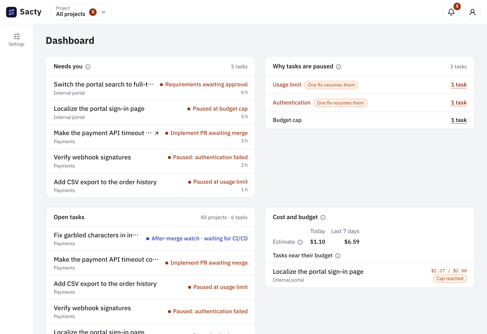

<!-- Code: apps/web/src/components/dashboard.tsx, apps/web/src/lib/dashboard-data.ts, apps/web/src/lib/notification-problems.ts, apps/web/src/i18n/messages/dashboard.ts, packages/core/src/dashboard.ts, apps/daemon/src/service.ts -->

[日本語](dashboard.md) | **English**

# Reading the dashboard

The dashboard (`/dashboard`) shows, across all projects, what needs you, how the factory is doing, the cost, and the quality in one place. You can act here before opening individual tasks. While it is open, it updates to the latest state without reloading the screen ([Working with tasks](tasks.en.md)).

Hover over or tap the mark (i) next to a heading to see what the numbers mean and where the periods start.

The dashboard looks like this.

## Sections

| Section | What it shows | When empty |
| --- | --- | --- |
| Needs you | Tasks awaiting approval, paused, or escalated, longest wait first. Press a title to go to the screen where you decide. If the task is awaiting approval and the PR of the current submission is open, the title opens the PR on GitHub in a new tab instead (the title has a "↗"). When the implementation PR conflicts with the base branch, the status says so ([When the base branch moves ahead](tasks.en.md#when-the-base-branch-moves-ahead)) | "Nothing needs you right now." |
| Why tasks are paused | Paused tasks counted by reason. Press a row to expand that reason's tasks inside the section. Usage limit and authentication are highlighted because one fix usually resumes all of them | "No tasks are paused." |
| Open tasks | All tasks except completed and cancelled ones. With more than 5 tasks, the section scrolls inside | "There are no open tasks." |
| Cost and budget | The cost for today and the last 7 days, as an estimate. Also the tasks that used 80% or more of their budget or reached the cap | "No task is near its budget." |
| Step queue | The number of running tasks against the parallel limit, and the number of tasks waiting to run. When more tasks than the limit have been waiting for 10 minutes, it is highlighted with a link to the Sacty settings | 0 |
| Intake | For issues, PR reviews, and tickets: the time of the last intake, how many tasks it created, and what could not be imported. "Run intake now" is also here | That intake is not set or cannot be read, with a link to the Sacty settings |
| Throughput | Completed and cancelled counts for the last 7 and 30 days, and the median time from creation to completion | 0 and "—" |
| Quality signals | For the last 30 days: changes requested by a person, rework from PR feedback, goal guardian misses, integration review failures, fix tasks from the post-merge watch, and rework counted by step. Rework whose cause was not chosen is shown as "Rework with unknown cause" under the misses, because it is not known whether it was a miss. Rework that is not a miss (a new request or change of direction, or a conflict from base changes) is not counted as a miss and is shown by cause | 0 times |
| Audit | Per project, the causes, recurred and needing-decision counts and the adoption rate, and, per week, the changes requested and PR remarks per task. Press a project name to open its audit page ([Audits](audit.en.md)). The card is hidden when the audit data cannot be read | "No audit results yet." |

Sections sit side by side when there is room and stack otherwise. The same sections appear at phone width.

## When Slack notifications could not be sent

If a Slack notification could not be sent, a warning appears above the sections. The warning shows why it could not be sent and the link "Check Slack notifications in Sacty settings". The link takes you to the Sacty settings, where you can check the Slack notification settings. The warning goes away once a notification is sent (see [Notifications](notifications.en.md)).

## Periods and counting

- "Today", "last 7 days", and "last 30 days" are split by the date of the machine running sacty. The UI language does not affect them. The last 7 and 30 days include today.
- Cost
  - It includes completed and cancelled tasks.
  - It is an estimate that Sacty calculates from usage and prices (including converted values such as subscriptions).
  - It may differ from what you are actually billed. Sacty does not handle actual billed amounts.
- The waiting time counts from the record that made the task await approval, pause, or escalate.
- Tasks of deleted projects are neither shown nor counted in any section.
- When the daemon cannot be reached
  - If it cannot be reached when you open the page, the page shows the error instead of the sections. The sections appear once it can be reached.
  - If it becomes unreachable after the sections were shown, they keep what was last fetched and a notice above them says updates are paused. Even though the sections are visible, their numbers are not current during that time. Updates resume once it can be reached.

## Related pages

- [Getting started](getting-started.en.md)
- [Working with tasks](tasks.en.md)
- [Intake of issues, PRs, and tickets](intake.en.md)
- [Notifications](notifications.en.md)
- [config.yaml settings](config.en.md)
