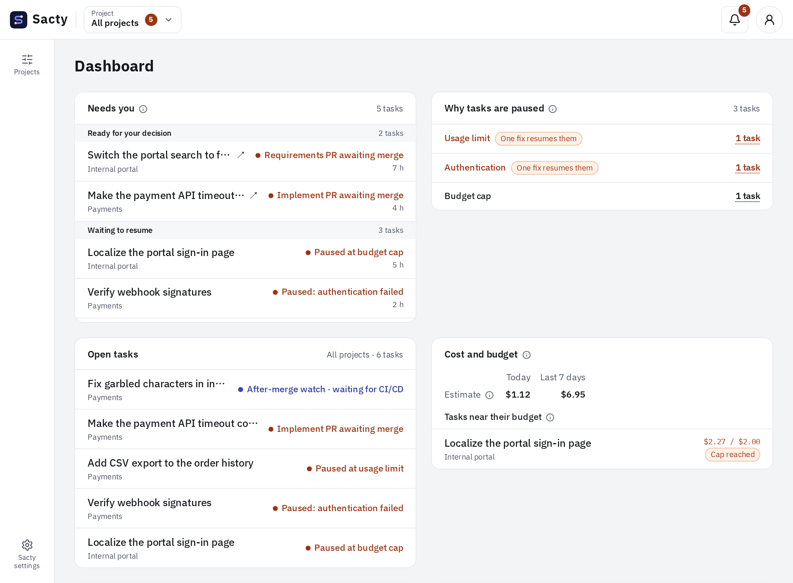

<!-- Code: apps/web/src/components/dashboard.tsx, apps/web/src/lib/dashboard-data.ts, apps/web/src/lib/notification-problems.ts, apps/web/src/i18n/messages/dashboard.ts, packages/core/src/dashboard.ts, apps/daemon/src/service.ts -->

[日本語](dashboard.md) | **English**

# Reading the dashboard

The dashboard (`/dashboard`) shows, across all projects, what needs you, how the factory is doing, the cost, and the quality in one place. You can act here before opening individual tasks. While it is open, it updates to the latest state without reloading the screen ([Working with tasks](tasks.en.md)).

The dashboard looks like this.

The image shows the first four sections. "Needs you" is at the top left, "Why tasks are paused" at the top right, "Open tasks" at the bottom left, and "Cost and budget" at the bottom right. The remaining sections continue below them on the screen.

Hover over or tap the mark (i) next to a heading to see what the numbers mean and where the periods start.

## Sections

The dashboard shows the following sections in the order of the table. The first four are the ones in the image. Each section name links to its explanation.

| Section | What it shows | When empty |
| --- | --- | --- |
| [Needs you](#needs-you) | Tasks awaiting approval, escalated, or paused | "Nothing needs you right now." |
| [Why tasks are paused](#why-tasks-are-paused) | Paused tasks counted by reason | "No tasks are paused." |
| [Open tasks](#open-tasks) | All tasks except completed and cancelled ones | "There are no open tasks." |
| [Cost and budget](#cost-and-budget) | The cost for today and the last 7 days (an estimate), and the tasks near their budget | "No task is near its budget." |
| [Step queue](#step-queue) | The number of running tasks against the parallel limit, and the number of tasks waiting to run | 0 |
| [Intake](#intake) | For issues, PR reviews, and tickets: the result of the last intake | That intake is not set or cannot be read, with a link to the Sacty settings |
| [Throughput](#throughput) | Completed and cancelled counts for the last 7 and 30 days, and the median time from creation to completion | 0 and "—" |
| [Quality signals](#quality-signals) | Counts such as rework for the last 30 days | 0 times |
| [Audit](#audit) | Audit counts per project, and, per week, the changes requested and PR remarks per task | "No audit results yet." |

Sections sit side by side when there is room and stack otherwise. The same sections appear at phone width.

### Needs you

This section shows the tasks that wait for a person, in two groups. The upper group, "Ready for your decision", holds tasks that move on once you decide (awaiting approval, escalated). The lower group, "Waiting to resume", holds tasks that stay stopped (paused, whatever the reason). Each group has a heading with a count, and a group with no tasks is not shown. Within a group, the longest wait comes first (by ID when equal). Because the upper group comes first, the tasks you can move forward right now are visible without scrolling, however many paused tasks there are. Each row shows the task title, the project name, the status, and the waiting time (in the image, the project name is under the title, and the status and the waiting time are on the right).

- Press a title to go to the screen where you decide.
- If the task is awaiting approval and the PR of the current submission is open, pressing the title opens the PR on GitHub in a new tab instead (the title has a "↗").
- If the task is awaiting approval and sacty's AI review is reviewing the current head of that PR, the status is followed by " · AI review in progress". The group and the order do not change, and you can still approve and merge.
- When the implementation PR conflicts with the base branch, the status says so ([When the base branch moves ahead](tasks.en.md#when-the-base-branch-moves-ahead)).

### Why tasks are paused

This section shows paused tasks counted by reason.

- Press a row to expand that reason's tasks inside the section.
- Usage limit and authentication are highlighted because one fix usually resumes all of them (in the image, they have the "One fix resumes them" mark).

### Open tasks

This section shows all tasks except completed and cancelled ones. Tasks that watch the PR for changes after posting a review ("Waiting on the PR"; [After the review is posted](intake.en.md#after-the-review-is-posted)) appear here too (not in "Needs you"). With more than 5 tasks, the section scrolls inside.

### Cost and budget

This section shows the cost for today and the last 7 days, as an estimate. "Tasks near their budget" shows the tasks that used 80% or more of their budget or reached the cap. For how cost is counted, see [Periods and counting](#periods-and-counting).

### Step queue

This section shows the number of running tasks against the parallel limit, and the number of tasks waiting to run. A task being processed before its first step starts (preparing the repository, gathering information, and so on) is counted as running too ([Status before the first step starts](tasks.en.md#status-before-the-first-step-starts)). When more tasks than the limit have been waiting for 10 minutes, it is highlighted with a link to the Sacty settings.

### Intake

For issues, PR reviews, and tickets, this section shows the time of the last intake, how many tasks it created, and what could not be imported. "Import now" is also here.

### Throughput

This section shows completed and cancelled counts for the last 7 and 30 days, and the median time from creation to completion.
A PR review task is counted as completed at the time its verdict became "no findings" or its PR was merged or closed (posting a review alone does not count; [After the review is posted](intake.en.md#after-the-review-is-posted)). Review tasks completed in an earlier version keep the time their review was posted.

### Quality signals

This section shows the following counts for the last 30 days.

- Changes requested by a person
- Rework from PR feedback
- Rework from AI review (times sacty's own review remarks alone sent a step back; not counted as changes requested by a person)
- Misses after a pass (rework of a deliverable that had passed)
- Integration review failures
- Fix tasks from the post-merge watch
- Rework counted by step

The following kinds of rework are shown apart from the misses.

- Rework whose cause was not chosen is shown as "Rework with unknown cause" under the misses, because it is not known whether it was a miss.
- Rework that is not a miss (a new request or change of direction, an answer to a question, or a conflict from base changes) is not counted as a miss and is shown by cause.

### Audit

From the audit results, this section shows the following two things.

- Per project, the causes, recurred and needing-decision counts, and the adoption rate of proposals
- Per week, the changes requested and PR remarks per task

Press a project name to open its audit page ([Audits](audit.en.md)). The section is hidden when the audit data cannot be read.

## When Slack notifications could not be sent

If a Slack notification could not be sent, a warning appears above the sections. The warning shows why it could not be sent and the link "Check Slack notifications in Sacty settings". The link takes you to the Sacty settings, where you can check the Slack notification settings. The warning goes away once a notification is sent (see [Notifications](notifications.en.md)).

## Periods and counting

- "Today", "last 7 days", and "last 30 days" are split by the date of the machine running sacty. The UI language does not affect them. The last 7 and 30 days include today.
- Cost is counted as follows.
  - It includes completed and cancelled tasks.
  - It is an estimate that sacty calculates from usage and prices (including converted values such as subscriptions).
  - It may differ from what you are actually billed. sacty does not handle actual billed amounts.
- The waiting time counts from the record that made the task await approval, pause, or escalate.
- Tasks of deleted projects are neither shown nor counted in any section.

## When the daemon cannot be reached

When the dashboard cannot reach the daemon, it shows the following.

- If it cannot be reached when you open the page, the page shows the error instead of the sections. The sections appear once it can be reached.
- If it becomes unreachable after the sections were shown, they keep what was last fetched and a notice above them says updates are paused. Even though the sections are visible, their numbers are not current during that time. Updates resume once it can be reached.

## Related pages

- [Getting started](getting-started.en.md)
- [Working with tasks](tasks.en.md)
- [Issue, PR, and ticket intake](intake.en.md)
- [Notifications](notifications.en.md)
- [config.yaml settings](config.en.md)
