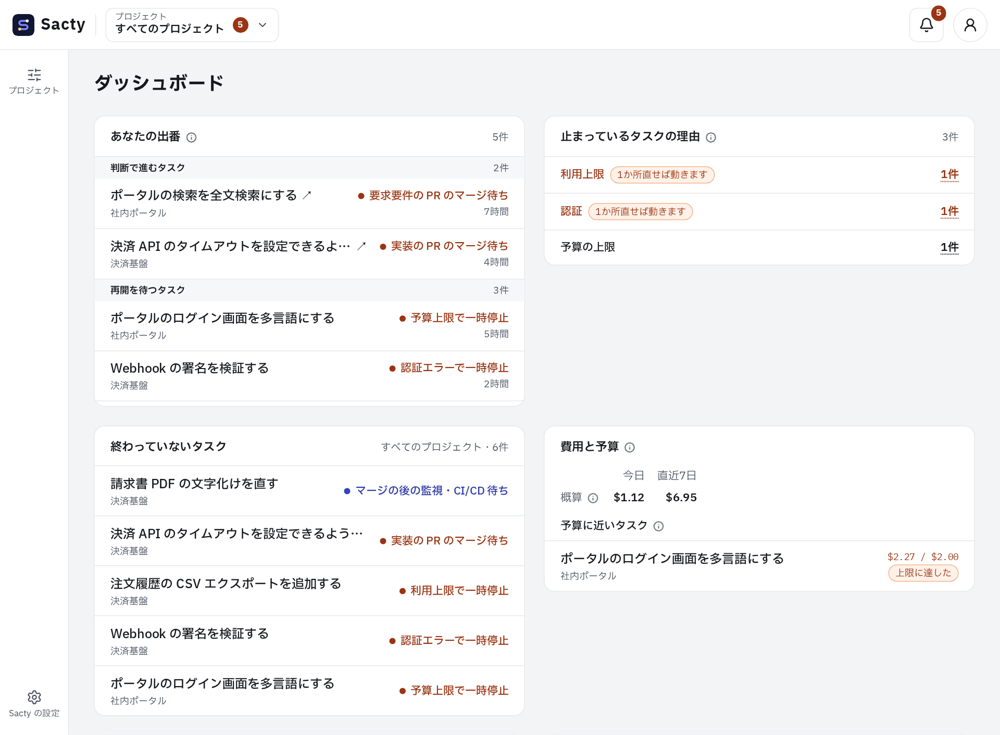

<!-- 対応するコード: apps/web/src/components/dashboard.tsx、apps/web/src/lib/dashboard-data.ts、apps/web/src/lib/notification-problems.ts、apps/web/src/i18n/messages/dashboard.ts、packages/core/src/dashboard.ts、apps/daemon/src/service.ts -->

**日本語** | [English](dashboard.en.md)

# ダッシュボードを見る

ダッシュボード（`/dashboard`）は、すべてのプロジェクトをまたいで、あなたの出番・工場の調子・お金・品質を1か所で見る画面です。
個別のタスクを開く前に、ここで手を打てます。
開いている間は、画面を読み直さなくても最新の状態に更新します（[タスクを進める](tasks.md)）。

ダッシュボードは、次のように表示されます。

画像には、最初の4つの欄が写っています。
左上が「あなたの出番」、右上が「止まっているタスクの理由」、左下が「終わっていないタスク」、右下が「費用と予算」です。
残りの欄は、画面のその下に続きます。

見出しの横の印（i）にマウスを乗せるか、タップすると、数字の意味や期間の境が出ます。

## 欄

ダッシュボードには、次の欄が、表の順に並びます。
最初の4つが、画像に写っている欄です。
欄の名前から、その欄の説明に移れます。

| 欄 | 出すもの | 空のとき |
| --- | --- | --- |
| [あなたの出番](#あなたの出番) | 承認待ち・エスカレーション・一時停止のタスク | 「対応待ちはありません。」 |
| [止まっているタスクの理由](#止まっているタスクの理由) | 一時停止の理由ごとの件数 | 「止まっているタスクはありません。」 |
| [終わっていないタスク](#終わっていないタスク) | 完了・中止を除くすべてのタスク | 「終わっていないタスクはありません。」 |
| [費用と予算](#費用と予算) | 今日と直近7日の費用（概算）と、予算に近いタスク | 「予算に近いタスクはありません。」 |
| [工程の待ち行列](#工程の待ち行列) | 実行中の件数と同時に実行する数の上限、実行待ちの件数 | 0 |
| [取り込みの状況](#取り込みの状況) | Issue・PR のレビュー・チケットの、最後の取り込みの結果 | 設定が無い・読めないことと、Sacty の設定へのリンク |
| [流量](#流量) | 直近7日・30日の完了・中止の件数と、作成から完了までの時間の中央値 | 0 件と「—」 |
| [品質の信号](#品質の信号) | 直近30日の、差し戻しなどの回数 | 0 回 |
| [監査](#監査) | プロジェクトごとの監査の件数と、週ごとのタスクあたりの差し戻し・指摘の件数 | 「監査の結果はまだありません。」 |

幅が足りれば欄を横に並べ、足りなければ縦に積みます。
スマホの幅でも同じ欄を出します。

### あなたの出番

人の対応を待っているタスクを、2つの組に分けて出します。
上の組「判断で進むタスク」は、人が判断すれば先へ進むタスク（承認待ち・エスカレーション）、下の組「再開を待つタスク」は、止まったままのタスク（一時停止。理由は問いません）です。
組ごとに見出しと件数が出て、件数が 0 の組は出ません。
組の中は、待っている時間が長い順です（同じなら ID の順）。
上の組が先に出るので、止まったままのタスクが何件あっても、いま判断すれば進むタスクは、欄をスクロールしなくても見えます。
行には、タスクの題・プロジェクトの名前・状態・待っている時間が出ます（画像では、題の下にプロジェクトの名前、右に状態と待っている時間）。

- 題を押すと、判断する画面に移ります。
- 承認待ちで、今の提出の PR が開いているときは、題を押すと、GitHub の PR を新しいタブで開きます（題に「↗」が付きます）。
- 承認待ちで、Sacty の AI のレビューがその PR の今の head をレビューしている間は、状態の後ろに「・AI のレビュー中」と出ます。組と並びは変わらず、承認もマージもできます。
- 実装の PR がベースブランチと競合しているときは、状態にそう出ます（[ベースブランチが進んだとき](tasks.md#ベースブランチが進んだとき)）。

### 止まっているタスクの理由

一時停止の理由ごとの件数を出します。

- 行を押すと、その理由のタスクが欄の中に出ます。
- 利用上限と認証は、1か所直せばまとめて動くことが多いので、目立たせます（画像では、「1か所直せば動きます」の印が付いています）。

### 終わっていないタスク

完了・中止を除く、すべてのタスクを出します。
レビューを投稿して PR の変化を見守っているタスク（「PR の対応待ち」。[レビューを投稿した後](intake.md#レビューを投稿した後)）も、ここに出ます（「あなたの出番」には出ません）。
5件より多いときは、欄の中でスクロールします。

### 費用と予算

今日と直近7日の費用を、概算で出します。
「予算に近いタスク」には、予算の 80% 以上を使ったか、上限に達したタスクを出します。
費用の数え方は、[期間と数え方](#期間と数え方) にあります。

### 工程の待ち行列

実行中の件数と同時に実行する数の上限、実行待ちの件数を出します。
最初の工程が始まる前の処理（リポジトリの用意・情報収集など）をしているタスクも、実行中に数えます（[工程が始まる前の状態の表示](tasks.md#工程が始まる前の状態の表示)）。
実行待ちが上限より多い状態が 10 分続くと、目立たせて、Sacty の設定へのリンクを出します。

### 取り込みの状況

Issue・PR のレビュー・チケットの、最後の取り込みの時刻、作ったタスクの数、取り込めなかった対象を出します。
「今すぐ取り込む」も、ここから押せます。

### 流量

直近7日・30日の完了・中止の件数と、作成から完了までの時間の中央値を出します。
PR のレビューのタスクは、判定が「指摘なし」になった・PR がマージかクローズされた時刻で、完了に数えます（レビューを投稿しただけでは数えません。[レビューを投稿した後](intake.md#レビューを投稿した後)）。以前の版で完了したレビューのタスクは、レビューを投稿した時刻のままです。

### 品質の信号

直近30日の、次の回数を出します。

- 人の差し戻し
- PR の指摘の差し戻し
- AI のレビューの差し戻し（sacty 自身のレビューの指摘だけで直した回数。人の差し戻しには数えません）
- 合格の見逃し（合格にした成果物の差し戻し）
- 統合レビューの不合格
- 監視で作った修正のタスク
- 工程ごとの差し戻し

差し戻しのうち、次のものは、見逃しとは分けて出します。

- 原因を選ばなかった差し戻しは、見逃しかどうか分からないので、「原因が分からない差し戻し」として、見逃しの下に出します。
- 見逃しではない差し戻し（新しい要望・方針の変更、質問への答え、ベースの変化による競合）は、見逃しに数えず、原因ごとに分けて出します。

### 監査

監査の結果から、次の2つを出します。

- プロジェクトごとの、原因・再発・判断待ちの件数と、提案の採用率
- 週ごとの、タスクあたりの差し戻し・指摘の件数

プロジェクトの名前を押すと、その監査の画面に移ります（[監査](audit.md)）。
監査を取れないときは、欄を出しません。

## Slack の通知を送れなかったとき

Slack の通知を送れなかったときは、欄の上に警告が出ます。
警告には、送れなかった理由と、「Sacty の設定で Slack の通知を確かめる」のリンクが出ます。
リンクを押すと「Sacty の設定」に移るので、Slack の通知の設定を確かめてください。
次に送れたら、警告は消えます（[通知](notifications.md)）。

## 期間と数え方

- 「今日」「直近7日」「直近30日」の境は、sacty を動かしているマシンの日付で決めます。
  画面の言語では決めません。
  直近7日・30日は今日を含みます。
- 費用は、次のように数えます。
  - 完了・中止したタスクの分も含みます。
  - sacty が使用量と単価から計算した概算です（サブスクリプションなどの換算値も含みます）。
  - 実際の請求額とは異なることがあります。
    sacty は実際の請求額を扱いません。
- 待っている時間は、承認待ち・一時停止・エスカレーションになった記録の時刻から数えます。
- 消したプロジェクトのタスクは、どの欄にも出さず、数えません。

## デーモンに届かないとき

ダッシュボードがデーモンに届かないときは、次のように表示します。

- 開いたときに届かなければ、欄の代わりに、届かないことを出します。
  届くと、欄を出します。
- 一度表示した後に届かなくなったときは、欄を最後に取れた内容のまま残し、更新できないことを上に出します。
  欄が見えていても、その間の数字は最新ではありません。
  届くようになると、また更新します。

## 関係するページ

- [はじめに](getting-started.md)
- [タスクを進める](tasks.md)
- [Issue・PR・チケットの取り込み](intake.md)
- [通知](notifications.md)
- [config.yaml の設定](config.md)
