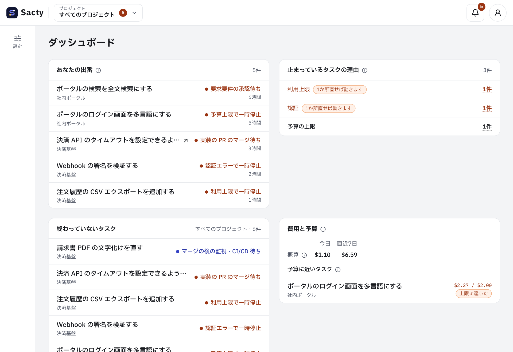

<!-- 対応するコード: apps/web/src/components/dashboard.tsx、apps/web/src/lib/dashboard-data.ts、apps/web/src/lib/notification-problems.ts、apps/web/src/i18n/messages/dashboard.ts、packages/core/src/dashboard.ts、apps/daemon/src/service.ts -->

**日本語** | [English](dashboard.en.md)

# ダッシュボードを見る

ダッシュボード（`/dashboard`）は、すべてのプロジェクトをまたいで、あなたの出番・工場の調子・お金・品質を1か所で見る画面です。
個別のタスクを開く前に、ここで手を打てます。
開いている間は、画面を読み直さなくても最新の状態に更新します（[タスクを進める](tasks.md)）。

見出しの横の印（i）にマウスを乗せるか、タップすると、数字の意味や期間の境が出ます。

ダッシュボードは、次のように表示されます。

## 欄

| 欄 | 出すもの | 空のとき |
| --- | --- | --- |
| あなたの出番 | 承認待ち・一時停止・エスカレーションのタスクを、待っている時間が長い順に出します。題を押すと、判断する画面に移ります。承認待ちで、今の提出の PR が開いているときは、GitHub の PR を新しいタブで開きます（題に「↗」が付きます） | 「対応待ちはありません。」 |
| 止まっているタスクの理由 | 一時停止の理由ごとの件数です。行を押すと、その理由のタスクが欄の中に出ます。利用上限と認証は、1か所直せばまとめて動くことが多いので目立たせます | 「止まっているタスクはありません。」 |
| 終わっていないタスク | 完了・中止を除くすべてのタスクです。5件より多いときは、欄の中でスクロールします | 「終わっていないタスクはありません。」 |
| 費用と予算 | 今日と直近7日の費用を、概算で出します。予算の 80% 以上を使ったか、上限に達したタスクも出します | 「予算に近いタスクはありません。」 |
| 工程の待ち行列 | 実行中の件数と同時に実行する数の上限、実行待ちの件数です。実行待ちが上限より多い状態が 10 分続くと目立たせ、Sacty の設定へのリンクを出します | 0 |
| 取り込みの状況 | Issue・PR のレビュー・チケットの最後の取り込みの時刻、作ったタスクの数、取り込めなかった対象です。「今すぐ取り込む」もここから押せます | 設定が無い・読めないことと、Sacty の設定へのリンク |
| 流量 | 直近7日・30日の完了・中止の件数と、作成から完了までの時間の中央値です | 0 件と「—」 |
| 品質の信号 | 直近30日の、人の差し戻し・PR の指摘の差し戻し・ゴールガーディアンの見逃し・統合レビューの不合格・監視で作った修正のタスクの回数と、工程ごとの差し戻しの回数です | 0 回 |
| 監査 | プロジェクトごとの原因・再発・判断待ちの件数と提案の採用率、週ごとのタスクあたりの差し戻し・指摘の件数です。プロジェクトの名前を押すと、その監査の画面に移ります（[監査](audit.md)）。監査を取れないときは欄を出しません | 「監査の結果はまだありません。」 |

幅が足りれば欄を横に並べ、足りなければ縦に積みます。
スマホの幅でも同じ欄を出します。

## Slack の通知を送れなかったとき

Slack の通知を送れなかったときは、欄の上に警告が出ます。
警告には、送れなかった理由と、「Sacty の設定で Slack の通知を確かめる」のリンクが出ます。
リンクを押すと「Sacty の設定」に移るので、Slack の通知の設定を確かめてください。
次に送れたら、警告は消えます（[通知](notifications.md)）。

## 期間と数え方

- 「今日」「直近7日」「直近30日」の境は、sacty を動かしているマシンの日付で決めます。
  画面の言語では決めません。
  直近7日・30日は今日を含みます。
- 費用
  - 完了・中止したタスクの分も含みます。
  - Sacty が使用量と単価から計算した概算です（サブスクリプションなどの換算値も含みます）。
  - 実際の請求額とは異なることがあります。
    Sacty は実際の請求額を扱いません。
- 待っている時間は、承認待ち・一時停止・エスカレーションになった記録の時刻から数えます。
- 消したプロジェクトのタスクは、どの欄にも出さず、数えません。
- デーモンに届かないとき
  - 開いたときに届かなければ、欄の代わりに届かないことを出します。
    届くと、欄を出します。
  - 一度表示した後に届かなくなったときは、欄を最後に取れた内容のまま残し、更新できないことを上に出します。
    欄が見えていても、その間の数字は最新ではありません。
    届くようになると、また更新します。

## 関係するページ

- [はじめに](getting-started.md)
- [タスクを進める](tasks.md)
- [Issue・PR・チケットの取り込み](intake.md)
- [通知](notifications.md)
- [config.yaml の設定](config.md)
