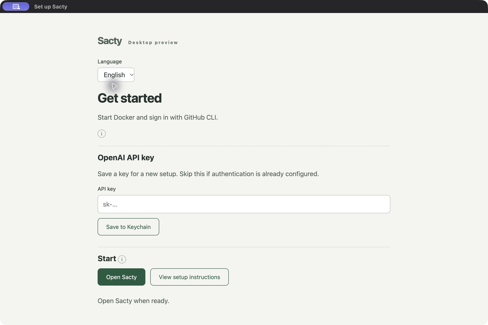
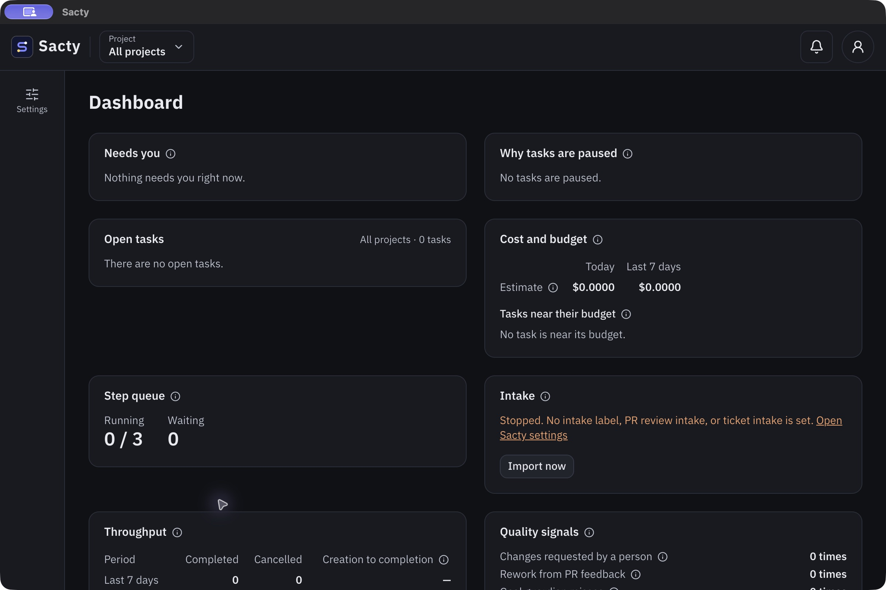

<!-- Code: apps/desktop/main.cjs, apps/desktop/runtime.cjs, apps/desktop/scripts/package.mjs -->

[日本語](desktop.md) | **English**

# Use the desktop app

This is a macOS proposal prototype. Signing, notarization, and automatic updates are not implemented. Docker and GitHub CLI must be set up separately.

## Start the app

1. Start Docker and sign in with GitHub CLI ([Getting started](getting-started.en.md)).
2. Open the built application. End users do not need to install Node.js or build the source.
3. For a new setup, enter your OpenAI API key and save it to Keychain. Skip this if authentication is already configured.
4. Press the start button. A configuration template is created only if missing. Existing configuration and work history are reused.
5. If the standard image is missing, the bundled image is imported before opening the screen. The first import may take several minutes.

The key-save result appears after the save process and its output have finished. Errors produce a message to check your input and Keychain rather than a success message.

Prepare custom images separately. Only the default image is bundled. If screen authentication is disabled in your existing configuration, enable it again.

External links, such as PRs and deployment results, open in your default browser.

Setup language can be selected from Japanese and English. The selection is saved for one year and carried into the main screen.

## Screenshots

The setup screen before starting the app.



The existing screen runs inside the app. This example uses test data.



## Update the app

1. Quit the running application.
2. Replace the app in Applications with the one from the new DMG.
3. Start the app and, when prompted to update the standard image, check the displayed versions and confirm.

Settings are backed up before being changed. Cancelling leaves them unchanged. Update custom images separately when using them. If the image name is shared through a YAML anchor and updating it would change other settings, the update stops without changing your configuration. Replace the shared references with separate values and retry.

## Use notifications

Enable desktop notifications in Sacty settings on the main screen. Allow notifications in macOS too if necessary. Notifications are not enabled automatically.

## If startup fails

After fixing the cause, use the same start button to retry. When diagnostic output is available, open “View diagnostics” to inspect causes such as port conflicts. Only output with credentials and URL query strings and fragments removed is displayed, regardless of URL scheme capitalization; it is not saved to disk or sent externally. If the CLI exits unexpectedly after startup, the app waits up to one second for remaining diagnostic output, displays the failure, and quits.

| Message or condition | Action |
| --- | --- |
| Docker is unavailable | Open Docker Desktop, wait until it is ready, and retry. |
| GitHub is unavailable | Run `gh auth login` in Terminal, then retry. |
| A custom image is missing | Prepare the displayed image separately. It is never automatically replaced with the bundled standard image. |
| Settings have changed | Finish editing settings, retry, and review the update confirmation again. |
| Startup fails or times out | Quit any other running Sacty instance. Check settings and reopen the app. |

Do not paste API keys into chats or Issues. See [Configuration](config.en.md) for initial AI authentication and custom settings.

## Quit the app

Closing the window or quitting the application stops its daemon and web processes. Repeated quit requests still wait for shutdown to finish. If shutdown fails, follow the message and try quitting again. It does not attach to sacty running elsewhere.

## Build the prototype

These are developer instructions. Install dependencies and build the repository first. The result targets macOS on the same CPU architecture.

```sh
npm ci
npm run build
npx sacty image build
npm run desktop:package
npm run desktop:dmg
```

The application is written to `dist/desktop`. Including Node.js and the default image makes it large. It is unsigned; signing, notarization, and an update strategy are required before general distribution.

The DMG is written to `dist/desktop`. Open it and drag the application to the Applications folder.

The bundled Node.js is the executable used to build the app. The license file from the official Node.js distribution is also required.

For development, run the following after building the application and image.

```sh
npm run desktop:dev
```

Run the following to copy the packaged app outside the repository and verify startup, shutdown, and external-link hand-off.

```sh
node apps/desktop/scripts/smoke.mjs
```

## Related pages

- [Getting started](getting-started.en.md)
- [Container images](images.en.md)
- [Desktop specification](../spec/desktop.en.md)
