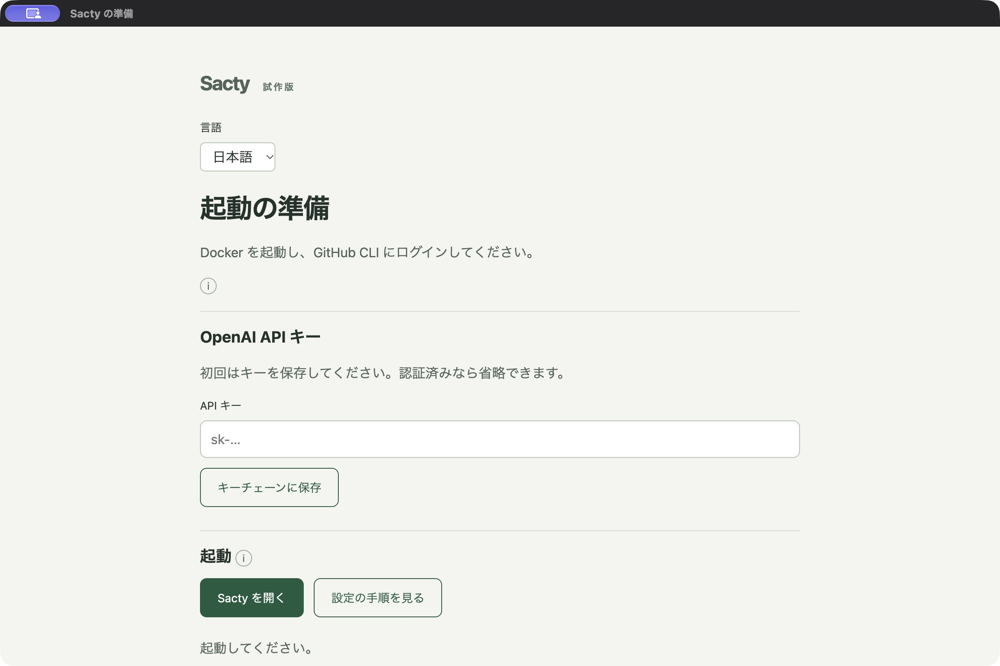
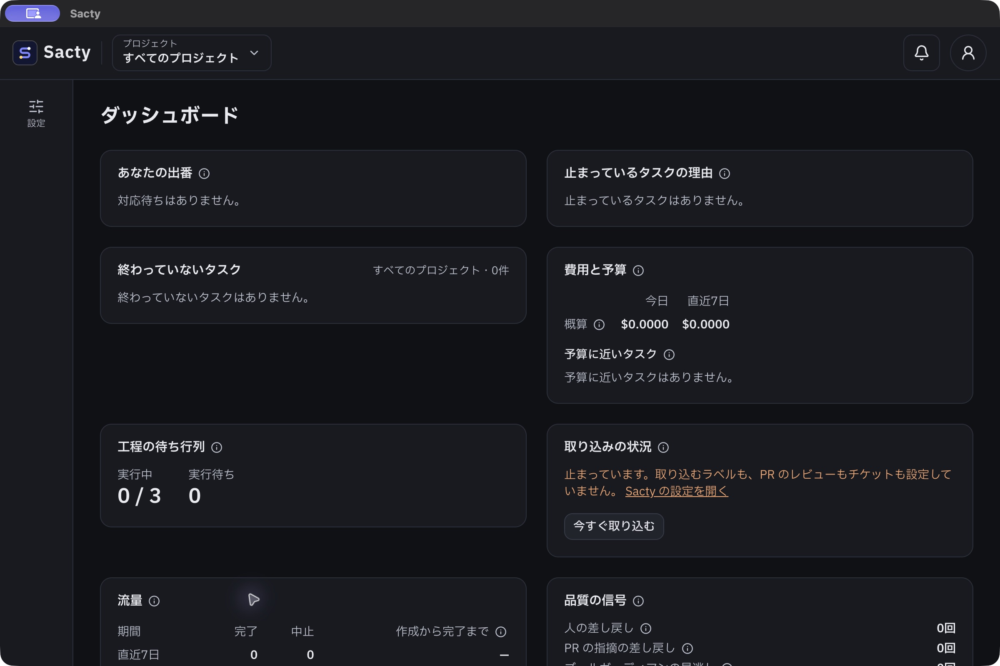

<!-- 対応するコード: apps/desktop/main.cjs、apps/desktop/runtime.cjs、apps/desktop/scripts/package.mjs -->

**日本語** | [English](desktop.en.md)

# デスクトップ版を使う

提案用の macOS 試作版です。署名・公証・自動更新には対応していません。Docker と GitHub CLI の準備は別途必要です。

## 起動する

1. Docker を起動し、GitHub CLI にログインします（[はじめに](getting-started.md)）。
2. 作成されたアプリを開きます。利用者側で Node.js をインストールしたり、コードをビルドしたりする必要はありません。
3. 初めて使う場合は OpenAI の API キーを入力し、キーチェーンに保存します。すでに認証を設定している場合は省略できます。
4. 起動ボタンを押します。設定が無ければ雛形を作ります。既存の設定と作業履歴はそのまま使います。
5. 標準イメージが無ければ、同梱イメージを読み込んで画面を開きます。初回は数分かかる場合があります。

キーの保存結果は、保存処理と出力が終了してから表示します。エラーがある場合は成功と表示せず、入力やキーチェーンの確認を案内します。

カスタムイメージは別途用意してください。同梱するのは既定のイメージだけです。既存の設定で画面の認証を無効にしている場合は、有効に戻してください。

PR やデプロイ先などの外部リンクは、既定のブラウザーで開きます。

準備画面の言語は日本語・英語から選べます。選択した言語は1年間保存し、メイン画面にも引き継ぎます。

## 画面の例

起動前の準備画面です。



起動後はアプリ内で既存の画面を使えます。検証用データの例です。



## 更新する

1. 起動中のアプリを終了します。
2. 新しいDMGからアプリをApplicationsへコピーして置き換えます。
3. アプリを起動し、標準イメージの更新を確認されたら、表示された版を確認して更新します。

設定はバックアップしてから変更します。取り消した場合は変更しません。独自のイメージを使っている場合は、そのイメージを別途更新してください。イメージ名をYAMLアンカーで共有していて、更新すると他の設定も変わる場合は、設定を変更せず停止します。共有している参照を個別の値に分けてから再試行してください。

## 通知を使う

メイン画面のSactyの設定でデスクトップ通知をオンにしてください。必要に応じてmacOS側でも通知を許可してください。通知は勝手にはオンになりません。

## 起動できないとき

エラーが出た場合は、原因を直してから同じ起動ボタンで再試行できます。

| 表示・状態 | 対応 |
| --- | --- |
| Docker が使えない | Docker Desktopを開き、起動完了を待ってから再試行します。 |
| GitHub に接続できない | ターミナルで `gh auth login` を実行してから再試行します。 |
| 独自イメージが無い | 表示されたイメージを別途用意します。同梱の標準イメージへは自動変更しません。 |
| 設定が変更されている | 設定の編集を終えて再試行し、更新確認の内容を再確認します。 |
| 起動できない・時間内に起動しない | 別のSactyが起動中なら終了します。設定を確認し、アプリを開き直します。 |

API キーはチャットやIssueへ貼らないでください。初回のAI認証やカスタム設定については[設定](config.md)を参照してください。

## 終了する

ウィンドウを閉じるか、アプリを終了すると、起動したデーモンと画面を停止します。停止を待っている間に終了を再度操作しても、停止完了まで待ちます。停止できない場合は案内に従い、もう一度終了してください。別の場所で起動中の sacty には接続しません。

## 試作版を作る

開発者向けの手順です。リポジトリで依存を入れ、ビルドしてから実行します。作成したアプリは同じ CPU の macOS 向けです。

```sh
npm ci
npm run build
npx sacty image build
npm run desktop:package
npm run desktop:dmg
```

アプリは `dist/desktop` に作ります。Node.js と既定のイメージを含むため大きくなります。署名していないので、一般向けの配布前には署名・公証と更新方式の整備が必要です。

DMG は `dist/desktop` に作ります。開いたらアプリを Applications フォルダへドラッグしてください。

同梱する Node.js は作成時に使用した実行ファイルです。Node.js の公式配布に含まれるライセンスファイルも必要です。

開発中は次で起動できます。事前にアプリ本体とイメージをビルドしてください。

```sh
npm run desktop:dev
```

完成品をリポジトリ外へコピーして検証する場合は、次を実行します。起動・終了と外部リンクの受け渡しを確認します。

```sh
node apps/desktop/scripts/smoke.mjs
```

## 関係するページ

- [はじめに](getting-started.md)
- [コンテナイメージ](images.md)
- [デスクトップ版の仕様](../spec/desktop.md)
