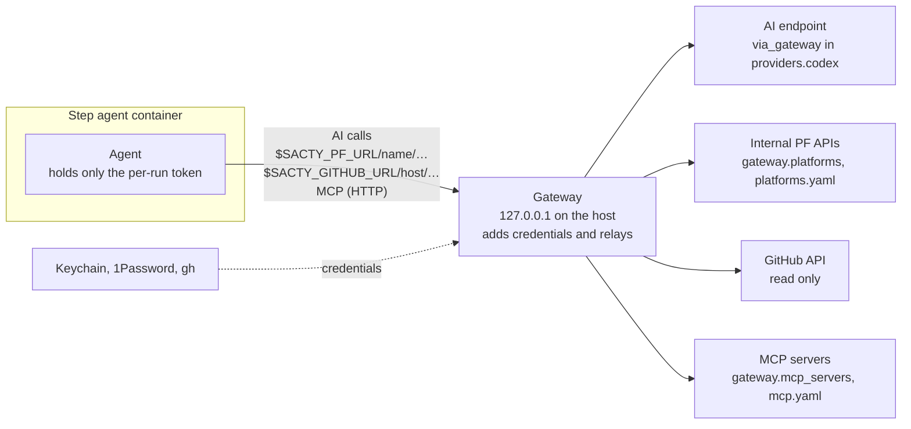

<!-- Code: apps/daemon/src/config.ts (gateway, providers, ProviderFile, ProviderAuth), apps/daemon/src/gateway.ts (DEFAULT_RETRY_POLICY, DEFAULT_HOST_ADDRESS), apps/daemon/src/host-mcp.ts (HostMcpFile), apps/daemon/src/host-mcp-processes.ts, apps/daemon/src/platforms.ts (PlatformFile), apps/daemon/src/github-relay.ts, packages/cli/docker/gh-shim.cjs -->

[日本語](gateway.md) | **English**

# Gateway

sacty runs a gateway on the host. The gateway relays AI calls, MCP, and external platform APIs from the step agents' containers. Only the gateway holds authentication values; the agent containers receive only a per-run token.

The paths through the gateway are as follows.



- The gateway listens only on 127.0.0.1 and accepts only requests that carry the token of a running agent.
- Configure it in `gateway` in `config.yaml` (along with `via_gateway` of `providers.codex`).

| Item | Meaning | Default |
| --- | --- | --- |
| `gateway.host_address` | The host's address as seen from containers ([Host address](#host-address)) | `host-gateway` |
| `gateway.retry.max_attempts` | Maximum number of times one request is sent upstream (including the first attempt; 1 to 50) | `8` |
| `gateway.retry.max_wait_sec` | Maximum total wait across a run of consecutive failures (seconds; 0 to 86400) | `600` |
| `gateway.mcp_servers` | MCP servers run on the host ([Host MCP servers](#host-mcp-servers)) | None |
| `gateway.platforms` | Organization platform (PF) APIs ([Organization platform (PF) APIs](#organization-platform-pf-apis)) | None |

## Relaying AI calls

If you write `via_gateway: true` in `providers.codex`, the AI calls of Codex agents go through sacty's gateway. It works only when `auth.mode` is `bedrock` or `openai-compatible` ([next section](#openai-compatible-endpoints)). Writing it with other authentication methods or in `providers.claude` is an error ([config.yaml settings](config.en.md#connections-and-prices-providers)).

- Only the gateway holds the API key; the agent containers receive only a per-run token.
- The gateway waits and then retries rate limits (429) and temporary failures (500, 502, 503, 504, connection failures). The wait follows `Retry-After`. If there is no `Retry-After`, the interval starts at 1 second, doubles each time, and caps at 60 seconds.
- You can change the retry limits with `gateway.retry` (`max_attempts`, `max_wait_sec`). When a limit is reached, the agent pauses as having hit a usage limit. You can retry by resuming it.
- Runs that were retried record the number of retries and the time waited in the Activity.

```yaml
gateway:
  retry:
    max_attempts: 8     # maximum number of times one request is sent upstream
    max_wait_sec: 600   # maximum total wait across a run of consecutive failures before success
```

## OpenAI-compatible endpoints

Write an OpenAI-compatible (Responses API) endpoint (such as your organization's AI gateway) in the `auth` of `providers.codex` with `mode: openai-compatible`. Codex's default agents ([Default agents](config.en.md#default-agents)) use this endpoint.

```yaml
providers:
  codex:
    auth:
      mode: openai-compatible
      base_url: https://ai-gateway.example.com/v1   # same as base_url in Codex's model_providers
      secret: op://Work/AI-Gateway/api-key           # the API key you used to put in env_key
    via_gateway: true                                # through sacty's gateway (429 retries; the key is not passed to the container)
    available_models:                                # the prices are examples; match your contract
      gpt-6-luna: { input: 0.25, cached_input: 0.025, output: 2 }
      gpt-6.1-sol: { input: 1.25, cached_input: 0.125, output: 10 }
```

| Item | Meaning | Default |
| --- | --- | --- |
| `auth.base_url` | The endpoint (an `http` or `https` URL). Required | None |
| `auth.secret` | The API key (sent as Bearer; a secret name or a 1Password reference). Omit it if no authentication is needed | None |
| `via_gateway` | Go through sacty's gateway | `false` |

- When the endpoint uses different model names, change `model` with [Overriding agents](config.en.md#overriding-agents) and write the price for that name in `available_models`.
- Named `providers` and `provider` of agents from earlier versions are errors. Rewrite them in the form above.

## Host address

Containers connect to the gateway at `host.docker.internal`. With the default (`host-gateway`), this works as is on Docker Desktop.

With Docker inside a virtual machine, such as Rancher Desktop, `host-gateway` points to the virtual machine, so containers cannot reach the gateway. The agent then stays at `Reconnecting... error sending request` and makes no progress. Write an address that reaches the host in `gateway.host_address` (for Rancher Desktop, `192.168.5.2`).

```yaml
gateway:
  host_address: 192.168.5.2   # Rancher Desktop
```

## Host MCP servers

Write a local command MCP server that authenticates in a browser at startup (Okta and so on) in `gateway.mcp_servers`, because a browser cannot be opened inside a container. The gateway starts the server on the host, keeps it running, and passes it to step agents as an HTTP MCP server.

```yaml
gateway:
  mcp_servers:
    private-cloud:
      command: npx
      args: ["-y", "@example/private-cloud-mcp"]
      env: { CLOUD_REGION: ap-northeast-1, TOKEN: { secret: op://Work/Cloud/token } }
      restart_every_min: 240     # restart and re-authenticate before the authentication expires (set it shorter than the expiry)
      ready_timeout_sec: 300     # maximum wait from start until authentication completes
      tool_timeout_sec: 900      # maximum time the agent waits for a tool call (optional)
```

| Item | Meaning | Default |
| --- | --- | --- |
| (name) | Alphanumerics, `_`, and `-` | None |
| `command` | The command to start. Required | None |
| `args` | Arguments | None |
| `env` | Environment variables. Write secrets as `{ secret: <name or reference>, prefix: <text to put before the value> }` | None |
| `description` | A description given to agents | None |
| `restart_every_min` | Restart interval (minutes; 1 to 10080) | If omitted, the server is not restarted periodically |
| `ready_timeout_sec` | Maximum wait from start until the server is ready (authenticated) (seconds; 5 to 3600) | `300` |
| `startup_timeout_sec`, `tool_timeout_sec` | Maximum time the agent waits for startup and for a tool call ([MCP server timeouts](context.en.md#mcp-server-timeouts)) | The agent's default |

### Restarts

- The gateway restarts the server every `restart_every_min`, before the authentication expires. It switches over once the new process is ready (authenticated), and then stops the old one. Agents in the middle of using the server are not interrupted.
- The gateway also restarts the server when the process exits or a tool returns an authentication error. This assumes that browser approval is automated; sacty does not wait for a person.
- If the server is still not ready after restarting, this is shown on the task list screen and the server is restarted every minute.

### Before a step agent's run

- Before a step agent's run, sacty checks the MCP servers that run uses against the settings.
  - For servers that were added or are in the middle of starting or re-authenticating, sacty waits until they are ready (up to `ready_timeout_sec`) before starting the run.
  - Setting changes take effect immediately without stopping the daemon.
  - Concurrent runs wait for the same startup to complete.
- If a server is not ready, the run proceeds, and the Activity (the notes of "Context prepared") records which MCP server it is. Results are not exported to that MCP server, and the reason is recorded.
- Containers receive only the HTTP MCP URL with a per-run token (it can be passed to both Claude Code and Codex).
- `startup_timeout_sec` and `tool_timeout_sec` are passed to the agent. The gateway's relay (10 minutes by default for tool calls and 60 seconds for the list) does not cut off before the values you wrote either. Changing only the timeouts does not restart the MCP server.

### Relation to the context repository's MCP servers

- If the same name exists in the context repository's `mcp.yaml`, the one in `gateway.mcp_servers` is used and a warning is recorded in the Activity.
- `command` servers in the context repository's `mcp.yaml` also run on the host by default through the same mechanism. They are started per project (see [Context repository](context.en.md#command-mcp-servers-run-on-the-host)).

### Cleaning up processes

Each MCP server is started in its own process group. Stopping `sacty up` (Ctrl-C, SIGTERM) also stops the MCP servers and the descendant processes they started.

Processes left behind when the daemon crashed are cleaned up on the next start. Only processes whose PID and start time match the records in `SACTY_HOME/host-mcp/processes` are stopped, so other processes that reused the PID are not stopped. Processes whose recording daemon is still running (those of another sacty running with the same `SACTY_HOME`) are not stopped either.

## Organization platform (PF) APIs

Organization platforms without an MCP server can be used by agents through their APIs if you write them in `gateway.platforms`. Only the gateway holds the credentials; they are not passed to agents. Per-project platforms can be written in the same form in the context repository's `platforms.yaml` ([Context repository](context.en.md#platformsyaml)).

```yaml
gateway:
  platforms:
    ticket:                                   # agents call it at $SACTY_PF_URL/ticket/…
      upstream: https://ticket.internal.example.com
      description: Ticket management
      auth:                                   # add a fixed key to a header (custom headers are allowed)
        header: X-Internal-Token
        secret: op://Work/Ticket/token
      allow:                                  # allowed APIs (* matches one level, ** matches everything below)
        - GET /api/v1/tickets/**
        - POST /api/v1/tickets/*/comments
    deploy:
      upstream: https://deploy.internal.example.com
      auth:                                   # get a token (JWT and so on) with an API key and add it
        header: Authorization
        prefix: "Bearer "
        token:
          url: https://auth.internal.example.com/api/token
          json: { apiKey: "{{secret}}" }      # {{secret}} can also be written in form (form data) and headers
          secret: op://Work/Deploy/api-key
          token_path: data.accessToken        # location of the token in the response JSON
          expires_in_path: data.expiresIn     # location of the expiry (seconds). If absent, ttl_sec
      allow:
        - GET /api/v1/deployments/**
    status:
      upstream: https://status.internal.example.com
      auth:                                   # send the key in the query (GET /auth/token?api_token=…) and receive a JWT
        prefix: "Bearer "
        token:
          url: https://status.internal.example.com/auth/token?v=2   # an existing query can also be written
          method: GET
          query: { api_token: "{{secret}}" }  # appended after url (keys are URL-encoded)
          secret: op://Work/Status/api-key
          token_path: token                   # location in the response {"token": "ey..."}
      allow:
        - GET /api/v1/status/**
```

| Item | Meaning | Default |
| --- | --- | --- |
| (name) | Lowercase letters, digits, and `-`, starting with a lowercase letter or digit (it becomes part of the URL `$SACTY_PF_URL/<name>`) | None |
| `upstream` | The forwarding destination (an `http` or `https` URL). Required | None |
| `description` | A description given to agents | Empty |
| `auth.header` | The header that carries the authentication | `Authorization` |
| `auth.prefix` | A prefix for the value (for example `"Bearer "`) | Empty |
| `auth.secret` | A fixed key (only one of this and `auth.token`) | None |
| `auth.token.url` | The token endpoint (`http` or `https`). Required. `{{secret}}` cannot be written here (write it in `query`) | None |
| `auth.token.method` | The method sent to the endpoint | `POST` |
| `auth.token.headers`, `json`, `form` | Headers, JSON, and form data sent to the endpoint (`{{secret}}` is replaced with the secret value). If `method` is `GET` or `HEAD`, `json` and `form` cannot be written | None |
| `auth.token.query` | Query parameters added to the endpoint URL (`name: value`; values are strings, and `{{secret}}` is replaced with the secret value). They are URL-encoded and appended after any query already in `url` | None |
| `auth.token.secret` | The secret sent to the endpoint. Required | None |
| `auth.token.token_path` | Location of the token in the response JSON. Required | None |
| `auth.token.expires_in_path` | Location of the expiry (seconds) in the response JSON | None |
| `auth.token.ttl_sec` | How long to keep the token when its expiry is unknown (seconds) | `300` |
| `allow` | Allowed APIs (`<method> <path>`; the method is one of `GET`, `POST`, `PUT`, `PATCH`, `DELETE`, `HEAD`). At least one line is required | None |

- sacty includes the list of available platforms and APIs in the step agent's instructions. Agents can call them without dealing with authentication.
- The gateway rejects requests that are not on the allowlist (403, with a response that says what is allowed).
- The gateway fetches tokens again before they expire. If a request is rejected (401, 403), it fetches the token again and resends the request once.
- Even when the key is sent in the query, URLs containing the key are not shown in the web UI, logs, the Activity, or responses to agents, including the reasons for fetch failures (they are masked as `[secret]`). The key is sent only to the token endpoint and is not added to the URL forwarded to the platform.
- When a token endpoint that receives the key in the query returns a failure (non-2xx), the reason shows only the status code, not the endpoint's body (for example `token endpoint returned 403 (the response body is not shown because the key is sent in the query)`). This ensures that the key is never shown, in whatever form it appears in the body. Check the cause in the endpoint's own logs or similar.
- Credentials are prepared when the daemon starts. Platforms whose credentials cannot be prepared are shown on the task list screen (other platforms remain usable).
- The platforms are also used as the connection for JIRA intake ([Intake](intake.en.md#jira-tickets)) and result export ([Exporting results](result-export.en.md)).

## Reading GitHub

Step agents can read the GitHub API through the gateway. No setting is needed, and it cannot be turned off. Only the hosts for which a GitHub account is chosen in the project settings ([Project settings](project-settings.en.md)) can be used. The gateway adds the token, and the token is not passed to the agent's container.

- It is read-only. The gateway sends only REST `GET` and `HEAD` and GraphQL `query`, and refuses writes (`POST`, `PATCH`, `mutation`, and so on).
- The `gh` in the agent image can use only `gh api` (for example `gh api repos/acme/app/pulls/12/comments`). Other commands such as `gh pr view` cannot be used. With curl, read `$SACTY_GITHUB_URL/<host>/<API path>`.
- For comments on PRs and issues, the agent writes them in the step's output, and sacty posts them after a person approves it ([Working on tasks](tasks.en.md#comments-on-prs-and-issues)).
- To use `gh`, you need an image rebuilt with this version (`npx sacty image build`). Even with an image built before that, curl can read.

## Related pages

- [config.yaml settings](config.en.md)
- [Context repository](context.en.md)
- [Troubleshooting](troubleshooting.en.md)
