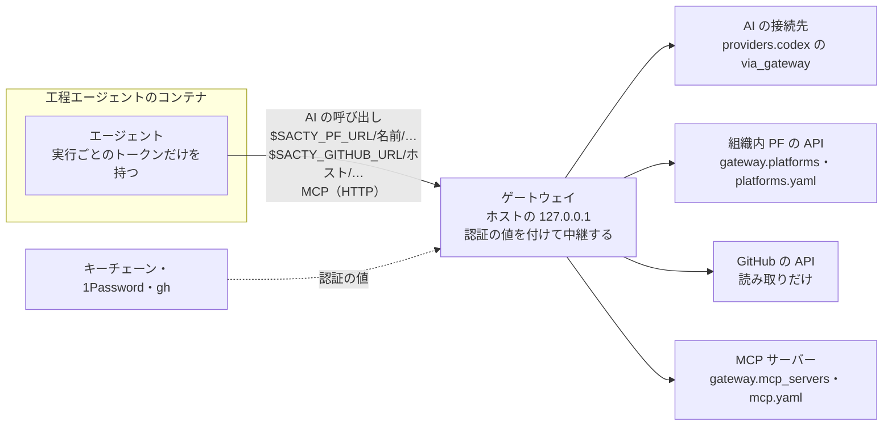

<!-- 対応するコード: apps/daemon/src/config.ts（gateway・providers・ProviderFile・ProviderAuth）、apps/daemon/src/gateway.ts（DEFAULT_RETRY_POLICY・DEFAULT_HOST_ADDRESS）、apps/daemon/src/host-mcp.ts（HostMcpFile）、apps/daemon/src/host-mcp-processes.ts、apps/daemon/src/platforms.ts（PlatformFile）、apps/daemon/src/github-relay.ts、packages/cli/docker/gh-shim.cjs -->

**日本語** | [English](gateway.en.md)

# ゲートウェイ

sacty は、ホストでゲートウェイを動かします。
ゲートウェイは、工程エージェントのコンテナからの AI の呼び出し・MCP・外部 PF の API を中継します。
認証の値はゲートウェイだけが持ち、エージェントのコンテナには実行ごとのトークンだけを渡します。

ゲートウェイを通る経路は次のとおりです。



- ゲートウェイは 127.0.0.1 だけで待ち受け、実行中のエージェントのトークンを持つリクエストだけを受け付けます。
- 設定は `config.yaml` の `gateway`（と `providers.codex` の `via_gateway`）に書きます。

| 項目 | 意味 | 既定値 |
| --- | --- | --- |
| `gateway.host_address` | コンテナから見たホストのアドレス（[ホストのアドレス](#ホストのアドレス)） | `host-gateway` |
| `gateway.retry.max_attempts` | 1件のリクエストで上流に送る回数の上限（最初の1回を含む。1〜50） | `8` |
| `gateway.retry.max_wait_sec` | 一続きの失敗で待つ合計の上限（秒。0〜86400） | `600` |
| `gateway.mcp_servers` | ホストで動かす MCP サーバー（[ホストで動かす MCP サーバー](#ホストで動かす-mcp-サーバー)） | なし |
| `gateway.platforms` | 組織内 PF の API（[組織内 PF の API](#組織内-pf-の-api)） | なし |

## AI の呼び出しを中継する

`providers.codex` に `via_gateway: true` を書くと、Codex のエージェントの AI の呼び出しが sacty のゲートウェイを通ります。
使えるのは、`auth.mode` が `bedrock` か `openai-compatible`（[次の節](#openai-互換の接続先)）のときだけです。
ほかの認証方式のときと、`providers.claude` に書いたときは誤りになります（[config.yaml の設定](config.md#接続先と単価providers)）。

- API キーはゲートウェイだけが持ち、エージェントのコンテナには実行ごとのトークンだけを渡します。
- ゲートウェイは、レート制限（429）と一時的な失敗（500・502・503・504・接続の失敗）を、待ってからリトライします。
  待つ間隔は `Retry-After` に従います。
  `Retry-After` が無ければ、1秒から倍にしていき、60秒で頭打ちにします。
- リトライの上限は `gateway.retry`（`max_attempts`・`max_wait_sec`）で変えられます。
  上限に達すると、エージェントは利用上限として一時停止します。
  再開すると、やり直せます。
- リトライした実行は、作業履歴に回数と待った時間を残します。

```yaml
gateway:
  retry:
    max_attempts: 8     # 1件のリクエストで上流に送る回数の上限
    max_wait_sec: 600   # 成功するまでの一続きの失敗で待つ合計の上限
```

## OpenAI 互換の接続先

OpenAI 互換（Responses API）の接続先（組織の AI gateway など）は、`providers.codex` の `auth` に `mode: openai-compatible` で書きます。
Codex の既定のエージェント（[既定のエージェント](config.md#既定のエージェント)）が、この接続先を使います。

```yaml
providers:
  codex:
    auth:
      mode: openai-compatible
      base_url: https://ai-gateway.example.com/v1   # Codex の model_providers の base_url と同じ
      secret: op://Work/AI-Gateway/api-key           # env_key に入れていた API キー
    via_gateway: true                                # sacty のゲートウェイ経由（429 のリトライ・キーをコンテナに渡さない）
    available_models:                                # 単価は例。契約の単価に合わせる
      gpt-6-luna: { input: 0.25, cached_input: 0.025, output: 2 }
      gpt-6.1-sol: { input: 1.25, cached_input: 0.125, output: 10 }
```

| 項目 | 意味 | 既定値 |
| --- | --- | --- |
| `auth.base_url` | 接続先（`http`・`https` の URL）。必須 | なし |
| `auth.secret` | API キー（Bearer で付ける。秘密情報の名前か 1Password の参照）。認証が要らなければ書かない | なし |
| `via_gateway` | sacty のゲートウェイ経由にする | `false` |

- 接続先でモデルの名前が違うときは、[エージェントの上書き](config.md#エージェントの上書き)で `model` を書き換え、その名前の単価を `available_models` に書きます。
- 以前の版の、名前を付けた `providers` とエージェントの `provider` は誤りになります。
  上の形に書き直してください。

## ホストのアドレス

コンテナは `host.docker.internal` でゲートウェイにつなぎます。
既定（`host-gateway`）のままで、Docker Desktop では届きます。

Rancher Desktop など、仮想マシンの中の Docker では、`host-gateway` が仮想マシンを指すので、ゲートウェイに届きません。
このときエージェントは `Reconnecting... error sending request` のまま進みません。
`gateway.host_address` に、ホストに届くアドレスを書いてください（Rancher Desktop は `192.168.5.2`）。

```yaml
gateway:
  host_address: 192.168.5.2   # Rancher Desktop
```

## ホストで動かす MCP サーバー

起動時にブラウザで認証（Okta など）する手元のコマンドの MCP サーバーは、`gateway.mcp_servers` に書きます。
コンテナの中ではブラウザを開けないためです。
ゲートウェイがホストでサーバーを起動して持ち続け、工程エージェントには HTTP の MCP として渡します。

```yaml
gateway:
  mcp_servers:
    private-cloud:
      command: npx
      args: ["-y", "@example/private-cloud-mcp"]
      env: { CLOUD_REGION: ap-northeast-1, TOKEN: { secret: op://Work/Cloud/token } }
      restart_every_min: 240     # 認証の期限の前に、起動し直して再認証する（期限より短くする）
      ready_timeout_sec: 300     # 起動してから認証が済むまで待つ上限
      tool_timeout_sec: 900      # エージェントがツールの呼び出しを待つ上限（任意）
```

| 項目 | 意味 | 既定値 |
| --- | --- | --- |
| （名前） | 英数字・`_`・`-` | なし |
| `command` | 起動するコマンド。必須 | なし |
| `args` | 引数 | なし |
| `env` | 環境変数。秘密情報は `{ secret: <名前か参照>, prefix: <値の前につける文字> }` で書く | なし |
| `description` | エージェントに伝える説明 | なし |
| `restart_every_min` | 起動し直す間隔（分。1〜10080） | 書かなければ、定期的には起動し直さない |
| `ready_timeout_sec` | 起動してから準備（認証）ができるまで待つ上限（秒。5〜3600） | `300` |
| `startup_timeout_sec`・`tool_timeout_sec` | エージェントが起動・ツールの呼び出しを待つ上限（[MCP サーバーの時間切れ](context.md#mcp-サーバーの時間切れ)） | エージェントの既定 |

### 起動し直すとき

- ゲートウェイは、認証の期限の前に、`restart_every_min` ごとにサーバーを起動し直します。
  新しいプロセスの準備（認証）ができてから切り替え、古いプロセスを止めます。
  使っている途中のエージェントは止めません。
- プロセスが終わったとき・ツールが認証エラーを返したときも、起動し直します。
  ブラウザでの承認は自動化されている前提で、人の操作は待ちません。
- 起動し直しても準備ができなければ、タスクの一覧の画面に出し、1分ごとに起動し直します。

### 工程エージェントの実行の前

- sacty は、工程エージェントの実行の前に、その実行が使う MCP サーバーを設定と突き合わせます。
  - 足したサーバーと、起動や再認証の途中のサーバーは、準備ができるまで（`ready_timeout_sec` まで）待ってから実行を始めます。
  - 設定の変更は、デーモンを止めずにすぐ使えます。
  - 並行する実行は、同じ起動の完了を待ちます。
- 準備ができなければ、どの MCP サーバーかを作業履歴（コンテキストの注意）に残して実行します。
  その MCP サーバーへの成果の書き出しはせず、理由を残します。
- コンテナには、実行ごとのトークンを付けた HTTP の MCP の URL だけを渡します（Claude Code・Codex のどちらにも渡せます）。
- `startup_timeout_sec`・`tool_timeout_sec` はエージェントに渡します。
  ゲートウェイの中継（ツールの呼び出しは既定で10分、一覧は既定で60秒）も、書いた値より先には切りません。
  時間切れだけを変えたときは、MCP サーバーを起動し直しません。

### コンテキストリポジトリの MCP サーバーとの関係

- コンテキストリポジトリの `mcp.yaml` に同じ名前があれば、`gateway.mcp_servers` のものを使い、作業履歴に警告を残します。
- コンテキストリポジトリの `mcp.yaml` の `command` のサーバーも、既定で同じ仕組みでホストで動きます。
  こちらはプロジェクトごとに起動します（[コンテキストリポジトリ](context.md#コマンドの-mcp-サーバーホストで動かす)）。

### プロセスの後片付け

MCP サーバーは、それぞれ自分のプロセスグループで起動します。
`sacty up` を止める（Ctrl-C・SIGTERM）と、MCP サーバーと、それが起動した子孫のプロセスも止めます。

デーモンが突然落ちて残ったプロセスは、次の起動のときに片付けます。
止めるのは、`SACTY_HOME/host-mcp/processes` の記録と PID・開始時刻が一致するものだけです。
そのため、PID が再利用されたほかのプロセスは止めません。
記録を書いたデーモンが動いているもの（同じ `SACTY_HOME` で動いているほかの sacty のもの）も止めません。

## 組織内 PF の API

MCP サーバーが無い組織内 PF は、`gateway.platforms` に書くと、エージェントが API で使えます。
認証情報はゲートウェイだけが持ち、エージェントには渡しません。
プロジェクトごとの PF は、コンテキストリポジトリの `platforms.yaml` に同じ形で書けます（[コンテキストリポジトリ](context.md#platformsyaml)）。

```yaml
gateway:
  platforms:
    ticket:                                   # エージェントは $SACTY_PF_URL/ticket/… で呼ぶ
      upstream: https://ticket.internal.example.com
      description: チケット管理
      auth:                                   # 固定のキーを、ヘッダーに付ける（独自のヘッダーも書ける）
        header: X-Internal-Token
        secret: op://Work/Ticket/token
      allow:                                  # 使える API（* は1階層、** はそれ以下すべて）
        - GET /api/v1/tickets/**
        - POST /api/v1/tickets/*/comments
    deploy:
      upstream: https://deploy.internal.example.com
      auth:                                   # API キーでトークン（JWT など）を取得して付ける
        header: Authorization
        prefix: "Bearer "
        token:
          url: https://auth.internal.example.com/api/token
          json: { apiKey: "{{secret}}" }      # form（フォーム）や headers にも {{secret}} を書ける
          secret: op://Work/Deploy/api-key
          token_path: data.accessToken        # 応答の JSON の、トークンの場所
          expires_in_path: data.expiresIn     # 期限（秒）の場所。無ければ ttl_sec
      allow:
        - GET /api/v1/deployments/**
    status:
      upstream: https://status.internal.example.com
      auth:                                   # キーをクエリで送り（GET /auth/token?api_token=…）、JWT を受け取る
        prefix: "Bearer "
        token:
          url: https://status.internal.example.com/auth/token?v=2   # 元からあるクエリも書ける
          method: GET
          query: { api_token: "{{secret}}" }  # url の後ろに足す（キーは URL エンコードする）
          secret: op://Work/Status/api-key
          token_path: token                   # 応答 {"token": "ey..."} の場所
      allow:
        - GET /api/v1/status/**
```

| 項目 | 意味 | 既定値 |
| --- | --- | --- |
| （名前） | 英小文字・数字で始まる、英小文字・数字・`-`（`$SACTY_PF_URL/<名前>` の URL の一部になる） | なし |
| `upstream` | 転送先（`http`・`https` の URL）。必須 | なし |
| `description` | エージェントに伝える説明 | 空 |
| `auth.header` | 認証を付けるヘッダー | `Authorization` |
| `auth.prefix` | 値の前置き（例 `"Bearer "`） | 空 |
| `auth.secret` | 固定のキー（`auth.token` とどちらか一方だけ） | なし |
| `auth.token.url` | トークンの窓口（`http`・`https`）。必須。`{{secret}}` は書けない（`query` に書く） | なし |
| `auth.token.method` | 窓口に送るメソッド | `POST` |
| `auth.token.headers`・`json`・`form` | 窓口に送るヘッダー・JSON・フォーム（`{{secret}}` に秘密情報の値を入れる）。`method` が `GET`・`HEAD` なら `json`・`form` は書けない | なし |
| `auth.token.query` | 窓口の URL に足すクエリのパラメーター（`名前: 値`。値は文字列で、`{{secret}}` に秘密情報の値を入れる）。URL エンコードして、`url` に元からあるクエリの後ろに足す | なし |
| `auth.token.secret` | 窓口に送る秘密情報。必須 | なし |
| `auth.token.token_path` | 応答の JSON の、トークンの場所。必須 | なし |
| `auth.token.expires_in_path` | 応答の JSON の、期限（秒）の場所 | なし |
| `auth.token.ttl_sec` | 期限が分からないときに、トークンを持つ時間（秒） | `300` |
| `allow` | 使える API（`<メソッド> <パス>`。メソッドは `GET`・`POST`・`PUT`・`PATCH`・`DELETE`・`HEAD`）。1行以上必須 | なし |

- sacty は、工程エージェントの指示に、使える PF と API の一覧を入れます。
  エージェントは認証を意識せずに呼べます。
- ゲートウェイは、ホワイトリストに無いリクエストを拒否します（403。何が使えるかを返します）。
- ゲートウェイは、トークンを期限の前に取り直します。
  拒否（401・403）されたら、トークンを取り直して1回だけ送り直します。
- キーをクエリで送るときも、キーの入った URL は、画面・ログ・作業履歴・エージェントへの応答（取得に失敗した理由を含む）に出しません（`[secret]` に伏せます）。
  キーは窓口に送るだけで、PF への転送の URL には付けません。
- キーをクエリで送る窓口が失敗（2xx 以外）を返したときは、理由に窓口の本文を出さず、状態コードだけを出します（例 `token endpoint returned 403 (the response body is not shown because the key is sent in the query)`）。
  本文に、送ったキーがどんな形で写っていても出さないためです。
  原因は、窓口の側のログなどで確かめてください。
- 認証情報はデーモンの起動時に用意します。
  用意できない PF は、タスクの一覧の画面に出します（ほかの PF は使えます）。
- JIRA の取り込み（[取り込み](intake.md#jira-のチケット)）と成果の書き出し（[成果の書き出し](result-export.md)）の接続先にも使います。

## GitHub の読み取り

工程エージェントは、ゲートウェイ経由で GitHub の API を読めます。
設定は要らず、切ることもできません。
使えるのは、プロジェクトの設定で GitHub のアカウントを選んだホスト（[プロジェクトの設定](project-settings.md)）だけです。
トークンはゲートウェイが付け、エージェントのコンテナには渡しません。

- 読み取りだけです。
  ゲートウェイは、REST の `GET`・`HEAD` と、GraphQL の `query` だけを送ります。
  書き込み（`POST`・`PATCH`・`mutation` など）は断ります。
- エージェントのイメージの `gh` は、`gh api` だけを使えます（例 `gh api repos/acme/app/pulls/12/comments`）。
  `gh pr view` などのほかのコマンドは使えません。
  curl では `$SACTY_GITHUB_URL/<ホスト>/<API のパス>` で読めます。
- PR・Issue へのコメントは、エージェントが工程の出力に書き、人が承認した後に sacty が投稿します（[タスクを進める](tasks.md#pr-と-issue-へのコメント)）。
- `gh` を使うには、この版で作り直したイメージが要ります（`npx sacty image build`）。
  作り直す前のイメージでも、curl では読めます。

## 関係するページ

- [config.yaml の設定](config.md)
- [コンテキストリポジトリ](context.md)
- [困ったとき](troubleshooting.md)
