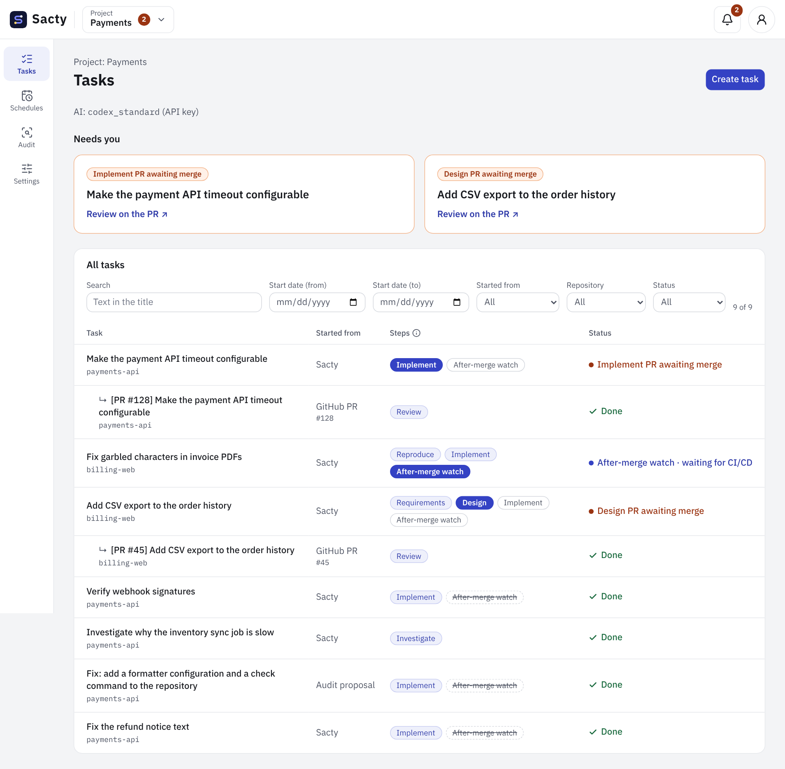
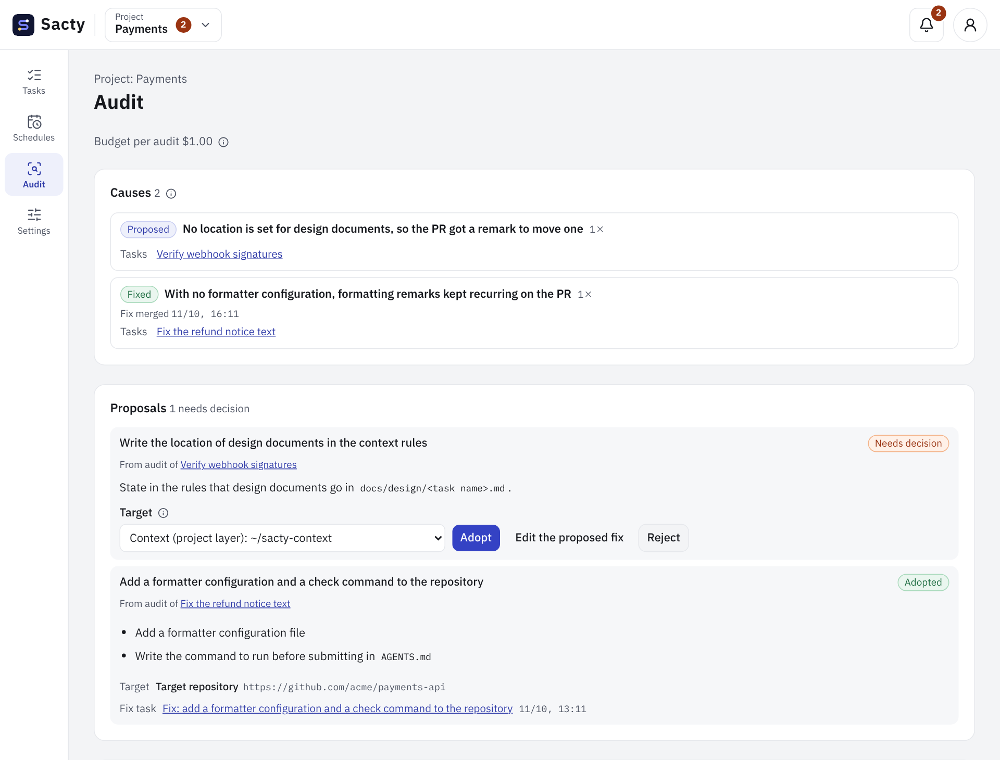

<!-- Code: apps/daemon/src/prompts.ts, apps/daemon/src/service.ts, apps/daemon/src/intake.ts, apps/daemon/src/context.ts, apps/daemon/src/audits.ts, apps/daemon/src/memory.ts, apps/daemon/src/gateway.ts, apps/daemon/src/agents/docker.ts, apps/daemon/src/agents/invocation.ts, apps/daemon/src/deployment.ts, apps/daemon/src/security.ts, apps/daemon/src/schedules.ts, apps/daemon/src/notifier.ts, packages/core/src/events.ts, apps/web/src/components/task-list.tsx, apps/web/src/components/audit-screen.tsx -->

[日本語](introduction.md) | **English**

# Introducing sacty

**Hand over what you want done, and sacty researches it, builds it, reviews it, and returns it as a PR. All you do is merge the PRs at the key points.**

sacty has AI agents such as Claude Code and Codex carry software development work through a defined set of steps (an AI software factory).
It runs on your machine, and AI does the research, planning, building, and review.
A person decides only at the approval points.

sacty looks at the request and chooses how to proceed.
A small fix is implemented right away, and a bug is reproduced first and then fixed.
A large feature goes through requirements, design, and implementation in order, and each moves on only after you approve it.

## Does this sound familiar?

- You explain the background and assumptions again every time you ask an AI
- You worry about what the AI produced, so you end up checking every detail yourself
- You wait in front of the screen while the AI works
- You keep pointing out the same things to the AI
- You are uneasy about giving an AI keys and permissions, so you cannot hand it more

sacty removes these reasons for not trusting AI with work, one by one, through how it works.

## What makes sacty different

### 1. You do not have to explain the background again

Before the work starts, AI reads the ticket's comments and links and the related code, and summarizes the goal, scope, and constraints.
It also reads internal documents if you connect them through MCP servers or APIs.
The summary is passed on to every step.

Write your team's rules, frequently used procedures (skills), and the MCP servers and internal APIs to use in a context repository, and they reach the AI in every task.
Contexts can be layered.
For example, you can keep what the whole company shares in one place, and have teams and projects inherit it and add to or override it.
Skills and connections that the whole company must use can be locked so that lower layers cannot change them.

See [Context repository](context.en.md) for how to write one.

### 2. AI checks the AI's work first

The AI for each step reviews its own work before submitting it.
Once it becomes a PR, another AI agent reviews it after running checks such as tests.
If there are remarks, the original AI fixes them, and this repeats within the budget until no remarks are left.
An implementation PR stays a draft until no remarks are left; then the draft is lifted and it waits for you to merge.

If you put a watch skill in the target repository, sacty also follows the CI/CD and deployment after the merge.
If they fail, it creates a fix task automatically ([After-merge watch](deployment-watch.en.md)).

### 3. You decide only when it is your turn

sacty runs several tasks in parallel.
Tasks that need your decision are listed under "Needs you".
If you set it up, sacty also notifies you through Slack or desktop notifications.

You decide on the GitHub PR.
**Merging a PR approves it; commenting sends it back** (results that are not PRs are approved in the sacty web UI).
When you send it back, the AI reads your remarks, fixes the work, and updates the PR.

### 4. It gets better the more you use it

When a task completes, AI looks back on its process (an audit).
If there were changes requested or trial and error, it finds the causes and proposes fixes (rules, skills, tests, and so on) so the same thing does not happen again.
When you adopt a proposal, it becomes a fix task and runs.
Lessons that help later tasks are kept as memories, which the AI reads in the next tasks of the same project or repository.

See [Viewing audits](audit.en.md) for how to read and use it.

### 5. You can trust it with the work

sacty limits what the AI can touch.

| Concern | How sacty handles it |
| --- | --- |
| Will the AI break my environment? | The AI runs in a container that is created for each run and thrown away. It works on a copy of the repository that sacty prepares for each task, not on your own working tree |
| I do not want to hand the keys of internal systems to the AI | Only the gateway running on your machine holds the keys for internal APIs, MCP servers, and GitHub. The gateway relays only the operations you allowed for internal APIs, and only reads for GitHub. The AI is given a token that works only during that run |
| Will it change GitHub on its own? | The AI can use GitHub directly only for reading. sacty pushes the branches and opens the PRs, and you are the one who merges |
| Will the costs grow? | You can set a budget limit per task. When it is reached, the task pauses before moving on to the next step |
| Can I trace what happened later? | Everything that happens is kept in the activity log, and you can also read the log of each AI run from the task screen |

The credentials for calling the AI service (Claude or Codex) are passed to the container, because the agent uses them.
With some endpoints, these can go through the gateway too ([Gateway](gateway.en.md)).

## Work you can hand over

| Work | Example |
| --- | --- |
| Adding or changing features | "Make the payment API timeout configurable" |
| Fixing bugs | It reproduces the bug first, then fixes it |
| Investigation | "Find out why the inventory sync job is slow". It summarizes the results without changing code |
| Writing documents | It drafts procedures and user guides. If you set up a connection, it can export approved results to Confluence, Notion, and so on |
| PR review | AI reviews PRs that people open and comments on them |
| Security checks | It examines a repository and writes a report. You can create tasks from the report to address the findings |
| Splitting large work | After you approve the design, it splits the work into child tasks, runs them, and checks the whole at the end |
| Recurring work | It creates tasks automatically on a schedule you set (daily, weekly, or monthly) |

You can write a request in the sacty web UI.
If you set it up, you can also make a request just by adding a label to a GitHub issue or a JIRA ticket.
In the same way, add a label to a PR or request a review from yourself, and sacty reviews that PR ([Intake of issues, PRs, and tickets](intake.en.md)).

## Try it

sacty is open source (MIT License) and runs on your own macOS machine.
You need the following to use it.

- macOS, Docker, the GitHub CLI (`gh`), and Node.js
- A plan that lets you use Claude Code or Codex (an API key, a subscription, and so on). AI usage is charged to that plan

Go through these pages in order.

1. [Getting started](getting-started.en.md): from installation to running your first task
2. [Working with tasks](tasks.en.md): how to create tasks and approve them on PRs
3. [Context repository](context.en.md): give your team's rules and skills to sacty

All pages are listed in the [user documentation contents](README.en.md).
