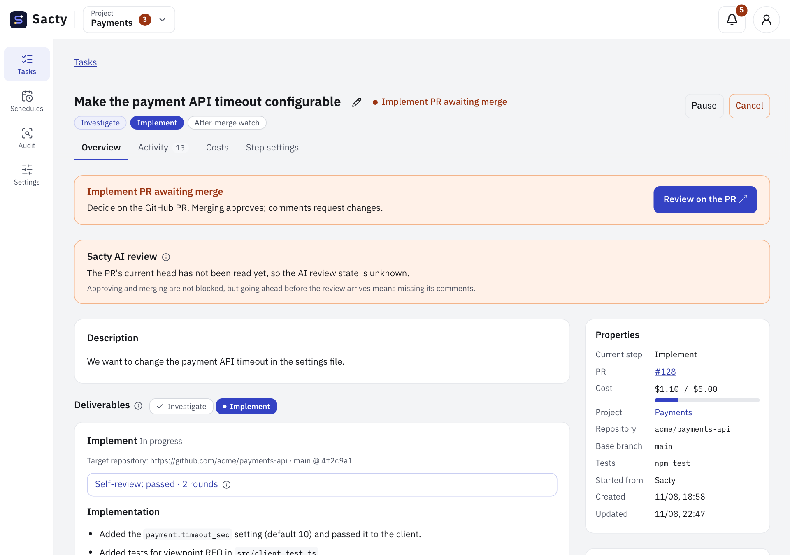
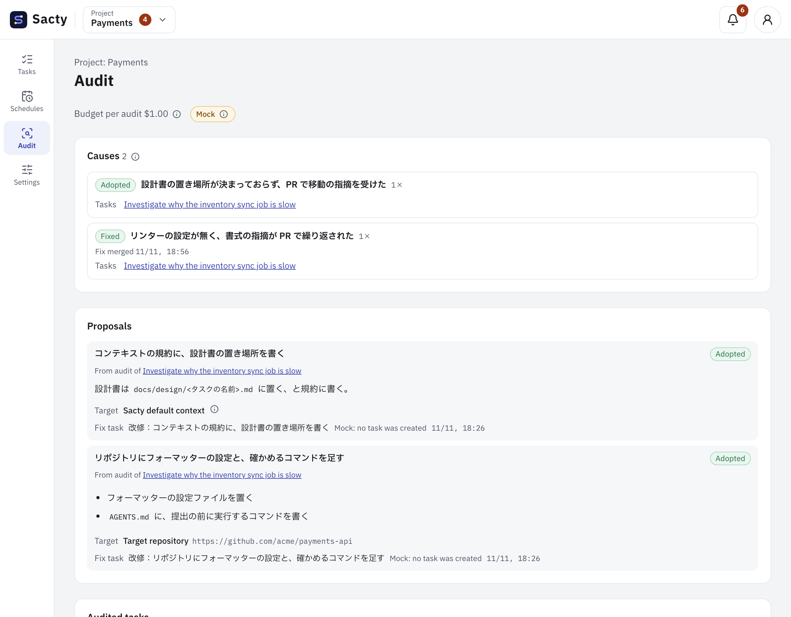
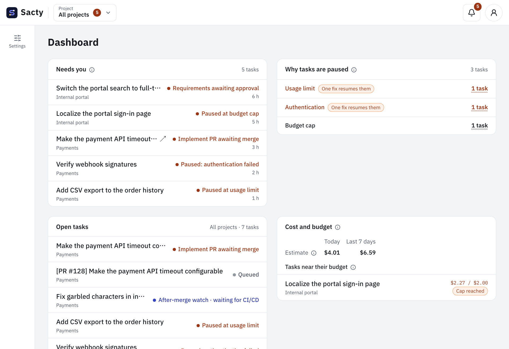

<!-- Code: apps/daemon/src/prompts.ts, apps/daemon/src/service.ts, apps/daemon/src/intake.ts, apps/daemon/src/audits.ts, apps/daemon/src/memory.ts, apps/daemon/src/gateway.ts, apps/daemon/src/schedules.ts, packages/core/src/events.ts -->

[日本語](introduction.md) | **English**

# Introducing sacty

**Hand over what you want done, and sacty researches it, builds it, reviews it, and returns it as a PR. All you decide is whether to merge.**

sacty lets you hand software development to AI agents (an AI software factory).
The flow of work and the points where a person decides are set in advance, so the work moves through its steps without detailed instructions to the AI every time.

## Does this sound familiar?

- You explain the background and assumptions again every time you ask an AI
- You worry about what the AI produced, so you end up checking every detail yourself
- You keep pointing out the same things to the AI
- You are uneasy about giving an AI keys and permissions, so you cannot hand it more

sacty removes these reasons for not trusting AI with work, one by one, through how it works.

## What makes sacty different

### 1. It gathers the context before it starts

Before the work starts, AI reads the ticket's comments and links, the related code, and internal documents, and summarizes the goal, scope, and constraints.
The summary is passed on to every step, so you do not have to explain the background again.

### 2. It chooses how to proceed for each piece of work

A small fix is implemented right away.
A large feature has its requirements and design checked before it is implemented.
A bug is reproduced first.
AI looks at the request and chooses the steps, so no work is pushed through a process heavier than it needs.

### 3. You only decide at the key points

For work that changes a repository, the requirements, design, and implementation arrive as GitHub PRs.
**Merging a PR approves it; commenting sends it back.**
You keep using your usual GitHub flow (results that are not PRs are approved in the sacty web UI).

Before a PR is opened, the AI reviews its own work, and another AI reviews the PR and fixes it until no remarks are left.
What reaches you is a PR that has already passed AI review.

### 4. It gets better the more you use it

When a task is done, AI looks back on its process (an audit).
If there were changes requested or trial and error, it finds the causes and proposes fixes (rules, skills, tests, and so on) so the same thing does not happen again.
When you adopt a proposal, sacty creates a fix task.
Lessons that help later tasks are kept as memories, which the AI reads in the next task.

### 5. You can teach it your team's way of working

Gather your team's rules, frequently used procedures (skills), and the MCP servers and internal APIs to use in a context repository.
sacty layers the organization, team, and project contexts on top of its own defaults, and passes them to the AI.
Rules shared across the company live in one place, and each team or project can add to or override them.
Once written, they do not need to be explained for every task.

### 6. You can trust it with the work

The AI runs in a container that is created for each run and thrown away.
When it uses internal APIs, MCP servers, or GitHub, the gateway on your machine adds the keys and relays the calls, and refuses operations that are not allowed.
What reaches the AI's container is a token that works only during that run.

| Concern | How sacty handles it |
| --- | --- |
| Will the AI break my environment? | The AI runs in a container that is created for each run and thrown away |
| I do not want to hand keys to the AI | Only the gateway holds the keys for internal APIs, MCP servers, and GitHub. AI calls can also go through the gateway if you configure it |
| Will the costs grow? | You can set a budget limit per task. When it is reached, the task pauses and you are notified |
| Will it change GitHub on its own? | The AI can use GitHub directly only for reading. sacty opens the PRs, and you are the one who merges |
| Can I trace what happened later? | Everything that happens is kept in the activity log, and you can look back at it from the task details |

## See every task at a glance

The dashboard shows the tasks waiting for your decision, the tasks that are stopped and why, and the costs.
You only need to look at the tasks where it is your turn.
When a decision is needed, sacty also notifies you through Slack or desktop notifications.

## Work you can hand over

| Work | Example |
| --- | --- |
| Adding or changing features | "Make the payment API timeout configurable" |
| Fixing bugs | It reproduces the bug first, then fixes it |
| Investigation | "Find out why the inventory sync job is slow". It summarizes the results without changing code |
| Writing documents | It writes specifications and procedures. It can also export them to Confluence or Notion |
| PR review | AI reviews PRs that people open |
| Security checks | It examines a repository and writes a report, from which you can create tasks to address the findings |
| Recurring work | It creates tasks automatically on a schedule you set |

You can write a request in the sacty web UI, or hand it over by adding a set label to a GitHub issue or PR or a JIRA ticket.

## AI you can use

You can choose Claude Code or Codex as the AI. You can also change the model for each step.

## Try it

sacty runs on your own macOS machine. Prepare Docker and the GitHub CLI, then start with the steps on these pages.

1. [Getting started](getting-started.en.md): from installation to running your first task
2. [Working with tasks](tasks.en.md): how to create tasks and approve them on PRs
3. [Context repository](context.en.md): give your team's rules and skills to sacty

All pages are listed in the [user documentation contents](README.en.md).
