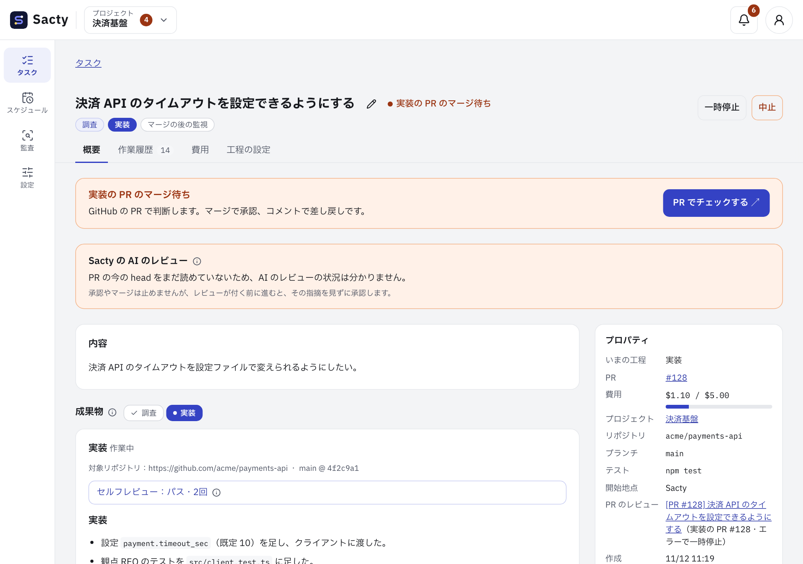
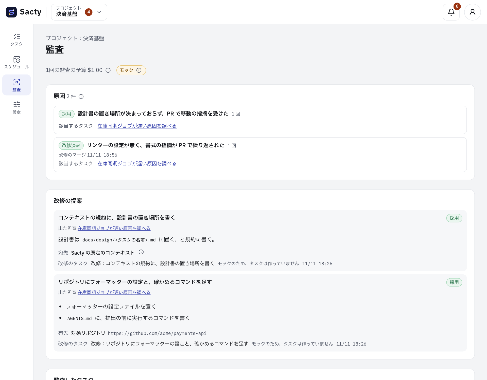
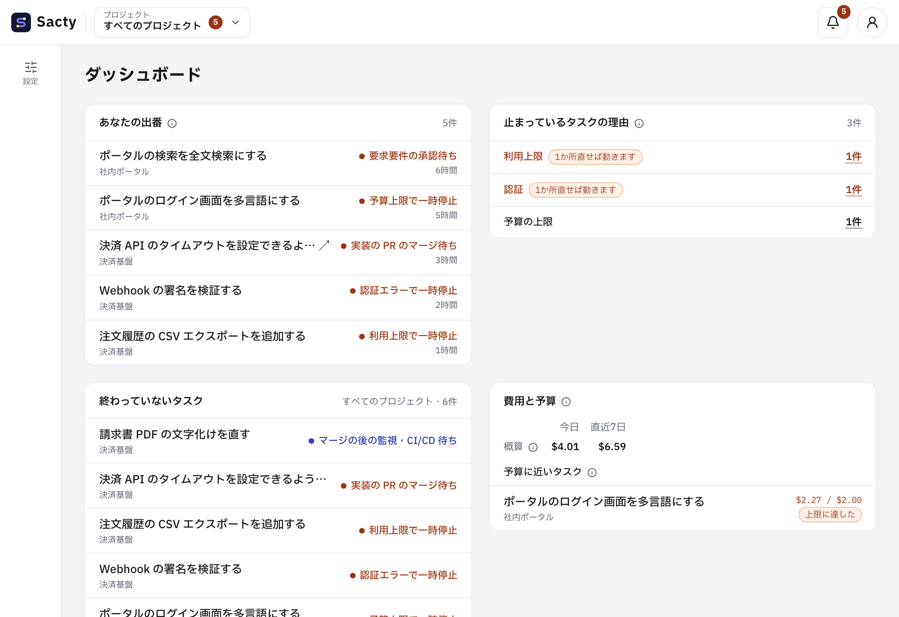

<!-- 対応するコード: apps/daemon/src/prompts.ts、apps/daemon/src/service.ts、apps/daemon/src/intake.ts、apps/daemon/src/audits.ts、apps/daemon/src/memory.ts、apps/daemon/src/gateway.ts、apps/daemon/src/schedules.ts、packages/core/src/events.ts -->

**日本語** | [English](introduction.en.md)

# sacty の紹介

**やりたいことを渡すと、調べて、作って、レビューして、PR にして返します。あなたは、マージするかどうかを決めるだけです。**

sacty は、ソフトウェア開発を AI エージェントに任せるための仕組み（AI ソフトウェアファクトリー）です。
AI に任せる作業の流れと、人が判断する場面をあらかじめ決めておくので、毎回 AI に細かく指示しなくても、仕事が工程に沿って進みます。

## こんなことに困っていませんか

- AI に頼むたびに、背景や前提を説明し直している
- AI の成果物が心配で、結局すみずみまで自分で確かめている
- 同じことを、何度も AI に指摘している
- AI に鍵や権限を渡すのが不安で、任せる範囲を広げられない

sacty は、こうした「AI に任せきれない理由」を、仕組みで1つずつ減らします。

## sacty の特長

### 1. 前提を集めてから動く

作業を始める前に、AI がチケットのコメントやリンク先・関係するコード・社内の資料を読み、目的・範囲・制約をまとめます。
まとめはすべての工程に引き継がれるので、あなたが背景を説明し直す必要はありません。

### 2. 作業に合わせて進め方を選ぶ

小さな修正なら、すぐに実装します。
大きな機能なら、要求要件と設計を確かめてから実装します。
不具合なら、まず再現します。
AI が依頼の中身を見て進め方を選ぶので、どんな作業も同じ重さで進めるという無駄がありません。

### 3. あなたは要所で判断するだけ

リポジトリを変える作業では、要求要件・設計・実装の成果が GitHub の PR として届きます。
**PR をマージすれば承認、コメントすれば差し戻し**です。
いつもの GitHub の流れのまま使えます（PR にならない成果は、sacty の画面で承認します）。

PR を出す前に、AI が自分の成果物を見直し、別の AI が PR をレビューして、指摘が無くなるまで直します。
あなたのところに届くのは、AI のレビューを通った PR です。

### 4. 回すほど賢くなる

タスクが終わると、AI がその過程を振り返ります（監査）。
差し戻しや試行錯誤があれば原因を探して、同じことが起きないための改修（ルール・スキル・テストなど）を提案します。
あなたが提案を採用すると、sacty は改修のタスクを作ります。
次のタスクにも役立つ知見はメモリーとして残り、次のタスクの AI が読みます。

### 5. チームのやり方を教えられる

チームのルール・よく使う手順（スキル）・使う MCP サーバーや社内の API は、コンテキストリポジトリにまとめておきます。
sacty は、自分の既定のやり方の上に、組織・チーム・プロジェクトのコンテキストを層のように重ねて、AI に渡します。
全社で共通のルールは1か所に置いて、チームやプロジェクトごとに足したり上書きしたりできます。
一度書いておけば、タスクのたびに説明する必要はありません。

### 6. 安心して任せられる

AI は、作業のたびに作って捨てるコンテナの中で動きます。
社内の API・MCP サーバー・GitHub を使うときは、あなたのマシンで動くゲートウェイが鍵を付けて中継し、許可していない操作は断ります。
AI のコンテナに渡るのは、その実行のあいだだけ使えるトークンです。

| 心配なこと | sacty の仕組み |
| --- | --- |
| AI が手元の環境を壊さないか | AI は、作業のたびに作って捨てるコンテナの中で動きます |
| AI に鍵を渡したくない | 社内の API・MCP サーバー・GitHub の鍵は、ゲートウェイだけが持ちます。AI の呼び出しも、設定すればゲートウェイを通せます |
| 費用が膨らまないか | タスクごとに予算の上限を決められます。上限に達したら、一時停止して知らせます |
| GitHub を勝手に書き換えないか | AI が GitHub を直接使えるのは読み取りだけです。PR は sacty が作り、マージするのはあなたです |
| あとから経緯を追えるか | 起きたことはすべて作業履歴に残り、タスクの詳細から振り返れます |

## すべてのタスクを一目で

ダッシュボードには、あなたの判断を待っているタスク・止まっているタスクとその理由・費用が並びます。
あなたは、出番が来たタスクだけを見れば十分です。
判断が要るときは、Slack やデスクトップの通知でも知らせます。

## こんな作業を任せられます

| 作業 | 例 |
| --- | --- |
| 機能の追加・改修 | 「決済 API のタイムアウトを設定で変えられるようにする」 |
| 不具合の修正 | まず再現してから直します |
| 調査 | 「在庫同期のジョブが遅い原因を調べる」。コードは変えずに結果をまとめます |
| ドキュメントの作成 | 仕様書や手順書を書きます。Confluence や Notion へ書き出すこともできます |
| PR のレビュー | 人が出した PR を AI がレビューします |
| セキュリティチェック | リポジトリを調べてレポートにし、対応のタスクを作れます |
| 定期的な作業 | 決めた予定で、タスクを自動で作ります |

依頼は、sacty の画面から書くほか、GitHub の Issue・PR や JIRA のチケットに決まったラベルを付けて渡すこともできます。

## 使える AI

AI は Claude Code と Codex から選べます。工程ごとに使うモデルを変えることもできます。

## 使ってみる

sacty は、macOS の手元のマシンで動きます。Docker と GitHub CLI を用意して、次のページの手順で始めてください。

1. [はじめに](getting-started.md)：インストールから、最初のタスクを進めるまで
2. [タスクを進める](tasks.md)：タスクの作り方と、PR での承認の仕方
3. [コンテキストリポジトリ](context.md)：チームのルールやスキルを sacty に渡す

すべてのページは [ユーザードキュメントの目次](README.md) にあります。
