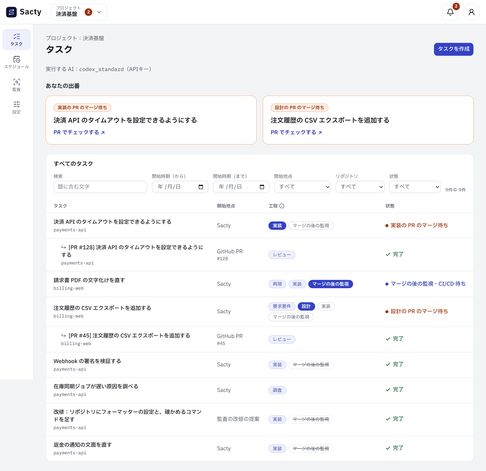
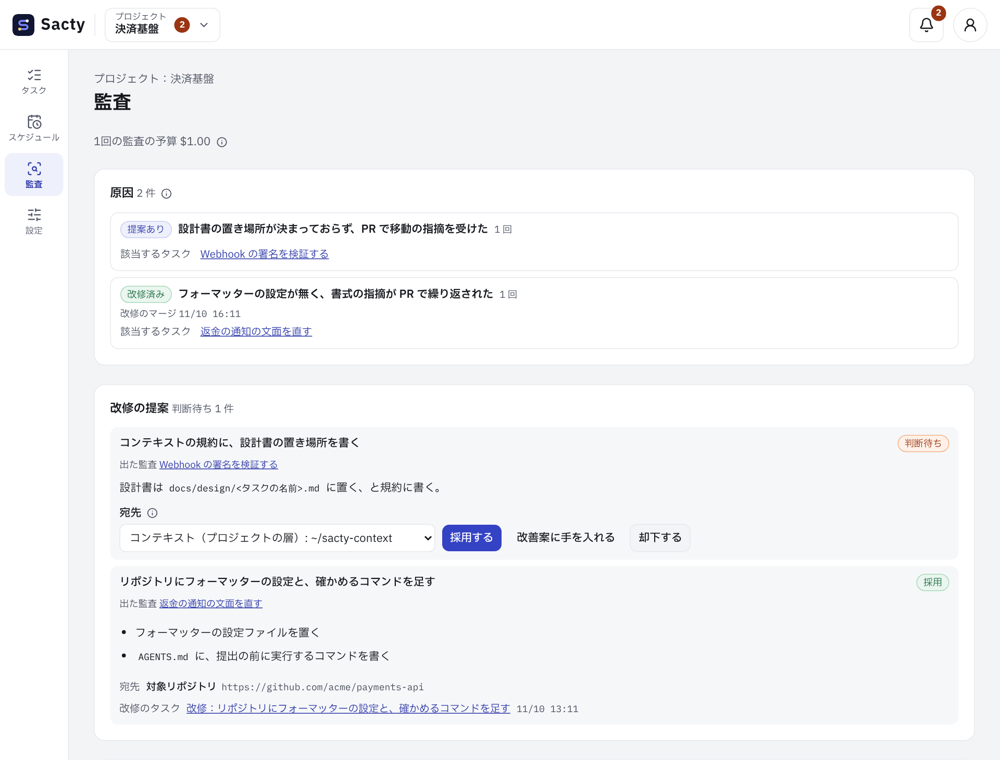

<!-- 対応するコード: apps/daemon/src/prompts.ts、apps/daemon/src/service.ts、apps/daemon/src/intake.ts、apps/daemon/src/context.ts、apps/daemon/src/audits.ts、apps/daemon/src/memory.ts、apps/daemon/src/gateway.ts、apps/daemon/src/agents/docker.ts、apps/daemon/src/agents/invocation.ts、apps/daemon/src/deployment.ts、apps/daemon/src/security.ts、apps/daemon/src/schedules.ts、apps/daemon/src/notifier.ts、packages/core/src/events.ts、apps/web/src/components/task-list.tsx、apps/web/src/components/audit-screen.tsx -->

**日本語** | [English](introduction.en.md)

# sacty の紹介

**やりたいことを渡すと、調べて、作って、レビューして、PR にして返します。**\
**あなたは、要所で PR をマージするだけです。**

sacty は、Claude Code や Codex などの AI エージェントに、ソフトウェア開発の仕事を工程に沿って進めさせる仕組み（AI ソフトウェアファクトリー）です。\
あなたのマシンで動き、下調べ・計画・作業・レビューを AI が進めます。\
人が判断するのは、承認の場面だけです。

進め方は、依頼の中身を見て sacty が選びます。\
小さな修正ならすぐに実装し、不具合ならまず再現してから直します。\
大きな機能なら、要求要件・設計・実装の順に進め、それぞれをあなたが承認してから次へ進みます。

## こんなことに困っていませんか

- AI に頼むたびに、背景や前提を説明し直している
- AI の成果物が心配で、結局すみずみまで自分で確かめている
- AI が作業している間、画面の前で待っている
- 同じことを、何度も AI に指摘している
- AI に鍵や権限を渡すのが不安で、任せる範囲を広げられない

sacty は、こうした「AI に任せきれない理由」を、仕組みで1つずつ減らします。

## sacty の特長

### 1. 背景を説明し直さなくていい

作業を始める前に、AI がチケットのコメントやリンク先、関係するコードを読んで、目的・範囲・制約をまとめます。\
社内の資料も、MCP サーバーや API でつないでおけば読みます。\
まとめは、すべての工程に引き継がれます。

チームのルール・よく使う手順（スキル）・使う MCP サーバーや社内の API は、コンテキストリポジトリに書いておくと、すべてのタスクで AI に渡ります。\
コンテキストは、層のように重ねられます。\
たとえば、全社で共通のものを1か所に置き、チームやプロジェクトがそれを引き継いで、足したり上書きしたりできます。\
全社で必ず使わせたいスキルや接続先は、下の層で変えられないように固定できます。

書き方は [コンテキストリポジトリ](context.md) にあります。

### 2. AI の成果物を、AI が先に確かめる

工程の AI は、成果物を出す前に自分で見直します。\
PR になると、別の AI エージェントが、テストなどの検証を実行したうえでレビューします。\
指摘があれば元の AI が直し、指摘が無くなるまで、予算の範囲で繰り返します。\
実装の PR は、指摘が無くなるまでドラフトにしておき、無くなったらドラフトを外して、あなたのマージを待ちます。

対象のリポジトリに監視のためのスキルを置くと、マージの後の CI/CD とデプロイまで見届けます。\
失敗していれば、修正のタスクを自動で作ります（[マージの後の監視](deployment-watch.md)）。

### 3. あなたは、出番のときだけ判断する

sacty は、複数のタスクを並行して進めます。\
あなたの判断が要るタスクは「あなたの出番」に並びます。\
設定すれば、Slack やデスクトップの通知でも知らせます。

判断は GitHub の PR で行います。\
**PR をマージすれば承認、コメントすれば差し戻し**です（PR にならない成果は、sacty の画面で承認します）。\
差し戻すと、AI が指摘を読んで直し、PR を更新します。

### 4. 回すほど賢くなる

タスクが完了すると、AI がその過程を振り返ります（監査）。\
差し戻しや試行錯誤があれば原因を探し、同じことが起きないための改修（ルール・スキル・テストなど）を提案します。\
あなたが提案を採用すると、改修のタスクになって進みます。\
次のタスクにも役立つ知見はメモリーとして残り、同じプロジェクトやリポジトリの次のタスクで AI が読みます。

見方と操作は [監査](audit.md) にあります。

### 5. 安心して任せられる

sacty は、AI が触れられるものを絞っています。

| 心配なこと | sacty の仕組み |
| --- | --- |
| AI が手元の環境を壊さないか | AI は、作業のたびに作って捨てるコンテナの中で動きます。作業するのは、sacty がタスクごとに用意したリポジトリの写しで、あなたの手元の作業ツリーではありません |
| 社内の仕組みの鍵を AI に渡したくない | 社内の API・MCP サーバー・GitHub の鍵は、あなたのマシンで動くゲートウェイだけが持ちます。ゲートウェイは、社内の API なら許可した操作だけ、GitHub なら読み取りだけを中継します。AI には、その実行のあいだだけ使えるトークンを渡します |
| GitHub を勝手に書き換えないか | AI が GitHub を直接使えるのは読み取りだけです。ブランチのプッシュと PR の作成は sacty が行い、マージするのはあなたです |
| 費用が膨らまないか | タスクごとに予算の上限を決められます。上限に達すると、次の工程に進む前に一時停止します |
| あとから経緯を追えるか | 起きたことはすべて作業履歴に残り、AI の実行ごとのログもタスクの画面から読めます |

AI のサービス（Claude・Codex）を呼ぶための認証は、エージェントが使うので、コンテナに渡ります。\
接続先によっては、これもゲートウェイ経由にできます（[ゲートウェイ](gateway.md)）。

## こんな作業を任せられます

| 作業 | 例 |
| --- | --- |
| 機能の追加・改修 | 「決済 API のタイムアウトを設定で変えられるようにする」 |
| 不具合の修正 | まず再現してから直します |
| 調査 | 「在庫同期のジョブが遅い原因を調べる」。コードは変えずに、結果をまとめます |
| 文書の作成 | 手順書やユーザーガイドの原稿を書きます。接続先を設定すれば、承認した成果を Confluence や Notion などへ書き出せます |
| PR のレビュー | 人が出した PR を、AI がレビューしてコメントします |
| セキュリティチェック | リポジトリを点検してレポートにします。レポートから、対応のタスクを作れます |
| 大きな作業の分割 | 設計を承認したあと、子タスクに分けて進め、最後に全体を確かめます |
| 定期的な作業 | 決めた予定（毎日・毎週・毎月）で、タスクを自動で作ります |

依頼は、sacty の画面で書けます。\
設定しておけば、GitHub の Issue や JIRA のチケットにラベルを付けるだけでも依頼できます。\
同じように、PR にラベルを付けるか、あなたにレビューを依頼すると、その PR をレビューします（[Issue・PR・チケットの取り込み](intake.md)）。

## 使ってみる

sacty はオープンソース（MIT ライセンス）で、あなたの macOS のマシンで動きます。\
使うには、次のものが要ります。

- macOS・Docker・GitHub CLI（`gh`）・Node.js
- Claude Code か Codex を使える契約（API キーやサブスクリプションなど）。\
  AI の利用料は、その契約にかかります

次のページの順に進めてください。

1. [はじめに](getting-started.md)：インストールから、最初のタスクを進めるまで
2. [タスクを進める](tasks.md)：タスクの作り方と、PR での承認の仕方
3. [コンテキストリポジトリ](context.md)：チームのルールやスキルを sacty に渡す

すべてのページは [ユーザードキュメントの目次](README.md) にあります。
