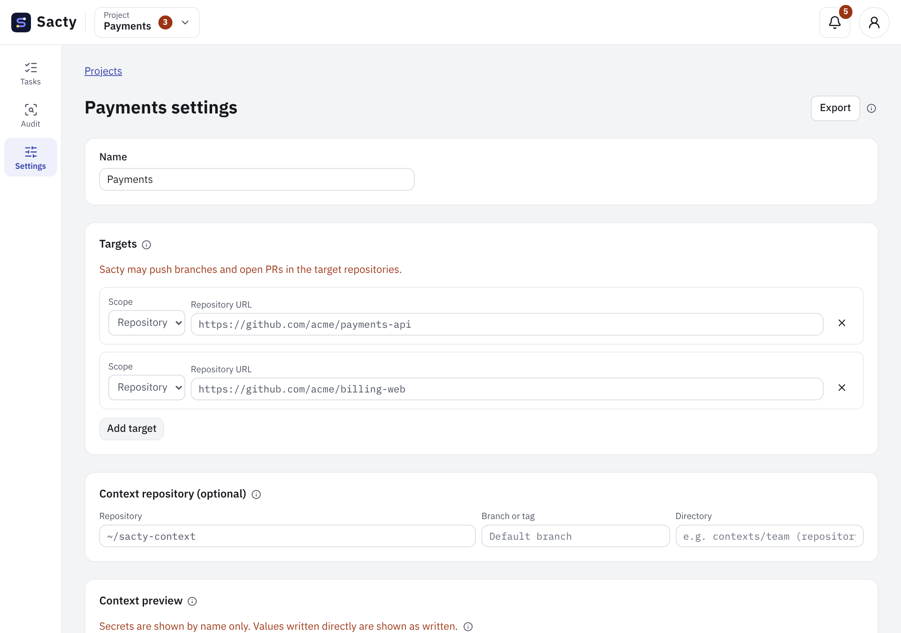

<!-- Code: packages/core/src/projects.ts (ProjectDefinition, ProjectTarget, ProjectExport), packages/core/src/github-url.ts, apps/daemon/src/gh.ts, apps/daemon/src/github.ts, apps/web/src/components/project-editor.tsx, apps/web/src/i18n/messages/projects.ts, apps/web/src/components/shell/follow-project.tsx, apps/web/src/components/delete-project.tsx, apps/web/src/app/actions.ts (deleteProjectAction) -->

[日本語](project-settings.md) | **English**

# Project settings

You register per-project settings in the project settings of the web UI (they do not go in config.yaml).

You open a project's settings at `/projects/<ID>/settings` ("Settings" in the side menu opens the settings of the project selected in the header).
You switch the displayed project in the header of the web UI (choosing one moves to that project's task list). When you create or import a project, the web UI switches to that project and opens its settings. When you open a task or a project's settings (from a list, a notification link, or a URL), the header also switches to that project ([Web UI screens](getting-started.en.md#web-ui-screens)).

| Field | Contents | Details |
| --- | --- | --- |
| Name | The name of the project (up to 80 characters) | |
| Targets | The orgs and repositories to create tasks for and import issues and PRs from | [Targets](#targets) |
| Ticket sources (optional) | The connection and keys for importing JIRA tickets | [Intake](intake.en.md#jira-tickets) |
| Context repository (optional) | Rules, skills, MCP, and external platforms passed to step agents | [Context repository](context.en.md) |
| Available external platforms | APIs that step agents can call through `$SACTY_PF_URL` (display only) | [Gateway](gateway.en.md#organization-platform-pf-apis) |
| GitHub account | The `gh` account to use for each host | [GitHub account](#github-account) |
| Shared compose (optional) | A team-shared docker compose used for tests | [docker compose services](compose.en.md#shared-compose) |

Slack notifications are not in project settings: set one destination shared by all projects in the "Sacty settings" ([Notifications](notifications.en.md)).

The after-merge watch is not turned on or off in project settings. If the target repository has the skill, it is added to the task's steps ([After-merge watch](deployment-watch.en.md)).

The project settings page looks like this.



## Targets

Write each target (a GitHub org or repository) as an `https://` URL that includes the host (for example `https://github.com/acme/app` or `https://ghe.example.com/acme`). github.com and GitHub Enterprise Server use the same form.

- sacty corrects a trailing `/` or `.git`, a query (`?…`) or `#…`, full-width characters, and invisible characters that slip in when pasting, when it reads the URL.
- For a URL that can't be read, the reason (http, SSH, an extra `/tree/…`, org and repository scope mixed up, and so on) is shown under the input.
- The host of a target that can't be read does not appear in the "GitHub account" section.

sacty uses the targets as follows.

- When you create a task in the web UI, you choose a repository from the targets (for an org target, you choose from that org's repositories read with `gh`).
- sacty imports open issues and PRs in the targets ([Intake](intake.en.md)).
  - Issues that have the label to import are imported as tasks.
  - PRs that have the review label (or that request your review) are imported as review-only tasks.
- The same org or repository cannot be registered in another project. If an org and a repository in it are in different projects, the repository takes precedence (it is excluded from the org's project).
- If you choose an "Image" for a target (a name in `images` of `config.yaml`, or `default`), the Orchestrator does not choose one, and every step uses it. A repository's choice takes precedence over its org's ([Container images](images.en.md#which-image-a-step-runs-in)). The list shows only the image names, and the description of the chosen image (`description` in `images`) appears below the target's row.

Once you register a target, sacty may push branches to the target repositories and open PRs, depending on the task.

## GitHub account

sacty accesses GitHub with the accounts signed in to the GitHub CLI (`gh`) on the host. It accesses GitHub to import issues, clone, push, create PRs, comment investigation results on issues, and post reviews on PRs. You can use github.com and any number of GitHub Enterprise Server instances at the same time.

```sh
gh auth login                                 # github.com. Sign in with each account you use
gh auth login --hostname ghe.example.com      # Sign in to each GitHub Enterprise Server host as well
```

- Always choose the account to use for each target host in the project settings (at first, the active `gh` account on that host is selected).
  - Even if you switch accounts in `gh`, sacty uses the account chosen for each project.
  - Until you choose one, sacty stops access to that host with the reason.
- An account is optional for hosts used only by the context repository or a shared compose. If you do not choose one, sacty uses the host's git authentication.
- The API is `https://api.github.com` for github.com and `https://<host>/api/v3` for GitHub Enterprise Server.
- sacty clones and pushes HTTPS repositories with the token of that host's account (you do not need to set up git authentication on the host). SSH URLs and local paths use the host's authentication (ssh-agent and so on).
- sacty fetches the token from `gh` each time it uses it, and the token never appears in the activity log, logs, the web UI, or containers.
- Open "gh accounts Sacty can see" in the "GitHub account" section to check the accounts the daemon read from `gh auth status`, listed by host, account, and status. If a host is missing, it is not signed in to `gh` for the user running the daemon (also check differences such as `GH_CONFIG_DIR`).
- After you sign in to `gh` again or add an account, press "Reload accounts" in the "GitHub account" section. The daemon checks `gh auth status` again and updates the accounts you can choose and the list. Your unsaved input stays.
- An account with the status "Not verified" is one whose token `gh` could not verify (the reason is shown in the list). You can still choose it, but for a GitHub Enterprise Server behind a corporate proxy, make sure `HTTPS_PROXY`, `NO_PROXY`, `SSL_CERT_FILE`, and similar are set in the shell that starts the daemon. The daemon passes them to `gh`.

## Context repository

In the "Context repository" field, write the following.

- Repository: a git URL or an absolute local path (a path starting with `~/` also works).
- Branch or tag (optional): if empty, a git URL uses the default branch, and a local path uses the current contents of the directory.
- Directory (optional): to use part of a monorepo as the context, the path relative to the repository root (e.g. `contexts/team`). If empty, the repository root is used.

See [Context repository](context.en.md) ([Where to put it](context.en.md#where-to-put-it)) for how to write it and what it contains. To remove it, clear the repository and save.

When you save, sacty reads and checks the context, and tells you if `mcp.yaml`, `platforms.yaml`, or other files have errors. sacty still saves the settings, but as they are, step runs will stop.

## Export and import

You can export a project definition and import it into another sacty.

- Included: the name, targets (including image choices), the context repository, ticket sources, and shared composes.
- If a file exported by an earlier sacty has the after-merge watch setting, it is imported without reading that setting.
- Not included: GitHub accounts (personal settings), tokens, and Slack notifications (they are in the "Sacty settings", not in project settings).
- On import, files with unknown fields are rejected.
- Files exported with an earlier version (version 3 or 4) cannot be imported, whether or not they include a notification destination. The web UI shows the reason; export the project again with the current sacty.

## Deleting a project

You can delete a project from the "Danger zone" at the end of the project settings page.

1. Click "Delete project".
2. In the confirmation dialog, type the project name exactly. When the name matches, you can click "Delete".
3. After deleting, the web UI moves to the project list.

- A deleted project cannot be restored. If you want to keep its definition, export it first.
- Only the project settings are deleted. Tasks and the activity log are kept, but they no longer appear on any screen (opening a task's URL shows that it is not found) or count on the dashboard.
- While the project has unfinished tasks (other than completed and cancelled ones), work still running or queued (such as audits), or a question being answered, it cannot be deleted.
  The dialog shows the count; complete or cancel the tasks, then delete the project again.

## Related pages

- [Issue, PR, and ticket intake](intake.en.md)
- [Working with tasks](tasks.en.md)
- [Context repository](context.en.md)
