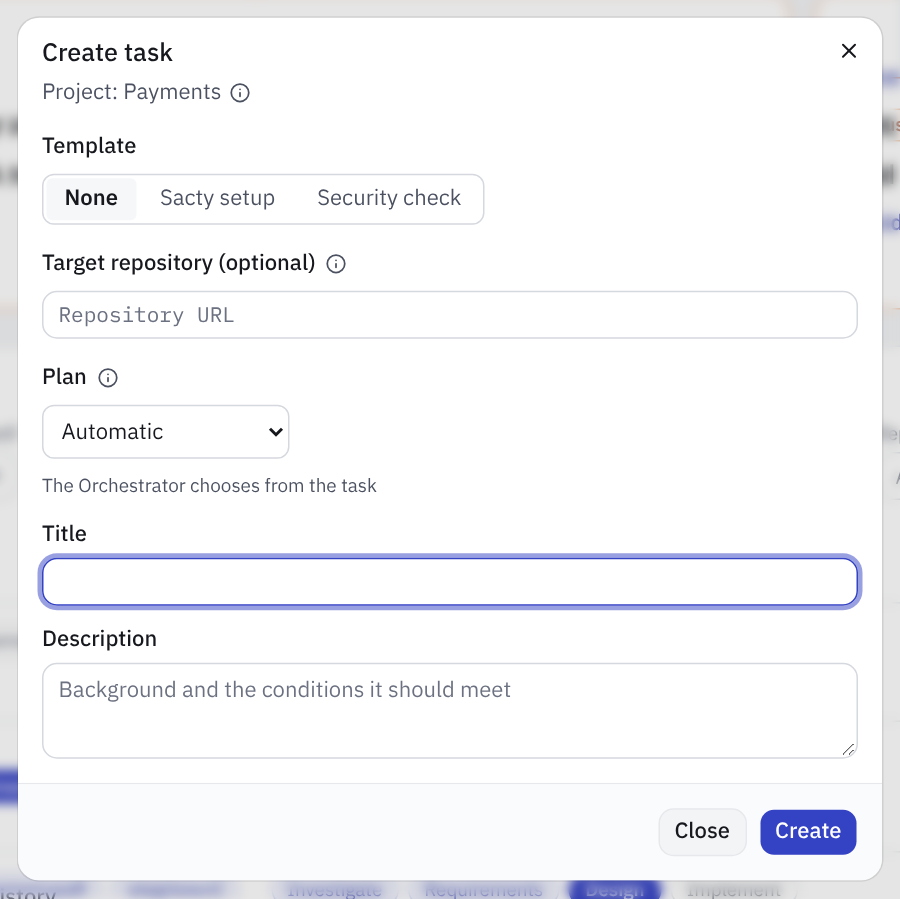
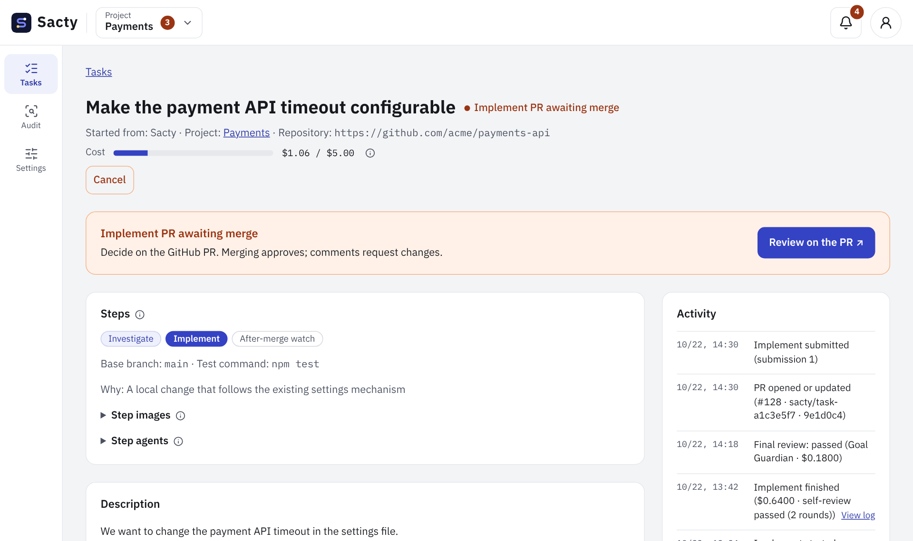
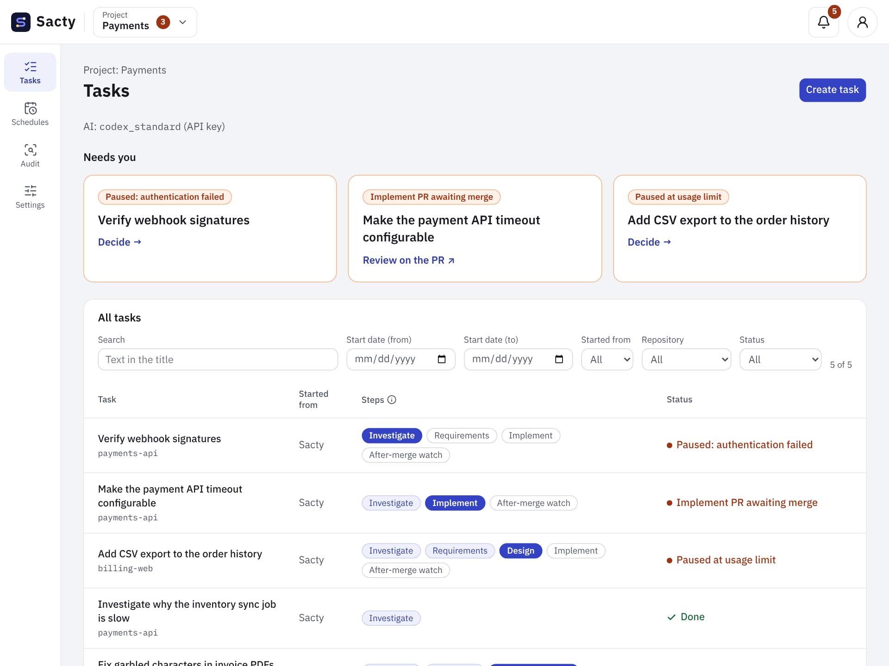

<!-- Code: apps/daemon/src/config.ts, apps/web/src/components/task-detail.tsx, apps/daemon/src/service.ts, apps/daemon/src/activity.ts, apps/daemon/src/pr-watcher.ts, apps/daemon/src/prompts.ts, packages/core/src/events.ts (StepKey, DEFAULT_DOCUMENTS_DIR), apps/web/src/i18n/messages/task.ts, apps/daemon/src/task-templates.ts, apps/daemon/src/test-files.ts, apps/web/src/components/new-task-dialog.tsx, apps/web/src/components/implementation.tsx, apps/web/src/components/task-list.tsx, apps/web/src/lib/task-filter.ts -->

[日本語](tasks.md) | **English**

# Working with tasks

When you create a task, the Orchestrator and the Goal Guardian move it through the steps. You make decisions only at approval gates.

A task proceeds as follows.


## Create a task

Press "Create task" in the task list to open this dialog.



- When you create a task in the web UI, you choose a repository from the project's targets ([Project settings](project-settings.en.md#targets)).
  - sacty reads the repository suggestions when you press "Create task" and the dialog opens. For an org target, `gh` asks GitHub, which can take a few seconds.
  - While they load, when they cannot be read, or when there are none, the dialog says so. In every case, you can type the repository URL and create the task.
- You can also import tasks from issues, PRs, and tickets ([Intake](intake.en.md)).
- You can also create a task without choosing a repository (research, overall design, or a large task to split). The Orchestrator chooses how to proceed from the project's context (the rules in the context repository and the export destinations) and its targets (the list of repositories).
  - Work that does not change code (investigation only, design only) proceeds without a repository and finishes when you approve it in the sacty web UI. No PR or branch is created. If there is an export destination, the results are exported.
  - For a large task to split, Task split chooses a repository from the targets for each child task (and records why). Integration review reads the latest base branch of each child task's repository.
  - For a task that needs code changes and is not split, the Orchestrator chooses a repository from the targets, prepares it, and then chooses the steps again. If it cannot choose, the task stops. You can choose the repository in the task details and resume.
- In "Plan", you can choose the combination of steps ("Specify the plan" below). With the default, "Automatic", the Orchestrator chooses from the task.
- The Orchestrator decides the base branch and the test command at the start of the task by reading the repository. In a repository without tests, the task proceeds without using tests ("Repositories without tests" below).
- The Orchestrator leaves out steps that are not needed.
  - A small change whose request is clear and that uses existing mechanisms may proceed as "investigation → implementation", without requirements or design.
  - Each time a step finishes (after the preliminary investigation, after the requirements are approved, and so on), it reviews whether the remaining requirements, design, and reproduction steps are needed and skips the ones that are not.
  - Skipped steps are shown struck through in the list of steps. The reason appears in the activity log.
  - For what was skipped, the Goal Guardian reviews the implementation against the task's purpose (the request), and you approve it by merging the PR.
- Whether the development setup (installing dependencies, building, and so on) runs depends on the step.
  - Choosing the steps, and investigations that read and explain code or how things work, do not run it. This takes precedence even if the repository's AGENTS.md or similar has setup instructions.
  - Bug investigation, Reproduce, and Implementation set up the repository as its instructions say.

### Specify the plan

To proceed differently from how the Orchestrator would choose, pick a plan in "Plan" under "Create task". When you pick one, the sequence of steps appears below it.

| Plan | Steps | When to use |
| --- | --- | --- |
| Automatic | The Orchestrator chooses | Default |
| Standard | Investigate → Requirements → Design → Implement → After-merge watch | Changes with several behaviors or a wide impact |
| Skip design | Investigate → Requirements → Implement → After-merge watch | Small, local changes |
| Implement directly | Investigate → Implement → After-merge watch | Changes whose request is itself the acceptance criteria |
| Bug fix | Investigate → Reproduce → Implement → After-merge watch | Bugs that tests can reproduce |
| Split | Investigate → Requirements → Design → Task split → Integration review | Changes that do not fit in one PR |
| Investigate only | Investigate | Questions, cause analysis, estimates |
| Review only | Review | Reviewing the PR linked in the description |
| Document | Document | Drafts such as procedure documents, user guides, and reports |
| Operation only | Operation | One-off changes to external services |
| Design only | Requirements → Design | Overall design without code changes |

- When you specify a plan, the Orchestrator does not choose again and does not skip steps in the review after each step. It still decides the base branch, the test command, the images, and so on as usual.
- "Review only" can be chosen only when you choose a target repository and put a link to a PR of that repository in the title or description. Otherwise, the reason appears when you create the task.
- You can also choose a plan that implements (Standard, Implement directly, and so on) without choosing a repository. The Orchestrator chooses a repository from the targets and then proceeds with the plan you specified.
- The specified plan appears in the "Steps" section of the task details.
- When you choose a template, you cannot choose a plan.

### Template "Sacty setup"

You can create a task that prepares the AI agent settings of a repository so that sacty can work with it, just by choosing the repository.

1. On the "Create task" screen, choose the "Sacty setup" template.
2. Choose the target repository and press "Create". You do not enter a title or contents (sacty decides them).

Like a normal task, the Orchestrator chooses how to proceed, and the task goes through approvals and PRs. The agent checks the following and opens a PR that fills in what is missing.

- Instructions for agents (AGENTS.md, CLAUDE.md, and so on)
- How to run the tests
  - If the repository has no tests yet, the agent writes that there are none and how to check changes.
  - This task does not add a new language or test framework.
- Services the tests need (databases, mocks, and so on)
- The after-merge watch skill `deployment-observer` ([After-merge watch](deployment-watch.en.md#skill))
  - It is created for repositories with CI/CD (even if they do not deploy). If there is no CI/CD, it is not created.
  - The original is `.agents/skills/deployment-observer/SKILL.md`. `.claude/skills/deployment-observer` for Claude Code is a relative symbolic link to the original.
  - A reference on how to check CI/CD (`references/ci.md`) is also created. If the repository does not deploy, the skill says to skip the deployment check.

If everything is already in place and nothing needs to change, the task finishes without a PR, keeping the check results as investigation results (you approve it in the web UI to finish). If, after Requirements, Design, and Implementation, it turns out that nothing needs to change, no PR is created either. The check results are kept in the implementation notes, and the task finishes when you approve it in the web UI (see "When the implementation has no changes" below).

For tasks created from a template, the template name appears in "Started from" in the list, at the top of the details, and in "Task created" in the Activity.

From the API, send `{"template": "sacty-setup", "projectId": "<project ID>", "repo": "<repository URL>"}` to `POST /api/tasks` (do not pass `title` or `body`). The CLI has no command to create tasks.

## Information gathering at the start of a task

When a task starts, before the Orchestrator chooses the plan, the information gatherer collects the information related to the task. For a task taken in from a ticket, it follows the parent story and epic, linked tickets, and URLs in comments, chooses the repository to work in from the gathered information, and also writes the task title and summary. If it cannot choose, the task stops and you can choose the repository on the task page and resume (the gathered information is kept, and only the title and summary are rewritten). It also searches for the task's terms with the available MCP servers and external platforms (documents, chat, and so on).

- The gathered information is summarized down to what is relevant and shown under "Gathered information" in the task details (collapsed once a step has started). Sources that could not be read and conflicts between sources are written too.
- The summary is given to the Orchestrator, every step, and the Goal Guardian. The Goal Guardian uses it only to understand the background; the basis of its verdicts stays the approved deliverables.
- You can choose the AI with `step_agents.gather` in `config.yaml` (the Orchestrator's AI if omitted; [config.yaml settings](config.en.md#models-per-step)). The cost is counted toward the task budget and shown in the "Information gathering" row of the per-step cost table.
- If it cannot summarize, the task is paused. Resuming gathers again.
- Split child tasks do not gather again; they carry over the information their parent gathered in their content.
- Information gathering only reads. For the gateway's external platforms, only GET and HEAD pass during information gathering, even if `allow` has write APIs. sacty cannot restrict the tools of MCP servers, so the instructions have it use only read operations. Be careful when the context includes an MCP server with write tools.
- To let it read external documents or chat, add the destination as an external platform of the gateway or an MCP server of the context ([Gateway](gateway.en.md), [Context repository](context.en.md)).

## Documents and one-off external work

To create a user guide, a procedure document, meeting notes, or a translated draft, write the audience, purpose, and source contents in the task. To write a procedure document based on a repository's code, choose that repository (the Document step reads the code; the repository is not changed). If the Orchestrator chooses a different plan, choose "Document" in "Plan".

- Review the Markdown draft in Document, request changes, and approve it.
- The draft is exported after approval only if the Orchestrator selected a destination. Check the selected destination and reason in the task's steps section ([Exporting results](result-export.en.md)).
- An export failure does not stop the draft from completing. Also check whether the external publication succeeded.
- To change documentation files in a repository, choose that repository. The change follows the normal Implementation and PR approval flow.

Like the other steps, the Document step can use the project context (rules, skills, and MCP servers), external destinations, and GitHub reads. To have it use external material, write which destination to read and what to read in the task body or in a Request changes comment. The draft itself is not written to external services directly; it is exported after approval.

You can also request an update to a calendar, a register, or an existing external page without choosing a repository. This covers one-off changes that use one configured destination. Apart from the chosen destination, GitHub can always be read (reading only; [Gateway](gateway.en.md#reading-github)).

1. Write the specific target ID/URL, the change and its preconditions, and the desired result in the request. The Orchestrator selects the destination, target, requested change, and verification method. If target or connection details are missing, the task stops before execution starts.
2. The single Operation step performs the request once. There is no separate preparation step or pre-execution approval. Confirm that the request is correct before starting the task.
3. Check the evidence in the successful result and approve it to complete the task. Failure or an unknown result does not count as completion.

After step selection, the task details show the selected destination and connection type, target, requested change, and verification method as read-only information. This view is not a pre-execution approval gate and does not stop the task.

If target details are missing, add the missing information to the request and create a new task. If the selected connection became unavailable before execution started, correct its configuration and resume the task.

You cannot request changes after execution starts. Resume is rejected after interruption, restart, or failure, and the task stays paused. Check the actual state in the external service, cancel the task, and create a new task for only the changes that remain undone.

sacty instructs the agent to write once and check the result after the change. However, this does not guarantee that the external service prevents duplicates.

You can also request replies on GitHub PRs and issues as an operation (for example "Reply to the review comments on https://github.com/acme/app/pull/12"). The hosts for which a GitHub account is chosen in the project settings become destination candidates. The agent reads the PR or issue and writes the reply in its output.

When you approve the result, sacty posts the reply ([Comments on PRs and issues](#comments-on-prs-and-issues)). It cannot fix or push code. To fix a PR's code, create a task with the repository selected.

Recurring updates, monitoring, and automation of long-running work across several destinations are outside this scope. Split requests with several deliverables, such as a draft and an external update, into units you can review and approve.

## Comments on PRs and issues

A step's agent can read GitHub but cannot write to it ([Gateway](gateway.en.md#reading-github)). When a comment on a PR or an issue is needed, the agent writes the comment in the step's output. After a person approves the step's output, sacty posts it with the project's GitHub account.

Nothing is posted unless you approve.

- Before approving, you can check what will be posted in the `sacty-github-comments` JSON at the end of the output. If you request changes and then approve, sacty posts the revised version.
- Only PRs and issues of the project's target repositories (and the task's source or working repository) can be targets. sacty does not post to other URLs and shows the reason in the activity history.
- The end of the comment notes that AI wrote it in a sacty task and a person approved it.
- The result of posting (the comment's URL, or why it could not be posted) appears in the activity history. Even if posting fails, the task does not stop.
- The review step, as before, has sacty post the written review to the PR.

## Test (verification) commands

To verify the implementation, the Goal Guardian runs the test (verification) command that the orchestrator chose by reading the repository, inside the final review. The Goal Guardian uses the Implementation step's image and a copy of the implemented code. It checks the whole output of the command (every kind of test the command runs, such as unit and integration tests), and judges from that result, the diff, and the code.

sacty does not run the tests separately.

Even a repository without test code uses a check that mechanically validates its artifacts, if there is one.

- sacty uses what CI, a Makefile or pre-commit runs, or what the shape of the repository decides (`kustomize build` when there is a `kustomization.yaml`, and so on).
  - For a repository of Kubernetes manifests, `kustomize build`, `helm lint` or `kubeconform`
  - For Terraform, `terraform validate`
  - For YAML, `yamllint`, and so on
- The chosen command appears as "Test command" in the Steps section of the task details.
- The command, exit code, and an excerpt of the result of the tests the Goal Guardian ran appear under "Tests run by the Goal Guardian" in the implementation deliverable. The test line of the PR body also shows "（ゴールガーディアンが実行。終了コード N）".
- In the following cases, the final review fails and the implementation is redone (the redo receives the results of the tests the Goal Guardian ran).
  - The Goal Guardian does not report exit code 0
  - There is a viewpoint the implementation did not map to a test
- In the Reproduce step of a bug fix, the reproduce agent runs the test it wrote itself and reports that it fails because of the bug. If it does not report that it confirmed this, the task stops as not reproduced. Request changes with hints for reproducing it to redo the reproduction.

### When the verification tool is not in the image

If a tool written in the test command (such as `kubeconform`) is not in the image that runs the tests (the Implementation step's image), the Goal Guardian reports it. The task pauses without redoing the implementation and shows "The test (verification) command uses …, which is not in the image that runs the tests (…)".

Fix the image as guided, then press "Resume". Resuming redoes the final review (running the tests) without redoing the implementation.

1. In `images` of `config.yaml`, add the tool to that image's `packages` (OS packages) or `run` (install commands). If it stopped on the default image, add an image with the tool to `images` and name the tool in its `description` too ([Container images](images.en.md#per-language-images)).

   ```yaml
   images:
     k8s:
       description: kubectl・kustomize・helm・kubeconform
       base_image: registry.example.com/ci/k8s-tools:1.31
       run:
         - curl -fsSL https://downloads.example.com/kubeconform-linux-amd64.tar.gz -o /tmp/kubeconform.tar.gz
         - tar -xzf /tmp/kubeconform.tar.gz -C /usr/local/bin kubeconform
   ```

2. Rebuild the image with `npx sacty image build <name>`.
3. If you added a new image, change the image of the Implementation step under "Step images" in the task details ([Changing a step's image](images.en.md#changing-a-steps-image)).

If a tool not written directly in the test command (such as a tool used by a script inside `npm test`) is not found, sacty treats it as a problem with the repository's dependencies. The implementation is redone like any other test failure (here too, the Goal Guardian runs the tests).

## Repositories without tests

Even in a repository that has no tests at all, such as one with only a README, tasks proceed without stopping.

- The Orchestrator looks at the package settings, Makefile, CI settings, README, and so on, and if it finds no tests, it leaves the basis for judging that the repository has no tests. A repository that collects agent skills or only holds documents also falls under this. The step field of the task details shows "Test command: none · judged by the goal", and the hint mark (i) next to it shows the basis (it also appears in "Steps chosen" in the Activity).
- Verification of the implementation does not run tests. The Goal Guardian judges acceptance for each viewpoint from the task's goal, the requirements (and design), and the code after implementation, the diff, and the implementation's description. If it does not pass, the implementation is redone, as for a task with tests, and if it fails 3 times in a row, the task is paused.
- The implementation deliverable (the task details and the Implement approval screen) shows "Not verified by tests". The test line of the PR body also includes the basis, with "テストのコマンドが無いため、テストでは検証していません。目的から判定しました。" (no test command, so it was not verified by tests; it was judged by the goal). Because nothing was checked by tests, check the content of the changes yourself before you approve.
- When the task is one that sets up tests (such as setting up a language) and the implementation adds tests, those tests are run before the judgment by the goal.
  - If they pass, the web UI shows "Verified by the tests added in the implementation".
  - If they fail, it shows "The tests added in the implementation failed", and the implementation is redone.
  - If the implementation does not write the test command report (a code block whose language name is `sacty-test-command`) correctly (including when it cannot be read as JSON), the task is paused with an error. Resuming redoes the implementation.
- While the implementation is being redone after failing the tests, the previous implementation's test results and final review are shown under headings such as "… for the previous submission". The hint mark next to them says that nothing has run or been judged for the current submission yet. They are not results for the current implementation (this is the same for tasks with tests).
- A bug fix (Reproduce → Implementation) confirms the reproduction with tests, so it is not chosen for a repository without tests. If it is chosen, the task stops.

### When the task stopped instead of proceeding without tests

In the following cases, the task does not proceed without tests and is paused (the reason appears in the task details). You do not need to create the task again. In "Tests" of the resume section of the task details, choose one of the following and resume.

- **Specify the test command**: enter the command that runs the repository's tests (for example `npm ci && npm test`). The Goal Guardian runs it in the final review.
- **Proceed without tests**: for repositories without tests, such as one that collects agent skills or only holds documents. When you write a reason, tests are not run and the Goal Guardian judges by the task's goal. The reason remains in the Activity, the task details, and the PR body as a reason decided by a person. It cannot be chosen for a bug fix.
- **Resume without deciding**: if no step has started yet, the Orchestrator chooses the steps again. The task does not continue with the same steps and stop for the same reason after spending on them. If the Orchestrator makes the same judgment again, the task stops again.

| Why it stopped | How to fix it |
| --- | --- |
| The Orchestrator could not determine the test command ("could not determine the test command") | If there are tests, specify the test command and resume. If the repository does not have tests, proceed without tests. |
| The Orchestrator judged that there are no tests, but some files look like tests ("some files look like tests (…)"; the files found are shown) | If the files found **really are tests**, specify the test command and resume. If a file that is **not a test** (such as a script that is not for testing) was matched by mistake, proceed without tests (resuming without deciding is likely to stop for the same reason again). |
| There were too many files to confirm that there are no test files ("too many files to confirm …") | If there are tests, specify the test command and resume. If there really are no tests, proceed without tests. |
| A workspace directory could not be read, so it could not be confirmed ("the workspace directory (…) could not be read (…)"; the location that could not be read and an error such as `EACCES` (no permission) are shown) | The location shown is a path relative to the task's workspace `$SACTY_HOME/workspaces/<task ID>/repo/` (`~/.sacty/workspaces/<task ID>/repo/` if you have not changed `SACTY_HOME`) (`.` is the workspace itself). The task ID is the end of the URL of the task details screen (`/tasks/<task ID>`). Check that the user running sacty can read that location (file permissions, disk state), and fix it. Then resume, either specifying the test command or choosing to proceed without tests. |
| A bug fix was chosen ("a reproduction is confirmed by tests, so a test command is required") | Specify the test command and resume (a bug fix cannot proceed without tests). To fix it without tests, cancel the task and use rerun to redo it as an ordinary task that describes what to fix. |

The following files count as files that look like tests.

- Files inside `test`, `tests`, and `__tests__` directories
- Files with names like `*.test.*`, `*.spec.*`, `*_test.*`, `*_spec.*`, `test_*`, `*Test.*`, or `Test*`

Document files (`.md`, `.txt`, `.rst`, `.adoc`, and so on) do not match (`tests/README.md` does not match).

## When the implementation has no changes

When the Implementation step changes nothing (it decided the requirements are already met and no change is needed), no PR is created. This is the same for every task.

- The task becomes "Implement awaiting approval with no changes". On the approval page, check the implementation notes (why no change is needed and the evidence), the test results, and the final review.
- If no changes is fine, press "Approve". The task becomes "Done (no changes)" without a PR.
- If changes are needed, write your feedback and request changes. Implementation starts over, and a PR is created if there are changes.
- In tasks whose Requirements and Design were approved in PRs, the task branch remains (delete it on GitHub if you do not need it).
- If a PR was already created and the implementation redone after a request for changes no longer changes anything, the task stops with an error. Decide what to do with the open PR, then cancel the task or request changes again.

## Approval in PRs (Requirements, Design, Implement)

The details of a task waiting for its implementation PR to be merged look like this.



Steps that need human approval (Requirements, Design, and Implement) are decided in PRs to the target repository. Approval is the merge. Steps that created a PR are not approved from the sacty web UI (the web UI guides you to the PR and shows the status).

While awaiting approval, if the PR of the current submission is open, you can open the GitHub PR directly in a new tab (without the sacty approval screen in between).

- In the task details and "Needs you" in the task list: press "Review on the PR ↗".
- In "Needs you" on the dashboard and the header notifications: press the task title (marked with ↗ at the end).

Once you merge the PR, the task moves on at the next check without returning to the sacty web UI. In the following cases, you are taken to the sacty approval screen as before ("Review" or "Decide" in the task details and the task list, and a task title without ↗ on the dashboard and in the notifications).

- When the task is escalated, such as when a person chooses the step to redo for PR comments.
- When the PR was closed without merging, was merged with content different from the submission, or does not exist yet.

Approval in PRs proceeds in this order.

1. sacty creates a task branch (`sacty/task-<short task ID>`) from the starting commit of the base branch.
2. The Requirements are written to a file (by default `docs/sacty/<short task ID>/requirements.md`) and opened as a PR to the task branch. When it is merged, sacty records it as approval of the Requirements and the task moves to the next step.
3. The Design (including Test viewpoints. `design.md`) is likewise opened as a PR to the task branch.
4. When the Design PR is merged, the task moves to the Implementation step.
   - When the implementation passes the tests and the Goal Guardian's final review, within the Implementation step the implementation is committed to the task branch and opened as a PR from the task branch to the base branch (CI runs). The implementation PR also contains the Requirements and Design files.
   - Implement waits for approval, and merging the PR approves the implementation and moves on to the after-merge watch step. If the target repository has no skill and the step was skipped, the task is completed.
   - In the after-merge watch, sacty follows CI/CD and the deployment, and the task is completed when it ends ([After-merge watch](deployment-watch.en.md)).

When Requirements, Design, and Implementation are all approved in PRs, the branches and PRs look like this (an example where the short task ID is 1a2b3c4d).


- If the rules of the repository or the project's context decide where the files go, the Orchestrator follows them.
- sacty takes in PR reviews, line comments, and regular comments as findings.
  - It excludes bots and sacty's own posts, but includes posts by the sacty review task that imported that PR ([Reviewing PRs that sacty created](intake.en.md#reviewing-prs-that-sacty-created)).
  - It checks every minute and takes them in 2 minutes after the last comment.
  - The Goal Guardian decides whether to redo that step (updating the same PR) or request changes back to an earlier step. No human check comes in between. The decision and its reasons are kept in the Activity and the PR section.
  - If requests for changes to the same step exceed the limit, it becomes an Escalation.
- When the task goes back to an earlier step, the merged PR is not reverted; a new fix PR to the task branch is created. When the fix is merged, the PRs of the later steps are recreated. The previous open PRs are closed (the implementation PR is updated in place).
- If a PR is closed without being merged, or merged with contents different from what sacty submitted, it is not treated as approval and sacty waits for your decision. If you request changes from the web UI, the redone contents are submitted in a new PR.
- In the following cases, no Requirements or Design PRs are created.
  - Steps that need no approval (such as an earlier Investigation)
  - Tasks that are investigation only, review only, or bug fixes (tasks without Requirements and Design). Investigation-only tasks are approved in the web UI.
  - Tasks that submitted Requirements or Design in the web UI in a version before approval in PRs existed. They are still approved in the web UI.
- Each child task of a Task split has its own task branch. The parent's Requirements and Design are also approved in PRs to the parent's task branch, but the parent's task branch is not merged into the base branch.
- The form of the PR body
  - If the target repository (or, if it has none, the org's public `.github` repository) has a PR template (`pull_request_template.md`), the PR body follows its headings. Headings sacty cannot fill are marked "該当なし" (not applicable). Checkboxes are left unchecked (the reviewer checks them).
  - If there is no template or it cannot be read, sacty uses its own format.
  - Which one was used appears in "Body" in the PR section of the task page.
  - See the [specification](../spec/approval.en.md#pr-body-and-pr-template) for the detailed rules on where templates are looked for and how they are filled.

## Ask the Orchestrator

Use "Ask the Orchestrator" in the task details to ask about the status of the task.

- The Orchestrator (`step_agents.orchestrator` or `default_agent`) answers by reading the task's ledger (the Activity, approved deliverables, step outputs, verdicts, and costs) and, if prepared, the code of the target repository at the starting commit (a disposable copy).
- It also examines, read-only, the session logs of each run, such as the agents of each step and the Orchestrator itself, and answers what the agents actually did.
  - The logs have secrets masked. It also examines the original files written by Claude Code and Codex.
  - Answers state which step and which run the log is from.
  - For runs without logs, logs with parts omitted due to limits, and logs that cannot be read, the answer says so.
- If a step is running, it also examines that step's log up to the time you asked. When work is taking a long time, ask "What is it doing now?" or "Where is it taking time?" and it answers with the current state, noting as of when.
- Asking does not change the steps or approved contents. It does not stop work, even on a task in progress.
- The cost of the answer is added to the task's cost. You cannot ask on a task that has reached its budget limit.

## Self-review before submitting

In the Requirements, Design, and Implementation steps, the agent self-reviews the work by viewpoint with the default skill `review-dispatch` before submitting. It fixes the work until no `must` findings are left, then submits it (up to 5 rounds including the first).

The result appears on the deliverable cards, the Implementation card, and the approval screen.

| Shown | Meaning |
| --- | --- |
| Self-review: passed · n rounds | Fixed until no `must` findings were left |
| Self-review: not passed · n rounds · m findings left | `must` findings were still left at the limit. Check them before deciding |
| No self-review record | The agent did not report a result. Check the deliverable yourself |

The cost of the self-review is included in the cost of that step.

## Changing a step's image

The "Steps" section of the task detail shows the image of each step and where it came from (the Orchestrator, the project target, or a person). It is usually left as is, so only its heading is shown, collapsed (click the heading to open it).

If an image doesn't fit a step, you can choose again there. The changed image is used from the next run of the step (for a running step, from the next run). See [Container images](images.en.md#changing-a-steps-image) for details.

## Changing a step's agent

In "Step agents" in the "Steps" section of the task details, you can choose again the agent each step uses. You can choose from the usable agents (sacty's defaults and `agents` in config.yaml that have a connection and a price). It is usually left as is, so only its heading is shown, collapsed (it is shown open when something needs checking, such as a name removed from the settings).

For example, you can rerun only a step that stopped on an error or was sent back with a stronger agent (one with a stronger model or reasoning effort, written as in [Models per step](config.en.md#models-per-step)).

- The changed agent is used from the next run of the step. It takes precedence over `step_agents` in config.yaml. Other tasks are not affected.
- Who changed what, when, and from what to what is kept in the Activity.
- If the chosen agent can no longer be used (you deleted it from config.yaml, removed its price, and so on), the task pauses when the step runs. Choose again, then resume.
- Integration review (the Goal Guardian) and the Orchestrator cannot be changed here.

## Pause, resume, and cancel

- For a task stopped by the budget limit, an AI usage limit, an authentication error, an error, and so on, check the cause and then resume it in the web UI (for the budget, see [config.yaml settings](config.en.md#budget)).
- Cancelling closes all open PRs that sacty created and deletes the task branch and the step branches (branches and PRs created by people are not touched). A cancelled task cannot be resumed.
- A cancelled task can be started over from "Rerun" on its detail page.
  - In the dialog, you can change the repository to work in (empty means no repository), the image, the title, and the description, and add notes.
  - sacty creates a new task that takes over the cancelled one. It adds the notes and the record of the previous attempt (step outputs, remarks, questions and answers, why it stopped) after the description.
  - A task imported from a ticket keeps the ticket and doesn't read it again.
  - A task can be rerun only once. Afterwards, the cancelled task shows a link to the new task.
- If you pause while the implementation PR is being opened, the PR is finished and Implement waits for approval; the task is not paused (the screen says it was not paused). Decide on the PR, or cancel the task to stop it.

## Task list

A project's task list looks like this.



Each row of the task list shows the name of the repository the task works on (only `repo` of `org/repo`) under its title. Tasks whose repository is not decided yet show none (a task created without a repository shows "No repository"). Tasks taken in from an Issue or PR show its number (such as `#7`) under where they started.

### Find and filter tasks

Use the fields above "All tasks" to filter the list.
Only tasks that match every filter are shown.

| Field | How it filters |
| --- | --- |
| Search | Tasks whose title contains the text (case-insensitive) |
| Start date (from), (to) | Tasks created between the dates (both days included; either one alone works too) |
| Started from | Where the task started, such as Sacty or GitHub Issue |
| Repository | The repository the task works on. "Not decided / No repository" is for tasks whose repository is not decided yet |
| Status | Not finished, Needs you, In progress, Waiting, Completed, Cancelled |

The count (such as "1 of 5") is shown on the right of the fields.
Press "Clear filters" to go back to all tasks.
The filters stay only while the screen is open (automatic updates keep them; reloading or moving to another project clears them).
The "Needs you" cards are not filtered.

## Hints on the screen

The text on the screen says only the current state and what to do next, briefly. How things work and why is shown when you hover over the hint mark (i) next to a heading or item.

With the keyboard, it opens when you stop on the mark with Tab; on a phone, it opens on tap. Esc or a tap outside closes it. Items without a hint have no mark.

## Automatic updates on the screen

While they are open, the dashboard, the task list, the task details, and the header's notices fetch the latest state every 3 seconds and show it. They do this whatever the state of the tasks (including when there are no tasks and when every task is awaiting approval, paused, or completed). As a result, tasks added by intake, approvals and resumes in other tabs or the CLI, tasks the daemon picked up and started, and tasks that became awaiting approval appear without any action.

- The screen is not reloaded; only the parts that changed are shown again. Questions, comments, and form values you are writing, what you selected, open dialogs and sections, focus, and the scroll position stay as they are.
- While the tab is hidden, nothing is fetched. When you come back to the tab, the screen is brought up to date right away.
- While the daemon cannot be reached, the screen stays as it is and shows "The daemon cannot be reached" (the header shows "Updates paused"). What is shown is what was last fetched. When the daemon can be reached again, the screen is brought up to date again and the notice goes away.
- The Approval screen and the project list (the intake status) are also brought up to date in the same way, without reloading. Comments you are writing are not lost.
- While a run is in progress, the run log adds new lines at the end automatically.
  - The scroll position does not move while you are reading in the middle. The screen follows new lines only while you are looking at the bottom.
  - If the list of the agent's original files cannot be read after the run has finished, the screen shows that and that it is retrying, and shows the list once it can be read.
- The Sacty settings and project settings screens are not updated automatically (only the header's notices are). To see the latest, open the screen again or reload it in the browser.

## Back up before updating and returning to an older version

A database containing new kinds of records (tasks with Document or Operation, audits of completed tasks and their fix tasks, and so on) cannot be read by an older version that does not support them, and startup fails.

- Stop the daemon and back up the data directory specified by `SACTY_HOME` (default: `~/.sacty`) before updating.
- To return to an older version, use the backup made before the update.
- If your settings include the new steps, also restore settings compatible with the older version.

Restoring the backup does not restore tasks or progress recorded after it was made. Keep a separate copy of the data before returning to the older version, and check which history will be lost.

- External changes, such as calendar updates, are not rolled back.
- Fix tasks created from adopted audit proposals may already have opened PRs.
- External operation start records made after the backup are also lost. Check the actual external state and do not repeat changes already made.

## Tasks from earlier versions (with the Open PR step)

Earlier versions had an "Open PR" step (`pr`; "PR作成" on the Japanese screen) after Implementation, whose approval screen was titled "Deliverable review". The current version removes this step: the PR is opened inside the Implementation step, which then waits for the Implement approval (on the Approval screen). Tasks from earlier versions cannot be carried over as they are.

- Tasks created in an earlier version that contain the Open PR step (`pr`) are deleted from the Activity when the daemon starts. **Tasks in progress (running, awaiting approval, paused, and so on) are deleted too.** The parent and children of a task split, and a fix task from the after-merge watch and its original task, are deleted together when either is deleted.
- The number and IDs of the deleted tasks are written to the daemon log.
- GitHub branches and PRs are left as they are. If you won't use an open PR, close it on GitHub. Create the work you want to continue as a new task.
- If you wrote `pr` in `step_agents` in `config.yaml`, delete it. Leaving it is a settings error. While there are old tasks, the daemon does not start and does not delete them (the log shows the settings error and asks you to delete it). Delete it and start again.

## Related pages

- [Exporting results](result-export.en.md)
- [After-merge watch](deployment-watch.en.md)
- [Notifications](notifications.en.md)
- [Troubleshooting](troubleshooting.en.md)
