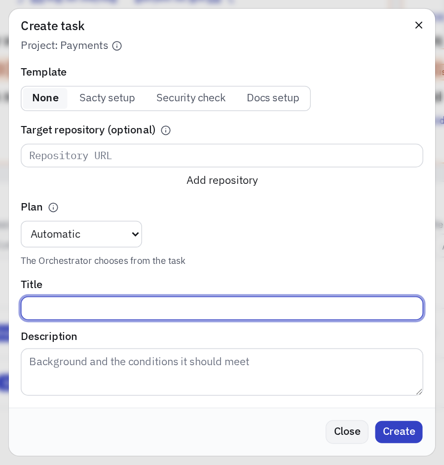
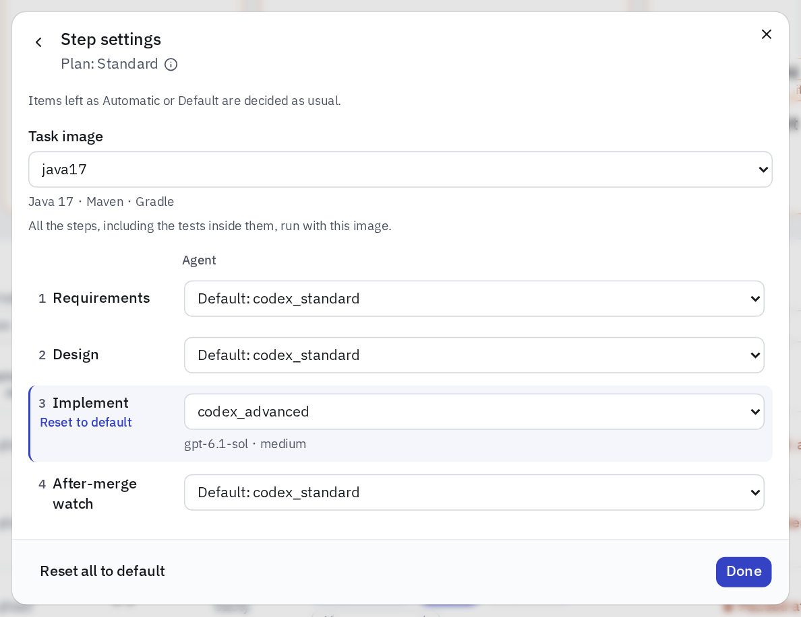
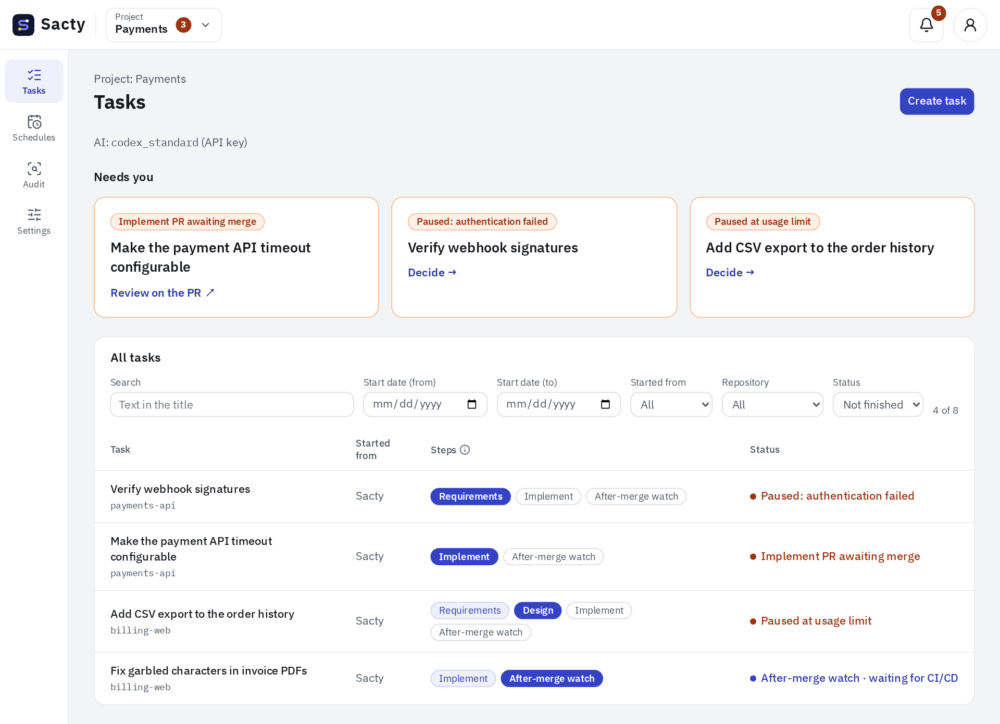
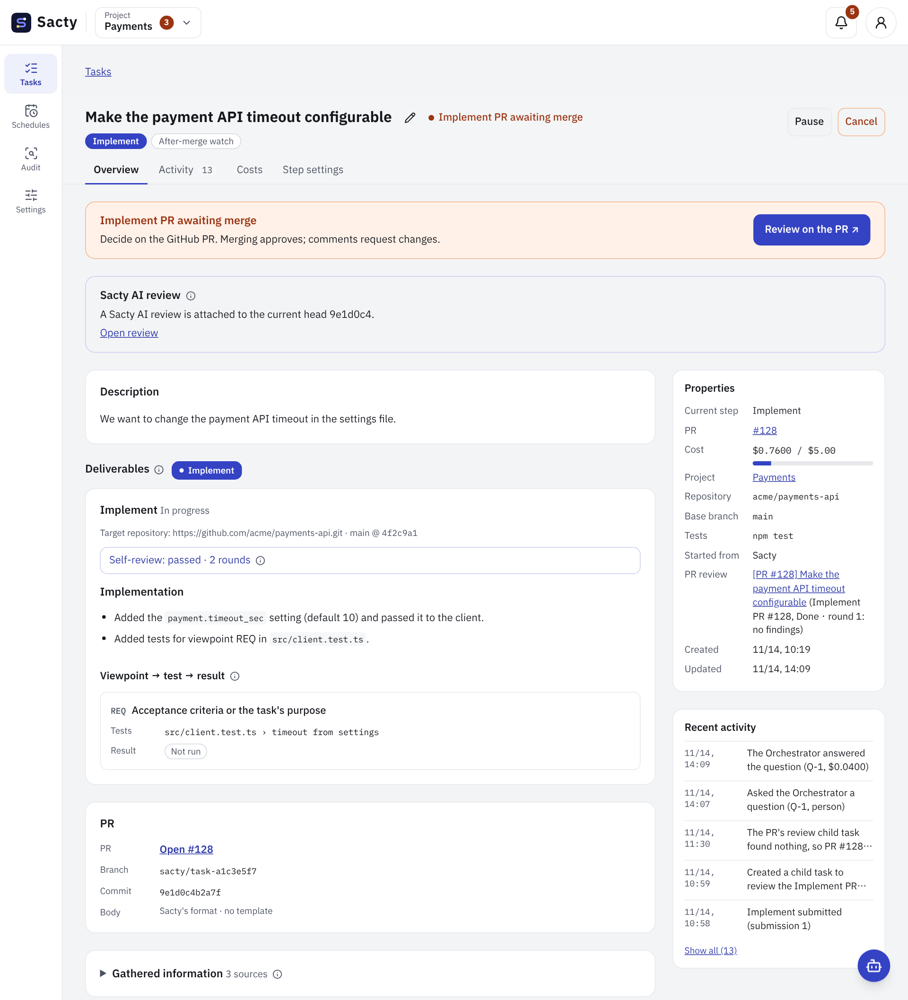
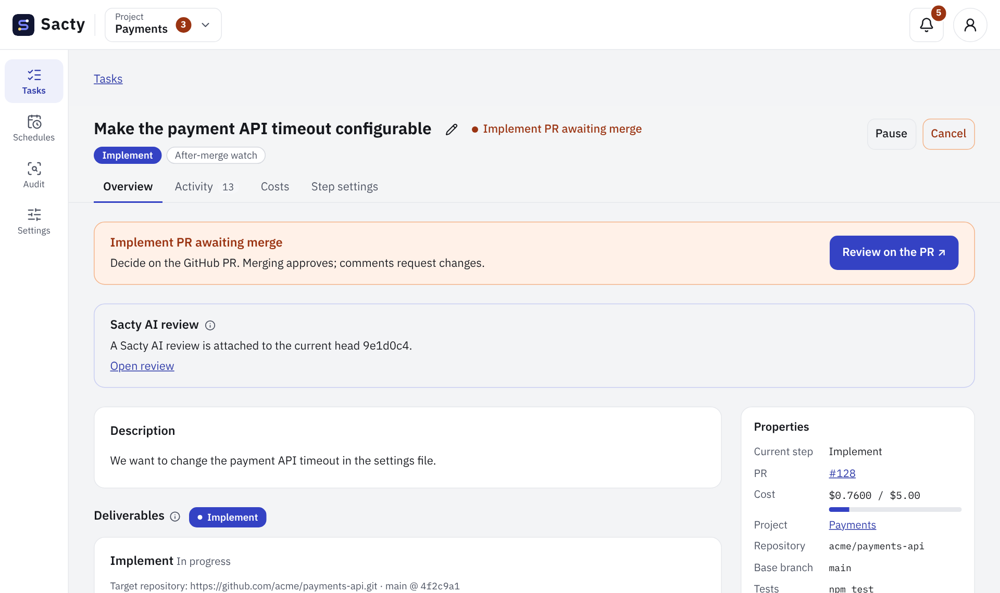
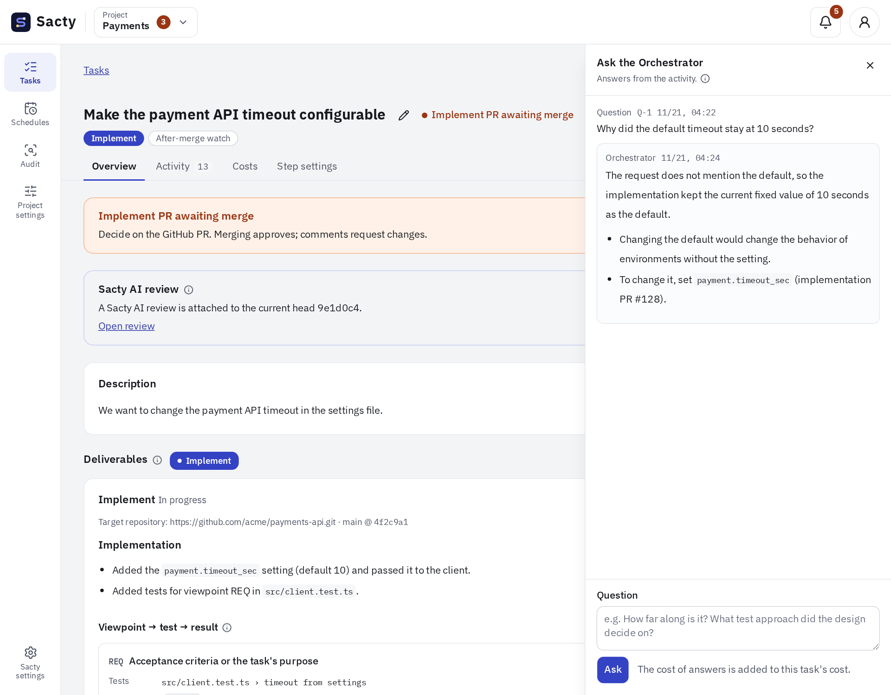
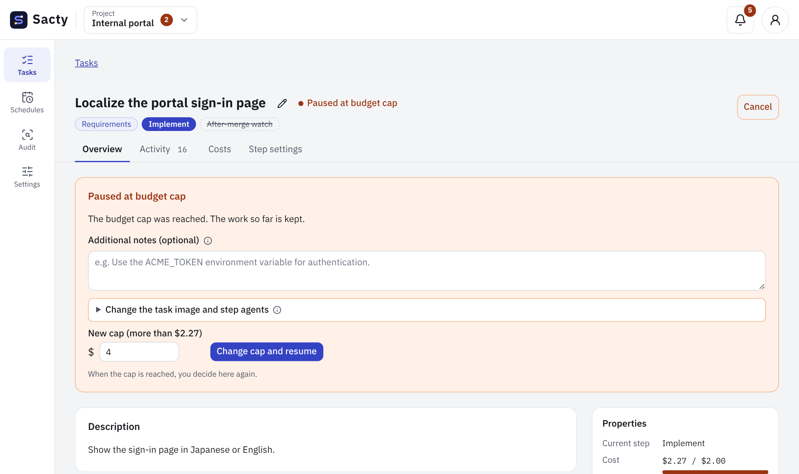

<!-- Code: apps/daemon/src/security.ts, apps/web/src/components/security-fixes.tsx, apps/web/src/components/derive-dialog.tsx, apps/daemon/src/config.ts, apps/web/src/components/task-detail.tsx, apps/web/src/components/self-review-depth.tsx, apps/daemon/src/service.ts, apps/daemon/src/repository.ts, apps/daemon/src/activity.ts, apps/daemon/src/pr-watcher.ts, apps/daemon/src/prompts.ts, packages/core/src/events.ts (StepKey, DEFAULT_DOCUMENTS_DIR), apps/web/src/i18n/messages/task.ts, apps/daemon/src/task-templates.ts, apps/daemon/src/test-files.ts, apps/web/src/components/new-task-dialog.tsx, apps/web/src/components/task-step-settings.tsx, apps/web/src/components/implementation.tsx, apps/web/src/components/integration.tsx, apps/web/src/components/provenance.tsx, apps/web/src/components/task-list.tsx, apps/web/src/lib/task-filter.ts, apps/web/src/components/deferral.tsx, apps/web/src/lib/labels.ts, apps/web/src/i18n/messages/labels.ts, apps/web/src/i18n/messages/parts.ts, apps/daemon/src/suggestion-triage.ts, apps/daemon/src/triage-reply.ts, packages/core/src/messages.ts -->

[日本語](tasks.md) | **English**

# Working with tasks

When you create a task, the Orchestrator (the AI that chooses the plan) and the step agents (the AIs that run the steps) move it through the steps. You make decisions only at approval gates (where you approve a step's result).

A task proceeds as follows.


## What this page covers

This page is long, so pick the sections to read by what you want to do.

| What you want to do | Sections to read |
| --- | --- |
| Create tasks, find them, and see how they are going | [Create a task](#create-a-task), [Task list](#task-list), [Reading the task details](#reading-the-task-details), [Hints on the screen](#hints-on-the-screen), [Automatic updates on the screen](#automatic-updates-on-the-screen) |
| Learn what sacty does on its own | [Information gathering at the start of a task](#information-gathering-at-the-start-of-a-task), [Self-review before submitting](#self-review-before-submitting), [Self-review for a light request](#self-review-for-a-light-request) |
| Check results, then approve or request changes | [Approval in PRs (Requirements, Design, Implement)](#approval-in-prs-requirements-design-implement), [Sorting AI review suggestions](#sorting-ai-review-suggestions), [Deciding the findings proposed for deferral](#deciding-the-findings-proposed-for-deferral), [Reading requirements and designs](#reading-requirements-and-designs), [Items to check (provenance)](#items-to-check-provenance), [Review of the implementation PR](#review-of-the-implementation-pr), [How the agent revises after you request changes](#how-the-agent-revises-after-you-request-changes), [Cause of a request for changes](#cause-of-a-request-for-changes), [Change requests](#change-requests), [Comments on PRs and issues](#comments-on-prs-and-issues), [Checking the result of the Integration review](#checking-the-result-of-the-integration-review) |
| Change a task that is under way | [Ask the Orchestrator](#ask-the-orchestrator), [Renaming a task](#renaming-a-task), [Changing the task image](#changing-the-task-image), [Changing a step's agent](#changing-a-steps-agent), [Pause, resume, and cancel](#pause-resume-and-cancel), [Create a follow-up task from a completed task](#create-a-follow-up-task-from-a-completed-task) |
| Learn how each kind of request proceeds | [Documents and one-off external work](#documents-and-one-off-external-work), [Fixing an existing PR](#fixing-an-existing-pr), [Security checks and fixes](#security-checks-and-fixes), [Repositories without tests](#repositories-without-tests), [When the implementation has no changes](#when-the-implementation-has-no-changes), [When the implementation does not finish, or a rework changes nothing](#when-the-implementation-does-not-finish-or-a-rework-changes-nothing) |
| Handle tasks created with an earlier version | [Tasks from earlier versions (with the Open PR step)](#tasks-from-earlier-versions-with-the-open-pr-step), [Tasks from earlier versions (with the final review)](#tasks-from-earlier-versions-with-the-final-review) |

## Create a task

You create a task from "Create task" in the task list. You can also import tasks from issues, PRs, and tickets ([Intake](intake.en.md)).

Press "Create task" to open this dialog.



Fill in the dialog as follows.

1. In "Target repository (optional)", choose a repository from the project's targets ([Project settings](project-settings.en.md#targets)). To select more than one, press "Add repository" and choose each repository (up to 10). At 10, "Add repository" is disabled and the reason appears next to the button. Press "Remove" to delete a field. When the same repository is in two or more fields, the dialog shows the numbers of the repeated fields (the same repository counts once). Templates accept one repository (while a template is chosen, only the first field is shown; the added fields and their values are kept and appear again after switching back to "None"). You can also create a task without choosing a repository ([Create a task without a repository](#create-a-task-without-a-repository)).
2. If you leave "Plan" at the default, "Automatic", the Orchestrator chooses the combination of steps from the task. You can also choose it yourself ([Specify the plan](#specify-the-plan)).
3. Enter the "Title" and the "Description".
4. Press "Create".

A draft Title and Description survive closing the dialog with Esc, a click outside, "Close", or the × at the top right, and come back when you reopen it. They are cleared after a task is created successfully, and are kept when creating fails. They are always lost when you reload the page or close the browser. They may still be there when you go to another screen and come back, but that is not guaranteed, so copy a long request before you leave.

If you choose a "Template", you can create a task just by choosing the repository ([Sacty setup](#template-sacty-setup), [Docs setup](#template-docs-setup), [Security check](#security-check)).

The repository suggestions appear as follows.

- sacty reads the suggestions when you press "Create task" and the dialog opens. For an org target, `gh` asks GitHub, which can take a few seconds.
- While they load, when they cannot be read, or when there are none, the dialog says so. In every case, you can type the repository URL and create the task.

sacty decides the base branch, the test command, the steps to leave out, and so on after you create the task ([What sacty decides](#what-sacty-decides)).

### Create a task without a repository

For research, overall design, or a large task to split, you can create the task without choosing a repository. The Orchestrator chooses how to proceed from the project's context (the rules in the context repository and the export destinations) and its targets (the list of repositories). After that, the task proceeds as follows, depending on its kind.

- Work that does not change code (investigation only, design only) proceeds without a repository and finishes when you approve it in the sacty web UI. sacty creates no PR or branch. If there is an export destination, the results are exported.
- For a large task to split, the Task split step chooses a repository from the targets for each child task (and records why). Integration review reads the latest base branch of each child task's repository.
- For a task that needs code changes and is not split, the Orchestrator chooses a repository from the targets, prepares it, and then chooses the steps again. If it cannot choose, the task stops. You can choose the repository in the task details and resume.

To specify multiple repositories through the API, send the following to `POST /api/tasks`.

```json
{"projectId":"default","title":"Change","repos":["https://github.com/acme/api","https://github.com/acme/web"]}
```

You can specify up to 10 distinct project targets. One is treated as a single repository. With two or more, the Orchestrator, human choice, splitting, and information gathering use only the specified repositories. Splitting selects a repository for each child, and integration review reads each child's repository. It checks the targets during information gathering, orchestration, human selection, and the Requirements, Design, and Split steps. If a specified repository cannot be verified, it stops or rejects the selection and checks again on resume. You cannot specify `repo` and `repos` together.

### Specify the plan

To proceed differently from how the Orchestrator would choose, pick a plan in "Plan" under "Create task". When you pick one, the sequence of steps appears below it. When you choose a template, you cannot choose a plan.

| Plan | Steps | When to use |
| --- | --- | --- |
| Automatic | The Orchestrator chooses | Default |
| Standard | Requirements → Design → Implement → After-merge watch | Changes with several behaviors or a wide impact |
| Skip design | Requirements → Implement → After-merge watch | Small, local changes |
| Skip requirements | Design → Implement → After-merge watch | Changes with verifiable acceptance criteria in place that need a design decision |
| Implement directly | Implement → After-merge watch | Changes whose request is itself the acceptance criteria (including requests with verifiable acceptance criteria in place and nothing for you to confirm) |
| Bug fix | Reproduce → Implement → After-merge watch | Bugs that tests can reproduce |
| Split | Requirements → Design → Task split → Integration review | Changes that do not fit in one PR |
| Investigate only | Investigate | Questions, cause analysis, estimates |
| Review only | Review | Reviewing the PR linked in the description |
| Document | Document | Drafts such as procedure documents, user guides, and reports |
| Operation only | Operation | One-off changes to external services |
| Design only | Requirements → Design | Overall design without code changes |
| Security check | Investigate | Checking for vulnerabilities and supply chain problems ([Security checks and fixes](#security-checks-and-fixes)) |
| Security fix | Investigate → Implement → After-merge watch | Fixing a specific security problem with the smallest change |

When you specify a plan, the following applies.

- The Orchestrator does not choose again and does not skip steps in the review after each step.
- The Orchestrator still decides the base branch, the test command, the images, and so on as usual (you can also set the image and the agents in [Set the task image and the agent for each step](#set-the-task-image-and-the-agent-for-each-step)).
- The specified plan appears on the "Step settings" tab of the task details.

The following rules apply, depending on the plan.

- "Review only" can be chosen only when you choose a target repository and put a link to a PR of that repository in the title or description. Otherwise, the reason appears when you create the task. The review runs the PR's code in the agent's container, so do not choose PRs you do not trust (see [Do not import PRs you do not trust](intake.en.md#do-not-import-prs-you-do-not-trust)).
- You can also choose a plan that implements (Standard, Implement directly, and so on) without choosing a repository. The Orchestrator chooses a repository from the targets and then proceeds with the plan you specified.
- Plans that implement have no Investigate step. [Information gathering at the start of the task](#information-gathering-at-the-start-of-a-task) reads the code. Only Security fix has Investigate before Implement, to decide the fix scope.
- For an "Investigate only" task, if you write the form of the result (a table, sections, items, and so on) in the description, it reports in that form. Otherwise, it reports the conclusion, the evidence, the related places, and the open questions, in that order.

The conditions under which the Orchestrator skips Requirements with the "Automatic" plan are in [When "Automatic" skips or keeps Requirements](#when-automatic-skips-or-keeps-requirements).

#### Set the task image and the agent for each step

When you pick a plan, "Set per step" appears below the sequence of steps. Press it to switch the dialog to the step settings, where you can choose the task image (one image) and the agent for each step. You can't set them with the "Automatic" plan or when you choose a template (the steps are not decided yet).



You can choose the following two things.

- For the image, choose a name in `images` or `default` (the default image) (see [Container images](images.en.md)). Every step and the tests of the task run in this image. If you leave it as "Automatic", the project target or the Orchestrator chooses as usual.
- For the agent, choose the name of an available agent (see [config.yaml settings](config.en.md)). If you leave it as "Default", the agent decided by `step_agents` (or `default_agent`) is used. The integration review agent can't be chosen, because it is decided by `step_agents.integrate` in `config.yaml` (or `default_agent` if absent).

The "Step settings" view behaves as follows.

- A step whose agent you set is marked, and "Reset to default" undoes it.
- "Done" or the back button at the top left returns to the main form. The sequence of steps in the main form also marks the steps whose agent you set, and the summary shows the image you set.
- Switching views keeps the title and description you are typing and your choices. Choosing another plan keeps the choices for the same steps (only those for the steps of the current plan are used).
- When the choices can't be loaded (for example, `config.yaml` can't be read), the reason is shown. You can still create the task without setting them.

The image and agents you set take precedence over the Orchestrator's choice and `step_agents`. After creating the task, you can still change them in "Task image" and "Step agents" on the task page (they show "set by a person at creation"; see [Changing the task image](#changing-the-task-image) and [Changing a step's agent](#changing-a-steps-agent)).

### Template "Sacty setup"

You can create a task that prepares the AI agent settings of a repository so that sacty can work with it, just by choosing the repository.

1. In the "Create task" dialog, choose the "Sacty setup" template.
2. Choose the target repository and press "Create". You do not enter a title or description (sacty decides them).

Like a normal task, the Orchestrator chooses how to proceed, and the task goes through approvals and PRs. The agent checks the following and opens a PR that fills in what is missing.

- Instructions for agents (AGENTS.md, CLAUDE.md, and so on)
- How to run the tests
  - If the repository has no tests yet, the agent writes that there are none and how to check changes.
  - This task does not add a new language or test framework.
- Services the tests need (databases, mocks, and so on)
- The after-merge watch skill `deployment-observer` ([After-merge watch](deployment-watch.en.md#skill))
  - It is created for repositories with CI/CD (even if they do not deploy). If there is no CI/CD, it is not created.
  - The original is `.agents/skills/deployment-observer/SKILL.md`. `.claude/skills/deployment-observer` for Claude Code is a relative symbolic link to the original.
  - A reference on how to check CI/CD (`references/ci.md`) is also created. If the repository does not deploy, the skill says to skip the deployment check.

If everything is already in place and nothing needs to change, the task finishes without a PR, keeping the check results as investigation results (you approve it in the web UI to finish). If, after Requirements, Design, and Implementation, it turns out that nothing needs to change, no PR is created either. The check results are kept in the implementation notes, and the task finishes when you approve it in the web UI (see [When the implementation has no changes](#when-the-implementation-has-no-changes)).

For tasks created from a template, the template name appears in "Started from" in the list, in "Started from" in the properties of the details, and in "Task created" in the Activity.

From the API, send `{"template": "sacty-setup", "projectId": "<project ID>", "repo": "<repository URL>"}` to `POST /api/tasks` (do not pass `title` or `body`). The CLI has no command to create tasks.

### Template "Docs setup"

In a repository with few docs, agents cannot get enough context and may not produce what you expect. With this template, you can create a task that builds docs from the code and adds skills for agents to look them up and update them, just by choosing the repository.

1. In the "Create task" dialog, choose the "Docs setup" template.
2. Choose the target repository and press "Create". You do not enter a title or description (sacty decides them).

Like a normal task, the Orchestrator chooses how to proceed, and the task goes through approvals and PRs. The agent does the following. It does not change the code.

- It takes stock of the existing docs (README, docs, AGENTS.md, and so on) and writes the result as a table in the PR description. Existing docs are not deleted, moved, or rewritten; the new docs link to them. If the location and format are already decided, it follows them (otherwise the docs go in `docs/` with `docs/README.md` as the index).
- From the code, it writes what cannot be learned by reading a little code (purpose and terms, overall structure, main flows, data, external connections, and conventions). It also adds figures for the overall structure and the main flows. The figures use the format of the figures in the repository's existing docs (or, when there are none or the same format cannot be produced, a format written as text inside Markdown). How to build and test is set up by the "Sacty setup" template.
- It creates two skills. The originals go under `.agents/skills/`, and the ones under `.claude/skills/` for Claude Code are relative symbolic links to the originals.
  - `docs-lookup`: a skill to find and read the docs before working.
  - `docs-update`: a skill to update the docs in the same PR when the code changes.

To keep the review light, it works as follows.

- New docs get the status `AI 生成・未レビュー` (AI-generated, not reviewed) at the top. Agents check unreviewed docs against the code before using them. When you have checked a doc, change it to `レビュー済み` (reviewed) yourself or ask an agent to.
- What cannot be confirmed in the code is written as `（未確認）` (unconfirmed) and listed in the PR description as questions you can answer briefly. You do not have to read every doc; answer the questions and check the overall structure doc.
- The first PR is limited to the stock-taking results, the index, the overall structure, and the two skills. The remaining items are listed in the index as not yet written. For a large repository, the Orchestrator may split the work into child tasks by area (one PR per area).

If everything is already in place and nothing needs to change, the task finishes without a PR and keeps the investigation results, as with "Sacty setup".

From the API, send `{"template": "docs-setup", "projectId": "<project ID>", "repo": "<repository URL>"}` to `POST /api/tasks`.

### What sacty decides

sacty decides the following after you create a task.

- The Orchestrator decides the base branch and the test command at the start of the task by reading the repository. In a [repository without tests](#repositories-without-tests), the task proceeds without using tests.
- The Orchestrator leaves out steps that are not needed.
  - A small change whose request is clear and that uses existing mechanisms may start from implementation, without requirements or design.
  - Each time a step finishes (after the requirements are approved, and so on), it reviews whether the remaining Design and Reproduce steps are needed and skips the ones that are not.
  - Skipped steps are shown struck through in the list of steps. The reason appears in the Activity.
  - For the skipped steps, the child task that reviews the implementation PR reviews it against the task's purpose (the request). You approve it by merging the PR.
  - When you specify a plan, steps are not skipped ([Specify the plan](#specify-the-plan)).
- The Orchestrator also judges whether the request is light when it chooses the steps.
  For a light request, the self-review uses fewer viewpoints ([Self-review for a light request](#self-review-for-a-light-request)).
- Whether the development setup (installing dependencies, building, and so on) runs depends on the step.
  - Choosing the steps, and investigations that read and explain code or how things work, do not run it, even if the repository's AGENTS.md or similar has setup instructions.
    In an investigation, the agent may run the setup only when something cannot be confirmed by reading the code and has to be confirmed by running it (the agent then writes in the investigation result why the setup was needed).
  - Bug investigation, Reproduce, and Implementation set up the repository as its instructions say.

#### When "Automatic" skips or keeps Requirements

With the "Automatic" plan, when the request has verifiable acceptance criteria in place and there is nothing for you to confirm, the Orchestrator skips Requirements and chooses "Implement directly". When Requirements is skipped, the following applies.

- The reason for skipping is written in the reason for the plan ("Why" on the "Step settings" tab of the task details).
- Fine defaults such as whitespace, limits, ordering, and column positions are decided by the implementation agent and written under "既定で決めたこと" (decided by default) in the PR body. Check them in the PR.

In any of the following cases, the Orchestrator keeps Requirements even if the acceptance criteria look detailed.

- The request is ambiguous.
- The request conflicts with a document or the code.
- The request has something you should confirm.
- The request puts a new meaning on an existing shared state or field (or adds a state).
- The request needs a change to a published API or field that the acceptance criteria do not state.
- A possible conflict with the code that uses the API or field needs to be confirmed with you.

When the acceptance criteria clearly state the change to a published API or field (the new name, shape, whether it is required, how errors are handled) and there is nothing to confirm about the code that uses it, that alone is not a reason to keep Requirements. However, a change such as a rename, where it is not settled what happens to the existing code that uses the API or field, does not count as clearly stated.

When the acceptance criteria are in place and a design decision (a new mechanism, or a choice of structure across layers) is needed, the Orchestrator skips Requirements and chooses "Skip requirements".
Even when you have something to confirm, Requirements is not kept; the Design asks it under "Questions to confirm".
However, when the request is ambiguous, conflicts with a document or the code in a way that changes what is built, or cannot be decided, Requirements is kept even if a design decision is needed.

The following are not reasons to keep Requirements, because there is nothing for you to confirm.

- A conflict between documents, or between a document and the acceptance criteria, that does not change what is built (such as which commands count for completion)
- Callers and tests following a change the acceptance criteria decided
- Points the implementation can decide from the request and the existing code

The reasons to keep Requirements are only things that have several answers, that neither the request nor the existing code and documents settle, and that you must be asked.

When Requirements is kept, the reasons the Orchestrator gave are passed to the first Requirements run. For each reason, either it appears under "確認したいこと" as something to ask you, or the reason it was decided without asking is written as "確認しないと決めたこと" (decided without asking) at the end of that section.

This decision does not change the number of self-review rounds, the model, or the effort.

## Task list

A project's task list looks like this.



Each row of the task list shows the name of the repository the task works on (only `repo` of `org/repo`) under its title. Tasks with multiple specified repositories show the specified list even before a working repository is chosen, and also show the working repository once chosen. The specified list also uses repository names (`org/repo` for names that repeat among the specified repositories). Point at a name, or open the hint mark (ⓘ) next to the list, to see the whole URL (the mark also opens from the keyboard or by tapping). "Repository" in the properties of the task detail shows the specified repositories as `org/repo`, and pressing one opens that repository. A value that cannot be read as a URL (recorded by an older version) is shown as recorded and does not open anything. Other tasks whose repository is not decided yet show none. Of these, a task created without a repository shows "No repository". Tasks taken in from an Issue or PR show its number (such as `#7`) under where they started. A task whose implementation PR, waiting to be merged, had failing CI shows a "CI failed" mark in the "Status" column ([When CI fails after "no findings"](#when-ci-fails-after-no-findings)).

Child tasks are indented directly under their parent task.

- The child tasks of a task split are listed in the order the split decided.
- A child task that reviews a PR sacty opened is listed under the task that opened the PR (after its split child tasks, if any). The list shows which task it reviews.
- The child task that reviews a PR opened by a split child task is indented one more level under that split child task.
- When the parent task is not in the list (it is in another project, or the filter hides it), the child task is listed without indent.

### Find and filter tasks

Use the fields above "All tasks" to filter the list.
Only tasks that match every filter are shown.

| Field | How it filters |
| --- | --- |
| Search | Tasks whose title contains the text (case-insensitive) |
| Start date (from), (to) | Tasks created between the dates (both days included; either one alone works too) |
| Started from | Where the task started, such as Sacty or GitHub Issue |
| Repository | The repository the task works on. A task with multiple specified repositories appears for any of the specified repositories. "Not decided / No repository" is for tasks whose repository is not decided yet and that have no specified repositories |
| Status | All, Not finished, Needs you, In progress, Waiting, Completed, Cancelled (first "Not finished") |

When you first open the list, the status is "Not finished" and only the tasks that are not completed or cancelled (including ones awaiting approval or waiting) are listed.
A project with no unfinished tasks opens with "All" (an empty list is never shown first).
To see completed and cancelled tasks too, choose "All" in the status.
The first view is decided once, when the screen opens. Automatic updates do not switch the status when a task finishes or starts.

At most 50 rows are shown at a time (a child task's row counts as one row).
When more rows match the filters, a button such as "Show more (70 left)" appears under the table.
Pressing it adds the next 50 rows below and moves the focus to the title of the first added row.
Changing a filter returns to the first 50 rows.
A parent task may be in the first 50 rows and its child task in the next 50. After you add more, the child task follows under its parent, indented.

The count is shown on the right of the fields. When every row is shown it looks like "1 of 5"; when the rows are cut into 50, it looks like "120 of 277 (showing 50)", so you can see the total, the number that match, and the number shown.
"Clear filters" appears only when the filters differ from the first view. Pressing it returns to the first view (the status is the "Not finished" or "All" decided when the screen opened, and every other filter is empty). It is not shown while the first view is unchanged.

The filters are kept in the query of the screen's URL (`q`, `from`, `to`, `start`, `repo`, `status`; "All" is `status=all`).
Only filters that differ from the first view are written, and no query is added while the first view is unchanged.
Opening that URL, reloading, or sharing the link opens the list with the same filters. Going back in the browser after opening a task keeps the filters and the rows you added (opening by reload or link starts from the first 50 rows; after going through three or more screens, such as task or PR pages, before coming back, the rows you added return to 50, while the filters stay because they are in the URL).
Changing a filter does not add to the browser's history. A value that cannot be read (an unknown status, a start date that is not a date, and so on) is treated as if that filter were not set. Moving to another project's list does not carry the previous filters over.
When a start date is in the URL, the table shows "Loading…" first because the day is decided in the browser's time zone.
The "Needs you" cards are not filtered or cut.

## Reading the task details

The task details look like this.



The top part of the screen shows the following.

- The title, status, steps, actions (pause, cancel, re-review), and tabs are fixed at the top of the screen and stay visible when you scroll.
- When the task is waiting for an approval or a decision, or is paused, the notice appears below the tabs whichever tab is open.
- While the PR awaiting approval is open, "Sacty AI review" appears below the notice.
  It shows whether a Sacty AI review is attached to the PR's current head (its latest commit): not yet, reviewing, or attached ([Reviewing PRs that sacty created](intake.en.md#reviewing-prs-that-sacty-created)).
  While sacty has not yet read the current head from GitHub (for example, right after it starts), it says the state is unknown.

Switch the view with the tabs.

| Tab | What it shows |
| --- | --- |
| Overview | Results related to the task, such as the cleanup after cancelling, the description, deliverables, the PR, and follow-up tasks |
| Activity | The whole Activity (newest first; open the run log from an agent run line) |
| Costs | The amount used and the cap, the cost per step, and the Orchestrator session |
| Step settings | The steps and why they were chosen, the base branch, the test command, export destinations, the task image, and step agents |
| Audit | The audit result (only for completed tasks; if not audited yet, it says so; [Audit](audit.en.md)) |

- The open tab is kept in the URL (such as `?tab=activity`), so reloading or sharing opens the same tab.
- Under "Deliverables" on the Overview tab, choose a step to read its deliverable one at a time. At first, the deliverable of the current step (running, awaiting approval, or the last finished step) is shown.

"Properties" in the right column shows the following.

- The current step, the PR, the cost, the project, the repository, the base branch, the tests (the test command), and the ticket
- Where the task started from (with the template's name for a task created from a template)
- Related tasks: the parent, the task whose PR it reviews, the PR review (the child task that reviews the PR, and its state), the task it reruns, the task it follows up, the task it fixes, and the report
- The task it was rerun as
- When the task was created and last updated

Of these, the PR, the base branch, the tests, the ticket, related tasks, and the rerun task are shown only when the task has them.

While a step's agent is running, one line above the deliverables in the overview shows the running step, the time since that run started, and "View log" (for example, "Running Design · 12 min · View log").
The elapsed time advances every minute and is written as "under a minute", "12 min", or "1 h 5 min".
"View log" opens the log screen of that run.
Before the first step starts (preparing the repository, gathering information, reading the ticket, deciding how to proceed, and so on), only the name of what is being done is shown (the start time and the run are not known, so the elapsed time and the log link are not shown).
While the task is queued, awaiting approval, awaiting a decision, paused, completed, or cancelled, this line is not shown.

For a task with error records, "Error report" appears below "Properties" ([Getting an error report](troubleshooting.en.md#getting-an-error-report)).
Below it, the recent Activity (5 entries) is shown.
Each line is cut at 2 lines. Read the full text, and the "Details" that open the reasons, in the Activity tab from "Show all (n)", which appears when there are more than 5 entries (or open the Activity tab directly).

## Hints on the screen

The text on the screen says only the current state and what to do next, briefly. How things work and why is shown when you hover over the hint mark (i) next to a heading or item.

With the keyboard, it opens when you stop on the mark with Tab; on a phone, it opens on tap. Esc or a tap outside closes it. Items without a hint have no mark.

In the Activity of the task details, press "Details" on a request-for-changes line to see the comments written when changes were requested. You can read past comments again even after approval, completion, or cancellation.

## Automatic updates on the screen

While they are open, the dashboard, the task list, the task details, and the header notifications fetch the latest state every 3 seconds and show it. They do this whatever the state of the tasks (including when there are no tasks and when every task is awaiting approval, paused, or completed).
As a result, tasks added by intake, approvals and resumes in other tabs or the CLI, tasks the daemon picked up and started, and tasks that became awaiting approval appear without any action. The running line in the overview and the paused section also follow a run starting, ending, or pausing without any action.
In the run log screen, "Finished" shows "Running" while the task is still running that run; when no end is recorded and the task is not running it, the screen shows "No end recorded. Still running, or the daemon stopped midway."

When the state is fetched again, the screen behaves as follows.

- The screen is not reloaded; only the parts that changed are shown again. Questions, comments, and form values you are writing, what you selected, open dialogs and sections, focus, and the scroll position stay as they are.
- While the browser tab is hidden, nothing is fetched. When you come back to the tab, the screen is brought up to date right away.
- While the daemon cannot be reached, the screen stays as it is and shows "The daemon cannot be reached" (the header shows "Updates paused"). What is shown is what was last fetched. Check that `sacty up` is running. When the daemon can be reached again, the screen is brought up to date again and the notice goes away.

Updates on the other screens work as follows.

- The Approval screen and the project list (the intake status) are also brought up to date in the same way, without reloading. Comments you are writing are not lost.
- While a run is in progress, the run log adds new lines at the end automatically.
  - The scroll position does not move while you are reading in the middle. The screen follows new lines only while you are looking at the bottom.
  - If the list of the agent's original files cannot be read after the run has finished, the screen shows that and that it is retrying, and shows the list once it can be read.
- The Sacty settings and project settings screens are not updated automatically (only the header notifications are). To see the latest, open the screen again or reload it in the browser.

## Information gathering at the start of a task

When a task starts, before the Orchestrator chooses the plan, the information gatherer collects the information related to the task.
The gathered information is summarized down to what is relevant.
This summary is shown under "Gathered information" in the task details (collapsed once a step has started).
Sources that could not be read and conflicts between sources are written in the summary too.

The information gatherer reads the following to collect information.

- For a task taken in from a ticket, it follows the parent story and epic, linked tickets, and URLs in comments.
- It also searches for the task's terms with the available MCP servers and external platforms (documents, chat, and so on).
  To let it read external documents or chat, add the destination as an external platform of the gateway or an MCP server of the context ([Gateway](gateway.en.md), [Context repository](context.en.md)).
- It also reads the target repository's code and writes the places in the code related to the task and their current behavior in the summary.
- It looks for the repository's documents not only among those referenced from AGENTS.md or README but also in the directories that hold documents, and reads those related to the task.
  Even a document that is not referenced, if it sets behavior or premises related to the request (data freshness, operational rules, and so on), is written in the summary.

How the code is read depends on whether the repository to work in is decided.

- For a task whose repository to work in is decided, sacty prepares the repository before information gathering, and the information gatherer reads that code.
  If the repository cannot be prepared, the task stops before information gathering.
  The information gatherer also summarizes how tests are written (the framework, the command to run them, where they are placed, and examples of existing tests).
  Tests are not necessarily written just because the summary describes them.
  The Orchestrator decides how tests are handled.
- For a task whose repository is not decided (a task created without a repository, or a ticket task before its repository is chosen), without a specified list it picks out at most 3 likely relevant repositories from the project's targets and reads them through the GitHub read relay (`gh api`).
- With a specified list, it reads all specified repositories through the GitHub read relay, even after a repository is chosen.

To use the GitHub read relay, choose the GitHub account for that host in the project settings ([GitHub account in project settings](project-settings.en.md#github-account)).
Repositories it could not read, and Orgs whose repository list could not be read (expired credentials, missing permissions, and so on), are written in the summary as sources that could not be read. For a task with multiple specified repositories, sacty pauses before gathering if it cannot verify the specified targets.

A child task that reviews a PR sacty opened does not gather information again.
It inherits the summary of the parent task that opened the PR, and "Gathered information" shows "inherited from the parent task".
When the parent task has no summary, the child task gathers.

For a task taken in from a ticket, the information gatherer chooses the repository to work in from the gathered information, and also writes the title and summary of the task.

- If it cannot choose a repository, the task stops.
  Choose the repository in the task details, and you can resume the task.
  When you resume, the gathered information is kept, and only the title and summary of the task are rewritten.
- If you renamed the task before the title and summary are written, the title stays as you changed it (the same applies when they are rewritten after you resume).

The summary is written and passed on as follows.

- Information gathered from outside the target repository (the code or documents of another repository such as the one the target was imported from, or external URLs) is written with its origin (repository name or URL) and an explicit "対象のリポジトリの外" (outside the target repository), in an item separate from the target repository's documents.
  A lack of documents in the target repository is not written as if outside documents made up for it.
  The later steps are also told not to treat outside information as the target repository's conventions or decisions.
- The summary is given to the Orchestrator and every step.
  It is also given to Integration review and to the judgment of the step to redo for PR comments.
  These judgments use it only to understand the background; the basis of the verdicts stays the approved deliverables.
- Split child tasks do not gather again; they carry over the information their parent gathered in their content.

Information gathering only reads.
It does not change code either.
External platforms and MCP servers are handled as follows.

- For the gateway's external platforms, only GET and HEAD pass during information gathering, even if `allow` has write APIs.
- sacty cannot restrict the tools of MCP servers, so the instructions have it use only read operations.
  Be careful when the context includes an MCP server with write tools.

If the information gatherer cannot summarize, the task is paused.
Resuming gathers again.

The AI it uses and its cost are as follows.

- You can choose the AI with `step_agents.gather` in `config.yaml` (the Orchestrator's AI if omitted; [config.yaml settings](config.en.md#models-per-step)).
- The cost is counted toward the task budget and shown in the "Information gathering" row of the per-step cost table.

### Status before the first step starts

From when a task is created until its first step starts, the task's status tells you what Sacty is doing.
While Sacty is processing the task, the status has the in-progress color and shows one of the following texts.

| Status text | What Sacty is doing |
| --- | --- |
| Preparing the repository | Fetching the repository to work in |
| Gathering information | The information gatherer is collecting the information related to the task |
| Reading the ticket | Reading the ticket to decide the repository to work in, the title, and the summary |
| Deciding how to proceed | The Orchestrator is choosing the plan, such as the steps |
| Checking the PR to review | In a PR review task, reading the target PR |
| Preparing to start the step | After the steps are chosen, getting ready to start the first step |

When a task whose first step has not started is shown as "Queued", it is not being processed yet.
It is waiting for its turn under the limit on tasks run in parallel, or for its next piece of work to start.

- The task list, the dashboard, the task details, and the scheduled task details show the same status.
- In the status filter of the list, a task being processed falls under "In progress" and a "Queued" task under "Waiting" ([Find and filter tasks](#find-and-filter-tasks)).
- Until the steps are chosen, the steps column shows "Steps not chosen yet".

## Self-review before submitting

In the Requirements, Design, Implementation, and Document steps, the agent self-reviews the work by viewpoint with the default skill `review-dispatch` before submitting.
It fixes the work until no `must` findings (the severity that requires a fix) are left, then submits it (up to 5 rounds including the first).

However, in a step whose submission becomes a PR that sacty creates, the agent does not self-review.
sacty reviews that PR in a separate task (a PR review child task).
The same deliverable is not reviewed twice.

| How the work is submitted | Self-review |
| --- | --- |
| Requirements, Design, and Implementation approved in a PR that sacty creates | Not done (the PR review child task reviews it) |
| Requirements and Design approved on the screen | Done |
| An existing PR is continued and fixed | Done |
| The Document step, and tasks without a target repository | Done |

Even in a step without the self-review, the agent runs verification such as formatters, linters, and tests before submitting, and makes it pass.
In such a step, no self-review result appears on the screen (it does not become "no record" either).

In the Requirements and Design steps, the agent also runs the document verification the repository defines (a document formatter, a document lint, a link check, and so on) before submitting, and makes it pass.
What it verifies is the Requirements or Design deliverable that sacty puts into the PR as a repository file (by default under `docs/sacty/<short task ID>/`).
It does not run verification of code, such as tests, builds, and type checks.
The reason for any verification it did not run is kept in the self-review report (it is not kept in a step without the self-review).

The result of the self-review appears on the deliverable cards, the Implementation card, and the approval screen.

| Shown | Meaning |
| --- | --- |
| Self-review: passed · n rounds | Fixed until no `must` findings were left |
| Self-review: not passed · n rounds · m findings left | `must` findings were still left at the limit. Check them before deciding |
| No self-review record | The agent did not report a result. Check the deliverable yourself |

In a step with the self-review, a rework that skips the self-review ([Self-review when the work is redone after comments](#self-review-when-the-work-is-redone-after-comments)) also results in "no record".

The cost of the self-review is included in the cost of that step.

### Viewpoints used in the self-review

The first round reviews with every viewpoint (for a task whose request was judged light, see [Self-review for a light request](#self-review-for-a-light-request)).
A re-review after fixing (the second round on) uses only the viewpoints that raised a `must` in the previous round, plus X-1, which looks for defects without being tied to a viewpoint (only X-1 when there was no `must` and only `should` findings were fixed).
The viewpoints a re-review did not use are recorded in the agent's run log as "not started (no `must` in the previous round)".

When the deliverable of a request is judged to be document files only, the self-review of the implementation also uses the document viewpoints (sync with the code, whether the steps work, fit to the reader, static quality) instead of the code viewpoints.
A request that also changes code is reviewed with the code viewpoints.

The draft of the Document step is reviewed with the document viewpoints that fit the kind of draft.

- User guides, procedures, READMEs, operations documents, reports, and so on: the viewpoints for user-facing documents (sync with the code, whether the steps work, fit to the reader, static quality)
- Design documents, records of comparisons or decisions, and so on: the viewpoints for design documents

The draft does not become a file in the repository, so the repository's verification (formatter, lint, and so on) is not run.
In a request to write external documents directly, the agent self-reviews the draft before writing, and writes externally after it finishes fixing.
In a request to fix existing external documents, the review is limited to what was fixed and what that fix requires (so that parts you did not ask about are not rewritten before approval).

When the target repository has skills or instruction files that apply to this change, the self-review adds the following.
Neither reduces the default viewpoints.

- When it has review skills, one reviewer is added per skill and also reviews with the items of that skill.
- When it has development skills or instruction files (`AGENTS.md`, `CLAUDE.md`, `CONTRIBUTING`, and so on), a viewpoint (X-3) that checks whether this change follows those rules is added too.

Nothing is added for ones that do not apply to this change, such as a skill for an area the change does not touch.
Fixes, posting, and starting subagents written in the skills or instruction files are not done.

### Self-review for a light request

When the request is light, the self-review uses fewer viewpoints, so its cost and time fit the size of the request.
The Orchestrator judges whether the request is light when it chooses the steps.
You can override the judgement per task with "Use the normal depth".

The judgement and its reason appear on the "Step settings" tab of the task details, under the reason for the plan.

| What is shown | Meaning |
| --- | --- |
| Self-review depth: light. Fewer viewpoints are used. | The request was judged light. Fewer viewpoints are used |
| Self-review depth: normal | The request was not judged light. Every viewpoint is used |
| Self-review depth: normal (set by a person) | The request was judged light, but a person set the normal depth |

A request is judged light when it is a small, local change, such as adding a section to a document or fixing wording.
A request that falls under any of the following is not judged light.

- It changes existing behavior, public interfaces, or the shape of stored data
- It includes a security-related change (authentication and authorization, secrets, permissions, input validation, adding or updating dependencies, and so on)
- It includes a change that is hard to undo (deleting or migrating data, an effect on external systems, release or deployment settings, and so on)
- It is a security fix task
- It is a task that is split into child tasks (after the split, each child task is judged on its own)

For a security fix task and a task that is split into child tasks, sacty uses the normal depth even when the Orchestrator answers light.
In that case, the reason for the judgement shows that sacty set the normal depth, together with the Orchestrator's reason.

The self-review of a task judged light goes as follows.

- The first round uses only two viewpoints: fit to the requirements, and X-1, which looks for defects without being tied to a viewpoint.
  When the target repository has skills or instruction files that apply to this change, those viewpoints are used too.
- A viewpoint that is reviewed with a strong model is reviewed with a model one tier lower.
- A re-review after fixing uses only the viewpoints that raised a `must` in the previous round.
  When there was no `must`, no re-review is done.
- The viewpoints that were not used, and why, stay in the agent's run log and in the summary of the self-review.
- When the agent finds during the work that the change concerns security or is hard to undo, it reviews with every viewpoint and says so in the summary.

To have the task reviewed at the normal depth, do the following.

1. Open the "Step settings" tab of the task details.
2. Press "Use the normal depth" under "Self-review depth".

The change applies from the next run of a step that does a self-review.
A run in progress does not change.
The first step starts as soon as the steps are chosen, so it runs light.
To redo a step that is running at the normal depth, pause the task, press "Use the normal depth", then resume ([Pause, resume, and cancel](#pause-resume-and-cancel)).
A fix after you request changes on a submitted deliverable is reviewed with the viewpoints related to your comments, even at the normal depth ([Self-review when the work is redone after comments](#self-review-when-the-work-is-redone-after-comments)).
To go back, press "Back to the judgement (light)" in the same place.
A task that was not judged light cannot be made light.

The viewpoints of PR reviews (the tasks in which sacty reviews a PR) do not change with this judgement.
The judgement also has no effect on a step that does no self-review ([Self-review before submitting](#self-review-before-submitting)).
No judgement is shown for a task with no step that does a self-review (investigation only, a security check, a one-off external operation, and so on).

### Self-review when the work is redone after comments

This section describes steps with the self-review.
In a step approved in a PR that sacty creates, the agent does not self-review when it redoes the work either ([Self-review before submitting](#self-review-before-submitting)).

When the agent redoes the work after requested changes from a person or a finding from the AI review, the self-review uses fewer viewpoints.
When you request changes on Requirements or Design, the range and the number of rounds of the review are narrowed too.

The viewpoints are narrowed as follows.

- The first review of that run is treated as a re-review.
  It uses only the viewpoints related to the findings of this run, plus X-1 (the first run of a task uses every viewpoint).
- The viewpoints it did not use are recorded as "not started (fix run: not related to this run's findings)".
- If the previous submission's self-review did not pass, every viewpoint is used.

When the agent revises requirements or a design after you request changes, working from a non-empty previous deliverable, the range and the number of rounds of the review are also narrowed as follows.

- The range is narrowed to the difference from the previous deliverable and what that change directly requires.
- The number of rounds is at most 2 including the first when the remark is small (at most 2 places to fix, and no change of direction; for example, reflecting the answer to a question, or correcting the wording of one requirement).
  If the first review finds no `must` findings, the agent submits at that point.
  For a remark that touches many places or changes the direction, or when it is unclear whether it is small, the limit is the normal 5.
  Which one the agent took is written at the start of the self-review summary.

However, the agent reviews the whole deliverable as usual in the following cases.

- The self-review of the previous submission did not pass or has no record (including after a person edited the document)
- The previous deliverable is empty
- The remark changes the direction

The narrowing of the range and the number of rounds is not applied to changes requested on the implementation or on a document draft.
However, a fix run of the implementation or of a document draft is also reviewed with only the viewpoints related to the findings and centered on what was fixed in that run, when the previous submission's self-review passed (for a document draft, only when the previous draft is not empty).

Some reworks skip the self-review.
When a PR comment only answers the "確認したいこと" (questions) and every answer is as recommended, the deliverable is not redone and not self-reviewed ([Cause of a request for changes](#cause-of-a-request-for-changes)).
The agent only removes the answered items and re-reads the text to check, for example, that nothing other than the places reflecting the answers differs from the previous version.
In a step with the self-review, the result is then "no record", and the next rework reviews the whole.

## Approval in PRs (Requirements, Design, Implement)

Steps that need human approval (Requirements, Design, and Implement) are decided in PRs to the target repository.
Merging the PR approves the step, and commenting on the PR requests changes.
Steps that created a PR are not approved from the sacty web UI (the web UI guides you to the PR and shows the status).

The details of a task waiting for its implementation PR to be merged look like this.



When a step is awaiting approval, decide as follows.

1. Open the PR.
   If the PR of the current submission is open, you can open the GitHub PR directly in a new tab from the following places (without the sacty approval screen in between).
   - In the task details and "Needs you" in the task list: press "Review on the PR ↗".
   - In "Needs you" on the dashboard and the header notifications: press the task title (marked with ↗ at the end).
2. Read the PR.
   The following sections help you read it.
   - Requirements and Design PRs: [Reading requirements and designs](#reading-requirements-and-designs) and [Items to check (provenance)](#items-to-check-provenance)
   - The implementation PR: [Review of the implementation PR](#review-of-the-implementation-pr)
3. Decide whether to approve or to request changes.
   - To approve, merge the PR.
     The task moves on at the next check without returning to the sacty web UI.
   - To have something fixed, comment on the PR.
     sacty takes your comments in as change requests and redoes the work ([Requesting changes with PR comments](#requesting-changes-with-pr-comments)).

When the PR of the current submission is not open, or the task is escalated, you are taken to the sacty approval screen instead of the GitHub PR ([When you are taken to the sacty approval screen](#when-you-are-taken-to-the-sacty-approval-screen)).

### The order of the PRs

Approval in PRs proceeds in this order.

1. sacty creates a task branch (`sacty/task-<short task ID>`) from the starting commit of the base branch.
2. The Requirements are written to a file (by default `docs/sacty/<short task ID>/requirements.md`) and opened as a PR to the task branch. When it is merged, sacty records it as approval of the Requirements and the task moves to the next step.
3. The Design (including Test viewpoints. `design.md`) is likewise opened as a PR to the task branch.
4. When the Design PR is merged, the task moves to the Implementation step.
   - When the Implementation step finishes, the implementation is committed to the task branch and opened as a draft PR from the task branch to the base branch (CI runs). When the child task that reviews the PR gives "no findings", the PR is marked ready ([Review of the implementation PR](#review-of-the-implementation-pr)). The implementation PR also contains the Requirements and Design files.
   - Implement waits for approval, and merging the PR approves the implementation and moves on to the after-merge watch step. If the target repository has no after-merge watch skill and this step was skipped, the task is completed.
   - In the after-merge watch, sacty follows CI/CD and the deployment, and the task is completed when it ends ([After-merge watch](deployment-watch.en.md)).

When Requirements, Design, and Implementation are all approved in PRs, the branches and PRs look like this (an example where the short task ID is 1a2b3c4d).


The following rules apply to the files and branches.

- If the rules of the repository or the project's context decide where the files go, the Orchestrator follows them.
- Each child task of a Task split has its own task branch.
  The parent's Requirements and Design are also approved in PRs to the parent's task branch, but the parent's task branch is not merged into the base branch.

In the following cases, no Requirements or Design PRs are created.

- Steps that need no approval (such as Reproduce and Review)
- Tasks that are investigation only, review only, or bug fixes (tasks without Requirements and Design).
  Investigation-only tasks are approved in the web UI.
- Tasks that take over an existing PR.
  Requirements and Design are approved in the sacty web UI ([Fixing an existing PR](#fixing-an-existing-pr)).
- Tasks that submitted Requirements or Design in the web UI in a version before approval in PRs existed.
  They are still approved in the web UI.

### Requesting changes with PR comments

sacty takes in PR reviews, line comments, and regular comments as change requests.
It then judges whether to redo that step (updating the same PR) or to go back to an earlier step (the step to redo), and redoes the work.
No human check comes in between.

The comments are taken in as follows.

- sacty checks every minute and takes them in 2 minutes after the last comment. Posts by sacty's review child task are taken in without waiting the 2 minutes.
- It excludes bots and sacty's own posts, but includes posts by the sacty review task that imported that PR ([Reviewing PRs that sacty created](intake.en.md#reviewing-prs-that-sacty-created)).

For a comment on an implementation PR, the step to redo depends on how heavy the decision is that the comment would change.

- Only a change of policy goes back to Design. These are decisions that are hard to undo, such as choosing a different method or structure, changing the scope or acceptance criteria, the shape of a public interface or of stored data, security, and migration.
- A local change is fixed in Implementation. Examples are wording, one row of a table or list, a default value, and adding a row.
- A round with even one change of policy goes back to Design as a whole.
- When it is hard to say which, it is fixed in Implementation. However, a comment that touches security, authorization, the shape of stored data, or migration goes back to Design when in doubt.
- A change only to the wording of a test viewpoint (without changing its input or expected result) is fixed in Implementation. A comment that changes the input or expected result, or adds or removes a viewpoint, goes back to Design.
- When you write "send it back to design" or "fix it in the implementation step" in a comment, sacty follows it.

Who judges the step to redo depends on where the comments come from.

- When the comments are only from the child task that reviews the PR, sacty follows the step the child task gave for each finding (no run is made for the judgment, and it costs nothing).
  When an implementation PR has suggestions (`[提案]`), an AI first sorts out whether to handle each one ([Sorting AI review suggestions](#sorting-ai-review-suggestions)).
- When your comments are included, the agent of that PR's step judges.

A comment that asks for nothing does not start a redo.

- This is a comment that only accepts sacty's reply or explanation, such as "Understood" or "Thank you".
  The agent of that PR's step tells them apart in the judgment made when your comments are included.
- When there are only such comments, sacty does not send the task back and it stays awaiting approval.
  The deliverable and the PR do not change, and sacty posts no reply on the PR.
- When they arrive together with comments that ask for something, only the comments that ask for something are sent back.
- A comment that contains any change, check, or question is treated as a change request.
  The judgment and its reasons are kept in the activity.

The judgment and its reasons are kept and passed to the redo as follows.

- The judgment and its reasons are kept in the Activity and the PR section.
  The reason starts with one of "does not change a decision", "changes a decision (local)", or "changes a decision (policy)", and says which decision it is.
- The reason and the judgment can run long, so the screen (the PR section and the Activity) shows the first one or two sentences as the gist, and you can open "Details" to read the full text.
  The record in the Activity and the judgment passed to the redo stay in full.
- The judgment of the step to redo (the step and the reasoning on how it read the comment) is also passed to the redo that starts from it.
  The judgment is an interpretation of the comments, so when it disagrees with the original text of your comment, the original text wins.
- When the step to redo could not be judged, what could not be read is passed too, and the redo does not make big changes by guessing; it leaves what it could not read in the response field.
- When there is something for a person to check, the approval screen and the task details show it, and the same content is also commented on the PR ([Things for a person to check](#things-for-a-person-to-check)).
- After the redo, sacty replies on the PR, per comment, whether it was addressed or why it was not ([Replies to your comments](#replies-to-your-comments)).

When the task goes back to an earlier step, the merged PR is not reverted; a new fix PR to the task branch is created.
When the fix is merged, the PRs of the later steps are recreated.
The previous open PRs are closed (the implementation PR is updated in place).

There is no limit on the number of requests for changes to the same step. Whatever the number, the task takes the request and redoes the work.
A request for changes made only of comments from sacty's own AI review is not counted in the number of requests for changes by you ([Reviewing PRs that sacty created](intake.en.md#reviewing-prs-that-sacty-created)).

**Tasks from earlier versions**: a task that an earlier version stopped (escalated) because requests for changes to the same step reached the limit shows the remaining comments one by one, as written, on the approval screen.
You add notes in a separate field, and choose between requesting changes and approving (for a step that made a PR, you approve by merging the PR, so the screen has no approve button).
- When you request changes to the step that escalated, the remaining comments are passed with your notes added. A long comment is not cut.
- When you request changes to another step, only your notes are passed.
- Your notes are one per line, up to 50 comments of 2,000 characters each. The remaining comments are not subject to this.
- The replies about the remaining comments go to the original PR comments (only when the remaining comments were passed on; comments not passed on because you requested changes to another step get no reply).

### The notice when work goes back to design, and local fixes to the design document

When a comment goes back to Design, sacty posts one notice on the implementation PR.
When a round fixes a comment in Implementation and the approved design document needs a local fix, the design document is fixed inside the implementation PR.

- The notice for work that went back to Design says that it went back, the reason (which decision changes), and what to do next (approve the design PR).
  - To have the comment fixed in the implementation step instead, write "fix it in the implementation step" in the comment from the next round. The redo of the design has already started.
  - There is one notice per request for changes. The notice is not imported as a comment, and it does not count toward the replies when watching the review.
- In a round that fixes a local change (wording, one row of a table or list, a default value, adding a row) in Implementation, when the approved design document needs a fix, the implementation gives the fix, and sacty applies it to the approved design and puts it in the same implementation PR.
  - The "Design fixes" section of the PR body lists, for each fix, the before, the after, and the comment. Fixes that were not applied are listed with their reasons.
  - Merging the implementation PR approves these design fixes. sacty does not ask you to approve the design PR again.
  - A fix that touches security, authorization, the shape of stored data, or migration is not applied. A change of policy is raised as a [change request](#change-requests).
  - The task's Activity shows the number of fixes applied and not applied.

If you operate sacty, keep the following in mind.

- When sacty receives design fixes from the implementation output, `DesignEdited` is recorded in the Activity whether or not any fix is applied (including zero applied, an unreadable fix block, and a change request in the same output). Once `DesignEdited` is recorded, you cannot go back to the previous version of sacty. The previous version cannot read `DesignEdited` and does not start.
- Before going back to the previous version, check that the Activity has no design fix line (a line with zero applied also counts).
- If you went back and it no longer starts, upgrade again to this version and it runs. The Activity is not lost.

### Things for a person to check

In a redo started by PR comments, there can be things you have to check yourself: whether your comment was read as you meant it.
In that case, "N things for you to check" appears on the approval screen and, in the task details, under the approval notice.
The same content is posted as a comment on the PR, starting with "Sacty：人に確かめてほしいことがあります". The sentence with the task-screen link is followed by "タスクの画面は、依頼した人のマシンでだけ開けます。" (the task screen opens only on the requester's machine) when the screen URL is `127.0.0.1`, `localhost`, or `[::1]`.
If the result is not what you meant, comment on the PR or request changes on the task screen.

It appears in the following cases.

- sacty could not tell what your comment meant.
  The reason (what could not be read) is shown (if it is long, the first one or two sentences, and you can open the full text).
  The redo goes ahead with the smallest change it could read.
  The person who commented should check that the result matches what they meant.
- The redo run listed something it wants you to check along with its response to the comment.
  The comment it concerns is also shown.
  When the same text is attached to several comments, it is shown once with those comments listed (the count is the number after merging).
  Texts that differ even slightly are not merged (a difference in whitespace alone counts as the same text).
  For example, the run lists something in the following cases.
  - It guessed because it could not read what the comment meant
  - It recreated a value or wording it no longer had
  - It changed something the comment did not ask for
  - It left a comment unaddressed

So that the people looking at the PR notice it, sacty comments the same content on the PR of the redone deliverable (implementation, requirements, or design).

- It comments when that deliverable is back to waiting for approval.
  There is one comment per submission.
- The comment starts with "Sacty：人に確かめてほしいことがあります".
- Secret values are hidden and long text is cut.
  Paths inside sacty's workspace are replaced with names a person can follow.
- This comment is not imported as a change request.

In the following cases, nothing is commented on the PR (the screen still shows it).

- A project with no GitHub account chosen
- Security check and security fix tasks (so that details of a vulnerability or the fix scope are not put in a public place)

If commenting fails, the task does not stop.
If it could not be commented while the task was paused, sacty tries again when you resume (it does not write again if a comment for the same submission exists).

### Replies to your comments

When sacty redoes a deliverable because of comments you made in PR reviews and comments, it replies on the PR, per comment, about how it handled it.
Without opening the sacty screen, you can read, where you commented, whether it was addressed or not.

- It replies when the redone deliverable is back to waiting for approval (after the PR is updated).
  Each comment gets one reply only.
- For a line comment, it posts a reply to that comment.
  When GitHub does not accept the reply because of its target (for example, the original comment is gone), it posts a PR comment.
  When permission is missing, it does not turn the reply into a PR comment and records in the Activity that it could not reply.
  When GitHub's posting limit is hit, it does not turn the reply into a PR comment either, and retries after waiting.
- For a review body and a regular comment, it posts a PR comment.
  Its opening sentence shows the kind of the original post (a review body, a regular comment, or a line comment), whether the sacty AI or a person wrote it, and a link to the original.
  A reply to a regular comment quotes the start of the original comment on one line right after the opening (up to 100 characters; secrets are hidden).
  Even when several replies are posted together, the first few lines show which post each one replies to.
  A reply to a finding handed to the implementation of a taken-over PR shows neither the source nor a quotation. A reply to a finding taken in after the implementation started shows them.
- The reply starts with "対応しました。" (addressed) or "対応していません。理由：" (not addressed, with the reason).
  When it was not addressed, the reason (for example, out of this task's scope) follows.
  For a comment the implementation would rather defer than fix in this PR, the reply says that it is a proposal, that a person is being asked, and that nothing is decided yet ([Deciding the findings proposed for deferral](#deciding-the-findings-proposed-for-deferral)).
  For a suggestion the AI decided before fixing not to handle in this PR, the reply says that the AI decided it, gives the reason for each suggestion it does not handle, and says how to have it fixed ([Sorting AI review suggestions](#sorting-ai-review-suggestions)).
  When the AI declared neither, only the explanation of the response is shown.
- The end of the reply says which sacty task's AI wrote it.
- Secret values are hidden and long text is cut.
  Paths inside sacty's workspace are replaced with names a person can follow.
- A task that fixes an existing PR ([Fixing an existing PR](#fixing-an-existing-pr)) also replies the same way, per PR comment passed to the implementation.
  It does not reply to those the AI judged to need no response (the author's replies, finished exchanges, and so on).
- This reply is not imported as a change request.
  On a PR sacty created, sacty's PR review reads this reply, when it was posted with the same GitHub account as the PR author, as the PR author's reply, and does not raise again a point answered as out of scope or to be handled later.
  However, it raises the point again when the scope changed or the current change is its direct cause.
  A reply posted with an account other than the author's (when the project's GitHub account was changed after the PR was created, or in a task that fixes a PR a person created) is read as one of the comments on the PR, not as the author's reply.
- The result of replying (the reply's URL, or why it could not reply) appears in the Activity.
  Even if replying fails, the task does not stop. When it could not reply for a reason other than the posting limit, the reply is not retried, so write to the PR yourself if needed.
- When it hits GitHub's posting limit, sacty stops posting there, waits, and then retries the replies to the remaining comments.
  - The time to wait is the longer of the time GitHub shows (capped at 1 day) and a time sacty extends.
    The time sacty extends starts at 1 minute and doubles each time the limit continues (up to 1 hour).
  - The task does not stop while sacty waits (you can approve, send back, and merge). The wait continues even if sacty is restarted.
  - While sacty waits, other tasks that use the same GitHub account do not post replies to comments either.
  - If you merge the PR, a new redo is submitted, or the PR is closed while sacty waits, that reply is not posted.
  - It retries up to 5 times. If the limit is still hit, sacty gives up and records in the Activity which comments could not get a reply.
  - The Activity shows that it is waiting (in about how many minutes it retries), that it retried after the wait, and that it gave up.
  - This wait and retry cover only replies to comments. Other posts by sacty (PR comments, reviews, and so on) do not look at this wait and keep their current handling (posting a review retries temporary failures automatically; [PR review](intake.en.md)).
- How to read the result of replying in the Activity:
  The Activity row shows how many comments were replied to and how many could not be. Open the details of the row to read the result per comment.

It does not reply to the following.

- Remarks written on the sacty screen
- Comments the AI wrote no response to

It does not reply in the following cases either (you can read the responses on the approval screen).

- A project with no GitHub account chosen
- Security check and security fix tasks

### Sorting AI review suggestions

When suggestions (`[提案]`) from the child task that reviews the PR reach an implementation PR that sacty opened, an AI decides, before fixing and with the scope of the PR in mind, whether this PR handles each suggestion or not. This keeps sacty from repeating fixes, PR updates, and re-reviews for suggestions it does not handle. The AI makes the decision not to handle a suggestion, and there is no step where you decide each one. If you want a suggestion fixed, you can override the decision with a comment on the PR.

What is sorted and what is not:

- Sorted: AI review suggestions (`[提案]`) that reach an implementation PR sacty opened.
- Not sorted (these are fixed without sorting):
  - Must-fix findings (`[要修正]`). They are always fixed.
  - Comments you wrote. Even when they arrive together with AI suggestions, your comments are fixed without sorting.
  - Findings on Requirements and Design PRs, and findings in security check and security fix tasks.

The AI decides by these criteria.

| Decision | What falls under it |
| --- | --- |
| Handle in this PR | A suggestion inside the scope of the PR's purpose that, if not fixed, causes harm such as wrong behavior, text that misleads readers, or a gap in verification, or causes rework later |
| Do not handle in this PR | A suggestion outside the scope of the purpose; preferences, formatting, and wording; a new suggestion about details of text added by a fix; another occurrence of the same cause that keeps coming; something answered in an earlier round as not fixable; raising again something already declined |

The review side also does not post findings that overlap one already addressed or one you decided not to do ([Intake](intake.en.md)). A suggestion that overlaps one the AI decided not to handle is not posted either.

- The later the review round, the stricter the bar for handling. When reviews with suggestions only come twice or more in a row, the AI does not handle them in principle.
- When the AI is unsure, it decides to handle the suggestion if reviews with suggestions only have not come in a row, and not to handle it if they have.
- A suggestion the AI could not judge (the run failed, the answer could not be read, and so on) is set to be handled and is fixed.

What happens after the sorting:

- When there are suggestions to handle, sacty fixes only those suggestions, the must-fix findings, and your comments.
- For suggestions it does not handle, sacty replies on the PR with the reason. The reply starts with "対応していません。理由：" (not handled; reason:), followed by "直しに入る前に AI が判断し、この PR では対応しません。直させたいときは、PR に要対応とコメントしてください。" (the AI decided before fixing and this PR does not handle it; to have it fixed, comment on the PR that it needs a fix) and the reason for each suggestion. When one review mixes suggestions to handle and suggestions not to handle, the suggestions not handled and their reasons are added after the reply about what was fixed (it is still one reply).
- When every suggestion is declined and nothing is left to fix, sacty neither fixes nor updates the PR. After the replies, the child task reviews the same commit once more.
  - With no findings, sacty removes the draft and waits for your approval.
  - When a must-fix or a suggestion to handle comes up, sacty goes on to fix it.
  - When only suggestions remain and all of them are declined too, sacty does not pause the task. After the replies, it removes the draft and waits for your approval. The verdict stays "suggestions". sacty does not review again; it runs only the risk assessment once and posts it as a PR comment before removing the draft (the draft is removed even if the assessment fails; the reason appears in the activity log and the screen). The approval screen and the task overview say so. This keeps the two AIs from going back and forth.
- A re-review does not count the declined suggestions as unaddressed and does not raise them again. However, when a fresh check shows one has must-fix weight (a bug, security, data corruption, and so on), the review raises it as a must-fix and sacty fixes it.

You can read the declined suggestions and their reasons in two places:

- The replies on the PR
- The Activity in the task details. The row shows "M of N suggestions will not be handled in this PR", and opening "Details" shows the decision and reason for each suggestion. The cost of the sorting shows in the "Sorting the suggestions" row of the per-step cost table.

To have a declined suggestion fixed, do one of the following:

- Comment on the PR asking for that suggestion to be fixed (write it so that it is clear a fix is needed). It is imported as your comment and fixed without sorting.
- Write the suggestion as a comment on the sacty screen and request changes.

In either case, when the Activity shows a request for changes with your comment, the fix has started.

When the draft was removed with suggestions remaining, choose one of these:

- Comment on the PR that the suggestion you want fixed needs action.
- Check the PR, then approve (merge) or request changes.

A task that an earlier version paused because suggestions remained goes back to waiting for approval when you press "Resume", and the draft is removed (it does not stop again).

### Deciding the findings proposed for deferral

The Implementation agent sometimes declares that it would rather not fix a comment in this PR and defer it.
This is a proposal. You decide, one by one before the merge, whether to defer it. A suggestion the AI decided before fixing not to handle in this PR is not such a proposal and does not appear in the list you decide on ([Sorting AI review suggestions](#sorting-ai-review-suggestions)).

1. When the task details show "N findings the implementation proposes to defer", press "Decide on the approval screen".
2. In the list on the approval screen, read each comment and the reason for the proposal.
   For a comment imported from the PR, "Open the original comment" opens the original comment on GitHub.
3. For each comment, choose "Defer" or "Fix in this PR".
   Leave a comment you do not decide yet as "Decide later".
4. For a comment you chose "Defer" for, choose "Handling when deferred".
5. Press "Decide".

The decisions have the following results.

| Choice | Result |
| --- | --- |
| Defer | The comment is not fixed in this PR. The task stays waiting for approval |
| Fix in this PR | The comment is sent back to the implementation. It counts as a request for changes |
| Decide later | It stays in the list |

- sacty records the decisions and the list of those comments in a PR comment.
  For a comment written on the sacty screen, it shows only the comment's number and the decision (text written on the screen is not put on the PR).
  The Activity shows whether it could comment, or why not.
  It does not comment in a project with no GitHub account chosen, or in security check and security fix tasks.
- The sacty PR review does not count a comment you decided to defer as unaddressed, and does not raise it again.
- Decided comments appear under "Decided" below the list, with the decision and the handling.
  The result of a handling that creates a follow-up task or an issue also appears under "Results for deferred findings" in the task details.
- You can merge the PR before deciding. If you merge without deciding, the proposals stay undecided.

Choose "Handling when deferred" from the following three.

| Handling | What sacty does |
| --- | --- |
| Do nothing | It creates nothing. The comment only stays in the PR comment. Choose this when you have noted it or will handle it yourself |
| Create a Sacty follow-up task | After this task completes, it creates one follow-up task per comment |
| Create a GitHub issue | When you decide, it creates an issue in the repository of the PR |

- The handling chosen at first is "Handling of deferred findings" in the project settings ([Project settings](project-settings.en.md#handling-of-deferred-findings)).
- A follow-up task is created after the PR is merged and the task completes. It is not created before the merge. When you close the PR without merging, or cancel the task, it is not created.
  The created task starts right away like any other task ([Create a follow-up task from a completed task](#create-a-follow-up-task-from-a-completed-task)).
  The original PR is already merged, so the follow-up task makes its fix in a new PR.
  The link to the created follow-up task appears under "Results for deferred findings" in the completed task's details.
- The issue is created right away when you decide with "Defer". Its title is the first line of the comment. The body has the comment, the reason for the proposal, and a link to the original PR.
  Even for a comment written on the sacty screen, choosing to create an issue puts its text in the issue.
- When it could not be created, the reason appears under "Results for deferred findings" in the task details and in the Activity. It is not retried, so create one yourself if you need it.
  The reason an issue could not be created also appears under "Decided" on the approval screen.
  When the reason says the issue may have been created (the request did not finish in time, or sacty stopped partway), check GitHub before you create one.
- No issue is created in security check and security fix tasks, or in a project with no GitHub account chosen.

The agent may propose deferral only for a comment with a small impact, or one that occurs only when rare conditions coincide, whose fix needs a new mechanism or lies outside the task's scope.
A comment with a large impact, such as data corruption, security, or not meeting an acceptance criterion, is fixed, not proposed for deferral.

Only the Implementation step can make these proposals.
In a task that fixes an existing PR, no proposal is made for the PR comments passed to the implementation ([Fixing an existing PR](#fixing-an-existing-pr)).

### When you are taken to the sacty approval screen

In the following cases, you are taken to the sacty approval screen instead of the GitHub PR.
You open it from "Review" or "Decide" in the task details and the task list, and from a task title without ↗ on the dashboard and in the notifications.

- When the task is escalated (for tasks from earlier versions, when requests for changes on the same step reached the limit, or when a person chooses the step to redo for PR comments).
  A change request that is waiting for your decision takes you to the "Change requests" section of the task details instead of the approval screen ([Change requests](#change-requests)).
- When the PR was closed without merging, or does not exist yet.

If a PR is closed without being merged, sacty does not treat it as approval and waits for your decision.
If you request changes from the web UI, the redone contents are submitted in a new PR.

### Merging after editing the PR, or while the implementation is being redone

If you edit the PR and then merge it (merged with contents different from what sacty submitted), the merge is still treated as approval and the task moves to the next step.
For Requirements and Design, the files you edited become the approved deliverable.

If a person merges the implementation PR while the implementation is being reworked (after a request for changes or imported PR comments), the merge is taken as the approval.

- sacty stops the running implementation and PR update (it does not create a new PR) and moves on to the next step (the after-merge watch, or completion if it is skipped).
- The stopped runs and the comments discarded before being passed to the rework (the ones not yet reflected in the PR) stay in the task's activity as "PR #N was merged, so the rework of the implementation was stopped".
- To handle the discarded comments (including PR comments that arrived while paused and had not been applied yet), create a follow-up task ([Create a follow-up task from a completed task](#create-a-follow-up-task-from-a-completed-task)).
- While Requirements or Design is being redone, a merge of the implementation PR does not stop it.

### The form of the PR body

If the target repository (or, if it has none, the org's public `.github` repository) has a PR template (`pull_request_template.md`), sacty writes the PR body following its headings.
If there is no template or it cannot be read, sacty uses its own format.
Which one was used appears in "Body" in the PR section of the task page.
See the [specification](../spec/approval.en.md#pr-body-and-pr-template) for the detailed rules on where templates are looked for and how they are filled.

When the body follows the template's headings, sacty fills it as follows.

- Headings sacty cannot fill are marked "該当なし" (not applicable).
- Checkboxes are left unchecked (the reviewer checks them).

When sacty uses its own format, the implementation PR body looks as follows.

- The "結論" (conclusion) section at the top holds only a summary of the change and the last fix (followed by the record of moving on despite a failure and what you should confirm, if any).
- The "レビューの進め方" (How the review goes) section after it has, one sentence per item, Sacty's review (the child task that reviews the PR reviews it and posts the review, the draft is removed when there are no findings, and CI results are checked on the PR) and the AI review state.
  In a body that follows a template, the same items are at the end of the body, before the approval guidance.
- When an item or the list of what you should confirm, the findings of a record of moving on despite a failure, or the content of a child task is long, the full text goes into the collapsible section "省いた続き" of the body.
  When the whole body exceeds the limit (65,000 characters) and its end is cut, the number of omitted characters and GitHub's limit are written.
- The approved requirements and design are given as key points and a link to the PR approved by merging.
  When there is no PR approved by merging (approved on the screen), the full text goes into a collapsible section of the body.
  When putting it in would push the body over the limit, the full text goes into Sacty comments and the body links to that comment (the comments are rewritten each time the body is rebuilt).
- The risk assessment is not put in the body ([PR risk assessment](#pr-risk-assessment)).
- The PR of a child task of a split has a "この PR の範囲（分割の子タスク）" (scope of this PR) section ([Scope of the PR of a child task of a split](#scope-of-the-pr-of-a-child-task-of-a-split)).
- The "変更" section is what remains after the first paragraph that the conclusion's "変更" already shows (the same sentence is not repeated).
  When the implementation's description itself starts with a heading such as "## 変更内容", no empty "変更" heading is put in front of it.
- The table matching viewpoints to tests is kept short, and the inputs and expected results are in the collapsed section "観点ごとの詳細" (details per viewpoint).

After the implementation is redone (whether the redo started from a request for changes or from AI review comments), the body describes the whole PR, not only the last fix.

- What the last fix changed is shown separately in a "最後の直し" (last fix) section (and one line in the conclusion).
  This section is also what remains after the first paragraph that the conclusion's "最後の直し" already shows.
  When it fits in the conclusion, the section is not shown.
- The table of viewpoints and tests also keeps the tests mapped in the earlier submissions.

The following rules apply to the viewpoint-test mapping and to internal paths.

- In the viewpoint-test mapping, the same test is shown once (a name with the describe prefix and one without are merged into the one with it).
  Format characters such as `%j` and `%s` in the name of a parameterized test are replaced with `‹…›`, because the values cannot be known from the name alone.
- Paths inside sacty's workspace (such as `/sacty-input/task.md:77`) do not appear in the PR body or comments (the investigation result, the comments a step requests, and the comment that tells you what to check).
  They are replaced with names a person can follow, such as "タスクの依頼" and "人の指摘".

For a task that had a final review in an earlier version, the body shows that record as follows.

- When there is a record of the final review, the conclusion also holds what you should confirm.
  In a body that follows a template, what you should confirm is at the end of the body.
- The findings of each viewpoint appear in the collapsed "観点ごとの詳細" (details per viewpoint).
- The summary of the review is usually not shown in the body (only for a task that a person moved on to review despite a failed final review, the summary is shown in one line as "最終レビューの所見" (final review findings), together with that record).

### PR risk assessment

When the child task that reviews an implementation PR finds no findings, sacty has an AI assess the risk of the PR's content and shows it in the "リスク評価" (risk assessment) section of the review comment and in the "PR risk assessment" section of the task detail.
Nothing is assessed when a PR is opened or updated, so no wait for an assessment is added, and the PR body does not carry it either. The one exception: when a re-judged round leaves only suggestions and all of them are declined, the risk assessment alone is run once before the draft is removed, without a re-review (the remaining suggestions and the reasons they were declined are part of the material; it appears in a PR comment and on the screen).
Use it as a guide when you decide how deeply to review the PR at the final judgment.
The assessment is a guide. sacty does not skip a review or a test, or merge automatically, because of it.

There are three levels, and each level has a fixed suggested review depth.

| Level | What kind of change | Suggested review depth |
| --- | --- | --- |
| High | At least one heavy signal applies. Or two or more light signals apply. Or a dependency version update is a major one | Check from the design and impact |
| Medium | Exactly one light signal applies. Or the size of a dependency version update could not be read. Or no signal applies but it changes behavior (its reach is limited, reverting it undoes it, and the changed behavior has been verified) | Read where the behavior changes |
| Low | Only safe kinds of change, such as documents, comments, formatting, tests only, or refactoring that does not change behavior. A change is also low when it has only minor or patch dependency version updates, nothing else changes, and the AI judges that no signal applies | A skim is enough |

The risk signals are the following seven. Some are heavy and some are light.

| Signal | Weight | What kind of change |
| --- | --- | --- |
| Security | Heavy | Changes security-related behavior, such as authentication, permissions, the handling of secrets, or input validation |
| Hard-to-undo change | Heavy | Migrating or deleting data, changing a storage format, sending something externally, and so on |
| Compatibility change | Heavy | Changing a public API, a setting, a file format, and so on incompatibly |
| Structural or wide-reaching change | Light | Changes the structure substantially, or changes behavior across many places |
| Performance or concurrency | Light | Affects performance, concurrency, or resource use |
| Large diff | Light | The diff is large, so following the intent takes effort |
| Unverified behavior | Light | The changed behavior has not been verified by tests or by running it |

For a dependency version update (a change to the version of an external library or the like that is used), the size of the update decides the level.

| Size | Level |
| --- | --- |
| Major | High |
| Minor or patch | The update alone does not raise the level. It is low when nothing else changes and the AI judges that no signal applies (the same applies to an update that fixes a vulnerability) |
| The size could not be read | Medium |

When other code changes together with a dependency version update, the level is the higher of that code change's level and the update's level.

Besides the level and the suggested depth, the section holds the following.

- The risk signals that apply (each name carries heavy or light)
- The size of the dependency version update (when there is one)
- The kind of change, the reach of the impact, the ease of undoing, and what was verified
- The places to look at (file and lines, and the reason to look)

Keep the following in mind about the assessment.

- An assessment is given only in a review round with no findings. It is not given in a round where suggestions remain, a round that requires fixes, or a round with no verdict (even if the answer says no findings, a line comment makes it "suggestions", so none is given).
- When it could not be assessed in a round with no findings (the AI's answer had no assessment, or it could not be read), the section says "評価できませんでした" (could not be assessed) with the reason. Posting the review and waiting for approval are not stopped.
- When the last assessment answer in the AI's output could not be read, sacty does not use an earlier answer even if there is one, and treats the PR as not assessed. The same applies when the assessment heading is written in the form of a JSON key (with quotation marks and a colon) after the assessment answer. Text that merely mentions the heading name has no effect. When an earlier answer was not used, the reason says so.
- The comment carries only the assessment of the head commit reviewed in this round. An assessment from an earlier round is not shown as this round's.
- The result appears in the "PR risk assessment" section of the detail of the task that opened the PR (including the screen waiting for approval), without opening the child task. It shows which commit was assessed, and says so when the PR's head has moved on since then and the assessment is not for the current head. Until a round with no findings exists, the section is not shown. The result also appears in the detail of the review child task and in the activity.
- A requirements or design PR, and a PR of a task that continues an existing PR, do not carry a risk assessment (neither the section nor the "PR risk assessment" section appears for them). A PR that a person merged without ever reaching no findings does not carry one either.
- For a task that was assessed before a PR was opened in an earlier version, that assessment may appear in the "PR risk assessment" section with the assessed commit. It is not put in the PR body.
- When the project's or repository's context has a skill or rules about RADAR (the idea of varying the review depth with the risk of a change), the AI puts that content before the criteria above when it assesses (the levels stay low, medium, and high).
- The signal "不具合の疑い" (suspected defect) may be shown. This signal does not count toward the level.
- For the detailed rules of the criteria, see the [specification](../spec/risk-assessment.en.md).

### The form of the commit message

The first line of the commits sacty makes depends on whether the repository defines the Conventional Commits form.

- When it does (a Commitizen or commitlint configuration exists, or the rules in AGENTS.md or CONTRIBUTING describe it), the first line takes the form `feat: <task title>`.
  - The type is `docs` for the commit of a documents-only request and of a Requirements or Design PR, `fix` for a bug fix, and `feat` otherwise.
  - A title that already has the form `feat: …` is not prefixed again.
- For a repository with no definition, or one whose definition cannot be read, the task title is used as is.
- When a commitlint configuration sets the form of the first line itself (for example, it requires a ticket number first), the custom form takes priority even if there is also a commitlint dependency, and no type is added.

## Reading requirements and designs

Requirements and designs start with the following three sections.
They are written so that you can decide whether the scope is as intended and whether to approve by reading these three sections.

| Section | Contents | What to do |
| --- | --- | --- |
| スコープ (scope) | What the change achieves, and what is in scope and out of scope | If the scope is not what you intended, write it in a remark and request changes |
| 確認したいこと (questions) | What you must decide before it can be settled | If the recommended answers are fine, approve as is. To choose a different answer, write it in a remark and request changes |
| 既定で決めたこと (decided by default) | Among what the request does not say but the agent decided from the existing code and rules, what you may disagree with (up to 5) | Write a remark and request changes only for the ones you disagree with |

In more detail, each section holds the following.

- スコープ
  - In scope: what this change changes.
  - Out of scope: what may seem included but this change does not do ("なし" if none).
- 確認したいこと
  - The questions are split into must and should.
    - must: if the answer later turns out different, the work done until then is wasted (no limit on the number).
    - should: if the answer later turns out different, extra work is needed (up to 5).
  - Each has a recommended answer, its reason, and the concern if the work goes ahead with the recommended answer unconfirmed.
  - They run from what you most want to decide (what bears on the purpose of your request).
  - The PR body also has a 確認したいこと section near the top (before 確かめる所).
    It shows the number of must and should questions, and each question with its recommended answer.
    When there are no questions, it shows one line, "確認したいこと：なし".
    When the output's shape does not allow counting, it shows the contents without a number; when it cannot find the section, it points you to the result file.
    A long section is copied up to a limit, and you read the rest in the result file.
  - To answer, comment on that PR. sacty takes the comment in and reflects the answer in the output.
  - If you merge without answering, work goes on to the next step with the recommended answers. This is the same when a must question is left unanswered.
  - 確かめる所 is a check of sources; the questions a person should decide appear in 確認したいこと. Even when it says "確かめる項目：0件", there may be questions in 確認したいこと.
- 既定で決めたこと
  - A decision about the purpose of your request, and a default that can harm you (cannot be undone, becomes unusable, and so on), is not put here; it appears in 確認したいこと.

Requirements, designs, and investigation results are written minimal in their first draft.
Assuming that you know the project's background, the agent writes only what you need to decide and work.
For a document draft, the level of detail is decided by the reader ([Draft detail and figures](#draft-detail-and-figures)).

For requirements and designs, the target is about 25 lines for a small change and about 65 lines even for a large change.
The agent does not write the following.

- Background, general knowledge, or explanations of existing code
- Behavior that existing mechanisms already guarantee and this change does not alter
- Unwanted behavior that this change cannot cause

However, a condition that the repository's rules (README, CONTRIBUTING, AGENTS.md, the CHANGELOG policy, the PR template, and so on) call for in this kind of change, such as updating a version, the change history, generated files, or documentation, is not removed as a "rewrite of the rules".
The rules hold only because the person making the change follows them, so they are not behavior that an existing mechanism guarantees.

If you want more detail somewhere, write that part in a remark and request changes (for example, "異常系を詳しく" or "移行の手順を書いて").
The agent adds detail only where you asked and keeps the rest short.
Text added for a remark is not removed in later revisions.

The body holds only the requirements or the design itself.

- The agent is told not to write a report of the work's progress, a report of how it handled a remark, or notes aimed at agents in the body (how it handled each remark is recorded for that remark, separately from the body).
- The IDs of requirements (such as R-1) run with no gaps in the first submission.
  When a requirement is removed after a request for changes, the IDs are not closed up; the row is kept like "R-5（削除：理由）" (because remarks and approved documents point to them by ID).
  This row is not listed under the items to check, nor under "確かめる所" in the PR body.
- An item that refers to another document adds what the referenced content asks for in one line.

Before submitting, the agent checks in its self-review that none of these remains, and fixes it.
The instructions to the agent alone do not keep a report such as "要求要件を直しました。セルフレビューは通りました" from getting in front of the first heading.
Therefore, sacty removes paragraphs of that kind that stand before the first heading or after the last rule (`---`) before showing the body on the approval screen and in the PR.
Anything mixed into the middle of the body cannot be removed, so the self-review checks it.

## Items to check (provenance)

For requirements and designs, the deliverable cards and the approval screen show "Items to check: n".
The items to check may not match your intent, so check them one by one.
When you approve the requirements or design on a PR, the same content appears under "確かめる所" in the PR body.

Which items you need to check is decided by how the basis of each item is classified.
In the Requirements and Design steps, an agent other than the author sorts the basis of each item (`R-n` of the requirements, `TV-n` of the test viewpoints) into the following three.

| Kind | Meaning |
| --- | --- |
| Quote | States as is what the task, the ticket, your remarks, or the approved earlier step says |
| Derived | Derived from the paired unwanted behavior, the investigation result, or conventions of existing code |
| Inference | Anything else; what the agent added on its own |

The items to check are the following.

- Inferences
- Quotes whose original text is not found in the input
- Items without a classification

Quotes and derived items are collapsed under "Others (quoted or derived)".
A quick look is enough.
A requirement row removed after a request for changes ("R-5（削除：理由）") is listed neither under the items to check nor under "確かめる所" in the PR body.

In the following cases, check every item.

| Shown | Meaning |
| --- | --- |
| No subagent could be started, so the author sorted the items itself | The classification may be lenient |
| No provenance record. Check every item | The agent did not report the classification, or it could not be read, so the items to check cannot be narrowed down |

## Review of the implementation PR

The implementation PR is reviewed by the child task that reviews the PR, and once it reaches "no findings", you approve it by merging.
From the end of the Implementation step to the merge, things go in this order.

1. When the Implementation step finishes, sacty pushes the implementation, opens the implementation PR as a draft, and creates the child task that reviews the PR ([Reviewing PRs that sacty created](intake.en.md#reviewing-prs-that-sacty-created)).
   The "レビューの進め方" section of the PR body gets a note about Sacty's review.
2. The child task reviews the PR and posts the review to the PR. It also reads the CI result at that point.
   - A CI failure caused by the change becomes a "changes required" finding.
   - A failure unrelated to the change is written in the review body as something a person should check.
   - If the CI has not finished, the child task reviews without waiting and writes that the CI is running.
3. If there are findings, sacty fixes the implementation and updates the PR (putting it back to draft), and the child task reviews it again.
4. When the child task gives "no findings", sacty removes the draft.
5. Check the PR's CI result, then merge the PR (sacty does not wait for the CI).
   Merging this PR approves the implementation.

In "Related tasks" of the task details, you can see the child task's status, which round the review is in, and its verdict.

At every PR check (every minute), sacty checks the PR's draft state and sets it as follows.

- If you remove the draft on GitHub before "no findings", sacty turns the PR back into a draft (except stacked PRs; [PRs of dependent child tasks (stacked PRs)](#prs-of-dependent-child-tasks-stacked-prs)).
- If the PR is turned back into a draft on GitHub after sacty removed the draft, sacty removes it again.
  However, if you add commits to the PR after sacty removed the draft, sacty turns the PR back into a draft until the child task re-reviews that head and gives "no findings".

To hold the merge, pause the task or send it back instead of making the PR a draft on GitHub.
When you pause the task, sacty turns the PR back into a draft, and removes the draft again when you resume it ([Pause, resume, and cancel](#pause-resume-and-cancel)).
However, sacty does not turn the following PRs back into drafts when you mark them ready while the task is paused.

- A PR stacked on a dependency's PR that is waiting for "No findings" ([PRs of dependent child tasks (stacked PRs)](#prs-of-dependent-child-tasks-stacked-prs))
- The PR of a task paused because a rework changed nothing ([When the implementation does not finish, or a rework changes nothing](#when-the-implementation-does-not-finish-or-a-rework-changes-nothing))

To convert a PR to a draft and to remove the draft, sacty needs the same permission for the project's GitHub account as for opening a PR.
If the draft cannot be removed, sacty tries again at the next PR check.

When you edit the PR directly, sacty handles your edits as follows.

- You may add commits to the PR branch directly (for example, applying a review suggestion).
  The next time sacty makes changes, it merges those commits first and then stacks on them (it does not force-push).
  If they conflict with sacty's changes in the same place, sacty redoes the implementation to resolve them.
- You may add notes to or reformat the PR body.
  When sacty updates the PR, it keeps your edits and adds the new content (test results, review status, and so on).
  - When sacty also rewrites the same place, an agent reconciles both.
    If it cannot, your body is left unchanged (this appears in the Activity of the task details).
  - However, sacty overwrites the body with its own in these cases.
    - When there is no record of the body sacty wrote last time (the first update of a PR that an earlier version of sacty opened, or when sacty stopped right after opening the PR and found the existing PR on resume)
    - When the current body cannot be read from GitHub

In the following cases, the PR is created differently.

- If the repository cannot use draft PRs (because of the GitHub plan, for example), the same flow runs with a normal PR.
- If the implementation changed nothing, no PR is opened ([When the implementation has no changes](#when-the-implementation-has-no-changes)).
- If the Implementation step ended before it finished its scope, no PR is opened or updated ([When the implementation does not finish, or a rework changes nothing](#when-the-implementation-does-not-finish-or-a-rework-changes-nothing)).
- A task that takes over an existing PR does not make it a draft, because it is your PR, and pushes to the PR it took over ([Fixing an existing PR](#fixing-an-existing-pr)).

In earlier versions, after the Implementation step, sacty ran the final review (running the tests and judging pass or fail) and waited for and reran the PR's CI.
The current version of sacty does neither.

- The Implementation step's agent runs the tests while it works ([Test commands](#test-commands)).
- A task that was in the middle of the final review or the CI wait in an earlier version moves on to this flow the next time it runs (a stopped task, when you resume it) ([Tasks from earlier versions (with the final review)](#tasks-from-earlier-versions-with-the-final-review)).

### Test commands

When choosing the steps, the Orchestrator reads the repository and decides the test (verification) command.
sacty does not run this command.
The Implementation step's agent runs the tests and checks it decides from the repository's procedures itself before submitting.

The command is decided and shown as follows.

- Even a repository without test code uses a check that mechanically validates its artifacts, if there is one, as the test command.
  - For the check command, sacty uses what CI, a Makefile, or pre-commit runs, or what follows from the shape of the repository (`kustomize build` if there is a `kustomization.yaml`, for example).
  - Examples of checks:
    - For a repository of Kubernetes manifests: `kustomize build`, `helm lint`, `kubeconform`
    - For Terraform: `terraform validate`
    - For YAML: `yamllint`, and so on
- The decided command appears as "Test command" in the "Step settings" tab of the task details and as "Tests" in the properties in the right column.

The handling in each step is as follows.

- Implementation: besides the tests, the Implementation step's agent runs the checks the repository defines, such as formatters, linters, and type checks, on every change that goes into the PR (code, tests, documents, configuration).
  For a check it did not run, it writes the reason in the implementation's description.
- Reproduce step of a bug fix: the decided command is passed to this step.
  The reproduce agent runs the test it wrote itself, confirms that it fails because of the bug, and reports it.
  If it does not report that it confirmed this, the task stops as not reproduced.
  If you write clues for reproducing it in a comment and send it back, the reproduction is redone.
- PR review: the decided command is not passed to the child task that reviews the PR.
  That child task decides its verification commands from the repository's instructions and CI configuration.

### Documents-only requests

When a request's artifacts are only document files (such as `.md`, `.rst`, or `.adoc`), the Orchestrator puts only document checks into the test command.
It does not put in code checks (tests, lint, type checking, build) that the document changes do not reach.
For a request that also changes code, it includes all the checks that cover the changes.

The test command is decided as follows.

- If the repository has a document check such as link checking, markdown lint, or document formatting, only that becomes the test command.
- If there is no such check, the test command is left empty and the task goes on without tests (the basis is kept as in [Repositories without tests](#repositories-without-tests)).
  In this case the judgment of no tests is used even if the repository has test files.

Whether a request is documents only is decided by the files it changes.

- Document files are those with the extension `.md`, `.markdown`, `.rst`, `.adoc`, `.asciidoc`, or `.org`.
- A request that changes code, comments in code, configuration files, `.txt`, or images is not treated as documents only.

When the Orchestrator judged a request to be documents only but the implementation's diff has files that are not documents, the task does not stop (the child task that reviews the PR reviews the diff).

### When the base branch moves ahead

Even if another task or a person's PR is merged into the base branch (main and the like) first, sacty merges the latest base branch into the implementation so that the implementation PR does not stay in conflict with the base branch.
It does not merge on its own while the task waits for approval, so when a conflict is shown on the screen, you either have sacty merge the base in or resolve it on GitHub.

sacty merges the latest base branch into the implementation workspace at these times.

- Before the implementation starts
- Before the implementation is redone after you request changes or after PR comments

It does not merge on its own while the task waits for approval.
To fix a PR after the base branch moved, send the task back or write a comment on the PR.

If another PR is merged while the task waits for approval and the implementation PR conflicts with the base branch, sacty notices and shows it (when GitHub says it conflicts; the PR check that runs every minute finds out).

- The task details and the approval screen show that it conflicts and how to merge the base in (send the task back with a comment from this screen, or write a comment on the GitHub PR).
- The status in "Needs you" (the dashboard and the task list) and in the header notifications also becomes "Implement PR conflicts with the base branch".
  The rows in "Needs you" add "Send it back or comment on the PR to merge the base branch in".
- It is not shown for Requirements and Design PRs (PRs to the task branch).

sacty only shows it on the screen. It does not merge the base in or start a run on its own.
It waits until you send the task back or write a comment.
You can also resolve the conflict yourself on GitHub.
When the conflict is resolved, the notice disappears at the next check. It also disappears when you send the task back and the implementation is redone.

The result of the merge appears in the PR as follows.

- If there is no conflict, it merges as is. The PR gets a merge commit that has the head of the base branch as a parent.
  The base branch's own changes do not appear in the PR's diff. History is not rewritten (no force push, no rebase).
- If there is a conflict, the conflicting files keep markers (`<<<<<<<`, `=======`, `>>>>>>>`).
  sacty gives the list of conflicting files to the implementation agent and has it resolve them so that both changes survive.
  The resolved content is added to the PR as the merge commit.

When the merge does not go well, the following happens.

- If the implementation ends with markers still left, no PR is opened. The implementation is redone with the conflicting files.
  If it cannot be resolved three times in a row, the task pauses and the conflicting files appear as the reason.
  "Resume" redoes the implementation with the files that have markers.
- If the latest base branch cannot be fetched or merged (a network failure, for example), the task pauses with the reason.
  Fix the cause and press "Resume" to start again from the merge.
- Merging the base branch needs git 2.40 or later on the host. If it is older, the task stops with a message about it.

A task that takes over an existing PR ([Fixing an existing PR](#fixing-an-existing-pr)) pushes to a person's PR branch, so it does not merge the base branch.

- A continued PR also shows the conflict while the task waits for approval.
  sacty does not merge the base branch in even if you send the task back, so resolve the conflict on GitHub.
- The row in "Needs you", the task details, and the approval screen say "This is a continued PR, so the base branch is not merged in. Resolve the conflict on GitHub".

### When CI fails after "no findings"

sacty reviews without waiting for the PR's CI to finish.
So CI that was still running can fail after the child task that reviews the PR reported "no findings".
CI that starts when the draft is removed (a workflow set up that way) can fail too.
sacty watches CI for a while after that, and when it was failing, shows it in the task list and the task details.

- The "Status" column of the task's row in the task list shows a "CI failed" mark.
- The notice of the wait for approval in the task details shows the time sacty looked at CI and the names of the checks that were failing (as links to that run on GitHub when they have one).
- The activity also shows that CI was failing.

When all CI passes while sacty is still watching it, the mark in the list and the notice in the details disappear.
The activity shows that they were cleared.

sacty only shows it and does not fix it automatically. It does not rerun CI either.
Do one of the following.

1. Check the failure and the current CI result on the PR on GitHub.
2. If the change caused it, send the task back with a comment from sacty's screen, or comment on the PR on GitHub. sacty redoes the implementation.
3. If it is unrelated to the change (a flaky test, for example), rerun CI on GitHub and check that it passes.

This notice is the result at the time sacty looked at CI. Keep the following in mind.

- The notice disappears when all CI passes while sacty is still watching it.
  It does not disappear when CI passes after sacty stopped watching. In that case it disappears when the PR is updated, merged, or closed.
- CI is not treated as passed while a cancelled CI item remains, while CI is running, when there is no CI at all, or when sacty could not read the CI list to the end. The notice stays.
- When you add a commit to the PR, the notice disappears once all CI on the new head commit passes.
- After sacty stopped watching, a rerun of CI on the same commit that fails is not shown again.
- Even when all CI finished without a failure, sacty does not stop watching on its first look, or on a look less than 5 minutes after it removed the draft. It looks once more about 5 minutes later.
  CI that starts when the draft is removed may not be in GitHub's list yet right after that.
- The status in the task list, "Needs you", and the header notifications does not change. You cannot filter the list by the "CI failed" mark.
- The dashboard, the "Needs you" cards, and the header notifications show no mark. No Slack or desktop notification is sent either.
- sacty looks at CI for each head commit of the PR at most 12 times, at least 5 minutes apart. It usually finishes about one hour after it first looked. CI that fails after it finished is not shown.
  When sacty removes the draft again after it stopped watching partway, it looks the remaining times after that (this can be more than one hour after it first looked).
  This count does not grow after a CI failure is shown. When the failure was found late, sacty may stop watching before it sees CI pass.
- Even while CI is failing, if you merge the PR, sacty takes it as the approval and goes on.
- It is not shown for requirements and design PRs, or for a PR before the review child task reports "no findings" (the review child task turns CI failures into findings).

### Test viewpoints of the child tasks of a split

A task split assigns the test viewpoints of the parent task's design to the child tasks.
A child task that is implemented without Requirements and Design (a child task with no Design or Reproduction step) maps a test, or a reason for writing no test, to every viewpoint assigned to it.

- "Subtasks" in the parent task's details shows the IDs of the test viewpoints of each child task.
  Viewpoints to check in the integration review (viewpoints the child tasks alone cannot fully check) are shown below them, with the reasons. The same viewpoint may also be assigned to a child task.
- "Assigned test viewpoints" in a child task's details shows the content of each viewpoint (its input and expected result).
- If the viewpoint-to-test mapping of the implementation of a child task with no Design or Reproduction step misses an assigned viewpoint, sacty does not submit the implementation.
  It redoes the implementation with the missing viewpoints, and the task pauses if they keep missing ([When the implementation does not finish, or a rework changes nothing](#when-the-implementation-does-not-finish-or-a-rework-changes-nothing)).
- If the result of the split leaves a viewpoint that is in no child task and not in the integration review, no child task is created and the parent task pauses.
  The reason it stopped shows the viewpoints that are left out. Resuming redoes the task split.
- For the following child tasks, the mapping of the assigned viewpoints is not checked.
  - A child task with a Design or Reproduction step: it uses the viewpoints decided in that step (the test viewpoints of its own design, or the reproduction test).
  - A child task without tests, and a child task whose request changes only documents: it writes no tests, so it describes in the implementation description how it meets each viewpoint.
- When the parent task's design has no test viewpoints, no viewpoints are assigned. A child task then uses meeting the purpose of the task as its viewpoint.

### Scope of the PR of a child task of a split

The PR of a child task of a split achieves only a part of the parent task.
Both the PR body and sacty's review show how far the scope of that PR goes.

- The "この PR の範囲（分割の子タスク）" section of the PR body carries the parent task's title and the child task's content (what to achieve, the acceptance criteria, and what is out of scope, as the task split wrote them) as it is.
  When the content is long, only the first part is carried, and the rest goes into the collapsible section "省いた続き" of the body.
- The section stays when the implementation is redone and the PR is updated.
- The child task that reviews the PR receives the scope of the child task and reviews with it.
  Even when what is written as out of scope (what another child task handles) is not implemented in that PR, it is not raised as a "changes required" comment.
- When the review notices that merging only that PR causes trouble with something out of scope (for example, the screen still shows choices that cannot be selected), it is written in the review body as "人が確かめること" (something for a person to confirm).
  Read it to decide whether to merge the PR together with the PRs of the other child tasks.
- What is in scope (what the child task's content says it achieves, its acceptance criteria, and defects caused by that PR's changes) is pointed out.
- The PR of a task that was not split, and a PR created by a person, get no scope section, and their reviews receive no scope.
- For some child tasks created by an earlier version of sacty, the scope cannot be confirmed (for example, when the records of the split are not kept).
  The PR of such a child task gets no scope section, and its review receives no scope. See the scope in the content shown in the child task's details in sacty.

### PRs of dependent child tasks (stacked PRs)

In a task split, a child task that depends on other child tasks can start without waiting for the dependency's PR to be merged. This keeps later child tasks moving while the dependency's PR is reviewed and merged.
In that case, the dependent child task's PR is created stacked on the dependency's PR (a stacked PR).

A dependent child task starts as follows.

- When the child task that reviews the PR gives the dependency's implementation PR "no findings" and sacty removes the draft, the dependent child task starts from that PR's branch.
- When the dependency is completed, or when you acknowledge the dependency's cancellation, it starts from the base branch.
- A child task in a different repository from the dependency waits for the dependency instead of being stacked.
- When there are two or more dependencies, the child task starts stacked on a dependency only when the current changes of all other dependencies can be confirmed to be in that dependency's PR.
  Otherwise it waits until all dependencies are in the base branch.
  - They can be confirmed in either of these cases.
    - The other dependencies are stacked under it and their fixes have been merged in
    - That dependency started without being stacked after the other dependencies got into the base branch
  - For example, a child task that depends on A and B, which do not depend on each other, is not stacked on B when A is merged, and waits until B is also merged (B's PR does not contain A's changes).

A stacked PR is created as follows.

- sacty opens the dependent child task's PR against the dependency PR's branch (its base is the dependency's branch). The diff on GitHub shows only that child task's changes.
- The top of the PR body says which PR it is stacked on and that it must not be merged before that PR.
- Until the dependency's PR is merged, it stays a draft (GitHub does not let you merge a draft PR). You can review and comment on it while it is a draft.
- The child task that reviews the PR reviews it only after the dependency is merged and the PR is retargeted.

When the dependency's PR is merged, things go in this order.

1. sacty changes the base of the dependent child task's PR to the base branch and rewrites the body (at the PR check every minute).
   If your edits to the body and sacty's new body overlap in the same place, sacty leaves the body as it is and changes only the base (both are reconciled the next time the implementation is fixed and the PR is updated).
2. After the base is changed, the child task that reviews the PR reviews it, and sacty removes the draft at "no findings".
3. After the draft is removed, approve the retargeted PR by merging it.

The details of what happens when the dependency's PR is merged are as follows.

- When the dependency was squash-merged, the diff can show the dependency's changes on top.
  When you send it back or write a comment on the PR, sacty merges in the base branch and redoes it, and the diff goes back to only the child task's changes.
- When you send the child task back while the base is being changed, sacty does not record the change and updates the PR with the reworked submission.
  If you sent it back while the draft was being removed, sacty turns it back into a draft.
- When the child task had not started yet, it starts from the branch the dependency's PR was merged into.

In the following cases, things go differently.

- If you want to merge it before the dependency's PR, you can remove the draft on GitHub and merge it.
  - The child task's changes then go into the dependency PR's branch, and the merge is taken as the approval.
  - They are not in the base branch yet, so child tasks that depend on that child task wait until the dependency's PR is merged.
  - A child task stacked on that child task's PR also waits, without its base being changed, until the dependency's PR is merged.
- When it cannot be made a draft (the repository cannot use draft PRs, or the change failed), sacty does not make it a normal PR and pauses the child task. Resuming tries again.
  If you resume after the dependency's PR is merged, sacty opens the PR as a draft without stacking it, like any other PR (the draft is removed when the child task that reviews the PR gives "no findings").
- When the dependency's PR is fixed (sent back or commented on) and the child task that reviews the PR gives it "no findings" again, the dependent child task takes in the new content when its implementation is redone.
  How it is merged in and how conflicts are handled are the same as in [When the base branch moves ahead](#when-the-base-branch-moves-ahead). It is not merged in while waiting for approval.
- When the dependency is cancelled, the child task built on top of it is paused and can no longer be resumed.
  Cancel the child task (what is missing may be added as fix child tasks by the Integration review).

### Checking the result of the Integration review

A task whose plan is "Split" runs the Integration review when all its child tasks are settled (completed, or cancelled with your acceptance), and then waits for your approval.
In the Integration review, an AI checks whether the code after the PRs of the child tasks were merged meets the requirements of the parent task (the changes of cancelled child tasks are not in it).

1. In "Integration review" in the task details, read the verdict, the verdict per viewpoint, and what is missing.
2. When there is "For a person to check", check those items yourself before approving.
3. If there is no problem, approve. The task completes.
4. If an item is not met, write a comment and request changes. sacty adds fix child tasks for the comment.

"For a person to check" lists what the AI could not check in the workspace (a real external service, a real device, visual inspection, and so on).
When only such items remain, the Integration review does not fail; it passes and hands the items to you.
There is no field that records the result of each item you checked. The approval stands for having checked.
When the Integration review is redone (after fix child tasks, for example), the items of the previous round are carried over. Items the AI removed because they could now be checked or are no longer needed are shown in the same section under "Items removed from the previous round's "For a person to check"", with the reason for removing them.
A removal the AI requested that sacty did not apply is shown under "Removal requests that were not applied". When even one of the AI's removal requests is not written in the fixed form or matches no item of the previous round, sacty removes no item in that round and shows all of that round's requests here (including the ones written in the fixed form). The items are not removed and stay in "For a person to check". Some of them may already have been checked, so read the requests and decide.

When something is missing within what can be checked with the code and tests, the Integration review fails and sacty adds fix child tasks.
If it fails three times in a row, it waits for your decision while still failing.

## How the agent revises after you request changes

When you send requirements or a design back, the agent starts from the previous deliverable and rewrites only the parts your remarks concern. It does not rewrite from scratch.
Sections and items unrelated to your remarks stay as they are. What was fixed in an earlier round is not undone either.

- When a remark spans several sections, the agent fixes every section it concerns.
- When a remark changes the direction of the deliverable (purpose, scope, approach), the agent fixes what concerns the direction throughout.
- When you write an answer to an item of "確認したいこと" in your remark, the agent reflects the answer where it applies and removes that item from "確認したいこと".
- The required sections, IDs, and the handling of questions are the same as in the first draft.
- When the previous deliverable cannot be read (for example, it is empty), it cannot be the base, so the agent rewrites to handle your remarks.

When the change is small, the number of self-review rounds is also reduced ([Self-review before submitting](#self-review-before-submitting)).
The aim is that the less needs to change, the less a revision costs.

## Cause of a request for changes

When you request changes on the approval screen, you can choose a "Cause of the rework".
This is so that only real misses are counted in the dashboard's "Misses after a pass".
In this case you choose where to send it back, so sacty does not judge the cause. To count misses correctly, choose the cause when you know it.

| Choice | When to use it | Counted as a miss? |
| --- | --- | --- |
| Don't choose (unknown) | When you request changes without deciding the cause (this is selected initially) | No. It is counted under "Rework with unknown cause" on the dashboard |
| Miss (a flaw that could be caught) | For a flaw the Integration review, or the final review of earlier versions (a review separate from the Integration review), could have caught | A miss is recorded when you send back a deliverable it had passed |
| A new request or change of direction | When you added something later that was not in what you approved | No |
| A conflict from changes to the base branch | When the base branch moved on (for example an earlier PR was merged) and caused a conflict you now fix | No |

When changes are requested from PR comments, sacty judges the cause together with where to send it back.

- If it cannot decide, no cause is set (it is not counted as a miss, and is counted under "Rework with unknown cause").
- When a comment on a Requirements or Design PR only answers the deliverable's "確認したいこと" (questions from sacty), the cause is judged to be "Answer to a question". It is not a new request, so it is not counted as a miss.
  - When every answer is as recommended (for example "as recommended") and nothing you approved changes, the deliverable is not redone and not self-reviewed. The answered items are removed from "確認したいこと", and only the places that reflect the answers are changed.
  - In the following cases, the work is redone as in an ordinary request for changes.
    - An answer differs from the recommendation
    - An answer changes what you approved
    - A request other than an answer is mixed in

The cause is shown on the screen as follows.

- The cause is shown on the request-for-changes line of the Activity ("cause: …") and in the "Redo from" row of the PR section.
  The PR section's "final review misses" count lists only what was recorded as a miss.
- The quality signals on the dashboard show the number of requests for changes by cause ([Dashboard](dashboard.en.md)).

Requests for changes from before the cause could be chosen have no cause.
On the dashboard, a request for changes with a miss record is counted as a miss, and the others as "Rework with unknown cause".

## Change requests

When a step's agent cannot proceed without changing the approved requirements or design, it makes a change request (numbered like `CP-1`).
You decide whether to accept the request (sacty does not have an AI judge it).

1. When there is a request, the task is escalated ("Change request needs you") and appears in "Needs you".
2. Press "Decide" to go to the "Change requests" section in the task details. Read the reason, the supporting facts, and the full proposed text.
3. Press "Accept change" or "Don't accept".
   - If you accept a change to the requirements, their approval is revoked, so approve them again.
   - If you accept a change to the design, it replaces the approved design.
   - If you don't accept it, the requesting step's deliverable is submitted as is (the approved requirements and design do not change).

- While the task waits for your decision, it cannot be paused.
- A request that an earlier version's AI was in the middle of judging waits for your decision when the updated version starts.

## Comments on PRs and issues

A step's agent can read GitHub but cannot write to it ([Gateway](gateway.en.md#reading-github)).
When a comment on a PR or an issue is needed, the agent writes the comment in the step's output (a comment request), and sacty posts it with the project's GitHub account.

sacty posts at the following times.

- sacty posts after a person approves the step's output. Nothing is posted unless you approve.
  - If you request changes and then approve, sacty posts the revised version.
  - The end of the comment notes that AI wrote it in a sacty task and a person approved it.
- However, for a step that is approved by merging its PR (implementation, requirements, and design), sacty posts the requested comments to that PR without waiting for the merge, as soon as the output is awaiting approval.
  This lets the people watching the PR read a reply to a review comment right away.
  - After a send-back and rework, sacty posts the request of the new version once. It never posts the same version's request again after the merge.
  - The end of this comment notes that AI wrote it and that the step's output is approved by merging the PR.
  - sacty does not import this comment as a PR remark (so a reply does not become a new remark and keep the send-backs going).

In both cases, the following applies.

- Before approving, you can check what will be posted in the `sacty-github-comments` JSON at the end of the output.
- Only PRs and issues of the project's target repositories (and the task's source or working repository) can be targets.
  sacty does not post to other URLs and shows the reason in the Activity.
- The result of posting (the comment's URL, or why it could not be posted) appears in the Activity.
  Even if posting fails, the task does not stop. If it could not be posted, read the record in the Activity and, if needed, write to the PR yourself.

In the review step, sacty posts the written review to the PR.

## Ask the Orchestrator

Use "Ask the Orchestrator" (the AI icon at the bottom right of the screen) in the task details to ask about the status of the task. Questions and answers stay in the panel that opens on the right of the screen.

Type in the Question field and send with the Ask button, Ctrl + Enter, or ⌘ + Enter. Enter and Shift + Enter insert a line break.



- The Orchestrator (`step_agents.orchestrator` or `default_agent`) answers by reading the task's ledger (the Activity, approved deliverables, step outputs, verdicts, and costs) and, if prepared, the code of the target repository at the starting commit (a disposable copy).
- It also examines, read-only, the session logs of each run, such as the agents of each step and the Orchestrator itself, and answers what the agents actually did.
  - The logs have secrets masked. It also examines the original files written by Claude Code and Codex.
  - Answers state which step and which run the log is from.
  - For runs without logs, logs with parts omitted due to limits, and logs that cannot be read, the answer says so.
- If a step is running, it also examines that step's log up to the time you asked. When work is taking a long time, ask "What is it doing now?" or "Where is it taking time?" and it answers with the current state, noting as of when.
- Asking does not change the steps or approved contents. It does not stop work, even on a task in progress.
- The cost of the answer is added to the task's cost. You cannot ask on a task that has reached its budget limit.

## Renaming a task

You can change a task's title in the task details.
You can rename a task in any state: in progress, waiting for approval, paused, or finished (a cancelled task can't be renamed).

1. Press "Rename the task" (the pencil button) next to the title at the top of the task details.
2. Type the new title in the input and press "Rename".
   "Cancel" or the Esc key closes it without a change. Esc does not close it while saving or while Japanese input is being converted.

The Activity records who changed it and from what to what.

A title has the following rules.

- An empty title and a title longer than 200 characters can't be used. Spaces around the title are removed.
- A link in the title to a PR of the target repository decides the PR the task works on (the PR it reviews or fixes). So you can't remove the link from the title, change it to another PR, or add a new one. Keep the link when you rename it.
  However, a task taken in from a GitHub PR (such as a task that reviews a PR) always works on the PR it was taken in from, so you can change the PR link in its title.

The new title is used in the following places.

- The new title is used from now on in step instructions, notifications, PR descriptions, and commits of results submitted from now on. A running step is not stopped.
- A commit of a result submitted before the rename has the previous title in its message, even if it is the first commit (such as when the task stopped after the result was submitted and before a PR was created, and you rename it and then resume). A PR created after that gets the new title.
- The title of a PR already created and the branch name don't change. If you also want to change the PR title, edit it on GitHub.

## Changing the task image

If the image doesn't fit the task, you can choose the task image (one image used for every step) again in "Task image" on the "Step settings" tab of the task details.
The changed image is used from the next run of every step (for a running step, from the next run).

- The "Step settings" tab shows the task image and where it came from ("chosen by the Orchestrator", "set on the project target", "set by a person at creation", "set by a person on rerun", "changed by a person from …", "not set", and so on).
  It is usually left as is, so only its heading is shown, collapsed (click the heading to open it).
- When resuming a paused task ([Pause, resume, and cancel](#pause-resume-and-cancel)) and when requesting changes on the approval screen, you can also choose the image again together, under "Change the task image and step agents" (open it to use it; [Changing a step's agent](#changing-a-steps-agent)).
- A task created by an earlier version of sacty with images decided per step shows "per step (older version)" and, for each step, the image set last and the images used in its runs.

See [Container images](images.en.md#changing-the-task-image) for details.

## Changing a step's agent

In "Step agents" on the "Step settings" tab of the task details, you can choose again the agent each step uses.
For example, you can rerun only a step that stopped on an error or was sent back with a stronger agent (one with a stronger model or reasoning effort, written as in [Models per step](config.en.md#models-per-step)).

- You can choose from the usable agents (sacty's defaults and `agents` in config.yaml that have a connection and a price).
- Integration review (`step_agents.integrate` in `config.yaml`) and the Orchestrator cannot be changed here.
- "Step agents" is usually left as is, so only its heading is shown, collapsed (it is shown open when something needs checking, such as a name removed from the settings).

After a change, the following applies.

- The changed agent is used from the next run of the step.
  It takes precedence over `step_agents` in config.yaml.
  Other tasks are not affected.
- Who changed what, when, and from what to what is kept in the Activity.
- If the chosen agent can no longer be used (you deleted it from config.yaml, removed its price, and so on), the task pauses when the step runs.
  Choose again, then resume.

You can also choose again when you request changes and when you resume.

- When requesting changes on the approval screen, you can also choose again the task image and the agents of the step to redo and the steps after it, under "Change the task image and step agents" (open it to use it).
  The current settings are selected at first, and only what you changed is recorded, only when you request changes (not when you approve).
- When resuming a paused task, you can also choose again the task image and the agents of the steps not yet finished in the resume section ([Pause, resume, and cancel](#pause-resume-and-cancel)).

## Pause, resume, and cancel

A task can pause at the budget limit, on an error, and so on. You can also pause it yourself with "Pause".
You resume a paused task in the resume section of the task details.
Cancel a task you will not continue. A cancelled task cannot be resumed, but you can start it over with "Rerun".

### Resuming a stopped task

Resume the task as follows, depending on why it stopped.

| Why it stopped | What you do |
| --- | --- |
| The budget limit | Enter the new cumulative limit and press "Change cap and resume" (for the budget settings, see [config.yaml settings](config.en.md#budget)) |
| An AI usage limit, an authentication error, an error, and so on | Check the cause, then press "Resume" |
| The implementation does not finish, or a rework changed nothing | Check the reason, change the step's agent if needed, then press "Resume" ([When the implementation does not finish, or a rework changes nothing](#when-the-implementation-does-not-finish-or-a-rework-changes-nothing)) |
| A finding a rework cannot resolve | The AI review left a finding it marked as unresolvable by a rework and needing your decision, so the task stopped without starting a rework. Comment on the PR with your approval or direction and the task resumes with it. You can also resume from the screen with a note. To accept the finding as it is, merge the PR (it is approved without applying the findings that caused the pause) |
| The chosen agent can no longer be used | Choose the agent again, then resume ([Changing a step's agent](#changing-a-steps-agent)) |
| AI review suggestions remained | The draft is removed and the task waits for approval. Check the PR and the reasons for the declined suggestions. Comment on the PR that a suggestion you want fixed needs action ([Sorting AI review suggestions](#sorting-ai-review-suggestions)) |

What to check for each reason is also in [Troubleshooting](troubleshooting.en.md#tasks-stop-or-do-not-progress).

The paused section has links for investigating the cause.
- "View the error report": shown only when the error report is shown on the screen. It moves you to the error report (which sits below on a narrow width).
- "View the log of the stopped run": shown only when there is a run that caused this pause. When you paused the task yourself, or the pause was not caused by a failed run, it does not link to an earlier failed run. When it stopped because the implementation did not finish, or the rework changed nothing, it links to the implementation run that completed just before.

While the task is paused, the deliverables do not show an in-progress word such as "In progress" or "Writing…" (the note beside the Implementation heading reads "Paused").

The details of a task stopped by the budget limit show a field for the new cumulative limit and "Change cap and resume".



In the resume section, you can change the following along with the resume.

- **Additional notes (optional)**: write what you want the agents to know (the credentials to use, approaches to avoid, and so on).
  They are added after the task description under the heading "補足（再開で人が足したもの）", and the Orchestrator and the steps still to run read them.
  When the task description is long and only a little can be added, the length of notes you can add is shown below the field (to stay within what can be edited when rerunning).
  If no notes can be added, the field is disabled; resume without notes, or cancel and fix the description in a rerun.
- **Change the task image and step agents** (open it to use): you can choose again the task image and the agent for each step not finished yet.
  The current settings are selected first, only what you changed is recorded, and it is used from the next run.
  Resuming without deciding the tests does not choose the steps again, so you can change them here ([Deciding the tests on resume](#deciding-the-tests-on-resume)).

### Pausing a task

To stop a task, press "Pause" in the task details.
A task waiting for approval (waiting for a PR merge) can also be paused. A task in escalation cannot be paused. A task that watches the PR for changes after posting a review ("Waiting on the PR") can be paused too ([After the review is posted](intake.en.md#after-the-review-is-posted)).

When you pause a task that is waiting for approval, the following applies.

- The approval screen and the task details stay as they are.
- While paused, you cannot approve or send it back. When you resume, it returns to waiting for approval and you can use the approval screen again.
- The implementation PR is watched the same way as while the implementation is being reworked. If it is merged while paused, the merge is taken as the approval without a resume. Comments that arrive are kept, and the check after the resume decides where to send the task back.
- A Requirements or Design PR is not watched while paused. If it is merged or comments arrive, the check after the resume (every minute) takes them in as an approval or a send-back.
- A person paused it, so nothing is sent to Slack. When it is resumed and returns to the same wait for approval, the approval notice is not sent again.

If you pause while the implementation PR is being opened, the PR is finished and Implement waits for approval; the task is not paused (the screen says it was not paused).
Decide on the PR, or cancel the task to stop it.

### Comments that arrive on the implementation PR while paused

If comments (reviews, line comments, or ordinary comments) arrive on the implementation PR while an implementation rework is paused, sacty keeps them and shows the number in the task details (whatever the reason for the pause: the budget, an error, a person's pause, and so on).
When you resume, before redoing the step that stopped (the implementation or the PR update, for example), sacty reads the comments, judges where to send the task back, and sends it back to that step (the judgment is the same as for [PR comments while waiting for approval](#approval-in-prs-requirements-design-implement)).
If no comments have arrived, the step that stopped is redone.
When the comments that arrived all ask for nothing ("Understood", for example), the task is not sent back either, and the step that stopped is redone.

- Comments you wrote just before resuming are read again after the resume and applied.
- sacty's own AI review comments are kept in the same way. They are handled separately from people's comments, and if they are the only ones, they do not count toward the number of send-backs.
- Whatever the number of requests for changes to the same step, the comments that were applied are sent back (the task does not escalate).
- A task that was paused while Requirements or Design was being redone is not covered. Its comments are imported once the task waits for approval of Implement.
- If the implementation PR is merged while the task is paused, the kept comments are discarded and the merge is taken as the approval (it stays in the Activity).

### Cancelling and rerunning

Cancelling closes all open PRs that sacty created and deletes the task branch and the step branches (branches and PRs created by people are not touched).
A cancelled task cannot be resumed.

A cancelled task can be started over (a rerun).

1. Press "Rerun" in the cancelled task's details.
2. In the dialog, change the repository to work in (empty means no repository), the image, the title, and the description. You can also add notes.

sacty creates a new task that takes over the cancelled one.
It adds the notes and the record of the previous attempt (step outputs, remarks, questions and answers, why it stopped) after the description.

- A task imported from a ticket keeps the ticket and doesn't read it again.
- A task can be rerun only once.
  Afterwards, the cancelled task shows a link to the new task.

## Create a follow-up task from a completed task

You can carry on with follow-up work (handling issues it found, further improvements, and so on) as a separate task based on a completed task's results.

1. In the "Follow-up tasks" section of a completed task's details, press "Create a follow-up task".
2. In the dialog, write the repository to work in (empty means no repository), the plan, the title, and the description (what to do next).
   The description is required.

sacty creates a new task that points to the original one.
It adds the original task's record (step outputs, PRs, an earlier version's final review, questions and answers) after the description.

- The original task doesn't change.
  You can create as many follow-up tasks from one task as you need.
- It does not take over a PR in the original task's record.
  To take over an open PR and fix it, write a link to that PR in the title or the description.
- The tasks you create are listed in the "Follow-up tasks" section, and "Follow-up of" in the properties of a follow-up task's details shows a link to the original task.
- The ticket and the intake source (issue or PR) are not carried over (results are not returned to the ticket or issue).
- From a security check or security fix task, you can create only a follow-up whose plan is "Security fix" or "Security check" ("Security fix" if you don't choose).
  This keeps the report's contents out of public places.

## Documents and one-off external work

You can request document creation and one-off external work as tasks.

- Document creation: the agent creates a draft such as a user guide, a procedure document, meeting notes, or a translated draft ([Creating a document draft](#creating-a-document-draft)). You can also have the agent create or edit external documents directly ([Creating or editing external documents directly](#creating-or-editing-external-documents-directly)).
- One-off external work: the agent changes a calendar, a register, or an existing external page once ([Making a one-off change to an external service](#making-a-one-off-change-to-an-external-service)). You can also request replies on GitHub PRs and issues ([Replying on GitHub PRs and issues](#replying-on-github-prs-and-issues)).

Split requests with several deliverables, such as a draft and an external update, into units you can review and approve.

### Creating a document draft

In document creation, normally the deliverable is one draft, and you approve the draft shown in the sacty web UI. The draft is not written to external services directly; it is exported after approval.

To change documentation files in a repository, choose that repository. The change follows the normal Implementation and PR approval flow.

1. Write the audience, purpose, and source contents in the task.
   - The level of detail of the draft depends on whether the audience knows the background of the matter ([Draft detail and figures](#draft-detail-and-figures)).
   - To write a procedure document based on a repository's code, choose that repository (the Document step reads the code; the repository is not changed).
   - To have the agent use external material, write which destination to read and what to read in the task body or in a Request changes comment.
   - If the Orchestrator chooses a different plan, choose "Document" in "Plan".
2. The agent of the Document step writes the draft.
   - Like the other steps, it can use the project context (rules, skills, and MCP servers), external destinations, and GitHub reads.
   - A work report (that something was created, the agent ID, and so on) is written neither in the draft nor externally.
   - Before submitting, it self-reviews the draft and fixes it ([Self-review before submitting](#self-review-before-submitting)).
3. Review the Markdown draft under "Document" and approve it (you can also request changes).
4. sacty exports the draft after approval only if the Orchestrator selected a destination.
   - Check the selected destination and reason on the "Step settings" tab of the task details ([Exporting results](result-export.en.md)).
   - An export failure does not stop the draft from completing. Also check whether the external publication succeeded.

#### Draft detail and figures

The agent decides the level of detail and the structure of the draft by whether the reader knows the background of the matter. Write who the reader is (the audience) in the task. If you do not, the agent decides from the kind of draft and the export destination.

| Reader | Example drafts | How it is written |
| --- | --- | --- |
| Someone who knows the background (the requester, people involved in the matter) | Reports, minutes, rough drafts | Written minimally. Background and explanations of terms the reader already knows are left out |
| Someone who does not know the background (someone who was not there, reading later) | User guides, procedures, READMEs, operations documents | Everything the reader needs to achieve their goal is written, with nothing left out |

A draft for a reader who does not know the background is structured as follows.

- The first few lines say what the document is, who it is for, and what is needed first (environment, permissions, and so on).
- Sections follow the order in which the reader proceeds (prepare, start, use, when in trouble), and each section starts with its main point.
- What the reader does in order is written as numbered steps, with the results and how to check that it worked.
- Terms the reader does not know are explained where they first appear.

Image files cannot be attached to a draft. Only the text of the draft reaches the approval screen and the export.

- Relationships such as structure, flow, and state transitions become figures only when the agent knows that the export destination renders text-based figures (such as Mermaid). Otherwise they are written as a list or a table (sacty's screens do not draw text-based figures).
- Where a screen image is needed, the agent writes the screen's name and what to look at in words, and collects those places under the unconfirmed items at the end of the draft.
- In a request to write external documents directly, the agent may use images when they can be placed at the destination.

If you want a part written in more detail or made shorter, write that part in a comment and request changes. The agent changes only the part you pointed out.

#### Creating or editing external documents directly

You can also have the agent create or edit external documents directly. In that case, the documents the agent wrote become the deliverable. The deliverable can be more than one document (for example, "Find the pages containing … and fix them together").

Documents written externally are changed when the agent writes them, without waiting for approval. Instruct direct editing only when the external documents may change before approval.

1. Write in the task body that you want external documents created or edited directly.
2. The agent self-reviews a draft and fixes it, then writes those documents directly.
3. "Document" shows the content of each document after the edit; review it and approve. The documents written externally are listed under "Pages written externally".
   - When you request changes, the agent edits those documents (it does not create another document with the same content).
   - You can also request changes to add target documents.

Because the documents written externally are the deliverable, nothing is exported after approval.

### Making a one-off change to an external service

You can request one-off external work without choosing a repository.

This covers one-off changes to a unique target that use one configured connection. They cannot be redone through Request changes. For external documents you want to revise as you go, or several documents fixed together, request them as a Document task ([Creating or editing external documents directly](#creating-or-editing-external-documents-directly)). Recurring updates, monitoring, and automation of long-running work across several destinations are outside this scope.

1. Write the specific target ID/URL, the change and its preconditions, and the desired result in the request. There is no separate preparation step or pre-execution approval. Confirm that the request is correct before starting the task.
2. The Orchestrator selects the connection, target, requested change, and verification method.
   - After step selection, "Operation settings" in the task details shows the selected connection and connection type, target, requested change, and verification method as read-only information. This view is not a pre-execution approval gate and does not stop the task.
   - If target or connection details are missing, the task stops before execution starts.
3. In the single Operation step, the agent performs the request once. Apart from the chosen connection, GitHub can always be read (reading only; [Gateway](gateway.en.md#reading-github)).
4. Check the evidence in the successful result and approve it to complete the task. Failure or an unknown result does not count as completion.

sacty gives the agent the following instructions.

- Make every write the request needs (there may be several, such as a parent post and a reply in its thread), and check the result after the change.
- Do not resend the same write.
- After a failure or an unknown result, stop the remaining writes and report, separately, the writes confirmed as successful, those not made, and those whose result is unknown.

However, this does not guarantee that the external service prevents duplicates.

If the task stops before execution starts, respond according to why it stopped.

- If target details are missing, add the missing information to the request and create a new task.
- If the selected connection became unavailable, correct its configuration and resume the task.

You cannot request changes after execution starts. Resume is rejected after interruption, restart, or failure, and the task stays paused. In that case, do the following in order.

1. Check the actual state in the external service. A write with an unknown result may have succeeded there.
2. Cancel the task.
3. Create a new task for only the changes that remain undone.

#### Replying on GitHub PRs and issues

You can also request replies on GitHub PRs and issues as an operation (for example "Reply to the review comments on https://github.com/acme/app/pull/12"). The hosts for which a GitHub account is chosen in the project settings become destination candidates.

1. The agent reads the PR or issue and writes the reply in its output.
2. When you approve the result, sacty posts the reply ([Comments on PRs and issues](#comments-on-prs-and-issues)).

This kind of request cannot fix or push code. To fix a PR's code, create a task with the repository selected ([Fixing an existing PR](#fixing-an-existing-pr)).

## Fixing an existing PR

To fix an existing PR itself, for example to address review comments on a PR a person opened, you can have sacty take over that PR and fix it without opening a new PR. A task that only refers to a PR (for example "Apply the same fix as PR 12 to the other modules") opens a new PR, like any other task.

1. Select the target repository, write the PR's link in the title or description, and create the task (for example "Address the review comments on https://github.com/acme/app/pull/12").
2. When the Orchestrator judges that the task asks to fix that PR, sacty takes over the PR. "Taking over PR" appears on the "Step settings" tab of the task details.
3. Requirements and Design steps, if any, are not opened as PRs; you approve them on the sacty screen (so that their files are not mixed into the taken-over PR).
4. The implementation starts from the head of the PR's branch, and sacty pushes commits to the same branch. It opens no new branch or PR, and does not change the PR's title or description.
5. Merging the PR approves the implementation.

sacty handles the feedback on the PR as follows.

- The reviews and comments on the PR (including sacty's reviews) are passed to the agents of the steps.
- If the agent of the Requirements or Design step decides not to address a comment of the PR, it appears under "確認したいこと" with the reason. The agent is not asked to report what it addressed.
- Feedback not passed to the implementation (such as feedback added after it started) is imported and fixed, as with other PRs.
- For the comments the implementation addressed and those it did not, sacty replies on the PR whether it was addressed or why it was not ([Replies to your comments](#replies-to-your-comments)).

Cancelling the task neither closes the PR nor deletes its branch (the pushed commits stay).

The following PRs cannot be taken over. To avoid opening a new PR, sacty stops the task without choosing the steps. Check the PR, then resume to choose the steps again.

- A merged or closed PR
- A PR from a fork (sacty cannot push to a fork's branch)
- A PR another sacty task opened or took over (feedback on a PR sacty opened is imported and fixed by that task)

If a person pushes commits to the PR's branch while sacty works, sacty stops without force-pushing. In that case, cancel the task and create a new one.

## Security checks and fixes

You can check for vulnerabilities and supply chain problems with a report, and fix them with a PR.

| Plan | Deliverable | When to use |
| --- | --- | --- |
| Security check | A report (approved in the web UI) | When you want to find where the problems are |
| Security fix | A PR (approved by merging) | When you want to fix a specific problem (a CVE, a GHSA, an alert, a finding of a check) |

For both kinds of task, sacty does not post the results as comments on the source issue or ticket. Comment requests in a step's output (`sacty-github-comments`) are not posted either.

### Security check

1. In "Create task", choose the template "Security check", choose the target repository, and create the task. Choosing this template in a scheduled task runs the check regularly ([Scheduled tasks](scheduled-tasks.en.md)).
2. The agent checks each of the following categories and writes a report of findings. It uses `osv-scanner` (dependency vulnerabilities) and `gitleaks` (secrets) in the default image.
   - Dependency vulnerabilities
   - Supply chain (CI workflows, where dependencies come from and lockfiles, install scripts, pinning image tags)
   - Code vulnerabilities
   - Leaked secrets (it writes only the location and the kind, not the value)
   - Configuration and IaC
3. Read the report and approve it (you can also request changes). Categories that could not be checked for lack of a tool appear in the report as unchecked scope.

### Creating fix tasks from the report

The task details of an approved security check show a "Security fixes" section. The findings are listed by category; press "Create fix task" for the category you want to fix.

- One task with the plan "Security fix" is created per category. Its description contains only the findings of that category.
- A category with a task shows a link to it. You cannot create another one for the same category.
- "Report" in the properties of a fix task's details shows a link to the original report and the category.
- To fix findings across categories, or only some of them, create a [follow-up task](#create-a-follow-up-task-from-a-completed-task) and write the findings to fix in its description.

### Security fix

Besides creating a security fix task from a report, you can create one in "Create task" by choosing the plan "Security fix" and writing the problem to fix (a CVE number, an alert URL, and so on) in the description. A PR is created for a public repository too, as for other implementations. Decide whether it may be public before creating the task.

1. In Investigate, the agent confirms the problem and decides the fix scope (the files that may change, the dependencies to raise, the command that confirms the fix). The scope does not need your approval.
2. In Implement, the agent fixes only inside the scope, with the smallest change that solves the problem. It does not mix in refactoring, reformatting, or unrelated fixes.
3. sacty checks the diff against the scope and then opens the PR. The child task that reviews the PR checks that the change is minimal (viewpoint `SEC-MIN`).
   - It is a violation if files outside the scope changed. The number of changed lines is not a violation. The violation appears in the PR body, the child task makes it a "changes required" finding, and sacty fixes the implementation.
   - Regression test files may be added outside the scope.
4. The PR body shows "修正の範囲（セキュリティ対応）". Check that the diff stays within the scope, and approve by merging. A task that fixes an existing PR ([Fixing an existing PR](#fixing-an-existing-pr)) does not change the PR body, so check the scope in the Investigate result in the task details.

When the problem cannot be fixed without changing something outside the scope, the agent writes the reason and the scope to widen in the implementation notes. You cannot request changes on the preliminary Investigate, so cancel the task, press "Rerun", and write the scope to widen in "Additional notes". The rerun task also proceeds as "Security fix".

In an earlier version, the Goal Guardian checked in the final review that the change was minimal and, on a violation, failed it and redid the implementation.

## Repositories without tests

Even in a repository that has no tests at all, such as one with only a README, tasks proceed without stopping.
A repository that collects agent skills or only holds documents also falls under this.

sacty proceeds as follows.

- The Orchestrator looks at the package settings, Makefile, CI settings, README, and so on.
  If it finds no tests, it records why it judged that the repository has no tests.
- sacty does not run tests.
  The child task that reviews the PR checks it from the task's goal, the requirements (and design), and the code after implementation, the diff, and the implementation notes, and sacty fixes the implementation when there are findings (as for a task with tests).

The following places show that the task proceeded without tests.

- The "Step settings" tab of the task details shows "Test command: none · judged by the goal", and the hint mark (i) next to it shows the basis (it also appears in "Steps chosen" in the Activity).
- The implementation deliverable (the task details and the Implement approval screen) shows "Not verified by tests".
- The test line of the PR body includes the basis, with "テストの仕組みが無いリポジトリとして進めたため、テストでは検証していません。" (it proceeded as a repository without tests, so it was not verified by tests).

Because nothing was checked by tests, check the content of the changes yourself before you approve.

When the task is one that sets up tests (such as setting up a language) and the implementation adds tests, the agent of the Implementation step runs those tests and checks the result.
The child task that reviews the PR checks it including their results (in this case too, sacty does not run tests).
If the implementation does not write the test command report (a code block whose language name is `sacty-test-command`) correctly (including when it cannot be read as JSON), the task is paused with an error.
Resuming redoes the implementation.

Even when the Orchestrator judges that there are no tests, sacty does not use the judgment in any of the following cases.
The task does not stop in these cases either.
It goes on with neither a test command nor the judgment of no tests, and the Implementation step's agent decides the tests from the repository and runs them.

- A bug fix (Reproduce → Implement) is chosen (a reproduction is confirmed by tests, so it is not chosen for a repository without tests)
- The repository has files that look like tests
- It could not be confirmed that there are no test files, because there are too many files, a directory cannot be read, and so on

The following files count as files that look like tests.
Document files (`.md`, `.txt`, `.rst`, `.adoc`, and so on) do not match (for example, `tests/README.md` does not match).

- Files inside `test`, `tests`, and `__tests__` directories
- Files with names like `*.test.*`, `*.spec.*`, `*_test.*`, `*_spec.*`, `test_*`, `*Test.*`, or `Test*`

### Deciding the tests on resume

This applies when you resume a task that an earlier version stopped.
In the current version, a task goes on without stopping even when how to handle tests is not decided, so the "Tests" section used here does not appear.

"Tests" appears in the resume section of the task details for the following tasks.

- A task that an earlier version stopped right after choosing the steps, because the test command could not be determined or it could not proceed without tests
- A task that an earlier version stopped because a verification tool was not in the image, or because the request was judged documents only but the diff disagreed
  (this section lets you decide how to handle tests again for it; see [Tasks from earlier versions (with the final review)](#tasks-from-earlier-versions-with-the-final-review))

It does not appear for a task that stopped for the budget, another error, or a person's pause.

Choose one of the following in "Tests" and resume (you do not need to create the task again).

- **Specify the test command**: enter the command that runs the repository's tests (for example `npm ci && npm test`).
  It is passed to the agent of the implementation step as the test command a person decided (sacty does not run it).
- **Proceed without tests**: for repositories without tests, such as one that collects agent skills or only holds documents.
  The reason remains in the Activity, the task details, and the PR body as a reason decided by a person.
  It cannot be chosen for a bug fix.
- **Resume without deciding**: the task continues from where it stopped with the chosen steps (the steps are not chosen again).
  It does not stop because the test command cannot be determined.

For a task that an earlier version stopped right after choosing the steps, choose according to why it stopped.

| Why it stopped | How to choose |
| --- | --- |
| The Orchestrator could not determine the test command ("could not determine the test command") | If there are tests, specify the test command. If the repository does not have tests, proceed without tests. |
| The Orchestrator judged that there are no tests, but some files look like tests ("some files look like tests (…)"; the files found are shown) | If the files found **really are tests**, specify the test command. If a file that is **not a test** (such as a script that is not for testing) was matched by mistake, proceed without tests. |
| There were too many files to confirm that there are no test files ("too many files to confirm …") | If there are tests, specify the test command. If there really are no tests, proceed without tests. |
| A workspace directory could not be read, so it could not be confirmed ("the workspace directory (…) could not be read (…)"; the location that could not be read and an error such as `EACCES` (no permission) are shown) | The location shown is a path relative to the task's workspace (`.` is the workspace itself). Check that the user running sacty can read that location (file permissions, disk state), and fix it. Then specify the test command or choose to proceed without tests. |
| A bug fix was chosen ("a reproduction is confirmed by tests, so a test command is required") | Specify the test command (a bug fix cannot proceed without tests). To fix it without tests, cancel the task and use rerun to redo it as an ordinary task that describes what to fix. |

The task's workspace is `$SACTY_HOME/workspaces/<task ID>/repo/` (`~/.sacty/workspaces/<task ID>/repo/` if you have not changed `SACTY_HOME`).
The task ID is the end of the URL of the task details screen (`/tasks/<task ID>`).

## When the implementation has no changes

When the Implementation step changes nothing (it decided the requirements are already met and no change is needed), sacty creates no PR. Because there is no PR, you approve on the approval screen. This is the same for every task.

1. The task becomes "Implement awaiting approval with no changes".
2. On the approval screen, check the following two things.
   - The implementation notes (why no change is needed and the evidence)
   - The verification results the Implementation step reported (the current version does not run the final review; for a task that had a final review in an earlier version, its result is also shown)
3. Approve or request changes.
   - If no changes is fine, press "Approve". The task becomes "Done (no changes)" without a PR.
   - If changes are needed, write your feedback and request changes. Implementation starts over, and a PR is created if there are changes.

In tasks whose Requirements and Design were approved in PRs, the task branch remains (delete it on GitHub if you do not need it).

If a PR was already created and the implementation redone after a request for changes no longer differs from the base branch at all, the task stops with an error. Decide what to do with the open PR, then cancel the task or request changes again.
When the redone implementation changes nothing from the content of the PR it published before, the task is handled differently ([When the implementation does not finish, or a rework changes nothing](#when-the-implementation-does-not-finish-or-a-rework-changes-nothing)).

## When the implementation does not finish, or a rework changes nothing

At the end of a run, the agent of the Implementation step declares whether it finished its scope (what the request, the requirements, the design, and the feedback ask for).
sacty submits only runs that declared they finished (it opens or updates the PR).

When the implementation does not finish, the task proceeds as follows.

1. A run that declared it is unfinished, or whose declaration is missing or unreadable, is not submitted. No PR is opened, and an existing PR is not updated.
   A run that declared it is complete is not submitted either if a test viewpoint has no test mapped (the viewpoints are the test viewpoints of the design, or the ones assigned by a task split).
2. sacty makes the agent continue the implementation, passing along what remains.
   If the agent declared what remains, the activity line shows how many items remain. Open "Details" to read them one by one.
   When the declaration is missing or unreadable, neither the count nor "Details" appears. When a test viewpoint has no test mapped, the line shows the viewpoint IDs.
   The continuing run starts with the agent that ran the previous run (if sacty had switched to a fallback because of a usage limit, that fallback).
   A continuation does not start over; it goes on from the same conversation (the agent session) as the run that ended unfinished.
   The activity shows "Continued the session (the session ID) of the Implement run that ended unfinished".
   When the conversation cannot be continued, for example after you change the agent, the step runs again from the start.
   If the agent does not accept resuming the conversation, that run stays in the activity as a failure, but the task does not stop, and the next run starts again from the start.
3. sacty repeats the continuation while the workspace keeps changing. If the implementation is still unfinished after 10 continuations, the task becomes "Paused: the implementation keeps ending unfinished".
   If continuing changed nothing in the workspace, the task stops without waiting for 10 continuations.
   However, when the implementation is finished and only the declaration (the completion declaration or the viewpoint-to-test mapping) is missing, sacty adds one run that asks only for the declaration, without changing code, before stopping.
   The activity shows this. When the declaration is complete, the task goes on to the submission. If the declaration is still not complete and the workspace still does not change, the task stops, and the reason says that asking only for the declaration changed nothing.
   When runs that the agent declared unfinished keep changing nothing, the task stops at once without asking only for the declaration.
   For a viewpoint that cannot be verified by a test, such as running the checks themselves or something a person confirms, the agent maps it with the reason no test is written and how it was checked (or who checks it).
4. If the agent declared what remains, it appears item by item under "What remains", below the reason the task stopped (up to 5 items; when there are more, the total is shown too). Check it, then resume.
   When the task stopped with the declaration missing or unreadable, what remains is not shown.
   When the task stopped because a test viewpoint has no test mapped, the reason shows those viewpoints.
5. When you resume, the implementation continues from the same conversation as the previous run.
   When the conversation cannot be continued (its record is missing or broken, or the agent does not accept resuming it), the step runs again from the start.
   If you think the same agent will not get further, you can change the agent of the Implementation step in the resume form ([Resuming a stopped task](#resuming-a-stopped-task)).
   If you change the agent and then resume, the step runs again from the start.

When a rework changes nothing, the task proceeds as follows.

1. Suppose the PR-review child task finished reviewing the current content of the PR and left findings.
   If the reworked implementation changed nothing in that PR, it is not submitted.
   The same content is not reviewed again, so the PR would stay a draft and never move on.
   When the child task has not reviewed it yet, or is still reviewing it, the rework is submitted even if it changed nothing.
2. However, when the reworked implementation declined every finding of the AI review with a reason, the rework is submitted without stopping (the content of the PR does not change).
   - sacty replies with the reasons where the findings were written on the PR.
   - After the replies, the child task judges the same content once more. The Activity of the child task shows "started a re-review that judges the same commit again".
   - When the child task accepts the reasons and concludes with no findings, the PR is marked ready and waits for your approval (merge).
   - When findings still remain, the task becomes "Paused: the rework changed nothing". The exchange between the two AIs stops here. The same content is judged again only once.
   - When some findings are declined and others are proposed for deferral, the rework is also submitted without stopping, and sacty replies. In this case the child task judges the same content again after you have decided all the proposals. The same applies when a proposal of an earlier submission is still undecided ([Deciding the findings proposed for deferral](#deciding-the-findings-proposed-for-deferral)).
   - When a finding from a person is among them, when a finding is declared as addressed or has no reason for declining it, or when the task is a security check or security fix task, the rework is not submitted and the pause below applies.
3. Otherwise the rework is not submitted, and the task becomes "Paused: the rework changed nothing".
4. Check the findings of the PR review (and the replies with the reasons for declining them, if any), then do one of the following.
   - If the findings should be fixed, resume (you can also change the agent of the Implementation step). sacty redoes the implementation with the findings.
   - If the findings do not apply, check the PR and decide yourself.
     Marking the PR ready and merging it on GitHub approves the implementation (while the task is paused for this reason, sacty does not turn the PR back into a draft).

## Tasks from earlier versions (with the Open PR step)

Read this section only if you updated sacty from an earlier version.

Earlier versions had an "Open PR" step (`pr`; "PR作成" on the Japanese screen; shown as "Deliverable review" on some approval screens) after Implementation. The current version removes this step: the PR is opened inside the Implementation step, which then waits for the Implement approval. Tasks from earlier versions cannot be carried over as they are.

Tasks created in an earlier version that contain the Open PR step (`pr`) are deleted from the Activity when the daemon starts.

- **Tasks in progress (running, awaiting approval, paused, and so on) are deleted too.**
- The parent and children of a task split, and a fix task from the after-merge watch and its original task, are deleted together when either is deleted.
- The number and IDs of the deleted tasks are written to the daemon log.
- GitHub branches and PRs are left as they are.

After updating, do the following.

- If you wrote `pr` in `step_agents` in `config.yaml`, delete it. Leaving it is a settings error. While there are old tasks, the daemon does not delete them and does not start (the log shows the settings error and asks you to delete this entry). Delete the entry and start again.
- If you won't use an open PR, close it on GitHub.
- Create the work you want to continue as a new task.

## Tasks from earlier versions (with the final review)

Read this section only if you updated sacty from an earlier version.

Older versions had the following three things after the Implementation step.

- The final review (the final review agent runs the tests and judges pass or fail)
- The wait for and rerun of the implementation PR's CI
- The flaky test ledger

The current version removed them, and the child task that reviews the PR reviews it instead ([Review of the implementation PR](#review-of-the-implementation-pr)).
Tasks from older versions are not deleted; they move on to the current flow the next time they run.

- A task that was in the middle of the final review or the wait for the PR's CI moves on to the flow of the child task that reviews the PR, without the final review, the next time it runs (a stopped task, when you resume it).
  A draft PR opened before the final review is updated and reused.
- A task that stopped in the final review moves on to the flow of the child task that reviews the PR, without the final review, when you press "Resume".
  The reasons it stopped include verification that kept failing, a verdict that could not be read, a verification tool that was not in the image, and a request judged documents only whose diff disagreed.
  Among these, for a task that stopped because the verification tool was missing, or because the request was judged documents only but the diff disagreed, you can also decide how to handle tests again before resuming.
  In "Tests" of the resume section, specify the test command again or choose to proceed without tests ([Deciding the tests on resume](#deciding-the-tests-on-resume)).

Records from the older version are shown on the screen as follows.

- The final review results ("Tests run in the final review", the items for a person to check, and so on) are shown on the task details and the Implement approval screen as records from the older version.
  For a task that was redoing the implementation after failing the final review, the previous implementation's test results and final review are shown under headings such as "… for the previous submission" (they are not results for the current implementation).
- The "Move to review" operation and the flaky test ledger are not shown on the screen ([The flaky test ledger](audit.en.md#the-flaky-test-ledger)).

## Related pages

- [Exporting results](result-export.en.md)
- [After-merge watch](deployment-watch.en.md)
- [Notifications](notifications.en.md)
- [Troubleshooting](troubleshooting.en.md)
