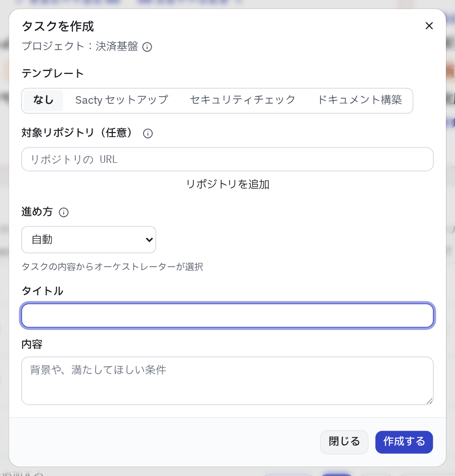
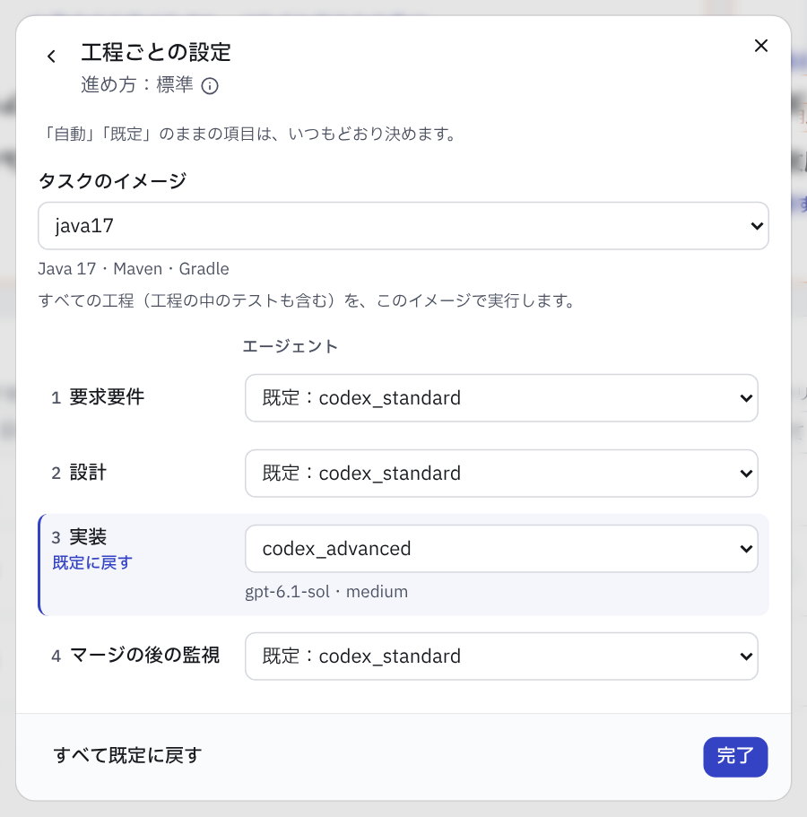
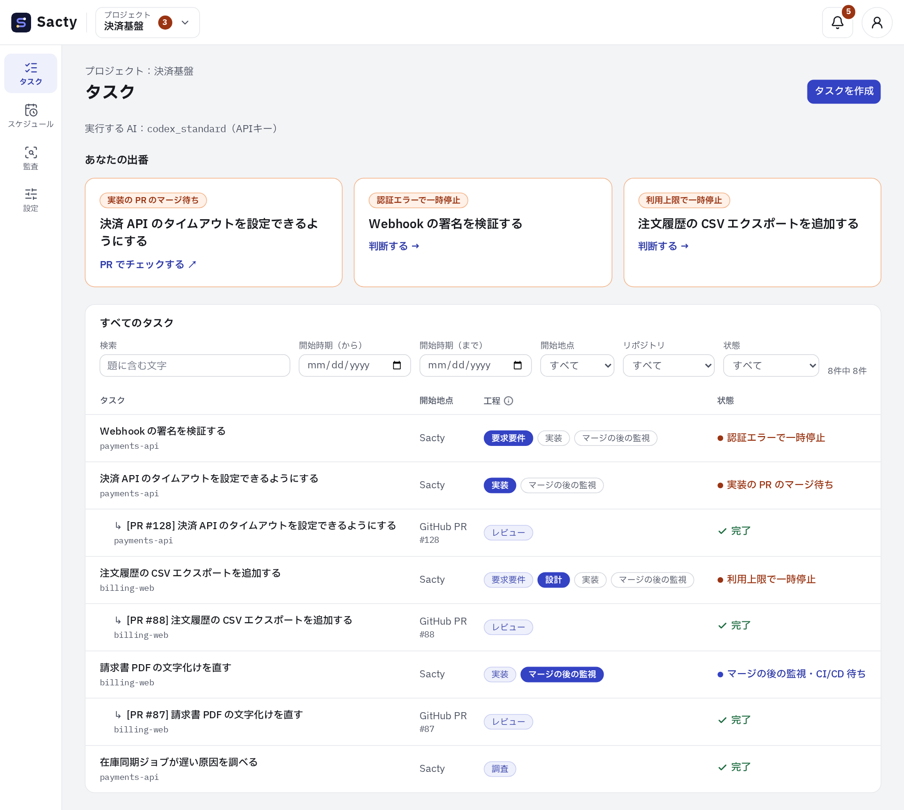
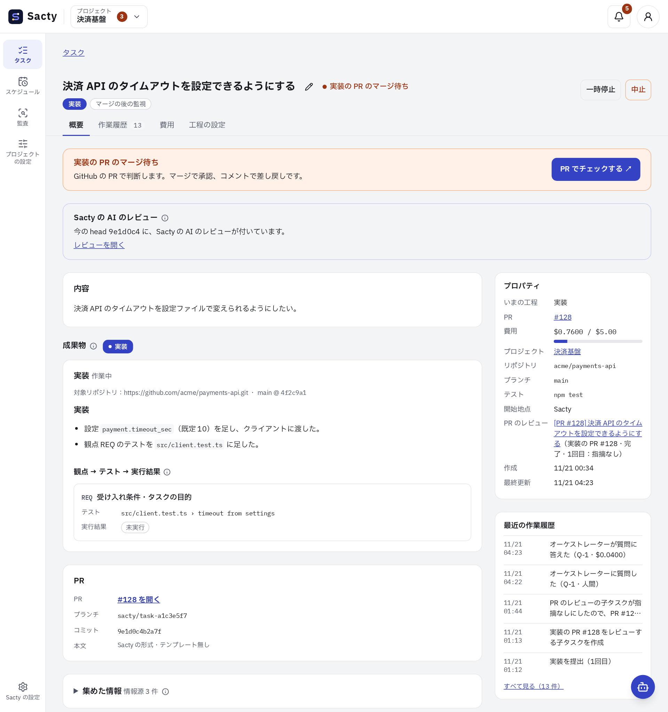
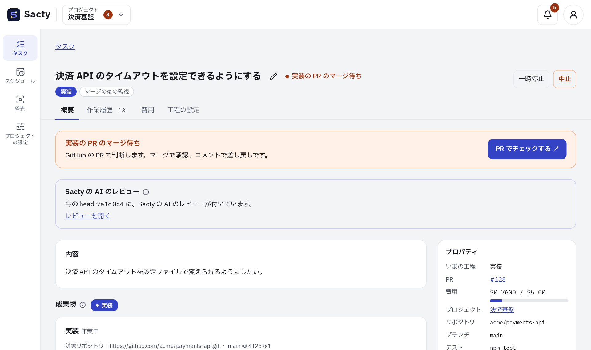
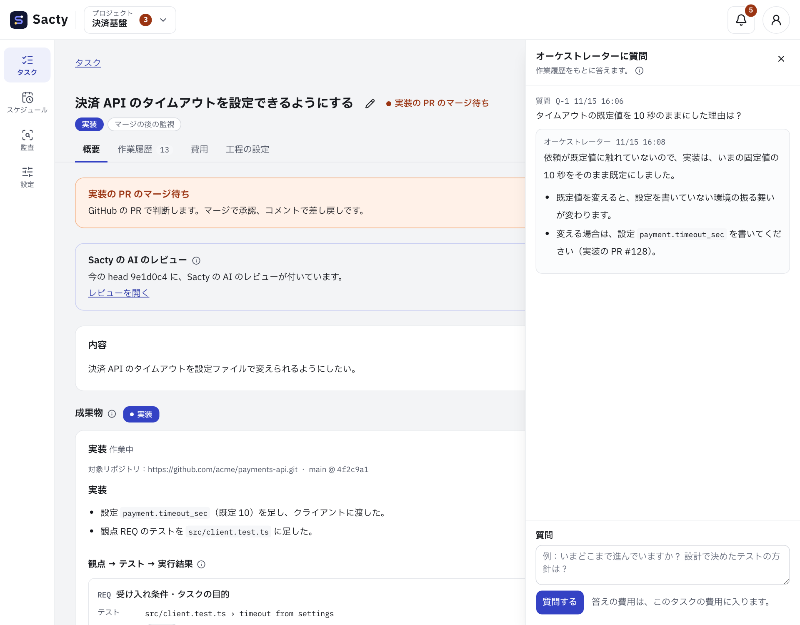
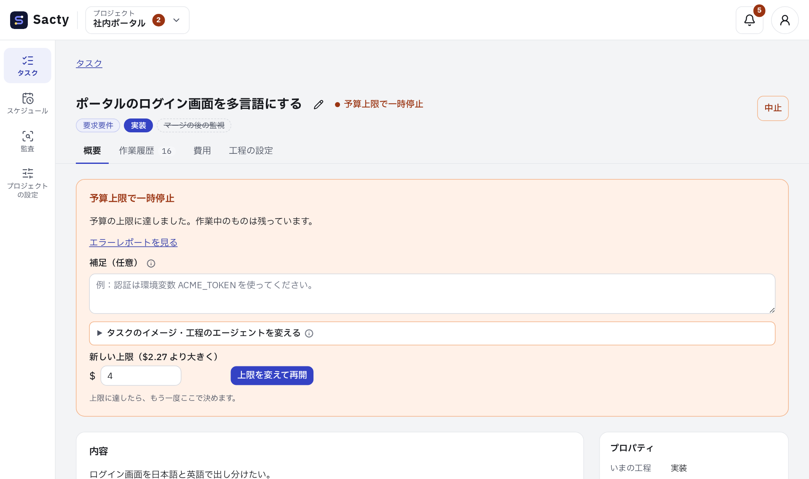

<!-- 対応するコード: apps/daemon/src/security.ts、apps/web/src/components/security-fixes.tsx、apps/web/src/components/derive-dialog.tsx、apps/daemon/src/config.ts、apps/web/src/components/task-detail.tsx、apps/daemon/src/service.ts、apps/daemon/src/repository.ts、apps/daemon/src/activity.ts、apps/daemon/src/pr-watcher.ts、apps/daemon/src/prompts.ts、packages/core/src/events.ts（StepKey・DEFAULT_DOCUMENTS_DIR）、apps/web/src/i18n/messages/task.ts、apps/daemon/src/task-templates.ts、apps/daemon/src/test-files.ts、apps/web/src/components/new-task-dialog.tsx、apps/web/src/components/task-step-settings.tsx、apps/web/src/components/implementation.tsx、apps/web/src/components/provenance.tsx、apps/web/src/components/task-list.tsx、apps/web/src/lib/task-filter.ts -->

**日本語** | [English](tasks.en.md)

# タスクを進める

タスクを作ると、オーケストレーター（進め方を選ぶ AI）と工程のエージェント（工程を実行する AI）が工程を進めます。
あなたは、承認ゲート（工程の成果を承認する所）でだけ判断します。

タスクは次のように進みます。

## このページの内容

このページは長いので、したいことから、読む節を選んでください。

| したいこと | 読む節 |
| --- | --- |
| タスクを作る・探す・状況を見る | [タスクを作る](#タスクを作る)、[タスクの一覧](#タスクの一覧)、[タスクの詳細の見方](#タスクの詳細の見方)、[画面の補足](#画面の補足)、[画面の自動の更新](#画面の自動の更新) |
| sacty が自分で進める部分を知る | [タスクの開始時の情報収集](#タスクの開始時の情報収集)、[提出の前のセルフレビュー](#提出の前のセルフレビュー) |
| 成果を確かめて、承認する・差し戻す | [PR での承認（要求要件・設計・実装）](#pr-での承認要求要件設計実装)、[要求要件・設計の読み方](#要求要件設計の読み方)、[確かめる項目（出典の分類）](#確かめる項目出典の分類)、[実装の PR のレビュー](#実装の-pr-のレビュー)、[差し戻したときの直し方](#差し戻したときの直し方)、[差し戻しの原因](#差し戻しの原因)、[変更の申し出](#変更の申し出)、[PR と Issue へのコメント](#pr-と-issue-へのコメント) |
| 進んでいるタスクに手を入れる | [オーケストレーターに質問する](#オーケストレーターに質問する)、[タスクの題を変える](#タスクの題を変える)、[タスクのイメージを変える](#タスクのイメージを変える)、[工程のエージェントを変える](#工程のエージェントを変える)、[一時停止・再開・中止](#一時停止再開中止)、[完了したタスクの続きのタスクを作る](#完了したタスクの続きのタスクを作る) |
| 依頼の種類ごとの進み方を知る | [文書作成と単発の外部作業](#文書作成と単発の外部作業)、[既存の PR を直す](#既存の-pr-を直す)、[セキュリティチェックと対応](#セキュリティチェックと対応)、[テストの仕組みが無いリポジトリ](#テストの仕組みが無いリポジトリ)、[実装に変更が無いとき](#実装に変更が無いとき)、[実装が終わらないとき・やり直しで変更が無いとき](#実装が終わらないときやり直しで変更が無いとき) |
| 以前の版で作ったタスクを扱う | [以前の版のタスク（「PR作成」の工程があった版）](#以前の版のタスクpr作成の工程があった版)、[以前の版のタスク（最終レビューがあった版）](#以前の版のタスク最終レビューがあった版) |

## タスクを作る

タスクは、タスクの一覧の「タスクを作成」から作ります。
Issue・PR・チケットから取り込むこともできます（[取り込み](intake.md)）。

「タスクを作成」を押すと、次のダイアログが開きます。

ダイアログでは、次のように入力します。

1. 「対象リポジトリ（任意）」で、プロジェクトの対象の中からリポジトリを選びます（[プロジェクトの設定](project-settings.md#対象)）。
   リポジトリを選ばずに作ることもできます（[リポジトリを選ばずに作る](#リポジトリを選ばずに作る)）。
2. 「進め方」は、既定の「自動」のままにすると、オーケストレーターがタスクの内容から工程の組み合わせを選びます。
   自分で選ぶこともできます（[進め方を指定する](#進め方を指定する)）。
3. 「タイトル」と「内容」を書きます。
4. 「作成する」を押します。

「テンプレート」を選ぶと、リポジトリを選ぶだけでタスクを作れます（[Sacty セットアップ](#テンプレートsacty-セットアップ)・[ドキュメント構築](#テンプレートドキュメント構築)・[セキュリティチェック](#セキュリティチェック)）。

リポジトリの候補は、次のように出ます。

- 候補は、「タスクを作成」を押してダイアログを開いたときに、sacty が読みます。
  Org の対象は `gh` で GitHub に問い合わせるので、数秒かかることがあります。
- 読んでいる間・読めなかったとき・候補が無いときは、ダイアログにそう出ます。
  どのときも、リポジトリの URL を入力すれば作れます。

ベースブランチ・テストのコマンド・省く工程などは、タスクを作った後に sacty が決めます（[sacty が決めること](#sacty-が決めること)）。

### リポジトリを選ばずに作る

調べもの・全体の設計・分割する大きなタスクは、リポジトリを選ばずに作れます。
オーケストレーターが、プロジェクトのコンテキスト（コンテキストリポジトリの規約・書き出しの接続先）と対象（リポジトリの一覧）から進め方を選びます。
その後は、タスクの種類によって、次のように進みます。

- コードを変えない仕事（調査だけ・設計だけ）は、リポジトリ無しのまま進み、あなたが sacty の画面で承認すると完了します。
  sacty は、PR やブランチを作りません。
  書き出し先があれば、成果を書き出します。
- 分割する大きなタスクは、タスク分割の工程が、子タスクごとに対象からリポジトリを選んで付けます（選んだ理由を残します）。
  統合レビューでは、子タスクのリポジトリごとにベースブランチの最新を読みます。
- コードの変更が要り、分けないタスクは、オーケストレーターが対象からリポジトリを選び、用意してから工程を選び直します。
  選べなければ、タスクが止まります。
  タスクの詳細で、あなたがリポジトリを選んで再開できます。

### 進め方を指定する

オーケストレーターの選び方と違う進め方にしたいときは、「タスクを作成」の「進め方」で組み合わせを選びます。
選ぶと、その下に工程の並びが出ます。
テンプレートを選んだときは、進め方を選べません。

| 進め方 | 工程 | 使いどき |
| --- | --- | --- |
| 自動 | オーケストレーターが選ぶ | 既定 |
| 標準 | 要求要件 → 設計 → 実装 → マージの後の監視 | 振る舞いが複数ある・影響範囲が広い変更 |
| 設計を省く | 要求要件 → 実装 → マージの後の監視 | 小さく局所的な変更 |
| 直接実装 | 実装 → マージの後の監視 | 依頼がそのまま受け入れ条件になる変更（確かめられる受け入れ条件がそろい、あなたに確かめることが無い依頼を含む） |
| 不具合の修正 | 再現 → 実装 → マージの後の監視 | テストで再現できる不具合 |
| 分割 | 要求要件 → 設計 → タスク分割 → 統合レビュー | 1つの PR に収まらない変更 |
| 調査だけ | 調査 | 質問・原因の調査・見積もり |
| レビューだけ | レビュー | 内容に書いた PR のレビュー |
| 文書作成 | 文書作成 | 手順書・ユーザーガイド・報告書などの原稿 |
| 作業のみ | 作業 | 外部サービスへの単発の変更 |
| 設計だけ | 要求要件 → 設計 | コードを変えない全体の設計 |
| セキュリティチェック | 調査 | 脆弱性・サプライチェーンの点検（[セキュリティチェックと対応](#セキュリティチェックと対応)） |
| セキュリティ対応 | 調査 → 実装 → マージの後の監視 | 特定のセキュリティ上の問題を、最小限の変更で直す |

進め方を指定すると、次のようになります。

- オーケストレーターは組み合わせを選び直さず、工程が終わるごとの見直しでも工程を飛ばしません。
- ベースブランチ・テストのコマンド・イメージなどは、いつもどおりオーケストレーターが決めます（イメージとエージェントは、[タスクのイメージと工程ごとのエージェントを指定する](#タスクのイメージと工程ごとのエージェントを指定する)で指定もできます）。
- 指定した進め方は、タスクの詳細の「工程の設定」タブに出ます。

進め方によって、次の決まりがあります。

- 「レビューだけ」は、対象リポジトリを選び、そのリポジトリの PR のリンクを題か内容に書いたときだけ選べます。
  そうでなければ、作成のときに理由が出ます。
  レビューでは PR のコードがエージェントのコンテナで動くので、信頼できない PR は選ばないでください（[信頼できない PR を取り込まない](intake.md#信頼できない-pr-を取り込まない)）。
- リポジトリを選ばずに、実装する進め方（標準・直接実装など）を選ぶこともできます。
  オーケストレーターが対象からリポジトリを選んでから、指定した進め方で進めます。
- 実装する進め方に、調査の工程はありません。
  コードの調べは、[タスクの開始時の情報収集](#タスクの開始時の情報収集)が行います。
  セキュリティ対応だけは、修正の範囲を決めるために、実装の前に調査があります。
- 「調査だけ」のタスクは、結果の形（表・章立て・項目など）を内容に書くと、その形で報告します。
  書かなければ、結論・根拠・関係する箇所・確認したいことの順で報告します。

進め方が「自動」のときに、オーケストレーターが要求要件を省く条件は、[「自動」で要求要件を省くとき・残すとき](#自動で要求要件を省くとき残すとき)にあります。

#### タスクのイメージと工程ごとのエージェントを指定する

進め方を選ぶと、工程の並びの下に「工程ごとに設定」が出ます。
押すと、ダイアログの中が工程ごとの設定に切り替わり、タスクのイメージ（1つ）と、工程ごとのエージェントを選べます。
進め方が「自動」のときと、テンプレートを選んだときは指定できません（工程が決まっていないため）。

選べるものは、次の2つです。

- イメージは、`images` の名前か `default`（既定のイメージ）を選びます（[コンテナイメージ](images.md)）。
  タスクのすべての工程・テストが、このイメージで動きます。
  「自動」のままなら、いつもどおりプロジェクトの対象の指定かオーケストレーターが選びます。
- エージェントは、使えるエージェントの名前を選びます（[config.yaml の設定](config.md)）。
  「既定」のままなら、`step_agents`（無ければ `default_agent`）で決まるエージェントを使います。
  統合レビューのエージェントは、`config.yaml` の `step_agents.integrate`（無ければ `default_agent`）で決まるので選べません。

「工程ごとの設定」の画面の動きは、次のとおりです。

- エージェントを選んだ工程には印が付き、「既定に戻す」で戻せます。
- 「完了」か左上の戻るボタンで、基本の入力に戻ります。
  基本の入力の工程の並びにも、エージェントを指定した工程に印が付き、指定したイメージが要約に出ます。
- 画面を切り替えても、入力中のタイトル・内容と選んだものは残ります。
  進め方を選び直しても、同じ工程の指定は残ります（今の進め方にある工程の分だけを使います）。
- 候補を読めないとき（`config.yaml` を読めないなど）は、理由が出ます。
  そのときも、指定せずにタスクを作れます。

指定したイメージ・エージェントは、オーケストレーターの選択や `step_agents` より優先します。
作成の後も、タスクの詳細の「タスクのイメージ」「工程のエージェント」で変えられます（選んだ元に「作成時に人が指定」と出ます。[タスクのイメージを変える](#タスクのイメージを変える)・[工程のエージェントを変える](#工程のエージェントを変える)）。

### テンプレート「Sacty セットアップ」

リポジトリを sacty で扱えるように、AI エージェント向けの設定を整えるタスクを、リポジトリを選ぶだけで作れます。

1. 「タスクを作成」のダイアログで、テンプレートの「Sacty セットアップ」を選びます。
2. 対象リポジトリを選んで「作成する」を押します。
   タイトル・内容は入力しません（sacty が決めます）。

作ったタスクは、通常のタスクと同じく、オーケストレーターが進め方を選び、承認・PR を経て進みます。
エージェントは次を検査し、足りないものを整える PR を作ります。

- エージェント向けの指示（AGENTS.md・CLAUDE.md など）
- テストの実行の仕方
  - テストの仕組みがまだ無ければ、無いことと、変更の確かめ方を書きます。
  - このタスクでは、言語やテストの仕組みを新しく入れません。
- テストに要るサービス（DB・モックなど）
- マージの後の監視のスキル `deployment-observer`（[マージの後の監視](deployment-watch.md#スキル)）
  - CI/CD のあるリポジトリで作ります（デプロイしていなくても作ります）。
    CI/CD が無ければ作りません。
  - 原本は `.agents/skills/deployment-observer/SKILL.md` です。
    Claude Code 用の `.claude/skills/deployment-observer` は、原本への相対のシンボリックリンクにします。
  - CI/CD の確認の仕方の reference（`references/ci.md`）も作ります。
    デプロイしていなければ、デプロイの確認を飛ばすことを書きます。

すでに整っていて変更が要らなければ、PR を作らずに、検査の結果を調査の結果として残して終えます（あなたが画面で承認すると、完了します）。
要求要件・設計・実装を進めた後に変更が要らないとわかったときも、PR を作りません。
実装の説明に検査の結果を残し、あなたが画面で承認すると終わります（[実装に変更が無いとき](#実装に変更が無いとき)）。

テンプレートで作ったタスクは、一覧の「開始地点」・詳細のプロパティの「開始地点」・作業履歴の「タスクを作成」に、テンプレートの名前が出ます。

API からは、`POST /api/tasks` に `{"template": "sacty-setup", "projectId": "<プロジェクトの ID>", "repo": "<リポジトリの URL>"}` を送ります（`title`・`body` は渡しません）。
CLI にはタスクを作るコマンドがありません。

### テンプレート「ドキュメント構築」

ドキュメントが足りないリポジトリでは、エージェントがコンテキストを得られず、思ったとおりの成果物を作れないことがあります。
このテンプレートを選ぶと、実装からドキュメントを作り、エージェントがそれを参照する・直すためのスキルを置くタスクを、リポジトリを選ぶだけで作れます。

1. 「タスクを作成」のダイアログで、テンプレートの「ドキュメント構築」を選びます。
2. 対象リポジトリを選んで「作成する」を押します。
   タイトル・内容は入力しません（sacty が決めます）。

作ったタスクは、通常のタスクと同じく、オーケストレーターが進め方を選び、承認・PR を経て進みます。
エージェントは次のことをします。コードは変えません。

- 既存のドキュメント（README・docs・AGENTS.md など）を棚卸しし、その結果を PR の説明に表で書きます。
  既存のドキュメントは消さず・動かさず・書き直さずに、新しいドキュメントからリンクします。
  置き場所や形が決まっていれば、それに従います（無ければ `docs/` に置き、入口を `docs/README.md` にします）。
- 実装から、コードを少し読むだけではわからないこと（目的と用語・全体の構成・主な処理の流れ・データ・外部とのつなぎ・規約）を書きます。
  全体の構成と主な処理の流れには、図も添えます。
  図の形式は、リポジトリの既存のドキュメントの図に合わせます（図が無いとき・同じ形式で作れないときは、Markdown の中にテキストで書ける形式にします）。
  ビルドやテストの実行の仕方は、テンプレート「Sacty セットアップ」で整えます。
- 2つのスキルを作ります。
  原本は `.agents/skills/` の下に置き、Claude Code 用の `.claude/skills/` の下は原本への相対のシンボリックリンクにします。
  - `docs-lookup`：作業の前にドキュメントを探して読むためのスキルです。
  - `docs-update`：実装を変えたときに、同じ PR でドキュメントを直すためのスキルです。

レビューの負担を抑えるため、次のように進めます。

- 新しく作ったドキュメントの先頭には、状態 `AI 生成・未レビュー` が付きます。
  エージェントは、未レビューのドキュメントをコードで確かめてから使います。
  中身を確かめたら、`レビュー済み` に書き換えてください（エージェントに頼んでもかまいません）。
- コードで確かめられないことは `（未確認）` と書かれ、PR の説明に、短く答えられる質問として挙がります。
  すべてのドキュメントを読まなくても、質問に答え、全体の構成のドキュメントを確かめればよいようにしています。
- 最初の PR は、棚卸しの結果・入口・全体の構成・2つのスキルに絞ります。
  残りの項目は、入口に「未作成」として並びます。
  リポジトリが大きければ、オーケストレーターが領域ごとに子タスクに分ける（1つの領域で1つの PR）こともあります。

すでに整っていて変更が要らなければ、「Sacty セットアップ」と同じく、PR を作らずに調査の結果を残して終えます。

API からは、`POST /api/tasks` に `{"template": "docs-setup", "projectId": "<プロジェクトの ID>", "repo": "<リポジトリの URL>"}` を送ります。

### sacty が決めること

次のことは、タスクを作った後に sacty が決めます。

- ベースブランチとテストのコマンドは、タスクの開始時にオーケストレーターがリポジトリを読んで決めます。
  [テストの仕組みが無いリポジトリ](#テストの仕組みが無いリポジトリ)では、テストを使わずに進めます。
- オーケストレーターは、要らない工程を省きます。
  - 依頼がはっきりしていて、既存の仕組みを使う小さな変更は、要求要件・設計を省いて実装から始めることがあります。
  - 工程が終わるごと（要求要件の承認の後など）に、残りの設計・再現の工程が要るかを見直し、要らない工程を飛ばします。
  - 飛ばした工程は、工程の並びに取り消し線で出ます。
    理由は作業履歴に出ます。
  - 飛ばした工程の分は、実装の PR をレビューする子タスクが、タスクの目的（依頼の内容）からレビューします。
    あなたは、PR のマージで承認します。
  - 進め方を指定したときは、工程を飛ばしません（[進め方を指定する](#進め方を指定する)）。
- 開発のセットアップ（依存のインストール・ビルドなど）を実行するかは、工程で決まります。
  - 工程の選択と、コードや仕組みを読んで説明する調査では、リポジトリの AGENTS.md などにセットアップの手順があっても、実行しません。
    調査で、コードを読むだけでは確かめられず、動かして確かめる必要があるときだけ、エージェントがセットアップすることがあります（そのときは、必要だった理由を調査の結果に書きます）。
  - 不具合の調査・再現・実装では、リポジトリの手順どおりセットアップします。

#### 「自動」で要求要件を省くとき・残すとき

進め方が「自動」のとき、依頼に、確かめられる受け入れ条件がそろっていて、あなたに確かめることが無ければ、オーケストレーターは要求要件を省いて「直接実装」を選びます。
要求要件を省いたときは、次のようになります。

- 省いた理由は、工程を選んだ理由（タスクの詳細の「工程の設定」タブの「選んだ理由」）に書かれます。
- 空白・上限・並び・列の位置のような細かい既定は、実装のエージェントが決め、PR の本文の「既定で決めたこと」に書きます。
  PR で確かめてください。

次のどれかに当たるときは、受け入れ条件が詳しく見えても、オーケストレーターは要求要件を残します。

- 依頼が曖昧なとき
- 依頼と文書やコードが食い違うとき
- あなたに確かめたいことがあるとき
- 設計の判断が要るとき
- 既存の共有の状態・項目に新しい意味を載せる（状態を増やす）とき
- 受け入れ条件に書かれていない公開 API・項目の変更が要るとき
- 使っている側との食い違いをあなたに確かめたいとき

受け入れ条件が公開 API・項目の変更（変更後の名前・形・必須かどうか・エラーのときの扱い）をはっきり書いていて、使う側との食い違いも確かめることが無ければ、それだけでは要求要件を残しません。
ただし、改名のように、使っている側がどうなるかが決まらない変更は、はっきり書いたことになりません。

次のことは、あなたに確かめることが無いので、残す理由にしません。

- 文書どうし、または文書と受け入れ条件の食い違いで、作るものが変わらないもの（完了の条件に含めるコマンドの違いなど）
- 受け入れ条件が決めた変更に伴う、呼び出し側やテストの追従
- 依頼と既存のコードから実装が決められること

残す理由は、答えが複数あり、依頼からも既存のコード・文書からも決まらず、あなたに聞かないと決められないことだけです。

要求要件を残したときは、オーケストレーターが挙げた残す理由が、要求要件の最初の実行に渡ります。
理由ごとに、あなたに聞くこととして「確認したいこと」に出るか、確認しないと決めた理由が、「確認したいこと」の節の最後に「確認しないと決めたこと」として書かれます。

この判断で、セルフレビューの回数・モデル・エフォートは変わりません。

## タスクの一覧

プロジェクトのタスクの一覧は、次のように表示されます。

タスクの一覧の各行には、題の下に、作業するリポジトリの名前（`org/repo` の `repo` だけ）が出ます。
リポジトリがまだ決まっていないタスクには出ません。
このうち、リポジトリを指定せずに作ったタスクには、「リポジトリ無し」と出ます。
Issue・PR から取り込んだタスクは、開始地点の下にその番号（`#7` など）が出ます。

子タスクは、親のタスクのすぐ下に字下げして並びます。

- タスク分割の子タスクは、分割で決めた順に並びます。
- sacty が作った PR をレビューする子タスクは、その PR を作ったタスクの下に（分割の子タスクがあればその後に）並びます。どのタスクのレビューかが、一覧で分かります。
- 分割の子タスクが作った PR をレビューする子タスクは、その分割の子タスクの下に、もう一段字下げして並びます。
- 親のタスクが一覧に出ていないとき（別のプロジェクトにある、または絞り込みで隠れた）は、子タスクは字下げせずに並びます。

### タスクを探す・絞り込む

「すべてのタスク」の上の欄で、一覧を絞り込めます。
すべての条件に合うタスクだけが出ます。

| 項目 | 絞り込み方 |
| --- | --- |
| 検索 | 題にその文字を含むタスク（大文字と小文字は区別しません） |
| 開始時期（から）・（まで） | タスクを作った日がその間のタスク（両端の日を含みます。片方だけでも使えます） |
| 開始地点 | Sacty・GitHub Issue など、タスクを始めた場所 |
| リポジトリ | 作業するリポジトリ。「未定・リポジトリ無し」は、リポジトリがまだ決まっていないタスクです |
| 状態 | 終わっていない・あなたの出番・進行中・待ち・完了・中止 |

件数（「5件中 1件」など）が欄の右に出ます。
「条件をクリア」を押すと、すべてのタスクに戻ります。
条件は画面を開いている間だけ残ります（自動の更新では消えません。再読み込みや別のプロジェクトへの移動で消えます）。
「あなたの出番」のカードは絞り込みません。

## タスクの詳細の見方

タスクの詳細は、次のように表示されます。

画面の上の部分には、次のものが出ます。

- 題・状態・工程の並び・操作（一時停止・中止・再レビュー）・タブは、画面の上に固定され、スクロールしても見えます。
- 承認や判断を待っているとき・一時停止しているときの案内は、どのタブを開いていても、タブの下に出ます。
- 承認待ちの PR が開いている間は、案内の下に「Sacty の AI のレビュー」が出ます。
  PR の今の head（いちばん新しいコミット）に、sacty の AI のレビューが付いているか（まだ付いていない・レビュー中・付いている）が分かります（[sacty が作った PR のレビュー](intake.md#sacty-が作った-pr-のレビュー)）。
  sacty が GitHub から今の head をまだ読めていない間（起動の直後など）は、状況が分からないと出ます。

タブで表示を切り替えます。

| タブ | 出すもの |
| --- | --- |
| 概要 | 中止したときの片付け・内容・成果物・PR・続きのタスクなど、そのタスクに関わる結果 |
| 作業履歴 | すべての作業履歴（新しい順。エージェントの実行の行から実行のログを開けます） |
| 費用 | 使った額と上限・工程ごとの費用・オーケストレーターのセッション |
| 工程の設定 | 工程と選んだ理由・ベースブランチ・テストのコマンド・書き出し先・タスクのイメージ・工程のエージェント |
| 監査 | 監査の結果（完了したタスクだけ。まだ監査していなければ、その旨。[監査](audit.md)） |

- 開いたタブは URL（`?tab=activity` など）に残るので、リロードや共有をしても同じタブが開きます。
- 概要の「成果物」では、工程を選んで1つずつ読みます。
  最初は、いまの工程（作業中・承認待ち・最後に終えた工程）の成果物が出ます。

右の列の「プロパティ」には、次のものが出ます。

- いまの工程・PR・費用・プロジェクト・リポジトリ・ブランチ・テスト（テストのコマンド）・元のチケット
- 開始地点（テンプレートで作ったタスクなら、テンプレートの名前も）
- 関連するタスク：親タスク・レビューする PR の元・PR のレビュー（その PR をレビューする子タスクと、その状態）・再実行の元・続きの元・修正の元・元のレポート
- 再実行したタスク
- 作成と最終更新の日時

このうち、PR・ブランチ・テスト・元のチケット・関連するタスク・再実行したタスクは、そのタスクにあるときだけ出ます。

エラーの記録があるタスクでは、「プロパティ」の下に「エラーレポート」が出ます（[エラーレポートを出す](troubleshooting.md#エラーレポートを出す)）。
その下に、最近の作業履歴（5件）が出ます。

## 画面の補足

画面の文は、いまの状態と次にすることだけを短く出します。
仕組みや理由は、見出し・項目の横の補足の印（i）にマウスを乗せると出ます。
キーボードでは Tab で印に止まると出て、スマホではタップで出ます。
Esc か外側を押すと閉じます。
補足が無い項目には印が出ません。

タスクの詳細の作業履歴で、差し戻しの行の「詳細」を押すと、差し戻したときに書いた指摘が出ます。
承認した後や、完了・中止した後でも、過去の指摘を読み返せます。

## 画面の自動の更新

ダッシュボード・タスクの一覧・タスクの詳細・ヘッダーのお知らせは、開いている間、3秒ごとに最新の状態を取り直して表示します。
タスクの状態によらず（タスクが無いとき・すべてが承認待ち・一時停止・完了のときも）取り直します。
そのため、取り込みで増えたタスク、ほかのタブや CLI での承認・再開、デーモンが拾って動き出したタスク、承認待ちになったタスクが、操作しなくても画面に出ます。

取り直すときの画面の動きは、次のとおりです。

- 画面は読み直さず、変わった所だけを表示し直します。
  書きかけの質問・コメント・フォームの値、選んだもの、開いたダイアログや欄、フォーカス、スクロールの位置は、そのまま残ります。
- ブラウザのタブが隠れている間は問い合わせません。
  タブに戻ると、すぐに最新にします。
- デーモンに届かない間は、画面をそのまま残し、「デーモンに届きません」（ヘッダーは「更新が止まっています」）と表示します。
  表示は最後に取得した内容です。
  届くようになったら、また最新にし、この表示を消します。

ほかの画面の更新は、次のとおりです。

- 承認の画面・プロジェクトの一覧（取り込みの状況）も、同じように読み直さずに最新にします。
  書きかけのコメントは消えません。
- 実行のログは、実行中、新しい行を自動で後ろに足します。
  - 読んでいる途中のスクロールの位置は動きません。
    一番下を見ているときだけ、新しい行についていきます。
  - 実行が終わった後に、エージェントの元のファイルの一覧を読めないときは、そのことと取り直していることを表示し、読めたら一覧を出します。
- Sacty の設定・プロジェクトの設定の画面は、自動では更新しません（ヘッダーのお知らせだけを更新します）。
  最新を見るときは、開き直すか、ブラウザで読み直してください。

## タスクの開始時の情報収集

タスクが始まると、オーケストレーターが進め方を選ぶ前に、情報収集のエージェントがタスクに関係する情報を集めます。
集めた情報は、関係するものだけにまとめられます。
このまとめが、タスクの詳細の「集めた情報」に出ます（工程が始まると折りたたまれます）。
まとめには、読めなかった情報源や、情報源の間の食い違いも書かれます。

情報収集のエージェントは、次のものを読んで情報を集めます。

- チケットから取り込んだタスクなら、親のストーリー・エピック、リンクしたチケット、コメントにある URL まで辿ります。
- 使える MCP サーバー・外部 PF（文書・チャットなど）でも、タスクの語を探します。
  外部の文書やチャットを読ませるには、その接続先をゲートウェイの外部 PF かコンテキストの MCP サーバーに入れておきます（[ゲートウェイ](gateway.md)・[コンテキストリポジトリ](context.md)）。
- 対象リポジトリのコードも読み、タスクに関係するコードの場所といまの振る舞いをまとめに書きます。
- リポジトリの文書は、AGENTS.md・README から参照されているものだけでなく、文書を置くディレクトリからも、タスクに関わるものを探して読みます。
  参照されていない文書でも、依頼に関わる振る舞いや前提（データの鮮度・運用上の決まりなど）を定めていれば、まとめに書かれます。

コードの読み方は、作業するリポジトリが決まっているかで変わります。

- 作業するリポジトリが決まっているタスクは、情報収集の前に sacty がリポジトリを用意し、情報収集のエージェントがそのコードを読みます。
  用意できなければ、情報収集の前にタスクが止まります。
  テストの書き方（フレームワーク・実行のコマンド・置き場所・既存のテストの例）もまとめます。
  まとめにテストの書き方があっても、テストを書くとは限りません。
  テストの扱いは、オーケストレーターが決めます。
- 決まっていないタスク（リポジトリを指定せずに作ったタスク・リポジトリを選ぶ前のチケットのタスク）は、プロジェクトの対象から関係しそうなリポジトリをいくつか（多くても3つ）洗い出し、GitHub の読み取りの中継（`gh api`）でコードを読みます。
  読むには、プロジェクトの設定でそのホストの GitHub のアカウントを選んでおきます（[プロジェクトの設定の GitHub アカウント](project-settings.md#github-アカウント)）。
  読めなかったリポジトリと、リポジトリの一覧を読めなかった Org（認証切れ・権限不足など）は、読めなかった情報源としてまとめに書かれます。

sacty が作った PR をレビューする子タスクは、情報を集め直しません。
PR を作った親タスクのまとめを引き継ぎ、「集めた情報」に「親タスクから引き継ぎ」と出ます。
親タスクにまとめが無いときは、子タスクが集めます。

チケットから取り込んだタスクでは、情報収集のエージェントが、集めた情報から作業するリポジトリを選び、タスクの題と概要も書きます。

- リポジトリを選べなかったときは、タスクが止まります。
  タスクの詳細でリポジトリを選ぶと、再開できます。
  再開したときは、集めた情報は残り、題と概要だけを書き直します。
- 題と概要を書く前に人が題を変えていれば、題は変えたままにします（再開して書き直すときも同じです）。

まとめの書かれ方と渡し先は、次のとおりです。

- 対象のリポジトリの外から集めた情報（取り込み元など別のリポジトリのコードや文書・外部の URL）は、出どころ（リポジトリ名か URL）を添えて「対象のリポジトリの外」と明記し、対象のリポジトリの文書とは別の項目に書かれます。
  対象のリポジトリに文書が無いことは、外の文書で補ったようには書かれません。
  後の工程にも、外の情報を対象のリポジトリの規約や決定として扱わないよう伝わります。
- まとめは、オーケストレーター・すべての工程に渡されます。
  統合レビュー・PR の指摘の戻し先の判断にも渡されます。
  判定や判断では、これを背景の理解にだけ使い、判定の基準は承認した成果物のままです。
- タスク分割の子タスクは集め直さず、親が集めた情報を内容に引き継ぎます。

情報収集は読むだけです。
コードも変更しません。
外部 PF と MCP サーバーの扱いは、次のとおりです。

- ゲートウェイの外部 PF は、`allow` に書き込みの API があっても、情報収集では GET・HEAD だけが通ります。
- MCP サーバーのツールは sacty では制限できないので、指示で読み取りの操作だけを使わせています。
  書き込みのツールを持つ MCP サーバーをコンテキストに入れているときは注意してください。

情報収集のエージェントがまとめられなかったときは、タスクが一時停止します。
再開すると集め直します。

使う AI と費用は、次のとおりです。

- 使う AI は `config.yaml` の `step_agents.gather` で選べます（書かなければオーケストレーターの AI。[config.yaml の設定](config.md#工程ごとのモデル)）。
- 費用はタスクの予算に入り、工程ごとの費用の表の「情報収集」の行に出ます。

## 提出の前のセルフレビュー

要求要件・設計・実装・文書作成の工程では、エージェントが提出の前に、既定のスキル `review-dispatch` で観点ごとにセルフレビューします。
`must`（修正が必要な重要度）の指摘が無くなるまで直してから提出します（初回を含めて最大 5 回）。

ただし、提出が sacty の作る PR になる工程では、セルフレビューをしません。
その PR を、sacty が別のタスク（PR のレビューの子タスク）でレビューするためです。
同じ成果物を二重にレビューしません。

| 提出のしかた | セルフレビュー |
| --- | --- |
| 要求要件・設計・実装を、sacty の作る PR で承認する | しません（PR のレビューの子タスクがレビューします） |
| 要求要件・設計を、画面で承認する | します |
| 既存の PR を引き継いで直す | します |
| 文書作成の工程、対象のリポジトリが無いタスク | します |

セルフレビューをしない工程でも、フォーマッター・リンター・テストなどの検証は、提出の前に実行して通します。
この工程では、セルフレビューの結果は画面に出ません（「記録なし」にもなりません）。

要求要件・設計の工程では、エージェントは提出の前に、リポジトリが定める文書に効く検証（文書のフォーマッター・文書の lint・リンクの検査など）も実行して通します。
検証するのは、sacty がリポジトリのファイル（既定 `docs/sacty/<タスクの短い ID>/`）として PR に入れる、要求要件・設計の成果物です。
テスト・ビルド・型チェックなど、コードの検証は実行しません。
実行しなかった検証は、理由がセルフレビューの報告に残ります（セルフレビューをしない工程では残りません）。

セルフレビューの結果は、成果物のカード・実装のカード・承認の画面に出ます。

| 表示 | 意味 |
| --- | --- |
| セルフレビュー：パス・n回 | `must` の指摘が無くなるまで直しました |
| セルフレビュー：パスしていません・n回・残った指摘 m件 | 上限まで直しても `must` の指摘が残りました。残った指摘を確かめてから判断してください |
| セルフレビューの記録がありません | エージェントが結果を報告しませんでした。成果物を自分で確かめてください |

セルフレビューをする工程で、セルフレビューをしない直し（[指摘を受けて直すときのセルフレビュー](#指摘を受けて直すときのセルフレビュー)）をしたときも、結果は「記録なし」になります。

セルフレビューの費用は、その工程の費用に入ります。

### セルフレビューで見る観点

初回は全部の観点で見ます。
直した後の再レビュー（2回目以降）は、前回 `must` を出した観点と、観点にとらわれず欠陥を探す X-1 だけで見ます（`must` が無く、`should` だけを直したときは X-1 だけ）。
再レビューで見なかった観点は、エージェントの実行の記録に「起動しない（前回の回で `must` なし）」と残ります。

依頼の成果物が文書のファイルだけと判断された場合は、実装のセルフレビューも、コードの観点ではなく文書の観点（コードとの同期・手順の成立・読み手の適合・静的品質）で見ます。
コードも変える依頼は、コードの観点で見ます。

文書作成の原稿は、原稿の種類に合った文書の観点で見ます。

- ユーザーガイド・手順書・README・運用の文書・報告など：利用者向けの文書の観点（コードとの同期・手順の成立・読み手の適合・静的品質）
- 設計書・比較や判断の記録など：設計の文書の観点

原稿はリポジトリのファイルにしないので、リポジトリの検証（フォーマッター・lint など）は実行しません。
外部の文書を直接書く依頼では、エージェントは書く前の下書きをセルフレビューし、直し終えてから外部に書きます。
外部の既存の文書を直す依頼では、見直す範囲を、直した所とその直しに必要な所に絞ります（依頼に無い所を、承認の前に書き換えないためです）。

対象のリポジトリに、今回の変更に当てはまるスキルや指示書があれば、次のように見る所を足します。
どちらも、既定の観点は減らしません。

- レビュー用のスキルがあれば、スキル 1 つにつき担当を 1 つ足して、そのスキルの項目でも見ます。
- 開発用のスキルや指示書（`AGENTS.md`・`CLAUDE.md`・`CONTRIBUTING` など）があれば、今回の変更がその決まりを守っているかを見る観点（X-3）も足します。

変えていない領域のスキルなど、今回の変更に当てはまらないものでは足しません。
スキルや指示書に書かれた修正・投稿・サブエージェントの起動は行いません。

### 指摘を受けて直すときのセルフレビュー

この節は、セルフレビューをする工程の説明です。
sacty の作る PR で承認する工程では、直しをやり直すときも、セルフレビューをしません（[提出の前のセルフレビュー](#提出の前のセルフレビュー)）。

人の差し戻し・AI のレビューの指摘を受けて、エージェントが直しをやり直すときは、セルフレビューで見る観点を絞ります。
要求要件・設計の差し戻しでは、レビューの範囲と回数も絞ります。

観点は、次のように絞ります。

- その実行の最初のレビューを、再レビューとして扱います。
  見るのは、今回の指摘に関わる観点と X-1 だけです（タスクの最初の実行は、全部の観点で見ます）。
- 見なかった観点は、「起動しない（直しの実行：今回の指摘に関わらない）」と残ります。
- 前回の提出のセルフレビューが合格していなかったときは、全部の観点で見ます。

要求要件・設計を差し戻し、空でない前回の成果物を元に直すときは、レビューの範囲と回数も、次のように絞ります。

- 範囲は、前回の成果物との差分とその直しに必要な所に絞ります。
- 回数は、直す所が 2 か所以内で、方針を変えない小さな指摘（例：確認したいことへの答えの反映、1つの要求の文言の訂正）のときは、初回を含めて最大 2 回にします。
  初回のレビューで `must` が無ければ、そこで提出します。
  直す所が多い・方針を変える指摘や、小さいか迷うときは、通常どおり最大 5 回です。
  どちらで進めたかは、セルフレビューの総評の最初に書かれます。

ただし、次のときは、全体を通常どおりレビューします。

- 前回の提出のセルフレビューが通っていないとき・記録が無いとき（人が文書を直した後を含む）
- 前回の成果物が空のとき
- 指摘が方針を変えるとき

レビューの範囲と回数の絞り込みは、実装・文書作成の差し戻しには適用しません。
ただし、実装・文書作成の直しの実行も、前回の提出のセルフレビューが合格していれば、指摘に関わる観点だけで、この実行で直した所を中心に見ます（文書作成は、前回の原稿が空でないときに限ります）。

セルフレビューをしない直しもあります。
PR のコメントが、「確認したいこと」への答えだけで、すべて推奨どおりのときは、成果物を作り直さず、セルフレビューもしません（[差し戻しの原因](#差し戻しの原因)）。
エージェントは、答えた項目を外し、答えを反映した所以外が前回と同じであることなどを読み直して確かめるだけです。
このときは、セルフレビューをする工程では、結果が「記録なし」になり、次の直しは全体をレビューします。

## PR での承認（要求要件・設計・実装）

人間の承認が要る工程（要求要件・設計・実装）は、対象のリポジトリへの PR で判断します。
PR をマージすると承認になり、PR にコメントすると差し戻しになります。
PR を作った工程は、sacty の画面からは承認しません（画面は PR への案内と状況の表示です）。

実装の PR のマージを待っているタスクの詳細は、次のように表示されます。

承認待ちになったら、次の手順で判断します。

1. PR を開きます。
   今の提出の PR が開いていれば、次の所から、GitHub の PR を新しいタブで直接開けます（sacty の承認の画面を挟みません）。
   - タスクの詳細・タスクの一覧の「あなたの出番」：「PR でチェックする ↗」を押します。
   - ダッシュボードの「あなたの出番」・ヘッダーのお知らせ：タスクの題（末尾に ↗ が付きます）を押します。
2. PR を読みます。
   読むときの手がかりは、次の節にあります。
   - 要求要件・設計の PR：[要求要件・設計の読み方](#要求要件設計の読み方)と[確かめる項目（出典の分類）](#確かめる項目出典の分類)
   - 実装の PR：[実装の PR のレビュー](#実装の-pr-のレビュー)
3. 承認するか、差し戻すかを決めます。
   - 承認するときは、PR をマージします。
     sacty の画面に戻らなくても、次の確認で承認として進みます。
   - 直してほしい所があるときは、PR にコメントします。
     sacty がコメントを指摘として取り込み、作り直します（[PR のコメントで差し戻す](#pr-のコメントで差し戻す)）。

今の提出の PR が開いていないときや、エスカレーションのときは、GitHub の PR ではなく、sacty の承認の画面に案内します（[sacty の承認の画面に案内されるとき](#sacty-の承認の画面に案内されるとき)）。

### PR が作られる順序

PR での承認は、次の順に進みます。

1. sacty が、ベースブランチの起点のコミットからタスクブランチ（`sacty/task-<タスクの短い ID>`）を作ります。
2. 要求要件を、ファイル（既定 `docs/sacty/<タスクの短い ID>/requirements.md`）にして、タスクブランチへの PR にします。
   マージされたら、要求要件の承認として記録し、次の工程に進みます。
3. 設計（テスト観点を含む。`design.md`）も同じく、タスクブランチへの PR にします。
4. 設計の PR がマージされたら、実装の工程に進みます。
   - 実装の工程が終わったら、タスクブランチに実装を積み、タスクブランチからベースブランチへのドラフトの PR にします（CI が動きます）。
     PR をレビューする子タスクが「指摘なし」にしたら、ドラフトを外します（[実装の PR のレビュー](#実装の-pr-のレビュー)）。
     実装の PR には、要求要件・設計のファイルも含まれます。
   - 実装の承認待ちになり、PR をマージすると実装の承認になって、マージの後の監視の工程に進みます。
     対象のリポジトリにマージの後の監視のスキルが無く、この工程を飛ばしたときは、タスクが完了します。
   - マージの後の監視では、CI/CD とデプロイを sacty が見届け、終わるとタスクが完了します（[マージの後の監視](deployment-watch.md)）。

要求要件・設計・実装をすべて PR で承認するときのブランチと PR は、次のようになります（タスクの短い ID が 1a2b3c4d の例）。

ファイルとブランチには、次の決まりがあります。

- ファイルの置き場所は、リポジトリやプロジェクトのコンテキストの規約に決まっていれば、オーケストレーターがそれに従います。
- タスク分割の子タスクは、それぞれ自分のタスクブランチを持ちます。
  親の要求要件・設計も親のタスクブランチへの PR で承認しますが、親のタスクブランチはベースブランチにはマージしません。

次のときは、要求要件・設計の PR を作りません。

- 承認が要らない工程（再現・レビューなど）
- 調査だけ・レビューだけ・不具合の修正（要求要件・設計の無いタスク）。
  調査だけのタスクは、画面で承認します。
- 既存の PR を引き継ぐタスク。
  要求要件・設計は、sacty の画面で承認します（[既存の PR を直す](#既存の-pr-を直す)）。
- PR での承認ができる前の版で、画面で要求要件・設計を提出したタスク。
  そのまま画面で承認します。

### PR のコメントで差し戻す

sacty は、PR のレビュー・行へのコメント・通常のコメントを、指摘として取り込みます。
そして、その工程のやり直し（同じ PR を更新）か、前の工程への差し戻しか（戻し先）を判断して、作り直します。
人の確認は挟みません。

指摘は、次のように取り込みます。

- 1分ごとに確かめ、最後のコメントから2分後に取り込みます。
- bot と sacty の投稿は除きます。
  ただし、その PR を取り込んだ sacty のレビューのタスクの投稿は含めます（[sacty が作った PR のレビュー](intake.md#sacty-が作った-pr-のレビュー)）。

戻し先は、指摘が承認済みの要求要件・設計の決定（受け入れ条件・振る舞い・画面・API やデータの形など）を変えるかで決まります。

- 決定を変えない指摘（文書への追記、実装の直し、決まったことの反映漏れ）は、その PR の工程（実装の PR なら実装）で直します。
- 決定そのものを変える指摘だけ、その決定を持つ工程に戻ります。

誰が戻し先を判断するかは、指摘の出どころで変わります。

- PR をレビューする子タスクの指摘だけなら、子タスクが指摘ごとに示した戻し先に従います（判断のための実行はせず、費用はかかりません）。
- あなたの指摘を含むときは、その PR の工程のエージェントが判断します。

判断と理由は、次のように残り、作り直しに伝わります。

- 判断と理由は、作業履歴と PR の欄に残ります。
  理由には、どの決定を変える・変えないかが書かれます。
- 判断と理由は長くなることがあるので、画面（PR の欄・作業履歴）には先頭の1〜2文を要点として出し、全文は「詳細」を開いて読めます。
  作業履歴の記録と、作り直しに渡す判断は全文のままです。
- 戻し先の判断（戻し先と、指摘をどう読んだかの理由）は、その判断で始まった作り直しにも伝わります。
  判断は指摘の解釈なので、あなたの指摘の原文と食い違うときは、原文が優先されます。
- 戻し先を判断できなかったときも、何が読み取れなかったかを伝え、作り直しでは、推測で大きく変えずに、読み取れなかった点を対応の欄に残します。
- 人に確かめてほしいことがあるときは、承認の画面とタスクの詳細に出し、同じ内容を PR にもコメントします（[人に確かめてほしいこと](#人に確かめてほしいこと)）。

前の工程に戻したときは、マージ済みの PR は戻さず、タスクブランチに直しの PR を新しく作ります。
直しがマージされたら、後ろの工程の PR を作り直します。
開いていた前の PR は閉じます（実装の PR は、同じ PR を更新します）。

同じ工程への差し戻しが上限を超えたら、エスカレーションになります。
上限に数えるのは、あなたが差し戻した回数です。
sacty 自身の AI のレビューの指摘だけの差し戻しは数えません（[sacty が作った PR のレビュー](intake.md#sacty-が作った-pr-のレビュー)）。

### 人に確かめてほしいこと

PR の指摘を受けた作り直しでは、指摘の意図が合っているかを、あなたが確かめないと分からないことがあります。
そのときは、承認の画面と、タスクの詳細の承認の案内の下に、「人に確かめてほしいことがN件あります」と出ます。
意図と違うときは、PR にコメントするか、タスクの画面で差し戻してください。

出るのは、次のときです。

- sacty が指摘の意図を判断できなかったとき。
  何が読み取れなかったかの理由が出ます（長いときは先頭の1〜2文で、全文は開いて読めます）。
  作り直しは、読み取れた範囲の最小限の変更で進みます。
  直した結果が意図と合うかを、指摘した方が確かめてください。
- 作り直した実行が、指摘への対応と一緒に、確かめたいことを挙げたとき。
  どの指摘についてのことかも出ます。
  たとえば、次のときに挙げます。
  - 指摘の意図を読み取れず、推測で直した
  - 元の値や文言が手元に無く、作り直した
  - 指摘が求めていない範囲を変えた
  - 指摘を直さずにおいた

PR を見ている方が気づけるよう、sacty は同じ内容を、作り直した成果物の PR（実装・要求要件・設計のどれでも）にコメントします。

- コメントするのは、その成果物が承認待ちに戻ったときです。
  1回の提出につき1件です。
- コメントの先頭は「Sacty：人に確かめてほしいことがあります」です。
- 秘密の値は伏せ、長い文は切って載せます。
  作業領域の内部のパスは、人が辿れる呼び方に置き換えます。
- このコメントは、指摘として取り込みません。

次のときは、PR にはコメントしません（画面には出ます）。

- GitHub のアカウントを選んでいないプロジェクト
- セキュリティチェック・セキュリティ対応のタスク（脆弱性や修正の範囲の詳細を公開の場所に出さないためです）

コメントできなかったときも、タスクは止まりません。
一時停止の間にコメントできなかったときは、再開したときにもう一度コメントします（同じ提出に書いたコメントがあれば、書き直しません）。

### sacty の承認の画面に案内されるとき

次のときは、GitHub の PR ではなく、sacty の承認の画面に案内します。
タスクの詳細・一覧では「チェックする」「判断する」、ダッシュボード・お知らせでは ↗ の無いタスクの題から開きます。

- エスカレーションのとき（同じ工程への差し戻しが上限を超えたときなど。以前の版のタスクでは、PR の指摘の戻し先を人が選ぶときも）。
  変更の申し出の判断待ちは、承認の画面ではなく、タスクの詳細の「変更の申し出」の欄に案内します（[変更の申し出](#変更の申し出)）。
- PR がマージされずに閉じられた・まだ無いとき。

PR がマージされずに閉じられたときは、sacty は承認にせずに、あなたの判断を待ちます。
画面から差し戻すと、作り直した内容を新しい PR で出します。

### 直してからマージしたとき・作り直しの間にマージしたとき

PR の中で直してからマージした（sacty の提出と違う内容でマージした）ときも、マージを承認として次の工程へ進みます。
要求要件・設計は、人が直したファイルを承認した成果にします。

実装を作り直している間（差し戻し・PR の指摘の取り込み）に、人が実装の PR をマージしたときは、マージを承認として扱います。

- sacty は、走っている実装・PR の更新を止めて（新しい PR は作りません）、次の工程（マージの後の監視。飛ばしていればタスクの完了）に進みます。
- 止めた実行と、作り直しに渡す前に捨てた指摘（まだ PR に反映していないもの）は、タスクの作業履歴に「PR #N がマージされたため、実装の作り直しを止めた」として残ります。
- 捨てた指摘（一時停止の間に届いて、まだ反映していなかった PR の指摘を含みます）を直したいときは、続きのタスクを作ってください（[完了したタスクの続きのタスクを作る](#完了したタスクの続きのタスクを作る)）。
- 要求要件・設計をやり直している間は、実装の PR がマージされても止めません。

### PR の本文の形

sacty は、対象のリポジトリ（無ければ Org の公開の `.github` リポジトリ）に PR テンプレート（`pull_request_template.md`）があれば、その見出しの形で PR の本文を書きます。
テンプレートが無い・読めないときは、sacty の決まった形で書きます。
どちらにしたかは、タスクの画面の PR の欄の「本文」に出ます。
探す場所・埋め方の詳しい規則は、[仕様書](../spec/approval.md#pr-の本文と-pr-テンプレート)を参照してください。

テンプレートの見出しの形で書くときは、次のようにします。

- sacty が埋められない見出しは「該当なし」にします。
- チェックボックスにはチェックを付けません（レビューする人が付けます）。

sacty の決まった形で書くときは、実装の PR の本文は次のようになります。

- 先頭の「結論」に、変更の要約と、sacty のレビュー（PR をレビューする子タスクがレビューして投稿すること）を書きます。
- 承認済みの要求要件・設計は全文を載せず、要点と、マージで承認した PR へのリンクにします。
- 「変更」の節は、結論の「変更」に載せた最初の段落を除いた残りです（同じ文を繰り返しません）。
  実装の説明が自分で「## 変更内容」のような見出しから始まるときは、中身の無い「変更」の見出しを重ねません。
- 観点とテストの対応の表は短くし、入力・期待結果は、折りたたみの「観点ごとの詳細」にあります。

実装を作り直した後（差し戻し・AI のレビューの指摘のどれで始まった作り直しでも）の本文は、最後の直しだけでなく、PR 全体の説明になります。

- 最後の直しの内容は、「最後の直し」の節（結論にも1行）に分けて載ります。
  この節も、結論の「最後の直し」に載せた最初の段落を除いた残りです。
  結論に収まるときは節を出しません。
- 観点とテストの対応の表には、前の提出までに対応させたテストも残ります。

観点とテストの対応と、内部のパスには、次の決まりがあります。

- 観点とテストの対応では、同じテストを1回だけ出します（describe の接頭辞を付けた名前と付けない名前は、付けたほうに統合します）。
  パラメータ化したテストの名前の `%j`・`%s` などの書式の文字は、値が名前だけからは分からないので、`‹…›` に置き換えます。
- sacty の作業領域の内部のパス（`/sacty-input/task.md:77` など）は、PR の本文・コメント（調査の結果、工程が頼んだコメント、人に確かめてほしいことのコメント）に出ません。
  「タスクの依頼」「人の指摘」のように、人が辿れる呼び方に置き換わります。

以前の版で最終レビューをしたタスクの本文には、その記録が次のように出ます。

- 最終レビューの記録があるときは、結論に「人が確かめること」も書きます。
  テンプレートに沿う本文では、人が確かめることは本文の末尾にあります。
- 観点ごとの所見は、折りたたみの「観点ごとの詳細」に出します。
- 総評は、ふつうは本文に出しません（最終レビューの不合格のまま人がレビューへ進めたタスクだけは、その記録と一緒に、総評を「最終レビューの所見」として1行で出します）。

### コミットのメッセージの形

sacty が作るコミットの1行目は、リポジトリが Conventional Commits の形を定めているかで変わります。

- 定めているとき（Commitizen・commitlint の設定がある、または AGENTS.md・CONTRIBUTING などの決まりが書いているとき）は、`feat: <タスクの題>` の形になります。
  - 種類は、文書だけの依頼と要求要件・設計の PR のコミットが `docs`、不具合の修正が `fix`、それ以外が `feat` です。
  - 題がすでに `feat: …` の形なら、重ねて付けません。
- 定めが無いリポジトリ、定めを読めないリポジトリでは、タスクの題のままです。
- commitlint の設定が1行目の形を独自に決めているとき（チケット番号を先頭に要求するなど）は、ほかに commitlint の依存があっても、独自の形を優先し、種類を付けません。

## 要求要件・設計の読み方

要求要件・設計は、最初に次の3つの節があります。
この3つの節を読めば、範囲が意図どおりかと、承認するかを決められるように書かせています。

| 節 | 中身 | すること |
| --- | --- | --- |
| スコープ | 何を実現するかと、対象・対象外 | 範囲が意図と違えば、指摘に書いて差し戻します |
| 確認したいこと | あなたが決めないと確定できないこと | 推奨の答えでよければ、そのまま承認します。違う答えにするなら、指摘に書いて差し戻します |
| 既定で決めたこと | 依頼に書かれていないが、エージェントが既存のコード・規約から決めたことのうち、あなたが異論を持ちうるもの（最大 5 件） | 異論があるものだけ、指摘に書いて差し戻します |

それぞれの節の中身を詳しく書くと、次のとおりです。

- スコープ
  - 対象は、今回変えるものです。
  - 対象外は、含まれると思われそうだが、今回はやらないことです（無ければ「なし」）。
- 確認したいこと
  - must と should に分かれています。
    - must は、後で違うと分かると、それまでの作業が無駄になるものです（件数の上限なし）。
    - should は、後で違うと分かると、追加の作業が要るものです（最大 5 件）。
  - 1件ごとに、推奨の答えと理由、確認しないまま推奨の答えで進めた場合の懸念があります。
  - あなたが一番決めたいこと（依頼の目的に関わること）から順に並んでいます。
- 既定で決めたこと
  - 依頼の目的に関わる判断や、あなたに不利益が出うる既定（元に戻せない・使えなくなる、など）は、ここではなく「確認したいこと」に出します。

要求要件・設計・調査の結果は、初版を最小限に書かせています。
あなたがプロジェクトの前提を知っているものとして、判断と作業に要ることだけを書きます。
文書作成の原稿は、読者に合わせて詳しさを決めます（[原稿の詳しさと図](#原稿の詳しさと図)）。

要求要件・設計は、小さな変更なら 25 行ほど、大きな変更でも 65 行ほどが目安です。
次のことは書きません。

- 背景・一般論・既存のコードの説明
- 既存の仕組みがすでに保証していて、今回の変更で変わらない振る舞い
- 今回の変更で起こりえない異常系

ただし、リポジトリの決まり（README・CONTRIBUTING・AGENTS.md・CHANGELOG の方針・PR テンプレートなど）が、この種の変更に求める条件（版・変更履歴・生成物・ドキュメントの更新など）は、「決まりの書き直し」として消しません。
決まりは変更する人が守って成り立つもので、既存の仕組みが保証する振る舞いではないためです。

詳しく書いてほしい所があれば、その所を指摘に書いて差し戻してください（例「異常系を詳しく」「移行の手順を書いて」）。
エージェントは、指摘した所だけを詳しくし、ほかの所は短いまま保ちます。
指摘で足した記述は、あとの直しでも消しません。

本文には、要求要件・設計そのものだけを書かせています。

- 作業の経過・指摘への対応の報告・エージェント向けのメモは、本文に書かせません（指摘への対応は、本文とは別に、指摘ごとに記録されます）。
- 要求の ID（R-1 など）は、最初の提出では欠番なく振らせます。
  差し戻しで要求を消したときは、ID を詰めず、「R-5（削除：理由）」のように行を残します（指摘や承認済みの文書が ID で指しているため）。
  この行は、「確かめる項目」と PR の本文の「確かめる所」には並びません。
- 別の文書を参照する項目には、参照先の中身を1行で添えさせます。

エージェントは提出の前に、セルフレビューでこれらが残っていないかを確かめて直します。
エージェントへの指示だけでは、最初の見出しの前に「要求要件を直しました。セルフレビューは通りました」のような報告が混ざるのを防げません。
そのため、sacty が、最初の見出しより前と最後の区切り線（`---`）より後ろにある報告の段落を取り除いてから、承認の画面と PR に出します。
本文の途中に混ざったものは取り除けないので、セルフレビューで確かめます。

## 確かめる項目（出典の分類）

要求要件・設計では、成果物のカードと承認の画面に「確かめる項目：n件」が出ます。
確かめる項目は、あなたの意図に沿っていない可能性があるので、1件ずつ確かめてください。
要求要件・設計を PR で承認するときは、PR の本文の「確かめる所」に同じ内容が出ます。

確かめる項目は、項目ごとの根拠の分類から決まります。
要求要件・設計の工程では、書いたエージェントとは別のエージェントが、項目（要求要件の `R-n`・テスト観点の `TV-n`）ごとの根拠を、次の3つに分けます。

| 区分 | 意味 |
| --- | --- |
| 引用 | タスク・チケット・あなたの指摘・承認済みの前の工程に書かれたことを、そのまま項目にしたもの |
| 導出 | 対になる異常系・調査の結果・既存のコードの規約から導いたもの |
| 推論 | それ以外。エージェントが自分で考えて足したもの |

確かめる項目になるのは、次の項目です。

- 推論
- 引用なのに、原文が入力に見つからない項目
- 分類の無い項目

引用と導出は「そのほか（引用・導出）」に折りたたまれます。
ざっと見るだけで構いません。
差し戻しで消した要求の行（「R-5（削除：理由）」）は、確かめる項目にも、PR の本文の「確かめる所」にも並びません。

次のときは、すべての項目を確かめてください。

| 表示 | 意味 |
| --- | --- |
| サブエージェントを起動できず、書いたエージェントが自分で分類しました | 分類が甘くなっている可能性があります |
| 出典の分類の記録がありません。すべての項目を確かめてください | エージェントが分類を報告しなかった・読めなかったので、確かめる項目を絞れません |

## 実装の PR のレビュー

実装の PR は、PR をレビューする子タスクがレビューし、「指摘なし」になってから、あなたがマージで承認します。
実装の工程が終わってからマージまでは、次の順に進みます。

1. 実装の工程が終わると、sacty が実装をプッシュして、実装の PR をドラフトで作り、PR をレビューする子タスクを作ります（[sacty が作った PR のレビュー](intake.md#sacty-が作った-pr-のレビュー)）。
   PR の本文の結論には、「sacty のレビュー」の行が入ります。
2. 子タスクが PR をレビューして、レビューを PR に投稿します。そのときの CI の結果も読みます。
   - 変更による CI の失敗は、「修正が必要」の指摘になります。
   - 変更と関係の無い失敗は、レビューの本文に、人が確かめることとして書かれます。
   - CI が終わっていなければ、子タスクは待たずにレビューし、実行中であることを書きます。
3. 指摘があれば、sacty が実装を直して PR を更新し（ドラフトに戻します）、子タスクがもう一度レビューします。
4. 子タスクが「指摘なし」にしたら、sacty がドラフトを外します。
5. PR の CI の結果を確かめてから、PR をマージしてください（sacty は CI を待ちません）。
   この PR をマージすると、実装を承認したことになります。

タスクの詳細の「関連するタスク」で、子タスクの状態と、何回目のレビューで、判定が何だったかが分かります。

PR のドラフトの状態は、sacty が PR の確認（1分ごと）のたびに確かめて、次のように合わせます。

- 「指摘なし」になる前に GitHub でドラフトを外しても、sacty はドラフトに戻します（重ねた PR は除きます。[依存のある子タスクの PR（重ねた PR）](#依存のある子タスクの-pr重ねた-pr)）。
- sacty がドラフトを外した後に GitHub でドラフトに戻っていると、sacty は外し直します。
  ただし、sacty がドラフトを外した後にあなたが PR にコミットを足したときは、子タスクがその先頭を再レビューして「指摘なし」にするまで、sacty は PR をドラフトに戻します。

マージを止めたいときは、GitHub でドラフトにせず、タスクを一時停止するか差し戻してください。
一時停止すると、sacty が PR をドラフトに戻し、再開すると外し直します（[一時停止・再開・中止](#一時停止再開中止)）。
ただし、次の PR は、一時停止の間にあなたがドラフトを外しても、戻しません。

- 依存先の PR に重ねた、「指摘なし」を待つ PR（[依存のある子タスクの PR（重ねた PR）](#依存のある子タスクの-pr重ねた-pr)）
- やり直しで変更が無くて止まったタスクの PR（[実装が終わらないとき・やり直しで変更が無いとき](#実装が終わらないときやり直しで変更が無いとき)）

sacty が PR をドラフトにする・外すには、プロジェクトの GitHub のアカウントに、PR を作るのと同じ権限が要ります。
ドラフトを外せなかったときは、次の PR の確認でやり直します。

あなたが PR を直接直したときは、sacty は次のように扱います。

- PR のブランチに、直接コミットを足してもかまいません（レビューの提案の適用など）。
  sacty は次に直すとき、そのコミットを取り込んでから、その上に積みます（強制プッシュはしません）。
  sacty の直しと同じ箇所が競合したときは、sacty が実装をやり直して解消します。
- PR の本文を補足・整形してもかまいません。
  sacty は PR を更新するとき、あなたの直しを残したまま、新しい内容（テストの結果・レビューの状況など）を入れます。
  - 同じ箇所を sacty も書き換えるときは、エージェントが両方をまとめます。
    まとめられなかったときは、あなたの本文のまま変えません（タスクの詳細の作業履歴に出ます）。
  - ただし、次のときは、sacty の本文で上書きします。
    - 前回 sacty が書いた本文の記録が無いとき（以前の版の sacty が作った PR を初めて更新するときや、PR を作った直後に止まって、再開で既存の PR を見つけたとき）
    - GitHub から今の本文を読めなかったとき

次のときは、PR の作り方が変わります。

- リポジトリがドラフトの PR を使えない（GitHub のプランなど）ときは、ふつうの PR で同じように進めます。
- 実装に変更が無ければ、PR は作りません（[実装に変更が無いとき](#実装に変更が無いとき)）。
- 実装の工程が、範囲を実装し終える前に終わったときは、PR を作らず、更新もしません（[実装が終わらないとき・やり直しで変更が無いとき](#実装が終わらないときやり直しで変更が無いとき)）。
- 既存の PR を引き継ぐタスクは、あなたの PR なので、ドラフトにせず、引き継いだ PR に積みます（[既存の PR を直す](#既存の-pr-を直す)）。

以前の版では、実装の工程の後に、sacty が最終レビュー（テストの実行と合否の判定）と、PR の CI の待ち・再実行をしていました。
今の版の sacty は、どちらもしません。

- テストは、実装の工程のエージェントが作業中に実行します（[テストのコマンド](#テストのコマンド)）。
- 以前の版で最終レビューや CI の待ちの途中だったタスクは、次に動くとき（止まっていたタスクは再開したとき）に、この流れに乗ります（[以前の版のタスク（最終レビューがあった版）](#以前の版のタスク最終レビューがあった版)）。

### テストのコマンド

オーケストレーターは、工程を選ぶときにリポジトリを読んで、テスト（検証）のコマンドを決めます。
sacty はこのコマンドを実行しません。
実装の工程のエージェントが、リポジトリの手順から決めたテストと検証を、提出の前に自分で実行します。

コマンドの決め方と、出る場所は、次のとおりです。

- テストのコードが無いリポジトリでも、成果物を機械的に確かめる検証があれば、それをテストのコマンドにします。
  - 検証のコマンドには、CI・Makefile・pre-commit が実行しているもの、またはリポジトリの形から決まるもの（`kustomization.yaml` があれば `kustomize build` など）を使います。
  - 検証の例は、次のとおりです。
    - Kubernetes のマニフェストのリポジトリなら `kustomize build`・`helm lint`・`kubeconform`
    - Terraform なら `terraform validate`
    - YAML なら `yamllint` など
- 決まったコマンドは、タスクの詳細の「工程の設定」タブの「テストのコマンド」と、右の列のプロパティの「テスト」に出ます。

工程ごとの扱いは、次のとおりです。

- 実装：実装の工程のエージェントは、テストのほかに、リポジトリが定めるフォーマッター・リンター・型チェックなどの検証を、PR に入る変更すべて（コード・テスト・文書・設定）に対して実行します。
  実行しなかった検証は、理由を実装の説明に書きます。
- 不具合の修正の再現：決まったコマンドは、再現の工程に渡ります。
  再現のエージェントが、書いたテストを自分で実行し、不具合のために失敗することを確かめて報告します。
  確かめたと報告しなかったときは、再現できなかったとして止まります。
  再現の手がかりを指摘に書いて差し戻すと、再現をやり直します。
- PR のレビュー：決まったコマンドは、PR をレビューする子タスクには渡りません。
  子タスクは、リポジトリの手順や CI の設定から検証のコマンドを決めます。

### 文書だけの依頼

依頼の成果物が文書のファイル（`.md`・`.rst`・`.adoc` など）だけのときは、オーケストレーターは、テストのコマンドに文書向けの検証だけを入れます。
文書の変更が及ばないコードの検証（テスト・lint・型の検査・ビルド）は入れません。
コードも変える依頼では、変更が及ぶ範囲の検証のすべてを入れます。

テストのコマンドは、次のように決まります。

- リポジトリにリンクの検査・markdown の lint・文書のフォーマットなどの検証があれば、それだけをテストのコマンドにします。
- そうした検証が無ければ、テストのコマンドを空にして、テストなしで進めます（根拠は[テストの仕組みが無いリポジトリ](#テストの仕組みが無いリポジトリ)と同じく残ります）。
  この場合は、リポジトリにテストのファイルがあっても、テストなしの判断を使います。

文書だけの依頼かどうかは、変えるファイルで決まります。

- 文書のファイルは、拡張子が `.md`・`.markdown`・`.rst`・`.adoc`・`.asciidoc`・`.org` のものです。
- コード・コード中のコメント・設定ファイル・`.txt`・画像を変える依頼は、文書だけの依頼として扱いません。

オーケストレーターが文書だけの依頼と判断したのに、実装の差分に文書でないファイルがあっても、止まりません（差分は PR をレビューする子タスクがレビューします）。

### ベースブランチが進んだとき

別のタスクや人の PR が先にベースブランチ（main など）へマージされても、実装の PR がベースブランチと競合したままにならないよう、sacty がベースブランチの最新を実装に取り込みます。
承認待ちの間は自動では取り込まないので、競合が画面に出たら、あなたが sacty に取り込ませるか、GitHub で直します。

sacty は、次のときに、ベースブランチの最新を実装の作業領域に取り込みます。

- 実装を始める前
- 差し戻しや PR の指摘で実装をやり直す前

承認待ちの間は、自動では取り込みません。
ベースブランチが進んだ PR を直すときは、差し戻すか PR に指摘を書いてください。

承認待ちの間に、先の PR がマージされて実装の PR がベースブランチと競合したら、sacty が気づいて画面に出します（GitHub が競合と答えたとき。1分ごとの PR の確認で分かります）。

- タスクの詳細・承認の画面に、競合していることと、取り込む操作（この画面から指摘を入れて差し戻す、または GitHub の PR に指摘を書く）が出ます。
- 「あなたの出番」（ダッシュボード・タスクの一覧）とヘッダーのお知らせの状態も「実装の PR がベースブランチと競合」になります。
  「あなたの出番」の行には、「差し戻すか、PR に指摘を書くと、ベースブランチを取り込みます」と添えます。
- 要求要件・設計の PR（タスクブランチへの PR）には出しません。

sacty は画面に出すだけで、自動では取り込まず、実行も始めません。
あなたが差し戻すか指摘を書くまで、待ちます。
GitHub で自分で競合を直してもかまいません。
競合が解消されると、次の確認で表示が消えます。差し戻して実装をやり直したときも消えます。

取り込んだ結果は、次のように PR に出ます。

- 競合しなければ、そのまま取り込みます。PR には、ベースブランチの先頭を親に含むマージコミットが積まれます。
  ベースブランチ側の変更は、PR の差分には出ません。履歴は書き換えません（強制プッシュ・リベースはしません）。
- 競合したときは、競合したファイルに目印（`<<<<<<<`・`=======`・`>>>>>>>`）が残ります。
  sacty は、競合したファイルの一覧を実装のエージェントに渡して、両方の変更が生きるように解消させます。
  解消した内容が、マージコミットとして PR に積まれます。

取り込みがうまくいかないときは、次のようになります。

- 目印が残ったまま実装が終わったときは、PR を作らず、競合したファイルを渡して実装をやり直します。
  続けて 3 回解消できないときはタスクが一時停止し、競合したファイルが理由に出ます。
  「再開する」で、目印のあるファイルを渡して実装をやり直します。
- ベースブランチの最新を取得・マージできなかったとき（ネットワークの失敗など）は、理由を出して一時停止します。
  原因を直してから「再開する」を押すと、取り込みからやり直します。
- ベースブランチの取り込みには、ホストの git が 2.40 以上である必要があります。古いときは、その案内を出して止まります。

既存の PR を引き継ぐタスク（[既存の PR を直す](#既存の-pr-を直す)）は、人の PR のブランチに積むので、ベースブランチを取り込みません。

- 引き継いだ PR にも、承認待ちの間の競合は出します。
  差し戻しても取り込まないので、GitHub で競合を解消してください。
- 「あなたの出番」の行・タスクの詳細・承認の画面には、「引き継いだ PR なので、ベースブランチは取り込みません。GitHub で競合を解消してください」と出します。

### タスク分割の子タスクのテスト観点

タスク分割は、親タスクの設計のテスト観点を、子タスクに割り当てます。
子タスクの実装は、割り当てられた観点のすべてにテストを対応させます。

- 親タスクの詳細の「子タスク」に、子タスクごとのテスト観点の ID が出ます。
  どの子タスクにも割り当てず、統合レビューで確かめる観点は、理由と一緒に、その下に出ます。
- 子タスクの詳細の「割り当てられたテスト観点」に、観点の内容（入力と期待する結果）が出ます。
- 子タスクの実装の、観点とテストの対応に、割り当てられた観点が欠けていると、sacty は実装を提出しません。
  欠けている観点を渡して実装をやり直し、続けて欠けると、タスクが一時停止します（[実装が終わらないとき・やり直しで変更が無いとき](#実装が終わらないときやり直しで変更が無いとき)）。
- 分割の結果で、どの子タスクにも統合レビューにも入っていない観点があるときは、子タスクを作らずに、親タスクが一時停止します。
  止まった理由に、入っていない観点が出ます。再開すると、タスク分割をやり直します。
- 親タスクの設計にテスト観点が無いときは、観点を割り当てません。子タスクは、タスクの目的を満たすことを観点にします。

### 依存のある子タスクの PR（重ねた PR）

タスク分割で、ほかの子タスクに依存する子タスクは、依存先の PR のマージを待たずに始まることがあります。依存先の PR のレビュー・マージを待つ間も、後の子タスクを進めるためです。
このとき、依存する子タスクの PR は、依存先の PR に重ねて作られます（重ねた PR）。

依存する子タスクは、次のように始まります。

- 依存先の実装の PR を、PR をレビューする子タスクが「指摘なし」にして、sacty がドラフトを外すと、依存する子タスクは、その PR のブランチから始まります。
- 依存先が完了したとき、または、依存先の中止をあなたが認めたときは、ベースブランチから始まります。
- 依存先と別のリポジトリの子タスクは、重ねずに、依存先を待ちます。
- 依存先が2つ以上あるときは、ほかの依存先の今の変更がすべて、ある依存先の PR に入っていると確かめられるときだけ、その依存先に重ねて始まります。
  そうでなければ、依存先がすべてベースブランチに入るまで待ちます。
  - 確かめられるのは、次のどちらかのときです。
    - ほかの依存先がその依存先の下に重なっていて、直された分も取り込み済みのとき
    - その依存先が重ねずに、ほかの依存先がベースブランチに入ってから始まったとき
  - たとえば、互いに依存しない A と B に依存する子タスクは、A がマージされても B に重ねず、B もマージされるまで待ちます（B の PR には A の変更が入っていないため）。

重ねた PR は、次のように作られます。

- sacty は、依存する子タスクの PR を、依存先の PR のブランチに向けて作ります（向き先（base）が依存先のブランチです）。GitHub の差分には、その子タスクの変更だけが出ます。
- PR の本文の先頭に、どの PR に重ねたかと、その PR より先にマージしないことが書かれます。
- 依存先の PR がマージされるまで、ドラフトのままです（GitHub はドラフトの PR をマージさせません）。レビューやコメントは、ドラフトのままでもできます。
- PR をレビューする子タスクがレビューするのは、依存先がマージされて、向き先が付け替わってからです。

依存先の PR がマージされると、次の順に進みます。

1. sacty が、依存する子タスクの PR の向き先をベースブランチに付け替え、本文を書き直します（1分ごとの PR の確認で行います）。
   あなたが直した本文と、sacty の新しい本文が同じ箇所で重なったときは、本文はそのままにして、向き先だけを付け替えます（次に実装を直して PR を更新するときに、両方をまとめます）。
2. 付け替えた後に、PR をレビューする子タスクがレビューし、「指摘なし」で sacty がドラフトを外します。
3. ドラフトが外れた後に、付け替えた PR をマージで承認してください。

依存先の PR がマージされたときの細かい扱いは、次のとおりです。

- 依存先が squash でマージされたときは、差分に依存先の変更が重なって見えることがあります。
  差し戻すか PR に指摘を書くと、sacty がベースブランチを取り込んでやり直し、差分は子タスクの変更だけに戻ります。
- 付け替えの途中で子タスクを差し戻したときは、付け替えを記録せず、やり直した提出で PR を更新します。
  ドラフトを外している最中に差し戻したときは、ドラフトに戻します。
- 子タスクがまだ始まっていなかったときは、依存先の PR がマージされたブランチから始まります。

次のときは、進み方が変わります。

- 依存先の PR より先にマージしたいときは、GitHub でドラフトを外してマージできます。
  - そのときは、子タスクの変更が依存先の PR のブランチに入り、マージは承認として扱われます。
  - ベースブランチにはまだ入っていないので、その子タスクに依存する子タスクは、依存先の PR がマージされるまで待ちます。
  - その子タスクの PR に重ねていた子タスクも、依存先の PR がマージされるまで、向き先を付け替えずに待ちます。
- ドラフトにできないとき（リポジトリがドラフトの PR を使えない・切り替えに失敗した）は、ふつうの PR にせず、子タスクを一時停止します。再開するとやり直します。
  依存先の PR がマージされた後に再開すると、依存先に重ねずに、ほかの PR と同じくドラフトで作ります（PR をレビューする子タスクが「指摘なし」にすると外れます）。
- 依存先の PR が直されて（差し戻し・指摘）、PR をレビューする子タスクが「指摘なし」にし直すと、依存する子タスクは、実装をやり直すときに、その新しい内容を取り込みます。
  取り込み方と、競合したときの扱いは、[ベースブランチが進んだとき](#ベースブランチが進んだとき)と同じです。承認待ちの間は取り込みません。
- 依存先が中止されると、その上に作った子タスクは一時停止し、再開できなくなります。
  子タスクを中止してください（足りない分は、統合レビューで修正の子タスクとして足されることがあります）。

## 差し戻したときの直し方

要求要件・設計を差し戻すと、エージェントは前回の成果物を元にして、指摘に関わる所だけを書き換えます。最初から書き直しません。
指摘に関係の無い節や項目は、そのまま残ります。前回の差し戻しで直した所も崩しません。

- 指摘が複数の節にまたがるときは、関わる節をすべて直します。
- 指摘が成果物の方針（目的・範囲・方式）を変えるときは、方針に関わる所を全体に及ぶまで直します。
- あなたが指摘に「確認したいこと」への答えを書いたときは、答えを関わる所に反映して、その項目を「確認したいこと」から外します。
- 必須の節・ID・確認したいことの扱いは、初回と同じです。
- 前回の成果物が読めないとき（空のときなど）は、元にできないので、指摘に対応して書き直します。

直す所が小さいと、セルフレビューの回数も減ります（[提出の前のセルフレビュー](#提出の前のセルフレビュー)）。
直す量が小さいほど、差し戻しの費用が小さくなることをねらっています。

## 差し戻しの原因

承認の画面で差し戻すときは、「差し戻しの原因」を選べます。
ダッシュボードの「合格の見逃し」を、見逃しだったものだけで数えるためです。
このときは、戻し先をあなたが選ぶので、sacty は原因を判断しません。見逃しを正しく数えるため、分かるときは原因を選んでください。

| 選ぶもの | 使うとき | 見逃しに数えるか |
| --- | --- | --- |
| 選ばない（分からない） | 原因を決めずに差し戻すとき（初めは、これが選ばれています） | 数えません。ダッシュボードの「原因が分からない差し戻し」に数えます |
| 見逃し（確かめられたはずの不備） | 統合レビュー、または以前の版の最終レビュー（統合レビューとは別のレビュー）が確かめられたはずの不備のとき | 合格にした成果物を差し戻したときに、見逃しとして記録します |
| 新しい要望・方針の変更 | 承認した内容に無かったことを、あなたが後から足したとき | 数えません |
| ベースブランチの変化による競合 | 先の PR のマージなどでベースブランチが進み、競合したために直すとき | 数えません |

PR の指摘で差し戻すときは、sacty が、戻し先と一緒に原因も判断します。

- 判断できなければ、原因を決めません（見逃しには数えず、「原因が分からない差し戻し」に数えます）。
- 要求要件・設計の PR のコメントが、成果物の「確認したいこと」（sacty からの質問）への答えだけのときは、原因を「質問への答え」と判断します。新しい要望ではないので、見逃しには数えません。
  - 答えがすべて推奨どおり（「推奨どおり」など）で、承認した内容を変えないときは、成果物を作り直さず、セルフレビューもしません。答えた項目を「確認したいこと」から外し、答えを反映する所だけを直します。
  - 次のときは、通常の差し戻しと同じように直します。
    - 推奨と違う答えがあるとき
    - 答えが承認した内容を変えるとき
    - 質問への答え以外の要望が混じるとき

原因は、次のように画面に出ます。

- 作業履歴の差し戻しの行（「原因：…」）と、PR の欄の戻し先に出ます。
  PR の欄の「最終レビューの見逃し」には、見逃しとして記録したものだけが出ます。
- ダッシュボードの品質の信号に、原因ごとの差し戻しの回数が出ます（[ダッシュボード](dashboard.md)）。

原因を選べるようになる前の差し戻しには、原因がありません。
ダッシュボードでは、見逃しの記録がある差し戻しを見逃し、ほかを「原因が分からない差し戻し」として数えます。

## 変更の申し出

工程のエージェントは、承認済みの要求要件・設計を変えないと進められないとき、変更を申し出ます（`CP-1` のような番号が付きます）。
申し出を認めるかどうかは、あなたが判断します（sacty は、申し出を AI で判定しません）。

1. 申し出があると、タスクはエスカレーション（「変更の申し出の判断待ち」）になり、「あなたの出番」に出ます。
2. 「判断する」を押すと、タスクの詳細の「変更の申し出」の欄に移ります。申し出の理由・根拠の事実・変更後の全文を読んでください。
3. 「変更を認める」か「認めない」を押します。
   - 要求要件の変更を認めると、要求要件の承認を取り消すので、もう一度承認してください。
   - 設計の変更を認めると、承認済みの設計を置き換えます。
   - 認めなければ、申し出た工程の成果物をそのまま提出します（承認済みの要求要件・設計は変わりません）。

- 判断を待つ間は、一時停止できません。
- 以前の版で AI が判定している途中だった申し出は、更新した版で起動すると、あなたの判断待ちになります。

## PR と Issue へのコメント

工程のエージェントは GitHub を読めますが、書き込めません（[ゲートウェイ](gateway.md#github-の読み取り)）。
PR・Issue へのコメントが要るときは、エージェントが工程の出力にコメントの内容を書き（コメントの頼み）、sacty がプロジェクトの GitHub のアカウントで投稿します。

sacty が投稿する時点は、次のとおりです。

- その工程の成果を人が承認した後に投稿します。承認しなければ投稿しません。
  - 差し戻して直した後に承認すると、直した版を投稿します。
  - コメントの末尾に、sacty のタスクで AI が書き、人が承認したことを添えます。
- ただし、PR のマージで承認する工程（実装・要求要件・設計）は、マージを待たずに、成果が承認待ちになったときに、頼まれたコメントをその PR に投稿します。
  指摘への返信を、PR を見ている人がその場で読めるようにするためです。
  - 差し戻して作り直した版も、その版の頼みを1回投稿します。マージした後に、同じ版の頼みを重ねて投稿することはありません。
  - このコメントの末尾には、AI が書いたことと、この工程の成果は PR のマージで承認されることを添えます。
  - sacty が投稿したこのコメントは、PR の指摘としては取り込みません（返信が新しい指摘になって、差し戻しが続かないようにするためです）。

どちらのときも、次のようになります。

- 投稿の内容は、承認の前に、成果の末尾の `sacty-github-comments` の JSON で確かめられます。
- 投稿先は、プロジェクトの対象のリポジトリ（と、タスクの取り込み元・作業するリポジトリ）の PR・Issue だけです。
  それ以外の URL には投稿せず、理由を作業履歴に出します。
- 投稿の結果（コメントの URL・投稿できなかった理由）は、作業履歴に出ます。
  投稿できなくても、タスクは止まりません。投稿できなかったときは、作業履歴の記録を見て、必要なら PR に直接書いてください。

レビューの工程では、書いたレビューを sacty が PR に投稿します。

## オーケストレーターに質問する

タスクの詳細の「オーケストレーターに質問」（画面の右下の AI のアイコン）で、タスクの状況を質問できます。
質問と答えは、画面の右に開く欄に残ります。

質問欄に入力し、「質問する」ボタン、Ctrl + Enter、⌘ + Enter のいずれかで送信できます。
Enter と Shift + Enter は改行します。

- オーケストレーター（`step_agents.orchestrator` か `default_agent`）が、タスクの台帳（作業履歴・承認済みの成果物・工程の出力・判定・費用）と、用意済みなら対象リポジトリの起点のコード（使い捨ての写し）を読んで答えます。
- 各工程のエージェント・オーケストレーター自身などの、実行ごとのセッションログも読み取り専用で調べ、エージェントが実際に何をしたかも答えます。
  - ログは秘密情報を伏せたものです。
    Claude Code・Codex が書いた元のファイルも調べます。
  - 答えには、どの工程・どの実行のログかが書かれます。
  - ログの無い実行・上限で間を省いたログ・読めないログは、その旨を書いて答えます。
- 実行中の工程があれば、質問した時点までのその工程のログも調べます。
  処理が長引いているときに「いま何をしている？」「どこで時間がかかっている？」と聞くと、いまの様子を、いつの時点のものかを添えて答えます。
- 質問しても、工程や承認済みの内容は変わりません。
  作業中のタスクでも、作業を止めません。
- 答えの費用はタスクの費用に入ります。
  予算の上限に達したタスクでは質問できません。

## タスクの題を変える

タスクの題は、タスクの詳細で変えられます。
進行中・承認待ち・一時停止中・完了のどの状態でも変えられます（中止したタスクは変えられません）。

1. タスクの詳細の上の題の横にある「題を変える」（鉛筆のボタン）を押します。
2. 入力に新しい題を書き、「変える」を押します。
   「やめる」か Esc キーで、変えずに閉じます。保存の途中と、日本語の変換中の Esc では閉じません。

誰が・何から何に変えたかは、作業履歴に残ります。

題には、次の決まりがあります。

- 空の題と、200文字を超える題は使えません。前後の空白は除きます。
- 題にある対象リポジトリの PR のリンクは、そのタスクが扱う PR（レビューや修正をする PR）を決めます。そのため、題からリンクを消す・別の PR に変える・新しく足す変更はできません。リンクは残したまま変えてください。
  ただし、GitHub の PR から取り込んだタスク（PR のレビューのタスクなど）は、取り込んだ PR を扱うことが決まっているので、題の PR のリンクも変えられます。

変えた題が使われる所は、次のとおりです。

- 変えた題は、この後の工程の指示・通知・PR の本文と、この後に出す成果のコミットから使います。実行中の工程は止まりません。
- 題を変える前に出した成果のコミットは、最初のコミットでも、メッセージが前の題になります（成果を出した後、PR を作る前に止まって、題を変えてから再開したときなど）。PR の題は、その後に作るなら新しい題です。
- すでに作った PR の題とブランチ名は変わりません。PR の題も変えたいときは、GitHub で直してください。

## タスクのイメージを変える

タスクに合わないイメージなら、タスクの詳細の「工程の設定」タブの「タスクのイメージ」で、タスクのイメージ（すべての工程で使う1つのイメージ）を選び直せます。
変えたイメージは、すべての工程の次の実行から使います（実行中の工程は、次の実行から）。

- 「工程の設定」タブには、タスクのイメージと、選んだ元（「オーケストレーターが選択」「プロジェクトの対象の指定」「作成時に人が指定」「再実行で人が指定」「人が … から変更」「指定なし」など）が出ます。
  普段は変えないので、見出しだけを出して閉じています（見出しを押すと開きます）。
- 一時停止したタスクを再開するとき（[一時停止・再開・中止](#一時停止再開中止)）と、承認の画面で差し戻すときも、「タスクのイメージ・工程のエージェントを変える」（開いて使います）で、イメージを一緒に選び直せます（[工程のエージェントを変える](#工程のエージェントを変える)）。
- 以前の版の sacty で作ったタスクで、工程ごとにイメージを決めていたものは、「工程ごと（古い版）」と、工程ごとに最後に設定したイメージと、実行で使ったイメージが出ます。

くわしくは [コンテナイメージ](images.md#タスクのイメージを変える) をご覧ください。

## 工程のエージェントを変える

タスクの詳細の「工程の設定」タブの「工程のエージェント」で、工程ごとに使うエージェントを選び直せます。
たとえば、エラーで止まった・差し戻した工程だけを、より強いエージェント（[工程ごとのモデル](config.md#工程ごとのモデル)で書いた、強いモデル・リーズニングエフォートのもの）で実行し直せます。

- 選べるのは、使えるエージェント（sacty の既定と config.yaml の `agents` のうち、接続先と単価があるもの）です。
- 統合レビュー（`config.yaml` の `step_agents.integrate`）とオーケストレーターは、ここでは変えられません。
- 「工程のエージェント」は、普段は変えないので、見出しだけを出して閉じています（設定から消えた名前を使っているときなど、確かめが要るときは開いて出します）。

変えた後は、次のようになります。

- 変えたエージェントは、その工程を次に実行するときから使います。
  config.yaml の `step_agents` より優先します。
  ほかのタスクには効きません。
- 誰が・いつ・何から何に変えたかは、作業履歴に残ります。
- 選んだエージェントが使えなくなる（config.yaml から消した・単価を消したなど）と、その工程を実行するときに一時停止します。
  選び直してから再開してください。

差し戻すときと再開するときにも、一緒に選び直せます。

- 承認の画面で差し戻すときも、「タスクのイメージ・工程のエージェントを変える」（開いて使います）で、タスクのイメージと、やり直す工程とそれより後の工程のエージェントを一緒に選び直せます。
  初めは今の設定が選ばれていて、差し戻したときだけ、変えたものを記録します（承認では記録しません）。
- 一時停止したタスクを再開するときも、再開の欄で、タスクのイメージと、まだ終わっていない工程のエージェントを一緒に選び直せます（[一時停止・再開・中止](#一時停止再開中止)）。

## 一時停止・再開・中止

タスクは、予算の上限やエラーなどで一時停止することがあります。あなたが「一時停止」で止めることもできます。
一時停止したタスクは、タスクの詳細の再開の欄で再開します。
続けないタスクは中止します。中止したタスクは再開できませんが、「再実行」で最初からやり直せます。

### 止まったタスクを再開する

止まった理由ごとに、次のようにして再開してください。

| 止まった理由 | あなたがすること |
| --- | --- |
| 予算の上限 | 累計の新しい上限を入れて、「上限を変えて再開」を押します（予算の設定は [config.yaml の設定](config.md#予算)） |
| AI の利用上限・認証エラー・エラーなど | 原因を確かめてから、「再開する」を押します |
| 実装が終わらない・やり直しで変更が無い | 理由を確かめ、必要なら工程のエージェントを変えてから、「再開する」を押します（[実装が終わらないとき・やり直しで変更が無いとき](#実装が終わらないときやり直しで変更が無いとき)） |
| 選んだエージェントが使えなくなった | エージェントを選び直してから、再開します（[工程のエージェントを変える](#工程のエージェントを変える)） |

止まった理由ごとに確かめることは、[困ったとき](troubleshooting.md#タスクが止まる進まない)にもあります。

予算の上限で止まったタスクの詳細には、累計の新しい上限の欄と「上限を変えて再開」が出ます。

再開の欄では、再開と一緒に次のものを変えられます。

- **補足（任意）**：エージェントに伝えたいこと（使う認証情報・避けてほしいやり方など）を書きます。
  タスクの内容の後に「補足（再開で人が足したもの）」として足され、オーケストレーターとこれから実行する工程が読みます。
  タスクの内容が長く、足せる補足が少ないときは、足せる長さが欄の下に出ます（再実行で直せる長さに収めるためです）。
  足せないときは欄が使えなくなるので、補足なしで再開するか、中止して再実行で内容を直してください。
- **タスクのイメージ・工程のエージェントを変える**（開いて使います）：タスクのイメージと、まだ終わっていない工程ごとのエージェントを選び直せます。
  初めは今の設定が選ばれていて、変えたものだけが記録され、次の実行から使います。
  テストの扱いを決めずに再開しても、工程の選択からはやり直さないので、ここで変えられます（[再開のときにテストの扱いを決める](#再開のときにテストの扱いを決める)）。

### タスクを一時停止する

タスクを止めるときは、タスクの詳細の「一時停止」を押します。
承認待ち（PR のマージ待ち）のタスクも止められます。エスカレーションは止められません。

承認待ちのタスクを止めたときは、次のようになります。

- 承認の画面とタスクの詳細は、そのまま残ります。
- 止めている間は、承認も差し戻しもできません。再開すると承認待ちに戻り、承認の画面が使えます。
- 実装の PR は、実装を作り直している間と同じに見守ります。止めている間にマージされたら、再開しなくても承認として進めます。届いた指摘は取っておき、再開したあとの確認で、戻し先を判断して差し戻します。
- 要求要件・設計の PR は、止めている間は見守りません。止めている間にマージされた、または指摘が届いたときは、再開したあとの確認（1分ごと）で承認・差し戻しに取り込みます。
- 人が止めたので、Slack には通知しません。再開して同じ承認待ちに戻ったときも、承認待ちの通知は重ねて送りません。

実装の PR を作っている途中に一時停止すると、PR を作り終えて実装の承認待ちになり、一時停止はしません（画面に、止めなかったことが出ます）。
PR で判断するか、止めるなら中止してください。

### 一時停止の間に実装の PR へ届いた指摘

実装の作り直しを一時停止している間に、実装の PR へ指摘（レビュー・行へのコメント・通常のコメント）が届いたときは、sacty が取っておき、タスクの詳細に件数を出します（予算・エラー・人が止めたなど、止まった理由は問いません）。
再開すると、sacty は、止まった工程（実装・PR の更新など）をやり直す前に、指摘を読んで戻し先を判断し、その工程に差し戻します（判断は[承認待ちの PR の指摘](#pr-での承認要求要件設計実装)と同じです）。
指摘が届いていなければ、止まった工程からやり直します。

- 再開の直前に書いた指摘も、再開のあとに読み直して反映します。
- sacty 自身の AI のレビューの指摘も同じように取っておきます。人の指摘と分けて扱い、AI のレビューの指摘だけなら、差し戻しの回数に数えません。
- 同じ工程への差し戻しの上限に達していても、再開は続ける判断として扱い、エスカレーションにはしません。
- 要求要件・設計をやり直している間に一時停止したタスクは、対象外です。実装の承認待ちになったあとの指摘として取り込みます。
- 一時停止の間に実装の PR がマージされたときは、取っておいた指摘は捨てて、マージを承認として進めます（作業履歴に残ります）。

### 中止と再実行

中止すると、sacty が作った開いている PR をすべて閉じ、タスクブランチ・工程のブランチを消します（人間が作ったブランチや PR には触れません）。
中止したタスクは再開できません。

中止したタスクは、最初からやり直せます（再実行）。

1. 中止したタスクの詳細の「再実行」を押します。
2. 開いた画面で、作業するリポジトリ（空欄ならリポジトリ無し）・イメージ・タイトル・内容を直します。補足も書けます。

sacty は、中止したタスクを引き継いだ新しいタスクを作ります。
内容の後に、補足と前の試行の記録（工程の成果・差し戻しの指摘・質問と答え・止まった理由）を足して渡します。

- チケットから取り込んだタスクは、チケットを引き継ぎ、読み直しません。
- 再実行は1度だけです。
  再実行した後の中止したタスクには、作ったタスクへのリンクが出ます。

## 完了したタスクの続きのタスクを作る

完了したタスクの成果をもとに、続きの作業（見つかった問題の対応・追加の改善など）を別のタスクとして進められます。

1. 完了したタスクの詳細の「続きのタスク」の欄で、「続きのタスクを作る」を押します。
2. 開いた画面で、作業するリポジトリ（空欄ならリポジトリ無し）・進め方・タイトル・内容（続きで何をするか）を書きます。
   内容は必須です。

sacty は、元のタスクを指す新しいタスクを作ります。
内容の後に、元のタスクの記録（工程の成果・PR・以前の版の最終レビュー・質問と答え）を足して渡します。

- 元のタスクは変わりません。
  1つのタスクから、いくつでも作れます。
- 作ったタスクは「続きのタスク」の欄に並び、作ったタスクの詳細のプロパティの「続きの元」に元のタスクへのリンクが出ます。
- チケットや取り込み元（Issue・PR）は引き継ぎません（結果をチケットや Issue に返しません）。
- セキュリティチェック・セキュリティ対応のタスクからは、進め方を「セキュリティ対応」か「セキュリティチェック」にした続きだけを作れます（指定しなければ「セキュリティ対応」）。
  レポートの内容を公開の場所に出さないためです。

## 文書作成と単発の外部作業

文書作成と単発の外部作業を、タスクとして依頼できます。

- 文書作成：ユーザーガイド・手順書・議事録・翻訳の草稿などの原稿を、エージェントが作ります（[文書の原稿を作る](#文書の原稿を作る)）。
  外部の文書を、エージェントに直接作らせる・直させることもできます（[外部の文書を直接作る・直す](#外部の文書を直接作る直す)）。
- 単発の外部作業：予定表や台帳、既存の外部のページを、エージェントが1回だけ変えます（[外部のサービスを1回だけ変える](#外部のサービスを1回だけ変える)）。
  GitHub の PR・Issue への返信も頼めます（[GitHub の PR・Issue に返信する](#github-の-prissue-に返信する)）。

文書作成と外部の更新のように複数の成果が要る依頼は、確かめて承認できる単位に分けてください。

### 文書の原稿を作る

文書作成の成果物は、ふつうは原稿1つで、sacty の画面に出る原稿を承認します。
原稿は外部に直接書かず、承認の後に書き出します。

リポジトリの文書のファイルを変えたいときは、対象のリポジトリを選んでください。
通常の実装・PR の承認で反映します。

1. タスクに、読者・目的・元の内容を書いてください。
   - 読者がこの件の前提を知っているかで、原稿の詳しさが変わります（[原稿の詳しさと図](#原稿の詳しさと図)）。
   - リポジトリのコードをもとに手順書を作るときは、対象のリポジトリを選んでください（文書作成の工程がコードを読みます。リポジトリは変えません）。
   - 外部の資料を使ってほしいときは、どの接続先の何を読むかをタスクの本文か差し戻しのコメントに書いてください。
   - オーケストレーターが別の進め方を選んでしまうときは、「進め方」で「文書作成」を選んでください。
2. 文書作成の工程のエージェントが、原稿を書きます。
   - ほかの工程と同じく、プロジェクトのコンテキスト（規約・スキル・MCP サーバー）・外部の接続先・GitHub の読み取りを使えます。
   - 作業の報告（作成した旨・エージェントの ID など）は、原稿にも外部にも書きません。
   - 提出の前に、原稿をセルフレビューして直します（[提出の前のセルフレビュー](#提出の前のセルフレビュー)）。
3. 「文書作成」で Markdown の原稿を確かめ、承認します（差し戻して直させることもできます）。
4. オーケストレーターが書き出し先を選んだときだけ、承認の後に、sacty が原稿を書き出します。
   - 選んだ接続先と理由は、タスクの詳細の「工程の設定」タブで確かめてください（[成果の書き出し](result-export.md)）。
   - 書き出しに失敗しても、原稿は完了します。
     外部へ反映できたかも確かめてください。

#### 原稿の詳しさと図

エージェントは、読者がこの件の前提を知っているかで、原稿の詳しさと組み立てを決めます。
読者は、タスクに書いてください。
書かなければ、エージェントが原稿の種類と書き出し先から決めます。

| 読者 | 原稿の例 | 書き方 |
| --- | --- | --- |
| 前提を知っている人（依頼した人・この件の関係者） | 報告・議事録・草稿 | 最小限に書きます。読者がすでに知っている背景や用語の説明は書きません |
| 前提を知らない人（その場にいなかった人が、後から読む） | ユーザーガイド・手順書・README・運用の文書 | 読者が目的を果たすのに要ることを、省かずに書きます |

前提を知らない人に向けた原稿は、次のように組み立てます。

- 最初の数行に、何の文書か・誰のためか・先に要るもの（環境・権限など）を書きます。
- 節を、読者が進む順（用意する・始める・使う・困ったとき）に並べ、節の最初にその節の要点を書きます。
- 読者が順にする操作は、番号付きの手順で書き、結果と、うまくいったことの確かめ方を書きます。
- 読者が知らない語は、最初に出る所で説明します。

原稿には、画像のファイルを付けられません。
承認の画面と書き出しには、原稿の文字だけが渡るためです。

- 構成・流れ・状態の移り方のような関係は、書き出し先がテキストで書いた図（Mermaid など）を表示できると分かっているときだけ、図にします。
  それ以外のときは、箇条書きか表で書きます（sacty の画面は、テキストで書いた図を描きません）。
- 画面の画像が要る所は、画面の名前と見る所を言葉で書き、原稿の末尾の未確認事項にまとめます。
- 外部の文書を直接書く依頼では、書き出し先に画像を置けるときに、画像を使うことがあります。

もっと詳しく、または短くしてほしい所があれば、その所を指摘に書いて差し戻してください。
エージェントは、指摘した所だけを直します。

#### 外部の文書を直接作る・直す

外部の文書を、エージェントに直接作らせる・直させることもできます。
このときは、エージェントが書いた文書が成果物になります。
成果物の文書は複数でもかまいません（例：「〇〇を含むページを探して、まとめて直してください」）。

外部に直接書いた文書は、承認を待たずに、エージェントが書いた時点で外部に反映されます。
承認の前に外部の文書が変わってよいときだけ、直接の編集を指示してください。

1. タスクの本文に、外部の文書を直接作ってほしい・直してほしいと書いてください。
2. エージェントが、下書きをセルフレビューして直してから、その文書を直接書きます。
3. 「文書作成」に、文書ごとに直した後の内容が出るので、確かめて承認します。
   外部に直接書いた文書は、「外部に直接書いたページ」に一覧で出ます。
   - 差し戻すと、エージェントはそれらの文書を直します（同じ内容の別の文書は作りません）。
   - 対象の文書を足すよう差し戻すこともできます。

外部に直接書いた文書が成果物なので、承認の後に書き出しはしません。

### 外部のサービスを1回だけ変える

単発の外部作業は、リポジトリを選ばずに依頼できます。

依頼できるのは、設定済みの接続先1つで行える、一意な対象への単発の変更です。
差し戻しでやり直すことはできません。
直しながら進めたい外部の文書や、複数の文書をまとめて直すときは、文書作成で依頼してください（[外部の文書を直接作る・直す](#外部の文書を直接作る直す)）。
定期的な更新・監視や、複数の接続先をまたぐ長い業務の自動化は対象外です。

1. 依頼に、対象の一意な ID/URL、変更の内容と前提、期待する結果を書いてください。
   別の準備の工程や、実行の前の承認はありません。
   タスクを始める前に、依頼の内容が正しいかを確かめてください。
2. オーケストレーターが、接続先・対象・依頼の内容・確かめ方を選びます。
   - 工程を選んだ後は、タスクの詳細の「作業の実行設定」で、選んだ接続先と接続の方式・対象・依頼の内容・確かめ方を、読み取り専用で確かめられます。
     この表示は実行の前の承認ゲートではなく、タスクの進行を止めません。
   - 対象や接続先が足りないときは、実行を始める前に止まります。
3. 1つの「作業」工程で、エージェントが依頼に従って1回実行します。
   選んだ接続先とは別に、GitHub はいつも読めます（読むだけです。[ゲートウェイ](gateway.md#github-の読み取り)）。
4. 成功した結果の根拠を確かめ、結果を承認して完了します。
   失敗や結果不明は完了になりません。

sacty はエージェントに、次のことを指示します。

- 依頼に必要な書き込み（親の投稿とスレッドへの返信のように複数でもかまいません）をすべて行い、変更の後に確かめること
- 同じ書き込みを再送しないこと
- 失敗や結果不明の後は、残りの書き込みも止めて、成功を確かめたもの・行っていないもの・結果が不明なものを分けて報告すること

ただし、外部のサービスの側で重複を防げるとは限りません。

実行を始める前に止まったときは、止まった理由に合わせて対応してください。

- 対象の情報が足りないときは、依頼に情報を補って、新しいタスクを作ってください。
- 選んだ接続先が使えなくなったときは、接続の設定を直してから再開できます。

実行が始まった後は差し戻せません。
中断・再起動・失敗の後の再開は拒否され、タスクは止まったままになります。
このときは、次の順に対応してください。

1. 外部のサービスで、実際の状態を確かめます。
   結果が不明な書き込みは、外部で成功している場合があります。
2. タスクを中止します。
3. まだ行われていない変更だけを、新しいタスクとして依頼します。

#### GitHub の PR・Issue に返信する

GitHub の PR・Issue への返信も、作業として依頼できます（例「https://github.com/acme/app/pull/12 のレビューの指摘に返信して」）。
プロジェクトの設定で GitHub のアカウントを選んだホストが、接続先の候補になります。

1. エージェントが PR・Issue を読み、返信の内容を出力に書きます。
2. あなたが結果を承認すると、sacty が返信を投稿します（[PR と Issue へのコメント](#pr-と-issue-へのコメント)）。

この依頼では、コードの修正やプッシュはできません。
PR のコードを直すときは、リポジトリを選んでタスクを作ってください（[既存の PR を直す](#既存の-pr-を直す)）。

## 既存の PR を直す

人が作った PR のレビューの指摘に対応するなど、既存の PR そのものを直したいときは、sacty にその PR を引き継がせて、新しい PR を作らずに直せます。
PR を参考にするだけのタスク（例「12 番の PR と同じ直し方を、ほかのモジュールにもする」）は、ほかのタスクと同じく、新しい PR を作ります。

1. 対象リポジトリを選び、その PR のリンクを題か内容に書いて、タスクを作ります（例「https://github.com/acme/app/pull/12 のレビューの指摘に対応して」）。
2. オーケストレーターがその PR を直す依頼だと判断すると、sacty が PR を引き継ぎます。
   タスクの詳細の「工程の設定」タブに「引き継いで直す PR」が出ます。
3. 要求要件・設計の工程があるときは、PR にせず、sacty の画面で承認します（引き継いだ PR に成果のファイルを混ぜないためです）。
4. 実装は、その PR のブランチの先頭から始め、sacty が同じブランチにコミットを積みます。
   新しいブランチ・PR は作らず、PR の題・本文も変えません。
5. 実装は、その PR のマージで承認します。

sacty は、PR にある指摘を次のように扱います。

- PR にあるレビュー・コメント（sacty のレビューを含みます）は、各工程のエージェントへの指示に渡ります。
- 要求要件・設計の工程のエージェントが、PR の指摘に対応しないと判断したものは、理由とともに「確認したいこと」に出ます。
  対応したことの報告は書かせません。
- 実装に渡さなかった指摘（実装を始めた後に付いたものなど）は、ほかの PR と同じく取り込んで直します。

タスクを中止しても、PR は閉じず、ブランチも消しません（積んだコミットは残ります）。

次の PR は引き継げません。
新しい PR を作らないように、sacty は工程を決めずに止まります。
PR を確かめてから再開すると、工程の選択からやり直します。

- マージ済み・閉じられた PR
- フォークからの PR（sacty はフォークのブランチにプッシュできません）
- sacty のほかのタスクが作った・引き継いだ PR（sacty が作った PR の指摘は、作ったタスクが取り込んで直します）

作業の間に人が PR のブランチにコミットを積むと、sacty は強制プッシュせずに止まります。
このときは、タスクを中止し、新しいタスクにしてください。

## セキュリティチェックと対応

脆弱性やサプライチェーンの問題を、レポートで点検し、PR で直せます。

| 進め方 | 成果物 | 使いどき |
| --- | --- | --- |
| セキュリティチェック | レポート（画面で承認） | どこに問題があるかを点検したいとき |
| セキュリティ対応 | PR（マージで承認） | 特定の問題（CVE・GHSA・アラート・チェックの指摘）を直したいとき |

どちらのタスクでも、sacty は成果を、取り込み元の Issue・チケットにコメントしません。
工程の出力にあるコメントの頼み（`sacty-github-comments`）も投稿しません。

### セキュリティチェック

1. 「タスクを作成」で、テンプレートの「セキュリティチェック」を選び、対象リポジトリを選んで作成します。
   スケジュールタスクでこのテンプレートを選ぶと、定期的に点検できます（[スケジュールタスク](scheduled-tasks.md)）。
2. エージェントが、次の区分ごとに点検し、指摘のレポートを書きます。
   既定のイメージにある `osv-scanner`（依存の脆弱性）と `gitleaks`（秘密情報）を使います。
   - 依存の脆弱性
   - サプライチェーン（CI のワークフロー・依存の取得元とロックファイル・インストールのスクリプト・イメージのタグの固定）
   - コードの脆弱性
   - 秘密情報の混入（値は書かず、場所と種類だけを書きます）
   - 設定・IaC
3. レポートを読み、承認します（差し戻して直させることもできます）。
   道具が無くて確かめられなかった区分は、レポートに「確かめていない範囲」として出ます。

### レポートから対応のタスクを作る

承認したセキュリティチェックのタスクの詳細に「セキュリティ対応」の欄が出ます。
区分ごとに指摘が並ぶので、直したい区分の「対応のタスクを作る」を押します。

- 区分ごとに1つ、進め方「セキュリティ対応」のタスクを作ります。
  内容には、その区分の指摘だけが入ります。
- 作った区分には、作ったタスクへのリンクが出ます。
  同じ区分では、もう作れません。
- 対応のタスクの詳細のプロパティの「元のレポート」に、元のレポートへのリンクと区分が出ます。
- 区分をまたいで直したい・一部の指摘だけを直したいときは、[続きのタスク](#完了したタスクの続きのタスクを作る) を作り、内容に直す指摘を書いてください。

### セキュリティ対応

セキュリティ対応のタスクは、レポートから作るほか、「タスクを作成」で進め方「セキュリティ対応」を選び、内容に直したい問題（CVE の番号・アラートの URL など）を書いても作れます。
公開リポジトリでも、ほかの実装と同じく PR を作ります。
公開してよいかは、タスクを作る前に判断してください。

1. 調査で、エージェントが問題を確かめ、修正の範囲（変えてよいファイル・上げる依存・解消を確かめるコマンド）を決めます。
   範囲に、あなたの承認は要りません。
2. 実装で、エージェントが範囲の中だけを、問題を解消する最小限の変更で直します。
   リファクタリング・整形・関係の無い修正は混ぜません。
3. sacty が差分を範囲と照らしてから、PR を作ります。
   PR をレビューする子タスクが、最小限の変更かを確かめます（観点 `SEC-MIN`）。
   - 範囲の外のファイルを変えたとき、またはロックファイルを除いて 300 行を超えて変えたときは、違反になります。
     違反は PR の本文に出て、子タスクが「修正が必要」の指摘にし、sacty が実装を直します。
   - 回帰のテストのファイルは、範囲の外でも足せます（行の数には数えます）。
4. PR の本文に「修正の範囲（セキュリティ対応）」が出ます。
   差分が範囲に収まっているかを確かめて、マージで承認してください。
   既存の PR を直すタスク（[既存の PR を直す](#既存の-pr-を直す)）では PR の本文を変えないので、範囲はタスクの詳細の「調査」の結果で確かめてください。

範囲の外を変えないと直せないときは、エージェントが理由と広げるべき範囲を実装の説明に書きます。
前段の調査には差し戻せないので、タスクを中止し、「再実行」の補足に広げる範囲を書いてやり直してください。
再実行のタスクも「セキュリティ対応」で進みます。

以前の版では、最小限の変更かを、ゴールガーディアンが最終レビューで確かめ、違反のときは不合格にして実装をやり直していました。

## テストの仕組みが無いリポジトリ

README しかないリポジトリのように、テストの仕組みがそもそも無いリポジトリでも、タスクは止まらずに進みます。
エージェントのスキルを集めたリポジトリや、ドキュメントを置くだけのリポジトリも、これに当たります。

sacty は、次のように進めます。

- オーケストレーターが、パッケージの設定・Makefile・CI の設定・README などを調べます。
  テストの仕組みが見つからなければ、無いと判断した根拠を残します。
- sacty はテストを実行しません。
  PR をレビューする子タスクが、タスクの目的・要求要件（設計）と、実装後のコード・差分・実装の説明から確かめ、指摘があれば sacty が実装を直します（テストのあるタスクと同じです）。

テストなしで進めたことは、次の所に出ます。

- タスクの詳細の「工程の設定」タブに「テストのコマンド：なし・目的から判定」と出て、横の補足の印（i）に根拠が出ます（作業履歴の「工程を決定」にも出ます）。
- 実装の成果物（タスクの詳細と実装の承認の画面）に「テストで検証していません」と出ます。
- PR の本文のテストの行に「テストの仕組みが無いリポジトリとして進めたため、テストでは検証していません。」と根拠が入ります。

テストで確かめていないので、承認の前に、変更の中身を自分で確かめてください。

タスクがテストの仕組みを用意するもの（言語のセットアップなど）で、実装がテストを用意したときは、実装の工程のエージェントがそのテストを実行して確かめます。
PR をレビューする子タスクは、その結果も含めて確かめます（このときも、sacty はテストを実行しません）。
実装がテストのコマンドの申告（言語の名前が `sacty-test-command` のコードブロック）を正しく書かなかったとき（JSON として読めないときを含みます）は、タスクがエラーで一時停止します。
再開すると、実装をやり直します。

オーケストレーターがテストの仕組みが無いと判断しても、次のどれかに当たるときは、sacty はその判断を使いません。
このときも、タスクは止まりません。
テストのコマンドもテストなしの判断も無いまま進み、実装の工程のエージェントが、リポジトリからテストを決めて実行します。

- 不具合の修正（再現 → 実装）を選んだとき（再現はテストで確かめるので、テストの仕組みが無いリポジトリでは選びません）
- リポジトリに、テストのように見えるファイルがあるとき
- ファイルが多すぎる・読めないディレクトリがあるなどで、テストのファイルが無いことを確かめきれなかったとき

テストのように見えるファイルとして当たるのは、次のファイルです。
文書のファイル（`.md`・`.txt`・`.rst`・`.adoc` など）は当たりません（たとえば `tests/README.md` は当たりません）。

- `test`・`tests`・`__tests__` のディレクトリの中のファイル
- `*.test.*`・`*.spec.*`・`*_test.*`・`*_spec.*`・`test_*`・`*Test.*`・`Test*` のような名前のファイル

### 再開のときにテストの扱いを決める

以前の版で止まったタスクを再開するときの操作です。
今の版では、テストの扱いが決まらなくても止まらずに進むので、この操作に使う「テストの扱い」の欄は出ません。

タスクの詳細の再開の欄に「テストの扱い」が出るのは、次のタスクです。

- 以前の版で、テストのコマンドが決まらない・テストなしでは進めないとして、工程を選んだ直後に止まったタスク
- 以前の版で、検証のツールがイメージに無くて止まったタスクと、文書だけの依頼と差分が食い違って止まったタスク
  （この欄で、テストの扱いを決め直せます。[以前の版のタスク（最終レビューがあった版）](#以前の版のタスク最終レビューがあった版)を参照してください）

予算・ほかのエラー・人の一時停止で止まったタスクには出ません。

「テストの扱い」で次のどれかを選んで、再開します（タスクを作り直す必要はありません）。

- **テストのコマンドを指定する**：リポジトリのテストを実行するコマンド（例 `npm ci && npm test`）を入れます。
  実装の工程のエージェントへの指示に、人が決めたテストのコマンドとして渡ります（sacty は実行しません）。
- **テストなしで進める**：エージェントのスキルを集めたリポジトリや、ドキュメントを置くだけのリポジトリのように、テストを書かないリポジトリ向けです。
  理由は、作業履歴・タスクの詳細・PR の本文に、人が決めた理由として残ります。
  不具合の修正では選べません。
- **決めずに再開する**：止まった所から、選んだ工程のまま進めます（工程の選択からはやり直しません）。
  テストのコマンドが決まらないことでは止まりません。

以前の版で、工程を選んだ直後に止まったタスクは、止まった理由に合わせて選んでください。

| 止まった理由 | 選び方 |
| --- | --- |
| オーケストレーターがテストのコマンドを決められなかった（「テストのコマンドを決められませんでした」） | テストがあるなら、テストのコマンドを指定してください。テストを書かないリポジトリなら、テストなしで進めてください。 |
| オーケストレーターはテストの仕組みが無いと判断したが、テストのように見えるファイルがあった（「テストのように見えるファイルがあります（…）」。見つけたファイルが出ます） | 見つけたファイルが**本当にテスト**なら、テストのコマンドを指定してください。**テストではない**ファイル（テスト用ではないスクリプトなど）を誤って当てたときは、テストなしで進めてください。 |
| ファイルが多すぎて、テストのファイルが無いことを確かめきれなかった（「ファイルが多く、…確かめきれませんでした」） | テストがあるなら、テストのコマンドを指定してください。本当にテストが無いなら、テストなしで進めてください。 |
| 作業領域のディレクトリを読めず、確かめきれなかった（「作業領域のディレクトリ（…）を読めず（…）」。読めなかった場所と、`EACCES`（権限が無い）などのエラーが出ます） | 出る場所は、そのタスクの作業領域からの相対のパスです（`.` は作業領域そのもの）。sacty を動かしているユーザーが、その場所を読めるか（ファイルの権限・ディスクの状態）を確かめて直してください。そのうえで、テストのコマンドを指定するか、テストなしで進めるを選んでください。 |
| 不具合の修正を選んだ（「再現はテストで確かめるので、テストのコマンドが要ります」） | テストのコマンドを指定してください（不具合の修正は、テストなしでは進められません）。テストなしで直したいときは、タスクを中止し、再実行で、直す内容を書いたふつうのタスクとしてやり直してください。 |

タスクの作業領域は `$SACTY_HOME/workspaces/<タスク ID>/repo/` です（`SACTY_HOME` を変えていなければ `~/.sacty/workspaces/<タスク ID>/repo/`）。
タスク ID は、タスクの詳細の画面の URL（`/tasks/<タスク ID>`）の末尾です。

## 実装に変更が無いとき

実装の工程が何も変えなかった（すでに満たしていて変更が要らないと判断した）ときは、sacty は PR を作りません。
PR が無いので、承認の画面で承認します。
どのタスクでも同じです。

1. タスクが「変更なしの実装の承認待ち」になります。
2. 承認の画面で、次の2つを確かめてください。
   - 実装の説明（変更が要らない理由と根拠）
   - 実装の工程が報告した検証の結果（今の版は最終レビューをしません。以前の版で最終レビューをしたタスクでは、その結果も出ます）
3. 承認するか、差し戻します。
   - 変更なしでよければ「承認する」を押します。
     PR を作らずに「完了（変更なし）」になります。
   - 変更が要るなら、指摘を書いて差し戻します。
     実装からやり直し、変更があれば PR を作ります。

要求要件・設計を PR で承認したタスクでは、タスクブランチは残ります（要らなければ GitHub で消してください）。

すでに PR を作った後に、差し戻しで作り直した実装が、ベースブランチとの差分をすべて無くしたときは、エラーで止まります。
開いている PR をどうするか決めてから、中止するか、差し戻し直してください。
作り直した実装が、前に出した PR の内容から何も変えなかったときは、これとは別の扱いです（[実装が終わらないとき・やり直しで変更が無いとき](#実装が終わらないときやり直しで変更が無いとき)）。

## 実装が終わらないとき・やり直しで変更が無いとき

実装の工程のエージェントは、実行の終わりに、範囲（依頼・要求要件・設計・指摘が求めること）を実装し終えたかを申告します。
sacty は、実装し終えたと申告された実行だけを提出します（PR を作る・更新する）。

実装が終わらないときは、次のように進みます。

1. 未完了と申告された実行と、申告が無い・読めない実行は、提出しません。PR は作らず、すでにある PR も更新しません。
   完了と申告された実行でも、テストの対応していないテスト観点があれば、同じように提出しません（観点は、設計のテスト観点か、タスク分割で割り当てられた観点です）。
2. sacty が、残っていることを渡して、実装をやり直します。
3. 3 回続けて終わらなければ、タスクが「実装が終わらないため一時停止」になります。
   やり直しても作業領域が何も変わらなかったときは、3 回を待たずに止まります。
4. エージェントが残っていることを申告していれば、止まった理由に出ます。確かめてから再開してください。
   申告が無い・読めないまま止まったときは、残っていることは出ません。
   テストの対応していないテスト観点があって止まったときは、その観点が出ます。
   同じエージェントでは進まないと考えるなら、再開の欄で実装のエージェントを変えられます（[止まったタスクを再開する](#止まったタスクを再開する)）。

やり直しで変更が無いときは、次のように進みます。

1. PR をレビューする子タスクが、PR の今の内容のレビューを終えて、指摘を残しているとします。
   その PR を、やり直しの実装が何も変えなかったときは、提出しません。
   同じ内容はもう一度レビューされず、PR がドラフトのまま進まなくなるためです。
   子タスクがまだレビューしていない・レビューの途中のときは、何も変えていなくても提出します。
2. タスクが「やり直しで変更が無いため一時停止」になります。
3. PR のレビューの指摘を確かめて、次のどちらかにしてください。
   - 指摘を直すべきなら、再開します（実装のエージェントを変えることもできます）。sacty が、指摘を渡して実装をやり直します。
   - 指摘が当たらないなら、PR を確かめて、あなたが判断します。
     GitHub でドラフトを外してマージすると、実装を承認したことになります（この理由で止まっている間は、sacty はドラフトに戻しません）。

## 以前の版のタスク（「PR作成」の工程があった版）

以前の版から sacty を更新したときだけ、読んでください。

以前の版には、実装の後に「PR作成」（工程 `pr`。英語の画面では「Open PR」、承認の画面によっては「成果物チェック」）の工程がありました。
今の版では、この工程を無くし、実装の工程の中で PR を作って、実装の承認を待ちます。
以前の版のタスクは、そのままでは引き継げません。

以前の版で作った、「PR作成」の工程（`pr`）を含むタスクは、デーモンを起動したときに作業履歴から消えます。

- **処理中のタスク（実行中・承認待ち・一時停止など）も消えます。**
- タスク分割の親と子、マージの後の監視の修正のタスクと元のタスクは、どちらかが消えるときは一緒に消えます。
- 消えたタスクの件数と ID は、デーモンのログに出ます。
- GitHub のブランチと PR は、そのまま残ります。

更新したときは、次のことをしてください。

- `config.yaml` の `step_agents` に `pr` を書いていたら、消してください。
  書いたままだと設定の誤りになります。
  古いタスクがあるときは、デーモンは古いタスクを消さず、起動もしません（ログに、設定の誤りと、この指定を消すよう案内が出ます）。
  指定を消してから、起動し直してください。
- 開いている PR を使わないなら、GitHub で閉じてください。
- 続けたい作業は、新しいタスクとして作り直してください。

## 以前の版のタスク（最終レビューがあった版）

以前の版から sacty を更新したときだけ、読んでください。

以前の版には、実装の工程の後に、次の3つがありました。

- 最終レビュー（最終レビューのエージェントがテストを実行して合否を判定する）
- 実装の PR の CI の待ちと再実行
- 不安定なテストの台帳

今の版では、これらを無くし、PR をレビューする子タスクがレビューします（[実装の PR のレビュー](#実装の-pr-のレビュー)）。
以前の版のタスクは消えずに、次に動くときに今の流れに乗ります。

- 最終レビュー・PR の CI の待ちの途中だったタスクは、次に動くとき（止まっていたタスクは再開したとき）に、最終レビューをせずに PR をレビューする子タスクの流れに乗ります。
  最終レビューの前に作ったドラフトの PR は、同じ PR を更新して使います。
- 最終レビューで止まったタスクは、「再開する」を押すと、最終レビューをせずに PR をレビューする子タスクの流れに乗ります。
  止まった理由には、検証に続けて通らなかった・判定を読み取れなかった・検証のツールがイメージに無かった・文書だけの依頼と差分が食い違った、などがあります。
  このうち、検証のツールが無くて止まったタスクと、文書だけの依頼と差分が食い違って止まったタスクは、再開の前に、テストの扱いを決め直すこともできます。
  再開の欄の「テストの扱い」で、テストのコマンドを指定し直すか、テストなしで進めるかを選んでください（[再開のときにテストの扱いを決める](#再開のときにテストの扱いを決める)）。

以前の版の記録は、画面に次のように出ます。

- 最終レビューの結果（「最終レビューで実行したテスト」・人が確かめることなど）は、タスクの詳細と実装の承認の画面に、以前の版の記録として出ます。
  最終レビューに通らずに実装をやり直していたタスクでは、前の実装のテストの結果と最終レビューが「前の提出の…」という見出しで出ます（今の実装の結果ではありません）。
- 「レビューへ進める」の操作と、不安定なテストの台帳は、画面に出しません（[不安定なテストの台帳](audit.md#不安定なテストの台帳)）。

## 関係するページ

- [成果の書き出し](result-export.md)
- [マージの後の監視](deployment-watch.md)
- [通知](notifications.md)
- [困ったとき](troubleshooting.md)
