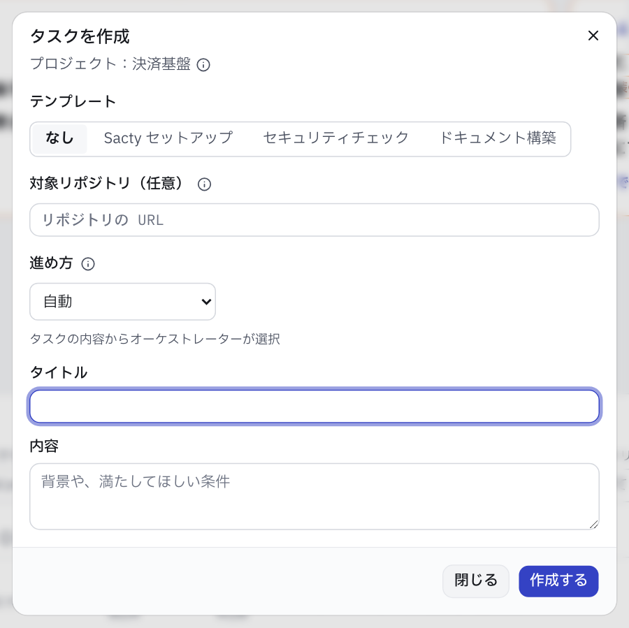
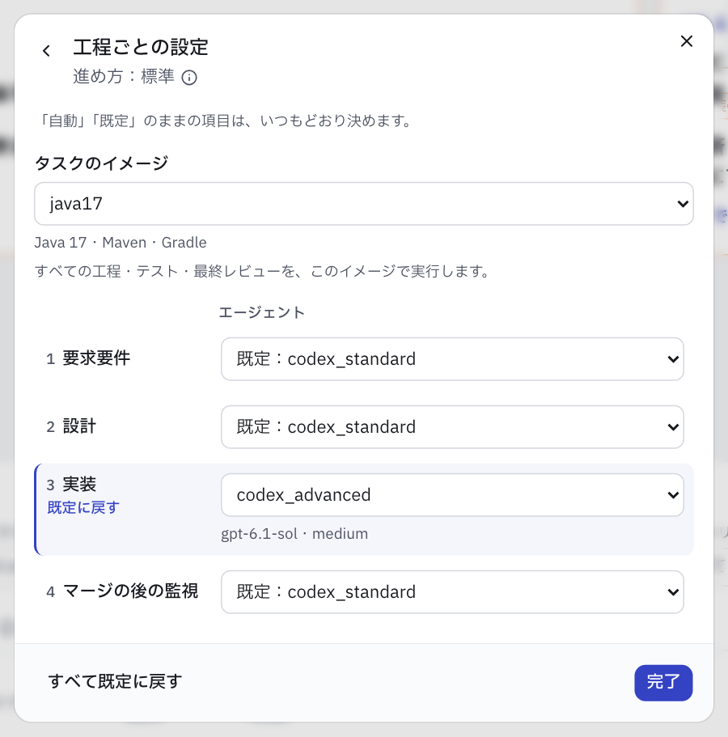
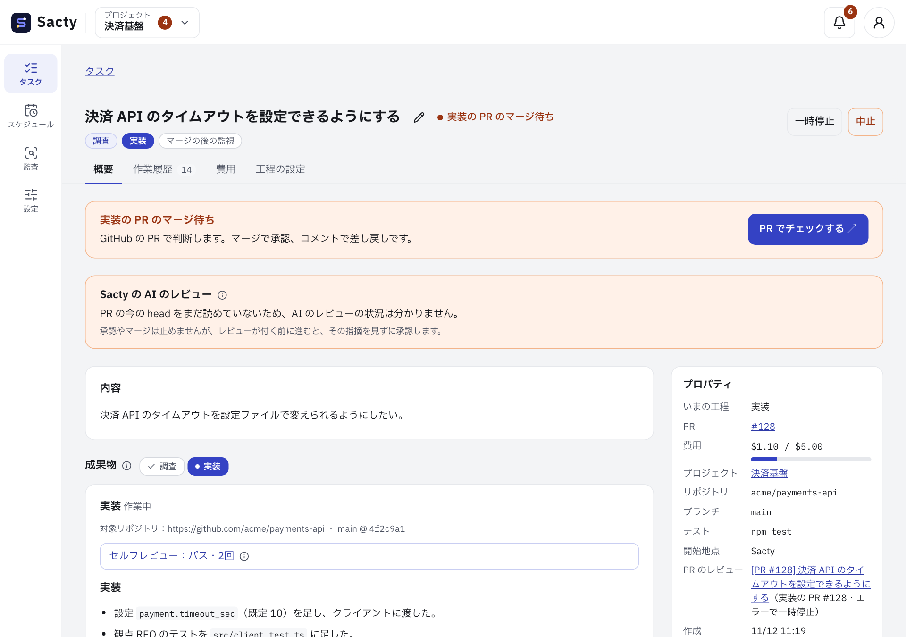
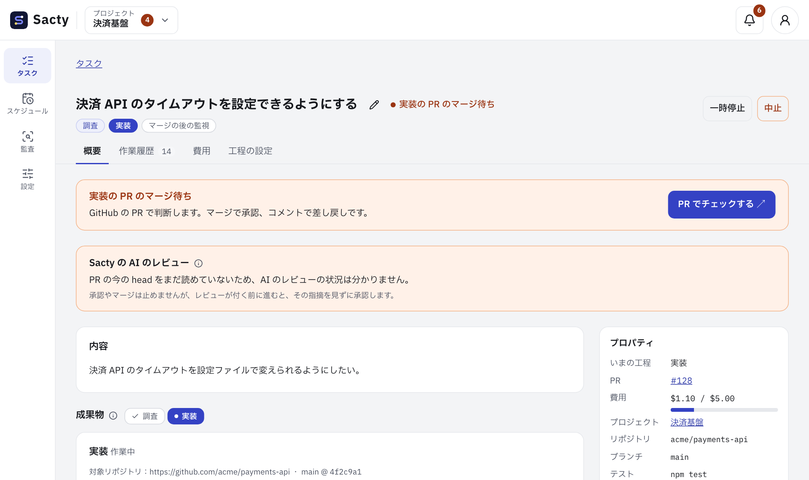
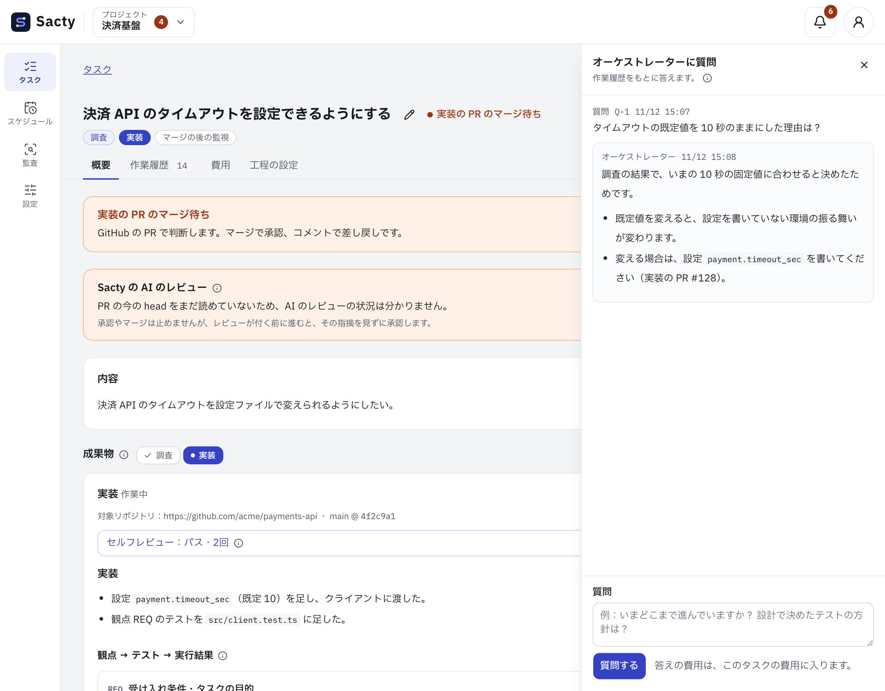
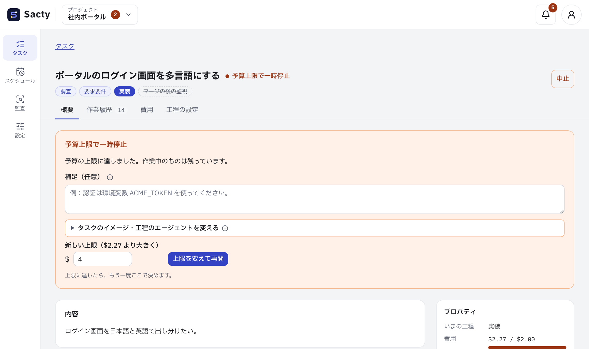
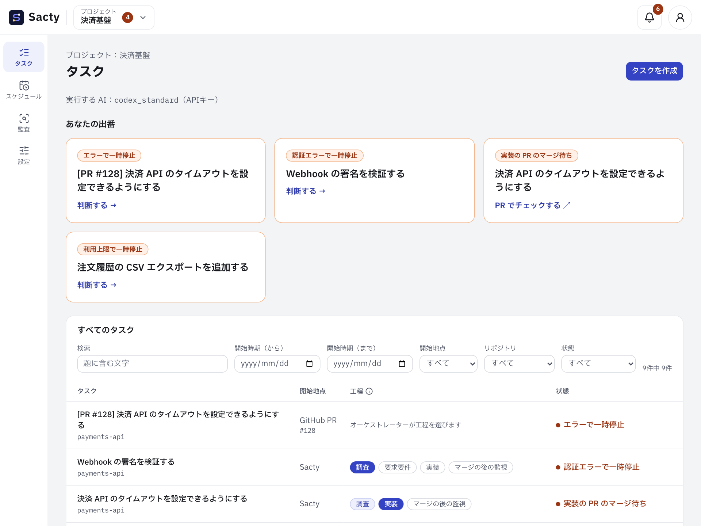

<!-- 対応するコード: apps/daemon/src/security.ts、apps/web/src/components/security-fixes.tsx、apps/web/src/components/derive-dialog.tsx、apps/daemon/src/config.ts、apps/web/src/components/task-detail.tsx、apps/daemon/src/service.ts、apps/daemon/src/repository.ts、apps/daemon/src/activity.ts、apps/daemon/src/pr-watcher.ts、apps/daemon/src/prompts.ts、packages/core/src/events.ts（StepKey・DEFAULT_DOCUMENTS_DIR）、apps/web/src/i18n/messages/task.ts、apps/daemon/src/task-templates.ts、apps/daemon/src/test-files.ts、apps/web/src/components/new-task-dialog.tsx、apps/web/src/components/task-step-settings.tsx、apps/web/src/components/implementation.tsx、apps/web/src/components/provenance.tsx、apps/web/src/components/task-list.tsx、apps/web/src/lib/task-filter.ts -->

**日本語** | [English](tasks.en.md)

# タスクを進める

タスクを作ると、オーケストレーターと工程のエージェントが工程を進めます。
人間は承認ゲートでだけ判断します。

タスクは次のように進みます。

## タスクを作る

タスクの一覧の「タスクを作成」を押すと、次のダイアログが開きます。

- 画面でタスクを作るときは、プロジェクトの対象の中からリポジトリを選びます（[プロジェクトの設定](project-settings.md#対象)）。
  - リポジトリの候補は、「タスクを作成」を押してダイアログを開いたときに読みます。
    Org の対象は `gh` で GitHub に問い合わせるので、数秒かかることがあります。
  - 読んでいる間・読めなかったとき・候補が無いときは、ダイアログにそう出ます。
    どのときも、リポジトリの URL を入力すれば作れます。
- Issue・PR・チケットから取り込むこともできます（[取り込み](intake.md)）。
- リポジトリを選ばずにタスクを作ることもできます（調べもの・全体の設計・分割する大きなタスク）。
  オーケストレーターが、プロジェクトのコンテキスト（コンテキストリポジトリの規約・書き出しの接続先）と対象（リポジトリの一覧）から進め方を選びます。
  - コードを変えない仕事（調査だけ・設計だけ）は、リポジトリ無しのまま進め、sacty の画面で承認して完了します。
    PR やブランチは作りません。
    書き出し先があれば書き出します。
  - 分割する大きなタスクは、タスク分割で、子タスクごとに対象からリポジトリを選んで付けます（選んだ理由を残します）。
    統合レビューでは、子タスクのリポジトリごとにベースブランチの最新を読みます。
  - コードの変更が要り、分けないタスクは、オーケストレーターが対象からリポジトリを選び、用意してから工程を選び直します。
    選べなければ止まります。
    タスクの詳細で人がリポジトリを選んで再開できます。
- 「進め方」で、工程の組み合わせを選べます（下の「進め方を指定する」）。
  既定の「自動」では、オーケストレーターがタスクの内容から選びます。
- ベースブランチとテストのコマンドは、タスクの開始時にオーケストレーターがリポジトリを読んで決めます。
  テストの仕組みが無いリポジトリでは、テストを使わずに進めます（下の「テストの仕組みが無いリポジトリ」）。
- オーケストレーターは、要らない工程を省きます。
  - 依頼がはっきりしていて、既存の仕組みを使う小さな変更は、要求要件・設計を省いて実装から始めることがあります。
  - 工程が終わるごと（要求要件の承認の後など）に、残りの設計・再現の工程が要るかを見直し、要らない工程を飛ばします。
  - 飛ばした工程は、工程の並びに取り消し線で出ます。
    理由は作業履歴に出ます。
  - 飛ばした分は、実装の PR をレビューの子タスクがタスクの目的（依頼の内容）からレビューし、人は PR のマージで承認します。
- 開発のセットアップ（依存のインストール・ビルドなど）を実行するかは、工程で決まります。
  - 工程の選択と、コードや仕組みを読んで説明する調査では、実行しません。
    リポジトリの AGENTS.md などにセットアップの手順があっても、こちらを優先します。
  - 不具合の調査・再現・実装では、リポジトリの手順どおりセットアップします。

### 進め方を指定する

オーケストレーターの選び方と違う進め方にしたいときは、「タスクを作成」の「進め方」で組み合わせを選びます。
選ぶと、その下に工程の並びが出ます。

| 進め方 | 工程 | 使いどき |
| --- | --- | --- |
| 自動 | オーケストレーターが選ぶ | 既定 |
| 標準 | 要求要件 → 設計 → 実装 → マージの後の監視 | 振る舞いが複数ある・影響範囲が広い変更 |
| 設計を省く | 要求要件 → 実装 → マージの後の監視 | 小さく局所的な変更 |
| 直接実装 | 実装 → マージの後の監視 | 依頼がそのまま受け入れ条件になる変更（確かめられる受け入れ条件がそろい、人に確かめることが無い依頼を含む） |
| 不具合の修正 | 再現 → 実装 → マージの後の監視 | テストで再現できる不具合 |
| 分割 | 要求要件 → 設計 → タスク分割 → 統合レビュー | 1つの PR に収まらない変更 |
| 調査だけ | 調査 | 質問・原因の調査・見積もり |
| レビューだけ | レビュー | 内容に書いた PR のレビュー |
| 文書作成 | 文書作成 | 手順書・ユーザーガイド・報告書などの原稿 |
| 作業のみ | 作業 | 外部サービスへの単発の変更 |
| 設計だけ | 要求要件 → 設計 | コードを変えない全体の設計 |
| セキュリティチェック | 調査 | 脆弱性・サプライチェーンの点検（下の「セキュリティチェックと対応」） |
| セキュリティ対応 | 調査 → 実装 → マージの後の監視 | 特定のセキュリティ上の問題を、最小限の変更で直す |

- 指定すると、オーケストレーターは組み合わせを選び直さず、工程が終わるごとの見直しでも工程を飛ばしません。
  ベースブランチ・テストのコマンド・イメージなどは、いつもどおりオーケストレーターが決めます（イメージとエージェントは、下の「タスクのイメージと工程ごとのエージェントを指定する」で指定もできます）。
- 「レビューだけ」は、対象リポジトリを選び、そのリポジトリの PR のリンクを題か内容に書いたときだけ選べます。
  そうでなければ、作成のときに理由が出ます。
  レビューでは PR のコードがエージェントのコンテナで動くので、信頼できない PR は選ばないでください（[PR のレビュー](intake.md#pr-のレビュー)）。
- リポジトリを選ばずに、実装する進め方（標準・直接実装など）を選ぶこともできます。
  オーケストレーターが対象からリポジトリを選んでから、指定した進め方で進めます。
- 「自動」のとき、依頼に確かめられる受け入れ条件がそろっていて、あなたに確かめることが無ければ、オーケストレーターは要求要件を省いて「直接実装」を選びます。省いた理由は、工程の決定の理由に書かれます。
  空白・上限・並び・列の位置のような細かい既定は、実装のエージェントが決め、PR の本文の「既定で決めたこと」に書くので、PR で確かめてください。
  依頼が曖昧なとき、依頼と文書やコードが食い違うとき、あなたに確かめたいことがあるとき、設計の判断が要るとき、既存の共有の状態・項目に新しい意味を載せる（状態を増やす）とき、受け入れ条件に書かれていない公開 API・項目の変更が要るとき、使っている側との食い違いをあなたに確かめたいときは、受け入れ条件が詳しく見えても要求要件を残します。
  受け入れ条件が公開 API・項目の変更（変更後の名前・形・必須かどうか・エラーのときの扱い）をはっきり書いていて、使う側との食い違いも確かめることが無ければ、それだけでは要求要件を残しません（改名のように、使っている側がどうなるかが決まらない変更は、はっきり書いたことになりません）。
  文書どうし、または文書と受け入れ条件の食い違いで、作るものが変わらないもの（完了の条件に含めるコマンドの違いなど）、受け入れ条件が決めた変更に伴う呼び出し側やテストの追従、依頼と既存のコードから実装が決められることは、あなたに確かめることが無いので、残す理由にしません。残す理由は、答えが複数あり、依頼からも既存のコード・文書からも決まらず、あなたに聞かないと決められないことだけです。
  要求要件を残したときは、オーケストレーターが挙げた残す理由が、要求要件の最初の実行に渡ります。理由ごとに、あなたに聞くこととして「確認したいこと」に出るか、確認しないと決めた理由が「確認しないと決めたこと」に書かれます。
  セルフレビューの回数・モデル・エフォートは変わりません。
- 指定した進め方は、タスクの詳細の「工程の設定」タブに出ます。
- 実装する進め方に、調査の工程はありません。
  コードの調べは、タスクの開始時の情報収集が行います（下の「タスクの開始時の情報収集」）。
  セキュリティ対応だけは、修正の範囲を決めるために、実装の前に調査があります。
- 「調査だけ」のタスクは、結果の形（表・章立て・項目など）を内容に書くと、その形で報告します。
  書かなければ、結論・根拠・関係する箇所・確認したいことの順で報告します。
- テンプレートを選んだときは、進め方を選べません。

#### タスクのイメージと工程ごとのエージェントを指定する

進め方を選ぶと、工程の並びの下に「工程ごとに設定」が出ます。
押すと、ダイアログの中が工程ごとの設定に切り替わり、タスクのイメージ（1つ）と、工程ごとのエージェントを選べます。

- イメージは、`images` の名前か `default`（既定のイメージ）を選びます（[イメージ](images.md)）。
  タスクのすべての工程・テストが、このイメージで動きます。
  「自動」のままなら、いつもどおりプロジェクトの対象の指定かオーケストレーターが選びます。
- エージェントは、使えるエージェントの名前を選びます（[設定](config.md)）。
  「既定」のままなら、`step_agents`（無ければ `default_agent`）で決まるエージェントを使います。
  統合レビューのエージェントは、`config.yaml` の `step_agents.integrate`（無ければ `default_agent`）で決まるので選べません。
- エージェントを選んだ工程には印が付き、「既定に戻す」で戻せます。
  「完了」か左上の戻るボタンで基本の入力に戻ります。
  基本の入力の工程の並びにも、エージェントを指定した工程に印が付き、指定したイメージが要約に出ます。
- 画面を切り替えても、入力中のタイトル・内容と選んだものは残ります。
  進め方を選び直しても、同じ工程の指定は残ります（今の進め方にある工程の分だけを使います）。
- 指定したイメージ・エージェントは、オーケストレーターの選択や `step_agents` より優先します。
  作成の後も、タスクの詳細の「タスクのイメージ」「工程のエージェント」で変えられます（選んだ元に「作成時に人が指定」と出ます）。
- 進め方が「自動」のときと、テンプレートを選んだときは指定できません（工程が決まっていないため）。
- 候補を読めないとき（`config.yaml` を読めないなど）は、理由が出ます。
  そのときも、指定せずにタスクを作れます。

### テンプレート「Sacty セットアップ」

リポジトリを sacty で扱えるように、AI エージェント向けの設定を整えるタスクを、リポジトリを選ぶだけで作れます。

1. 「タスクを作成」の画面で、テンプレートの「Sacty セットアップ」を選びます。
2. 対象リポジトリを選んで「作成する」を押します。
   タイトル・内容は入力しません（sacty が決めます）。

作ったタスクは、通常のタスクと同じく、オーケストレーターが進め方を選び、承認・PR を経て進みます。
エージェントは次を検査し、足りないものを整える PR を作ります。

- エージェント向けの指示（AGENTS.md・CLAUDE.md など）
- テストの実行の仕方
  - テストの仕組みがまだ無ければ、無いことと、変更の確かめ方を書きます。
  - このタスクでは、言語やテストの仕組みを新しく入れません。
- テストに要るサービス（DB・モックなど）
- マージの後の監視のスキル `deployment-observer`（[マージの後の監視](deployment-watch.md#スキル)）
  - CI/CD のあるリポジトリで作ります（デプロイしていなくても作ります）。
    CI/CD が無ければ作りません。
  - 原本は `.agents/skills/deployment-observer/SKILL.md` です。
    Claude Code 用の `.claude/skills/deployment-observer` は、原本への相対のシンボリックリンクにします。
  - CI/CD の確認の仕方の reference（`references/ci.md`）も作ります。
    デプロイしていなければ、デプロイの確認を飛ばすことを書きます。

すでに整っていて変更が要らなければ、PR を作らずに、検査の結果を調査の結果として残して終えます（画面で承認して完了します）。
要求要件・設計・実装を進めた後に変更が要らないとわかったときも、PR を作りません。
実装の説明に検査の結果を残し、画面で承認して終えます（下の「実装に変更が無いとき」）。
テンプレートで作ったタスクは、一覧の「開始地点」・詳細のプロパティの「開始地点」・作業履歴の「タスクを作成」に、テンプレートの名前が出ます。

API からは、`POST /api/tasks` に `{"template": "sacty-setup", "projectId": "<プロジェクトの ID>", "repo": "<リポジトリの URL>"}` を送ります（`title`・`body` は渡しません）。
CLI にはタスクを作るコマンドがありません。

### テンプレート「ドキュメント構築」

ドキュメントが足りないリポジトリでは、エージェントがコンテキストを得られず、思ったとおりの成果物を作れないことがあります。
このテンプレートを選ぶと、実装からドキュメントを作り、エージェントがそれを参照する・直すためのスキルを置くタスクを、リポジトリを選ぶだけで作れます。

1. 「タスクを作成」の画面で、テンプレートの「ドキュメント構築」を選びます。
2. 対象リポジトリを選んで「作成する」を押します。
   タイトル・内容は入力しません（sacty が決めます）。

作ったタスクは、通常のタスクと同じく、オーケストレーターが進め方を選び、承認・PR を経て進みます。
エージェントは次のことをします。コードは変えません。

- 既存のドキュメント（README・docs・AGENTS.md など）を棚卸しし、その結果を PR の説明に表で書きます。
  既存のドキュメントは消さず・動かさず・書き直さずに、新しいドキュメントからリンクします。
  置き場所や形が決まっていれば、それに従います（無ければ `docs/` に置き、入口を `docs/README.md` にします）。
- 実装から、コードを少し読むだけではわからないこと（目的と用語・全体の構成・主な処理の流れ・データ・外部とのつなぎ・規約）を書きます。
  ビルドやテストの実行の仕方は、テンプレート「Sacty セットアップ」で整えます。
- 2つのスキルを作ります。
  原本は `.agents/skills/` の下に置き、Claude Code 用の `.claude/skills/` の下は原本への相対のシンボリックリンクにします。
  - `docs-lookup`：作業の前にドキュメントを探して読むためのスキルです。
  - `docs-update`：実装を変えたときに、同じ PR でドキュメントを直すためのスキルです。

レビューの負担を抑えるため、次のように進めます。

- 新しく作ったドキュメントの先頭には、状態 `AI 生成・未レビュー` が付きます。
  エージェントは、未レビューのドキュメントをコードで確かめてから使います。
  中身を確かめたら、`レビュー済み` に書き換えてください（エージェントに頼んでもかまいません）。
- コードで確かめられないことは `（未確認）` と書かれ、PR の説明に、短く答えられる質問として挙がります。
  すべてのドキュメントを読まなくても、質問に答え、全体の構成のドキュメントを確かめればよいようにしています。
- 最初の PR は、棚卸しの結果・入口・全体の構成・2つのスキルに絞ります。
  残りの項目は、入口に「未作成」として並びます。
  リポジトリが大きければ、オーケストレーターが領域ごとに子タスクに分ける（1つの領域で1つの PR）こともあります。

すでに整っていて変更が要らなければ、「Sacty セットアップ」と同じく、PR を作らずに調査の結果を残して終えます。

API からは、`POST /api/tasks` に `{"template": "docs-setup", "projectId": "<プロジェクトの ID>", "repo": "<リポジトリの URL>"}` を送ります。

## タスクの詳細の見方

タスクの詳細は、次のように表示されます。

- 題・状態・工程の並び・操作（一時停止・中止・再レビュー）・タブは、画面の上に固定され、スクロールしても見えます。
- 承認や判断を待っているとき・一時停止しているときの案内は、どのタブを開いていても、タブの下に出ます。
- タブで表示を切り替えます。

| タブ | 出すもの |
| --- | --- |
| 概要 | 中止したときの片付け・内容・成果物・PR・続きのタスクなど、そのタスクに関わる結果 |
| 作業履歴 | すべての作業履歴（新しい順。エージェントの実行の行から実行のログを開けます） |
| 費用 | 使った額と上限・工程ごとの費用・オーケストレーターのセッション |
| 工程の設定 | 工程と選んだ理由・ベースブランチ・テストのコマンド・書き出し先・タスクのイメージ・工程のエージェント |
| 監査 | 監査の結果（完了したタスクだけ。まだ監査していなければ、その旨。[監査](audit.md)） |

- 開いたタブは URL（`?tab=activity` など）に残るので、リロードや共有をしても同じタブが開きます。
- 概要の「成果物」では、工程を選んで1つずつ読みます。最初は、いまの工程（作業中・承認待ち・最後に終えた工程）の成果物が出ます。
- 右の列の「プロパティ」には、いまの工程・PR・費用・プロジェクト・リポジトリ・ブランチ・テスト（テストのコマンド）・元のチケット・開始地点（テンプレートで作ったタスクなら、テンプレートの名前も）・関連するタスク（親タスク・レビューする PR の元・PR のレビュー（その PR をレビューする子タスクと、その状態）・再実行の元・続きの元・修正の元・元のレポート）・再実行したタスク・作成と最終更新の日時が出ます。
  PR・ブランチ・テスト・元のチケット・関連するタスク・再実行したタスクは、そのタスクにあるときだけ出ます。
  エラーの記録があるタスクでは、その下に「エラーレポート」が出ます（[エラーレポートを出す](troubleshooting.md#エラーレポートを出す)）。
  その下に、最近の作業履歴（5件）が出ます。

## タスクの開始時の情報収集

タスクが始まると、オーケストレーターが進め方を選ぶ前に、情報収集のエージェントがタスクに関係する情報を集めます。
チケットから取り込んだタスクなら、親のストーリー・エピック、リンクしたチケット、コメントにある URL まで辿り、集めた情報から作業するリポジトリを選んで、タスクの題と概要も書きます（それより前に人が題を変えていれば、題は変えたままにします）。
選べなかったときはタスクが止まり、タスクの画面でリポジトリを選んで再開できます（集めた情報は残り、題と概要だけを書き直します。人が題を変えていれば、題は変えたままにします）。
使える MCP サーバー・外部 PF（文書・チャットなど）でも、タスクの語を探します。
対象リポジトリのコードも読み、タスクに関係するコードの場所といまの振る舞いをまとめに書きます。

- 作業するリポジトリが決まっているタスクは、情報収集の前にリポジトリを用意し、そのコードを読みます。
  用意できなければ、情報収集の前にタスクが止まります。
  テストの書き方（フレームワーク・実行のコマンド・置き場所・既存のテストの例）もまとめます。
  まとめにテストの書き方があっても、テストを書くとは限りません。
  テストの扱いは、オーケストレーターが決めます。
- 決まっていないタスク（リポジトリを指定せずに作ったタスク・リポジトリを選ぶ前のチケットのタスク）は、プロジェクトの対象から関係しそうなリポジトリをいくつか（多くても3つ）洗い出し、GitHub の読み取りの中継（`gh api`）でコードを読みます。
  読むには、プロジェクトの設定でそのホストの GitHub のアカウントを選んでおきます（[プロジェクトの設定の GitHub アカウント](project-settings.md#github-アカウント)）。
  読めなかったリポジトリと、リポジトリの一覧を読めなかった Org（認証切れ・権限不足など）は、読めなかった情報源としてまとめに書かれます。

- リポジトリの文書は、AGENTS.md・README から参照されているものだけでなく、文書を置くディレクトリからも、タスクに関わるものを探して読みます。
  参照されていない文書でも、依頼に関わる振る舞いや前提（データの鮮度・運用上の決まりなど）を定めていれば、集めた情報に書かれます。
- 対象のリポジトリの外から集めた情報（取り込み元など別のリポジトリのコードや文書・外部の URL）は、出どころ（リポジトリ名か URL）を添えて「対象のリポジトリの外」と明記し、対象のリポジトリの文書とは別の項目に書かれます。対象のリポジトリに文書が無いことは、外の文書で補ったようには書かれません。後の工程にも、外の情報を対象のリポジトリの規約や決定として扱わないよう伝わります。
- 集めた情報は、関係するものだけにまとめられ、タスクの詳細の「集めた情報」に出ます（工程が始まると折りたたまれます）。
  読めなかった情報源や、情報源の間の食い違いも書かれます。
- まとめは、オーケストレーター・すべての工程に渡されます。統合レビュー・PR の指摘の戻し先の判断にも渡されます。
  判定や判断では、これを背景の理解にだけ使い、判定の基準は承認した成果物のままです。
- 使う AI は `config.yaml` の `step_agents.gather` で選べます（書かなければオーケストレーターの AI。[config.yaml の設定](config.md#工程ごとのモデル)）。
  費用はタスクの予算に入り、工程ごとの費用の表の「情報収集」の行に出ます。
- まとめられなかったときは、タスクが一時停止します。
  再開すると集め直します。
- タスク分割の子タスクは集め直さず、親が集めた情報を内容に引き継ぎます。
- 情報収集は読むだけです。
  コードも変更しません。
  ゲートウェイの外部 PF は、`allow` に書き込みの API があっても、情報収集では GET・HEAD だけが通ります。
  MCP サーバーのツールは sacty では制限できないので、指示で読み取りの操作だけを使わせています。
  書き込みのツールを持つ MCP サーバーをコンテキストに入れているときは注意してください。
- 外部の文書やチャットを読ませるには、その接続先をゲートウェイの外部 PF かコンテキストの MCP サーバーに入れておきます（[ゲートウェイ](gateway.md)・[コンテキストリポジトリ](context.md)）。

## 文書作成と単発の外部作業

ユーザーガイド・手順書・議事録・翻訳の草稿などを作るときは、読者・目的・元の内容をタスクに書いてください。
リポジトリのコードをもとに手順書を作るときは、対象のリポジトリを選んでください（文書作成の工程がコードを読みます。リポジトリは変えません）。
オーケストレーターが別の進め方を選んでしまうときは、「進め方」で「文書作成」を選んでください。

- 「文書作成」で Markdown の原稿を確かめ、差し戻し・承認できます。
- オーケストレーターが書き出し先を選んだときだけ、承認の後に書き出します。
  選んだ接続先と理由は、タスクの詳細の「工程の設定」タブで確かめてください（[成果の書き出し](result-export.md)）。
- 書き出しに失敗しても、原稿は完了します。
  外部へ反映できたかも確かめてください。
- リポジトリの文書のファイルを変えたいときは、対象のリポジトリを選んでください。
  通常の実装・PR の承認で反映します。

文書作成の工程も、ほかの工程と同じく、プロジェクトのコンテキスト（規約・スキル・MCP サーバー）・外部の接続先・GitHub の読み取りを使えます。
外部の資料を使ってほしいときは、どの接続先の何を読むかをタスクの本文か差し戻しのコメントに書いてください。
ふつうは、成果物は原稿1つで、sacty の画面に出る原稿を承認します。
原稿は外部に直接書かず、承認の後に書き出します。

外部の文書を直接作ってほしい・直してほしいときは、タスクの本文にそう書いてください。
エージェントがその文書を直接書き、書いた文書が成果物になります。
成果物の文書は複数でもかまいません（例：「〇〇を含むページを探して、まとめて直してください」）。

- 「文書作成」には、文書ごとに直した後の内容が出ます。外部に直接書いた文書は「外部に直接書いたページ」に一覧で出ます。
- 差し戻すと、エージェントはそれらの文書を直します（同じ内容の別の文書は作りません）。対象の文書を足すよう差し戻すこともできます。
- 外部に直接書いた文書は、承認を待たずに、エージェントが書いた時点で外部に反映されます。承認の前に外部の文書が変わってよいときだけ、直接の編集を指示してください。
- 外部に直接書いた文書が成果物なので、承認の後に書き出しはしません。

作業の報告（作成した旨・エージェントの ID など）は、原稿にも外部にも書きません。

予定表や台帳、既存の外部のページを変えるときも、リポジトリを選ばずに依頼できます。
対象は、設定済みの接続先1つで行える、一意な対象への単発の変更です（差し戻しでやり直せません。直しながら進めたい外部の文書や、複数の文書をまとめて直すときは、上の文書作成で依頼してください）。
選んだ接続先とは別に、GitHub はいつも読めます（読むだけです。[ゲートウェイ](gateway.md#github-の読み取り)）。

1. 依頼に、対象の一意な ID/URL、変更の内容と前提、期待する結果を書いてください。
   オーケストレーターが、接続先・対象・依頼の内容・確かめ方を選びます。
   対象や接続先が足りないときは、実行を始める前に止まります。
2. 1つの「作業」工程で、依頼に従って1回実行します。
   別の準備の工程や、実行の前の承認はありません。
   タスクを始める前に、依頼の内容が正しいかを確かめてください。
3. 成功した結果の根拠を確かめ、結果を承認して完了します。
   失敗や結果不明は完了になりません。

工程を選んだ後は、タスクの詳細で、選んだ接続先と接続の方式・対象・依頼の内容・確かめ方を、読み取り専用で確かめられます。
この表示は実行の前の承認ゲートではなく、タスクの進行を止めません。

対象の情報が足りないときは、依頼に情報を補って、新しいタスクを作ってください。
実行を始める前に、選んだ接続先が使えなくなったときは、接続の設定を直してから再開できます。

実行が始まった後は差し戻せません。
中断・再起動・失敗の後の再開は拒否され、タスクは止まったままになります。
外部のサービスで実際の状態を確かめてからタスクを中止し、まだ行われていない変更だけを、新しいタスクとして依頼してください。
sacty はエージェントに、依頼に必要な書き込み（親の投稿とスレッドへの返信のように複数でもかまいません）をすべて行い、変更の後に確かめるよう指示します。
同じ書き込みは再送させず、失敗や結果不明の後は残りの書き込みも止めて、成功を確かめたもの・行っていないもの・結果が不明なものを分けて報告させます。
結果が不明な書き込みは外部で成功している場合があるので、新しいタスクで依頼する前に、外部のサービスで確かめてください。
ただし、外部のサービスの側で重複を防げるとは限りません。

GitHub の PR・Issue への返信も、作業として依頼できます（例「https://github.com/acme/app/pull/12 のレビューの指摘に返信して」）。
プロジェクトの設定で GitHub のアカウントを選んだホストが、接続先の候補になります。
エージェントは PR・Issue を読み、返信の内容を出力に書きます。
結果を承認すると、sacty が返信を投稿します（[PR と Issue へのコメント](#pr-と-issue-へのコメント)）。
コードの修正やプッシュはできません。
PR のコードを直すときは、リポジトリを選んでタスクを作ってください（[既存の PR を直す](#既存の-pr-を直す)）。

定期的な更新・監視や、複数の接続先をまたぐ長い業務の自動化は対象外です。
文書作成と外部の更新のように複数の成果が要る依頼は、確かめて承認できる単位に分けてください。

## 既存の PR を直す

人が作った PR のレビューの指摘に対応するなど、既存の PR そのものを直すときは、対象リポジトリを選び、その PR のリンクを題か内容に書いてタスクを作ります（例「https://github.com/acme/app/pull/12 のレビューの指摘に対応して」）。
オーケストレーターがその PR を直す依頼だと判断すると、sacty は PR を引き継ぎます。

- 実装は、その PR のブランチの先頭から始め、同じブランチにコミットを積みます。
  新しいブランチ・PR は作らず、PR の題・本文も変えません。
- PR にあるレビュー・コメント（sacty のレビューを含みます）は、各工程のエージェントへの指示に渡ります。
- 要求要件・設計の工程があっても PR にはせず、sacty の画面で承認します（引き継いだ PR に成果のファイルを混ぜないため）。
  この工程のエージェントが、PR の指摘に対応しないと判断したものは、理由とともに「確認したいこと」に出ます。対応したことの報告は書かせません。
- 実装は、その PR のマージで承認します。
  実装に渡さなかった指摘（実装を始めた後に付いたものなど）は、ほかの PR と同じく取り込んで直します。
- タスクの詳細の「工程の設定」タブに「引き継いで直す PR」が出ます。
- タスクを中止しても、PR は閉じず、ブランチも消しません（積んだコミットは残ります）。

次の PR は引き継げません。
新しい PR を作らないように、工程を決めずに止まります。
PR を確かめてから再開すると、工程の選択からやり直します。

- マージ済み・閉じられた PR
- フォークからの PR（sacty はフォークのブランチにプッシュできません）
- sacty のほかのタスクが作った・引き継いだ PR（sacty が作った PR の指摘は、作ったタスクが取り込んで直します）

作業の間に人が PR のブランチにコミットを積むと、sacty は強制プッシュせずに止まります。
タスクを中止し、新しいタスクにしてください。
PR を参考にするだけのタスク（例「12 番の PR と同じ直し方を、ほかのモジュールにもする」）は、今までどおり新しい PR を作ります。

## セキュリティチェックと対応

脆弱性やサプライチェーンの問題を、レポートで点検し、PR で直せます。

| 進め方 | 成果物 | 使いどき |
| --- | --- | --- |
| セキュリティチェック | レポート（画面で承認） | どこに問題があるかを点検したいとき |
| セキュリティ対応 | PR（マージで承認） | 特定の問題（CVE・GHSA・アラート・チェックの指摘）を直したいとき |

### セキュリティチェック

1. 「タスクを作成」で、テンプレートの「セキュリティチェック」を選び、対象リポジトリを選んで作成します。
   スケジュールタスクでこのテンプレートを選ぶと、定期的に点検できます（[スケジュールタスク](scheduled-tasks.md)）。
2. エージェントが、次の区分ごとに点検し、指摘のレポートを書きます。
   既定のイメージにある `osv-scanner`（依存の脆弱性）と `gitleaks`（秘密情報）を使います。
   - 依存の脆弱性
   - サプライチェーン（CI のワークフロー・依存の取得元とロックファイル・インストールのスクリプト・イメージのタグの固定）
   - コードの脆弱性
   - 秘密情報の混入（値は書かず、場所と種類だけを書きます）
   - 設定・IaC
3. レポートを読み、承認します（差し戻して直させることもできます）。
   道具が無くて確かめられなかった区分は、レポートに「確かめていない範囲」として出ます。

### レポートから対応のタスクを作る

承認したセキュリティチェックのタスクの詳細に「セキュリティ対応」の欄が出ます。
区分ごとに指摘が並ぶので、直したい区分の「対応のタスクを作る」を押します。

- 区分ごとに1つ、進め方「セキュリティ対応」のタスクを作ります。
  内容には、その区分の指摘だけが入ります。
- 作った区分には、作ったタスクへのリンクが出ます。
  同じ区分では、もう作れません。
- 対応のタスクの詳細のプロパティの「元のレポート」に、元のレポートへのリンクと区分が出ます。
- 区分をまたいで直したい・一部の指摘だけを直したいときは、[続きのタスク](#完了したタスクの続きのタスクを作る) を作り、内容に直す指摘を書いてください。

### セキュリティ対応

レポートから作るほか、「タスクを作成」で進め方「セキュリティ対応」を選び、内容に直したい問題（CVE の番号・アラートの URL など）を書いても作れます。

1. 調査で、エージェントが問題を確かめ、修正の範囲（変えてよいファイル・上げる依存・解消を確かめるコマンド）を決めます。
   範囲は承認しません。
2. 実装で、エージェントが範囲の中だけを、問題を解消する最小限の変更で直します。
   リファクタリング・整形・関係の無い修正は混ぜません。
3. sacty が差分を範囲と照らしてから、PR を作ります。PR のレビューの子タスクが、最小限の変更かを確かめます（観点 `SEC-MIN`）。
   範囲の外のファイルを変えた、またはロックファイルを除いて 300 行を超えて変えたときは、PR の本文にその違反が出て、子タスクが「修正が必要」の指摘にし、実装を直します。
   回帰のテストのファイルは、範囲の外でも足せます（行の数には数えます）。
   以前の版では、ゴールガーディアンが最終レビューで確かめ、違反のときは不合格にして実装をやり直していました。
4. PR の本文に「修正の範囲（セキュリティ対応）」が出ます。
   差分が範囲に収まっているかを確かめて、マージで承認してください。
   既存の PR を直すタスク（[既存の PR を直す](#既存の-pr-を直す)）では PR の本文を変えないので、範囲はタスクの詳細の「調査」の結果で確かめてください。

- 範囲の外を変えないと直せないときは、エージェントが理由と広げるべき範囲を実装の説明に書きます。
  前段の調査には差し戻せないので、タスクを中止し、「再実行」の補足に広げる範囲を書いてやり直してください。
  再実行のタスクも「セキュリティ対応」で進みます。
- セキュリティチェック・セキュリティ対応のタスクの成果は、取り込み元の Issue・チケットにコメントしません。
  工程の出力にあるコメントの頼み（`sacty-github-comments`）も投稿しません。
- 公開リポジトリでも、ほかの実装と同じく PR を作ります。
  公開してよいかは、タスクを作る前に判断してください。

## PR と Issue へのコメント

工程のエージェントは GitHub を読めますが、書き込めません（[ゲートウェイ](gateway.md#github-の読み取り)）。
PR・Issue へのコメントが要るときは、エージェントが工程の出力にコメントの内容を書きます。
その工程の成果を人が承認した後に、sacty がプロジェクトの GitHub のアカウントで投稿します。
承認しなければ投稿しません。
ただし、PR のマージで承認する工程（実装・要求要件・設計）は、マージを待たずに、成果が承認待ちになったときに投稿します（下の箇条書き）。

- 投稿の内容は、承認の前に、成果の末尾の `sacty-github-comments` の JSON で確かめられます。
  差し戻して直した後に承認すると、直した版を投稿します。
- 投稿先は、プロジェクトの対象のリポジトリ（と、タスクの取り込み元・作業するリポジトリ）の PR・Issue だけです。
  それ以外の URL には投稿せず、理由を作業履歴に出します。
- PR のマージで承認する工程は、成果が承認待ちになると、頼まれたコメントをその PR に投稿します。
  指摘への返信を、PR を見ている人がその場で読めるようにするためです。
  差し戻して作り直した版も、その版の頼みを1回投稿します。マージした後に、同じ版の頼みを重ねて投稿することはありません。
  このコメントの末尾には、AI が書いたことと、この工程の成果は PR のマージで承認されることを添えます。
- sacty が投稿したこのコメントは、PR の指摘としては取り込みません（返信が新しい指摘になって、差し戻しが続かないようにするためです）。
- コメントの末尾に、sacty のタスクで AI が書き、人が承認したことを添えます。
- 投稿の結果（コメントの URL・投稿できなかった理由）は、作業履歴に出ます。
  投稿できなくても、タスクは止まりません。投稿できなかったときは、作業履歴の記録を見て、必要なら PR に直接書いてください。
- レビューの工程は、これまでどおり、書いたレビューを sacty が PR に投稿します。

## 実装の PR のレビュー

sacty は、実装の工程の後に、最終レビュー（テストの実行と合否の判定）も、PR の CI の待ち・再実行もしません。
代わりに、PR をレビューする子タスクがレビューし、指摘なしになってから、あなたの承認（マージ）に回します。
実装の工程のエージェントは、これまでどおり作業中にテストを実行します。

1. 実装の工程が終わると、sacty が実装をプッシュして、実装の PR をドラフトで作り、PR をレビューする子タスクを作ります（[sacty が作った PR のレビュー](intake.md#sacty-が作った-pr-のレビュー)）。
   PR の本文の結論には、「sacty のレビュー」の行が入ります。
2. 子タスクが PR をレビューして投稿します。そのときの CI の結果も読みます。
   変更による CI の失敗は「修正が必要」の指摘になり、変更と関係の無い失敗は、本文に人が確かめることとして書かれます。CI が終わっていなければ、待たずにレビューし、実行中であることを書きます。
3. 指摘があれば、sacty が実装を直して PR を更新し（ドラフトに戻します）、子タスクがもう一度レビューします。
4. 子タスクが「指摘なし」にしたら、sacty がドラフトを外します。この PR をマージすると、実装を承認したことになります。
   マージの前に、PR の CI の結果を確かめてください（sacty は CI を待ちません）。
   「指摘なし」になる前に GitHub でドラフトを外しても、sacty は PR の確認のたびにドラフトに戻します（重ねた PR は除きます。[依存のある子タスクの PR（重ねた PR）](#依存のある子タスクの-pr重ねた-pr)）。
   ドラフトを外した後に GitHub でドラフトに戻っていると、sacty は PR の確認のたびに外し直します。マージを止めたいときは、GitHub でドラフトにせず、タスクを一時停止するか差し戻してください。一時停止すると、sacty が PR をドラフトに戻し、再開すると外し直します。

- タスクの詳細の「関連するタスク」で、子タスクの状態と、何回目のレビューで、判定が何だったかが分かります。
- PR のブランチに直接コミットを足しても（レビューの提案の適用など）かまいません。sacty は次に直すとき、そのコミットを取り込んでから、その上に積みます（強制プッシュはしません）。sacty の直しと同じ箇所が競合したときは、sacty が実装をやり直して解消します。
- PR の本文を補足・整形してもかまいません。sacty は PR を更新するとき、あなたの直しを残したまま、新しい内容（テストの結果・レビューの状況など）を入れます。同じ箇所を sacty も書き換えるときは、エージェントが両方をまとめます。まとめられなかったときは、あなたの本文のまま変えません（タスクの詳細の作業履歴に出ます）。
  ただし、次のときは、これまでどおり sacty の本文で上書きします。前回 sacty が書いた本文の記録が無いとき（この版より前に sacty が作った PR を初めて更新するときや、PR を作った直後に止まって、再開で既存の PR を見つけたとき）と、GitHub から今の本文を読めなかったときです。
- リポジトリがドラフトの PR を使えない（GitHub のプランなど）ときは、ふつうの PR で同じように進めます。
- PR をドラフトにする・外すには、プロジェクトの GitHub のアカウントに、PR を作るのと同じ権限が要ります。
  ドラフトを外せなかったときは、次の PR の確認でやり直します。
- 実装に変更が無ければ、PR は作りません（[実装に変更が無いとき](#実装に変更が無いとき)）。
- 既存の PR を引き継ぐタスクは、あなたの PR なので、ドラフトにせず、引き継いだ PR に積みます（[既存の PR を直す](#既存の-pr-を直す)）。
- 以前の版で最終レビューや CI の待ちの途中だったタスクは、次に動くとき（止まっていたタスクは再開したとき）に、この流れに乗ります（[以前の版のタスク（最終レビューがあった版）](#以前の版のタスク最終レビューがあった版)）。

### テストのコマンド

オーケストレーターは、工程を選ぶときにリポジトリを読んで、テスト（検証）のコマンドを決めます。
sacty はこのコマンドを実行しません。
実装の工程のエージェントが、リポジトリの手順から決めたテストと検証を、提出の前に自分で実行します。

- テストのコードが無いリポジトリでも、成果物を機械的に確かめる検証があれば、それをテストのコマンドにします。
  - 検証のコマンドには、CI・Makefile・pre-commit が実行しているもの、またはリポジトリの形から決まるもの（`kustomization.yaml` があれば `kustomize build` など）を使います。
  - Kubernetes のマニフェストのリポジトリなら `kustomize build`・`helm lint`・`kubeconform`
  - Terraform なら `terraform validate`
  - YAML なら `yamllint` など
- 決まったコマンドは、タスクの詳細の「工程の設定」タブの「テストのコマンド」と、右の列のプロパティの「テスト」に出ます。
- 決まったコマンドは、不具合の修正の再現の工程に渡ります。PR をレビューする子タスクには渡りません。子タスクは、リポジトリの手順や CI の設定から検証のコマンドを決めます。
- 実装の工程のエージェントは、テストのほかに、リポジトリが定めるフォーマッター・リンター・型チェックなどの検証を、PR に入る変更すべて（コード・テスト・文書・設定）に対して実行します。
  実行しなかった検証は、理由を実装の説明に書きます。
- 不具合の修正の再現の工程では、再現のエージェントが、書いたテストを自分で実行し、不具合のために失敗することを確かめて報告します。
  確かめたと報告しなかったときは、再現できなかったとして止まります。
  再現の手がかりを指摘に書いて差し戻すと、再現をやり直します。

### ベースブランチが進んだとき

別のタスクや人の PR が先にベースブランチ（main など）へマージされても、実装の PR がベースブランチと競合したままにならないよう、sacty が自動で対応します。

- sacty は、実装を始める前に、ベースブランチの最新を実装の作業領域に取り込みます。
  差し戻しや PR の指摘で実装をやり直すときも、やり直す前に取り込みます。
  承認待ちの間は自動では取り込みません。ベースブランチが進んだ PR を直すときは、差し戻すか PR に指摘を書いてください。
- 承認待ちの間に、先の PR がマージされて実装の PR がベースブランチと競合したら、sacty が気づいて画面に出します（GitHub が競合と答えたとき。1分ごとの PR の確認で分かります）。
  - タスクの詳細・承認の画面に、競合していることと、取り込む操作（この画面から指摘を入れて差し戻す、または GitHub の PR に指摘を書く）が出ます。
  - 「あなたの出番」（ダッシュボード・タスクの一覧）とヘッダーのお知らせの状態も「実装の PR がベースブランチと競合」になります。「あなたの出番」の行には、「差し戻すか、PR に指摘を書くと、ベースブランチを取り込みます」と添えます。
  - 出すだけで、sacty は自動では取り込まず、実行も始めません。差し戻すか指摘を書くまで、待ちます。
  - GitHub で自分で競合を直してもかまいません。解消されると、次の確認で表示が消えます。差し戻して実装をやり直したときも消えます。
  - 引き継いだ PR（[既存の PR を直す](#既存の-pr-を直す)）にも競合は出しますが、sacty はベースブランチを取り込みません。差し戻しても取り込まないので、GitHub で競合を解消してください。「あなたの出番」の行・タスクの詳細・承認の画面には、「引き継いだ PR なので、ベースブランチは取り込みません。GitHub で競合を解消してください」と出します。
  - 要求要件・設計の PR（タスクブランチへの PR）には出しません。
- 競合しなければ、そのまま取り込みます。PR には、ベースブランチの先頭を親に含むマージコミットが積まれます。
  ベースブランチ側の変更は、PR の差分には出ません。履歴は書き換えません（強制プッシュ・リベースはしません）。
- 競合したときは、競合したファイルに目印（`<<<<<<<`・`=======`・`>>>>>>>`）が残ります。
  sacty は、競合したファイルの一覧を実装のエージェントに渡して、両方の変更が生きるように解消させます。
  解消した内容が、マージコミットとして PR に積まれます。
- 目印が残ったまま実装が終わったときは、PR を作らず、競合したファイルを渡して実装をやり直します。
  続けて 3 回解消できないときはタスクが一時停止し、競合したファイルが理由に出ます。
  「再開する」で、目印のあるファイルを渡して実装をやり直します。
- ベースブランチの最新を取得・マージできなかったとき（ネットワークの失敗など）は、理由を出して一時停止します。
  原因を直してから「再開する」を押すと、取り込みからやり直します。
- ベースブランチの取り込みには、ホストの git が 2.40 以上である必要があります。古いときは、その案内を出して止まります。
- 既存の PR を引き継ぐタスク（[既存の PR を直す](#既存の-pr-を直す)）は、人の PR のブランチに積むので、ベースブランチを取り込みません。

### 依存のある子タスクの PR（重ねた PR）

タスク分割で、ほかの子タスクに依存する子タスクは、依存先の PR のマージを待たずに始まることがあります。依存先の PR のレビュー・マージを待つ間も、後の子タスクを進めるためです。

- 依存先の実装の PR を、PR のレビューの子タスクが「指摘なし」にして、sacty がドラフトを外すと、依存する子タスクは、その PR のブランチから始まります。
  依存する子タスクの PR は、依存先がマージされて向き先が付け替わってからレビューの子タスクがレビューし、「指摘なし」でドラフトが外れます。
  依存先が完了したとき・中止を認めたときは、今までどおりベースブランチから始まります。
- 依存する子タスクの PR は、依存先の PR のブランチに向けて作ります（向き先（base）が依存先のブランチです）。GitHub の差分には、その子タスクの変更だけが出ます。
  - PR の本文の先頭に、どの PR に重ねたかと、その PR より先にマージしないことが書かれます。
  - 依存先の PR がマージされるまで、ドラフトのままです（GitHub はドラフトの PR をマージさせません）。レビューやコメントは、ドラフトのままでもできます。
  - ドラフトにできないとき（リポジトリがドラフトの PR を使えない・切り替えに失敗した）は、普通の PR にせず、子タスクを一時停止します。再開するとやり直します。依存先の PR がマージされた後に再開すると、依存先に重ねずに、ほかの PR と同じくドラフトで作ります（PR のレビューの子タスクが「指摘なし」にすると外れます）。
  - 依存先の PR より先にマージしたいときは、GitHub でドラフトを外してマージできます。そのときは、子タスクの変更が依存先の PR のブランチに入り、マージは承認として扱われます。ベースブランチにはまだ入っていないので、その子タスクに依存する子タスクは、依存先の PR がマージされるまで待ちます。その子タスクの PR に重ねていた子タスクも、依存先の PR がマージされるまで、向き先を付け替えずに待ちます。
- 依存先の PR がマージされると、sacty が子タスクの PR の向き先をベースブランチに付け替え、本文を書き直します（1分ごとの PR の確認で行います）。あなたが直した本文と、sacty の新しい本文が同じ箇所で重なったときは、本文はそのままにして、向き先だけを付け替えます（次に実装を直して PR を更新するときに、両方をまとめます）。
  付け替えた後に、PR のレビューの子タスクがレビューし、「指摘なし」でドラフトを外します。
  付け替えの途中で子タスクを差し戻したときは、付け替えを記録せず、やり直した提出で PR を更新します。ドラフトを外している最中に差し戻したときは、ドラフトに戻します。子タスクがまだ始まっていなかったときは、依存先の PR がマージされたブランチから始まります。
  付け替えた PR は、レビューの子タスクが「指摘なし」にしてドラフトが外れた後に、マージで承認します。依存先が squash でマージされたときは、差分に依存先の変更が重なって見えることがあります。差し戻すか PR に指摘を書くと、sacty がベースブランチを取り込んでやり直し、差分は子タスクの変更だけに戻ります。
- 依存先の PR が直されて（差し戻し・指摘）、PR のレビューの子タスクが「指摘なし」にし直すと、依存する子タスクは、実装をやり直すときに、その新しい内容を取り込みます。取り込み方と、競合したときの扱いは、[ベースブランチが進んだとき](#ベースブランチが進んだとき)と同じです。承認待ちの間は取り込みません。
- 依存先が中止されると、その上に作った子タスクは一時停止し、再開できなくなります。子タスクを中止してください（足りない分は、統合レビューで修正の子タスクとして足されることがあります）。
- 依存先が2つ以上あるときは、ほかの依存先の今の変更がすべて、ある依存先の PR に入っていると確かめられるときだけ、その依存先に重ねて始まります。確かめられるのは、ほかの依存先がその依存先の下に重なっていて、直された分も取り込み済みのとき、または、その依存先が重ねずに、ほかの依存先がベースブランチに入ってから始まったときです。そうでなければ、依存先がすべてベースブランチに入るまで待ちます。
  たとえば、互いに依存しない A と B に依存する子タスクは、A がマージされても B に重ねず、B もマージされるまで待ちます（B の PR には A の変更が入っていないため）。
- 依存先と別のリポジトリの子タスクは、重ねずに、依存先を待ちます。

### 文書だけの依頼

依頼の成果物が文書のファイル（`.md`・`.rst`・`.adoc` など）だけのときは、オーケストレーターは、文書の変更が及ばないコードの検証（テスト・lint・型の検査・ビルド）をテストのコマンドに入れません。
コードも変える依頼では、これまでどおり、変更が及ぶ範囲の検証のすべてを入れます。

- リポジトリにリンクの検査・markdown の lint・文書のフォーマットなどの検証があれば、それだけをテストのコマンドにします。
- そうした検証が無ければ、テストのコマンドを空にして、テストなしで進めます（根拠は[テストの仕組みが無いリポジトリ](#テストの仕組みが無いリポジトリ)と同じく残ります）。
  この場合は、リポジトリにテストのファイルがあっても、テストなしの判断を使います。
- 文書のファイルは、拡張子が `.md`・`.markdown`・`.rst`・`.adoc`・`.asciidoc`・`.org` のものです。
  コード・コード中のコメント・設定ファイル・`.txt`・画像を変える依頼は、文書だけの依頼として扱いません。
- オーケストレーターが文書だけの依頼と判断したのに、実装の差分に文書でないファイルがあっても、止まりません（差分は PR のレビューの子タスクがレビューします）。

## テストの仕組みが無いリポジトリ

README しかないリポジトリのように、テストの仕組みがそもそも無いリポジトリでも、タスクは止まらずに進みます。

- オーケストレーターは、パッケージの設定・Makefile・CI の設定・README などを調べ、テストの仕組みが見つからなければ、無いと判断した根拠を残します。
  エージェントのスキルを集めたリポジトリや、ドキュメントを置くだけのリポジトリも、これに当たります。
  タスクの詳細の「工程の設定」タブに「テストのコマンド：なし・目的から判定」と出て、横の補足の印（i）に根拠が出ます（作業履歴の「工程を決定」にも出ます）。
- sacty はテストを実行しません。
  PR のレビューの子タスクが、タスクの目的・要求要件（設計）と、実装後のコード・差分・実装の説明から確かめ、指摘があれば sacty が実装を直します（テストのあるタスクと同じです）。
- 実装の成果物（タスクの詳細と実装の承認の画面）に「テストで検証していません」と出ます。
  PR の本文のテストの行にも「テストの仕組みが無いリポジトリとして進めたため、テストでは検証していません。」と根拠が入ります。
  テストで確かめていないので、承認の前に、変更の中身を自分で確かめてください。
- タスクがテストの仕組みを用意するもの（言語のセットアップなど）で、実装がテストを用意したときは、実装の工程のエージェントがそのテストを実行して確かめ、PR のレビューの子タスクがその結果も含めて確かめます（sacty はテストを実行しません）。
  - 実装がテストのコマンドの申告（言語の名前が `sacty-test-command` のコードブロック）を正しく書かなかったとき（JSON として読めないときを含みます）は、エラーで一時停止します。
    再開すると実装をやり直します。
- オーケストレーターがテストの仕組みが無いと判断しても、次のときは、その判断を使いません。
  タスクは止まらず、テストのコマンドもテストなしの判断も無いまま進みます（実装の工程のエージェントが、リポジトリからテストを決めて実行します）。
  - 不具合の修正（再現 → 実装）を選んだとき（再現はテストで確かめるので、テストの仕組みが無いリポジトリでは選びません）
  - リポジトリに、テストのように見えるファイルがあるとき
  - ファイルが多すぎる・読めないディレクトリがあるなどで、テストのファイルが無いことを確かめきれなかったとき

  テストのように見えるファイルとして当たるのは、次のファイルです。
  文書のファイル（`.md`・`.txt`・`.rst`・`.adoc` など）は当たりません（`tests/README.md` は当たりません）。

  - `test`・`tests`・`__tests__` のディレクトリの中のファイル
  - `*.test.*`・`*.spec.*`・`*_test.*`・`*_spec.*`・`test_*`・`*Test.*`・`Test*` のような名前のファイル

### 再開のときにテストの扱いを決める

以前の版で、テストのコマンドが決まらない・テストなしでは進めないとして工程を選んだ直後に止まったタスクは、タスクの詳細の再開の欄の「テストの扱い」で、次のどれかを選んで再開できます（タスクを作り直す必要はありません）。
今の版では、テストの扱いが決まらなくても止まらずに進むので、この欄は出ません。予算・ほかのエラー・人の一時停止で止まったタスクにも出ません（以前の版で、検証のツールがイメージに無くて止まったタスクと、文書だけの依頼と差分が食い違って止まったタスクは別で、この欄でテストの扱いを決め直せます。[以前の版のタスク（最終レビューがあった版）](#以前の版のタスク最終レビューがあった版)を参照してください）。

- **テストのコマンドを指定する**：リポジトリのテストを実行するコマンド（例 `npm ci && npm test`）を入れます。
  実装の工程のエージェントへの指示に、人が決めたテストのコマンドとして渡ります（sacty は実行しません）。
- **テストなしで進める**：エージェントのスキルを集めたリポジトリや、ドキュメントを置くだけのリポジトリのように、テストを書かないリポジトリ向けです。
  理由は、作業履歴・タスクの詳細・PR の本文に、人が決めた理由として残ります。
  不具合の修正では選べません。
- **決めずに再開する**：止まった所から、選んだ工程のまま進めます（工程の選択からはやり直しません）。
  テストのコマンドが決まらないことでは止まりません。

以前の版で、工程を選んだ直後に止まったタスクは、止まった理由に合わせて選んでください。

| 止まった理由 | 選び方 |
| --- | --- |
| オーケストレーターがテストのコマンドを決められなかった（「テストのコマンドを決められませんでした」） | テストがあるなら、テストのコマンドを指定してください。テストを書かないリポジトリなら、テストなしで進めてください。 |
| オーケストレーターはテストの仕組みが無いと判断したが、テストのように見えるファイルがあった（「テストのように見えるファイルがあります（…）」。見つけたファイルが出ます） | 見つけたファイルが**本当にテスト**なら、テストのコマンドを指定してください。**テストではない**ファイル（テスト用ではないスクリプトなど）を誤って当てたときは、テストなしで進めてください。 |
| ファイルが多すぎて、テストのファイルが無いことを確かめきれなかった（「ファイルが多く、…確かめきれませんでした」） | テストがあるなら、テストのコマンドを指定してください。本当にテストが無いなら、テストなしで進めてください。 |
| 作業領域のディレクトリを読めず、確かめきれなかった（「作業領域のディレクトリ（…）を読めず（…）」。読めなかった場所と、`EACCES`（権限が無い）などのエラーが出ます） | 出る場所は、そのタスクの作業領域 `$SACTY_HOME/workspaces/<タスク ID>/repo/`（`SACTY_HOME` を変えていなければ `~/.sacty/workspaces/<タスク ID>/repo/`）からの相対のパスです（`.` は作業領域そのもの）。タスク ID は、タスクの詳細の画面の URL（`/tasks/<タスク ID>`）の末尾です。sacty を動かしているユーザーが、その場所を読めるか（ファイルの権限・ディスクの状態）を確かめて直してください。そのうえで、テストのコマンドを指定するか、テストなしで進めるを選んでください。 |
| 不具合の修正を選んだ（「再現はテストで確かめるので、テストのコマンドが要ります」） | テストのコマンドを指定してください（不具合の修正は、テストなしでは進められません）。テストなしで直したいときは、タスクを中止し、再実行で、直す内容を書いたふつうのタスクとしてやり直してください。 |

## 実装に変更が無いとき

実装の工程が何も変えなかった（すでに満たしていて変更が要らないと判断した）ときは、PR を作りません。
どのタスクでも同じです。

- タスクは「変更なしの実装の承認待ち」になります。
  承認の画面で、実装の説明（変更が要らない理由と根拠）と、実装の工程が報告した検証の結果を確かめてください（今の版は最終レビューをしません。以前の版で最終レビューをしたタスクでは、その結果も出ます）。
- 変更なしでよければ「承認する」を押します。
  PR を作らずに「完了（変更なし）」になります。
- 変更が要るなら、指摘を書いて差し戻します。
  実装からやり直し、変更があれば PR を作ります。
- 要求要件・設計を PR で承認したタスクでは、タスクブランチは残ります（要らなければ GitHub で消してください）。
- すでに PR を作った後に、差し戻しで作り直した実装が何も変えなくなったときは、エラーで止まります。
  開いている PR をどうするか決めてから、中止するか、差し戻し直してください。

## PR での承認（要求要件・設計・実装）

実装の PR のマージを待っているタスクの詳細は、次のように表示されます。

人間の承認が要る工程（要求要件・設計・実装）は、対象のリポジトリへの PR で判断します。
承認はマージです。
PR を作った工程は、sacty の画面からは承認しません（画面は PR への案内と状況の表示です）。

承認待ちで、今の提出の PR が開いていれば、GitHub の PR を新しいタブで直接開けます（sacty の承認の画面を挟みません）。

- タスクの詳細・タスクの一覧の「あなたの出番」：「PR でチェックする ↗」を押します。
- ダッシュボードの「あなたの出番」・ヘッダーのお知らせ：タスクの題（末尾に ↗ が付きます）を押します。

PR をマージすれば、sacty の画面に戻らなくても、次の確認で承認として進みます。
次のときは、今までどおり sacty の承認の画面に案内します（タスクの詳細・一覧では「チェックする」「判断する」、ダッシュボード・お知らせでは ↗ の無いタスクの題）。

- PR の指摘の戻し先を人が選ぶときなど、エスカレーションのとき。
- PR がマージされずに閉じられた・まだ無いとき。

実装を作り直している間（差し戻し・PR の指摘の取り込み）に、人が実装の PR をマージしたときは、マージを承認として扱います。
sacty は、走っている実装・PR の更新を止めて（新しい PR は作りません）、次の工程（マージの後の監視。飛ばしていればタスクの完了）に進みます。
止めた実行と、作り直しに渡す前に捨てた指摘（まだ PR に反映していないもの）は、タスクの作業履歴に「PR #N がマージされたため、実装の作り直しを止めた」として残ります。
捨てた指摘（一時停止の間に届いて、まだ反映していなかった PR の指摘を含みます）を直したいときは、続きのタスクを作ってください。
要求要件・設計をやり直している間は、実装の PR がマージされても止めません。

PR での承認は、次の順に進みます。

1. sacty が、ベースブランチの起点のコミットからタスクブランチ（`sacty/task-<タスクの短い ID>`）を作ります。
2. 要求要件を、ファイル（既定 `docs/sacty/<タスクの短い ID>/requirements.md`）にして、タスクブランチへの PR にします。
   マージされたら、要求要件の承認として記録し、次の工程に進みます。
3. 設計（テスト観点を含む。`design.md`）も同じく、タスクブランチへの PR にします。
4. 設計の PR がマージされたら、実装の工程に進みます。
   - 実装の工程が終わったら、タスクブランチに実装を積み、タスクブランチからベースブランチへのドラフトの PR にします（CI が動きます）。
     PR のレビューの子タスクが「指摘なし」にしたら、ドラフトを外します（[実装の PR のレビュー](#実装の-pr-のレビュー)）。
     実装の PR には、要求要件・設計のファイルも含まれます。
   - 実装の承認待ちになり、PR をマージすると実装の承認になって、マージの後の監視の工程に進みます。
     対象のリポジトリにスキルが無く、工程を飛ばしたときは、タスクが完了します。
   - マージの後の監視では、CI/CD とデプロイを sacty が見届け、終わるとタスクが完了します（[マージの後の監視](deployment-watch.md)）。

要求要件・設計・実装をすべて PR で承認するときのブランチと PR は、次のようになります（タスクの短い ID が 1a2b3c4d の例）。

- ファイルの置き場所は、リポジトリやプロジェクトのコンテキストの規約に決まっていれば、オーケストレーターがそれに従います。
- PR のレビュー・行へのコメント・通常のコメントを、指摘として取り込みます。
  - bot と sacty の投稿は除きます。
    ただし、その PR を取り込んだ sacty のレビューのタスクの投稿は含めます（[sacty が作った PR のレビュー](intake.md#sacty-が作った-pr-のレビュー)）。
  - 1分ごとに確かめ、最後のコメントから2分後に取り込みます。
  - その工程のやり直し（同じ PR を更新）か、前の工程への差し戻しかを、sacty が判断します。
    人の確認は挟みません。
    sacty のレビューの子タスクの指摘だけなら、子タスクが指摘ごとに示した戻し先に従います（判断のための実行はせず、費用はかかりません）。
    あなたの指摘を含むときは、その PR の工程のエージェントが判断します（以前の版では、別の AI が判断しました）。
    判断と理由は作業履歴と PR の欄に残ります。
  - 戻し先は、指摘が承認済みの要求要件・設計の決定（受け入れ条件・振る舞い・画面・API やデータの形など）を変えるかで決まります。
    決定を変えない指摘（文書への追記、実装の直し、決まったことの反映漏れ）は、その PR の工程（実装の PR なら実装）で直します。
    決定そのものを変える指摘だけ、その決定を持つ工程に戻ります。
    理由には、どの決定を変える・変えないかが書かれます。
  - 戻し先の判断（戻し先と、指摘をどう読んだかの理由）は、その判断で始まった作り直しにも伝わります。
    判断は指摘の解釈なので、あなたの指摘の原文と食い違うときは、原文が優先されます。
    戻し先を判断できなかったときも、何が読み取れなかったかを伝え、作り直しでは、推測で大きく変えずに、読み取れなかった点を対応の欄に残します。
  - 判断と理由は長くなることがあるので、画面（PR の欄・作業履歴）には先頭の1〜2文を要点として出し、全文は「詳細」を開いて読めます。作業履歴の記録と、作り直しに渡す判断は全文のままです。
  - 人に確かめてほしいことがあるときは、承認の画面とタスクの詳細の目立つ所に「人に確かめてほしいことがN件あります」として出し、同じ内容を PR にもコメントします（[人に確かめてほしいこと](#人に確かめてほしいこと)）。
  - 同じ工程への差し戻しが上限を超えたら、エスカレーションになります。
    上限に数えるのは、あなたが差し戻した回数です。sacty 自身の AI のレビューの指摘だけの差し戻しは数えません（[sacty が作った PR のレビュー](intake.md#sacty-が作った-pr-のレビュー)）。
- 前の工程に戻したときは、マージ済みの PR は戻さず、タスクブランチに直しの PR を新しく作ります。
  直しがマージされたら、後ろの工程の PR を作り直します。
  開いていた前の PR は閉じます（実装の PR は、同じ PR を更新します）。
- マージされずに閉じられたときは、承認にせずに判断を待ちます。
  画面から差し戻すと、作り直した内容を新しい PR で出します。
- PR の中で直してからマージした（sacty の提出と違う内容でマージした）ときも、マージを承認として次の工程へ進みます。
  要求要件・設計は、人が直したファイルを承認した成果にします。
- 次のときは、要求要件・設計の PR を作りません。
  - 承認が要らない工程（再現・レビューなど）
  - 調査だけ・レビューだけ・不具合の修正（要求要件・設計の無いタスク）。
    調査だけのタスクは、画面で承認します。
  - PR での承認ができる前の版で、画面で要求要件・設計を提出したタスク。
    そのまま画面で承認します。
- タスク分割の子タスクは、それぞれ自分のタスクブランチを持ちます。
  親の要求要件・設計も親のタスクブランチへの PR で承認しますが、親のタスクブランチはベースブランチにはマージしません。
- PR の本文の形
  - 対象のリポジトリ（無ければ Org の公開の `.github` リポジトリ）に PR テンプレート（`pull_request_template.md`）があれば、その見出しの形で書きます。
    sacty が埋められない見出しは「該当なし」にします。
    チェックボックスにはチェックを付けません（レビューする人が付けます）。
  - テンプレートが無い・読めないときは、sacty の決まった形で書きます。
    実装の PR の本文は、先頭の「結論」に、変更の要約・sacty のレビュー（PR のレビューの子タスクがレビューして投稿すること）・人が確かめること（以前の版の最終レビューの記録があるとき）を書きます。
    承認済みの要求要件・設計は全文を載せず、要点と、マージで承認した PR へのリンクにします。
    観点とテストの対応の表は短くし、入力・期待結果は、折りたたみの「観点ごとの詳細」にあります（以前の版の最終レビューをしたタスクでは、その所見も）。
    テンプレートに沿う本文では、人が確かめることは本文の末尾にあります。
  - 実装を作り直した後（差し戻し・AI のレビューの指摘のどれで始まった作り直しでも）の本文は、最後の直しだけでなく、PR 全体の説明になります。最後の直しの内容は、「最後の直し」の節（結論にも1行）に分けて載ります。観点とテストの対応の表には、前の提出までに対応させたテストも残ります。
  - どちらにしたかは、タスクの画面の PR の欄の「本文」に出ます。
  - 「変更」の節は、結論の「変更」に載せた最初の段落を除いた残りです（同じ文を繰り返しません）。実装の説明が自分で「## 変更内容」のような見出しから始まるときは、中身の無い「変更」の見出しを重ねません。
  - 「最後の直し」の節も、結論の「最後の直し」に載せた最初の段落を除いた残りです。結論に収まるときは節を出しません。以前の版の最終レビューをしたタスクでも、その総評は、ふつうは本文に出しません（以前の版で、最終レビューの不合格のまま人がレビューへ進めたタスクだけは、その記録と一緒に、総評を「最終レビューの所見」として1行で出します）。観点ごとの所見は、折りたたみの「観点ごとの詳細」に出します。
  - 観点とテストの対応では、同じテストを1回だけ出します（describe の接頭辞を付けた名前と付けない名前は、付けたほうに統合します）。パラメータ化したテストの名前の `%j`・`%s` などの書式の文字は、値が名前だけからは分からないので、`‹…›` に置き換えます。
  - sacty の作業領域の内部のパス（`/sacty-input/task.md:77` など）は、PR の本文・コメント（調査の結果、工程が頼んだコメント、人に確かめてほしいことのコメント）に出ません。「タスクの依頼」「人の指摘」のように、人が辿れる呼び方に置き換わります。
  - 探す場所・埋め方の詳しい規則は、[仕様書](../spec/approval.md#pr-の本文と-pr-テンプレート)を参照してください。
- コミットのメッセージの形
  - リポジトリが Conventional Commits の形を定めているとき（Commitizen・commitlint の設定がある、または AGENTS.md・CONTRIBUTING などの決まりが書いているとき）、sacty が作るコミットの1行目は `feat: <タスクの題>` の形になります。
  - 種類は、文書だけの依頼と要求要件・設計の PR のコミットが `docs`、不具合の修正が `fix`、それ以外が `feat` です。題がすでに `feat: …` の形なら、重ねて付けません。
  - 定めが無いリポジトリ、定めを読めないリポジトリでは、今までどおり、タスクの題のままです。
  - commitlint の設定が1行目の形を独自に決めているとき（チケット番号を先頭に要求するなど）は、ほかに commitlint の依存があっても、独自の形を優先し、種類を付けません。

### 人に確かめてほしいこと

PR の指摘を受けた作り直しでは、指摘の意図が合っているかを、あなたが確かめないと分からないことがあります。
次のときは、承認の画面とタスクの詳細の、承認の案内の下に、「人に確かめてほしいことがN件あります」として出します。

- 指摘の意図を判断できなかったとき。何が読み取れなかったかの理由が出ます（長いときは先頭の1〜2文で、全文は開いて読めます）。作り直しは、読み取れた範囲の最小限の変更で進みます。直した結果が意図と合うかを、指摘した方が確かめてください。
- 作り直した実行が、指摘への対応と一緒に、確かめたいことを挙げたとき。指摘の意図を読み取れず推測で直した、元の値や文言が手元に無く作り直した、指摘が求めていない範囲を変えた、指摘を直さずにおいた、などです。どの指摘についてのことかも出ます。

PR を見ている方が気づけるよう、作り直した成果物が承認待ちに戻ったときに、同じ内容を、その成果物の PR（実装・要求要件・設計のどれでも）にコメントします。1回の提出につき1件です。

- コメントの先頭は「Sacty：人に確かめてほしいことがあります」です。意図と違うときは、PR にコメントするか、タスクの画面で差し戻してください。
- このコメントは、指摘として取り込みません。
- GitHub のアカウントを選んでいないプロジェクトでは、PR にはコメントしません（画面には出ます）。コメントできなかったときも、タスクは止まりません。
- セキュリティチェック・セキュリティ対応のタスクでは、PR にはコメントしません（脆弱性や修正の範囲の詳細を公開の場所に出さないためです。画面には出ます）。
- 一時停止の間にコメントできなかったときは、再開したときにもう一度コメントします（同じ提出に書いたコメントがあれば、書き直しません）。
- 秘密の値は伏せ、長い文は切って載せます。作業領域の内部のパスは、人が辿れる呼び方に置き換えます。

## 変更の申し出

工程のエージェントは、承認済みの要求要件・設計を変えないと進められないとき、変更を申し出ます（`CP-1` のような番号が付きます）。
sacty は申し出を AI で判定せず、あなたに判断を求めます。

1. 申し出があると、タスクはエスカレーション（「変更の申し出の判断待ち」）になり、「あなたの出番」に出ます。
2. 「判断する」を押すと、タスクの詳細の「変更の申し出」の欄に移ります。申し出の理由・根拠の事実・変更後の全文を読んでください。
3. 「変更を認める」か「認めない」を押します。
   - 要求要件の変更を認めると、要求要件の承認を取り消すので、もう一度承認してください。
   - 設計の変更を認めると、承認済みの設計を置き換えます。
   - 認めなければ、申し出た工程の成果物をそのまま提出します（承認済みの要求要件・設計は変わりません）。

- 判断を待つ間は、一時停止できません。
- 以前の版で AI が判定している途中だった申し出は、更新した版で起動すると、あなたの判断待ちになります。

## 差し戻しの原因

承認の画面で差し戻すときは、「差し戻しの原因」を選べます。
ダッシュボードの「合格の見逃し」を、見逃しだったものだけで数えるためです。

| 選ぶもの | 使うとき |
| --- | --- |
| 選ばない（初めの選択） | 原因を決めずに差し戻します。見逃しには数えず、ダッシュボードの「原因が分からない差し戻し」に数えます |
| 見逃し（確かめられたはずの不備） | 統合レビュー（以前の版では最終レビュー）が確かめられたはずの不備です。合格にした成果物を差し戻したときに、見逃しとして記録します |
| 新しい要望・方針の変更 | 承認した内容に無かったことを、あなたが後から足しました。見逃しには数えません |
| ベースブランチの変化による競合 | 先の PR のマージなどでベースブランチが進み、競合したために直します。見逃しには数えません |

- PR の指摘で差し戻すときは、戻し先と一緒に原因も判断します。
  判断できなければ、原因を決めません（見逃しには数えず、「原因が分からない差し戻し」に数えます）。
- 要求要件・設計の PR のコメントが、成果物の「確認したいこと」（sacty からの質問）への答えだけのときは、原因を「質問への答え」と判断します。新しい要望ではないので、見逃しには数えません。
  - 答えがすべて推奨どおり（「推奨どおり」など）で、承認した内容を変えないときは、成果物を作り直さず、セルフレビューもしません。答えた項目を「確認したいこと」から外し、答えを反映する所だけを直します。
  - 推奨と違う答えがあるとき、答えが承認した内容を変えるとき、質問への答え以外の要望が混じるときは、今までどおり直します。
- 承認の画面から差し戻すときは、戻し先をあなたが選ぶので、sacty は原因を判断しません。見逃しを正しく数えるため、分かるときは原因を選んでください。
- 原因は、作業履歴の差し戻しの行（「原因：…」）と、PR の欄の戻し先に出ます。
  PR の欄の「最終レビューの見逃し」には、見逃しとして記録したものだけが出ます。
- ダッシュボードの品質の信号に、原因ごとの差し戻しの回数が出ます（[ダッシュボード](dashboard.md)）。
- 原因を選べるようになる前の差し戻しには、原因がありません。
  ダッシュボードでは、見逃しの記録がある差し戻しを見逃し、ほかを「原因が分からない差し戻し」として数えます。

## オーケストレーターに質問する

タスクの詳細の「オーケストレーターに質問」（画面の右下の AI のアイコン）で、タスクの状況を質問できます。
質問と答えは、画面の右に開く欄に残ります。

質問欄に入力し、「質問する」ボタン、Ctrl + Enter、⌘ + Enter のいずれかで送信できます。
Enter と Shift + Enter は改行します。

- オーケストレーター（`step_agents.orchestrator` か `default_agent`）が、タスクの台帳（作業履歴・承認済みの成果物・工程の出力・判定・費用）と、用意済みなら対象リポジトリの起点のコード（使い捨ての写し）を読んで答えます。
- 各工程のエージェント・オーケストレーター自身などの、実行ごとのセッションログも読み取り専用で調べ、エージェントが実際に何をしたかも答えます。
  - ログは秘密情報を伏せたものです。
    Claude Code・Codex が書いた元のファイルも調べます。
  - 答えには、どの工程・どの実行のログかが書かれます。
  - ログの無い実行・上限で間を省いたログ・読めないログは、その旨を書いて答えます。
- 実行中の工程があれば、質問した時点までのその工程のログも調べます。
  処理が長引いているときに「いま何をしている？」「どこで時間がかかっている？」と聞くと、いまの様子を、いつの時点のものかを添えて答えます。
- 質問しても、工程や承認済みの内容は変わりません。
  作業中のタスクでも、作業を止めません。
- 答えの費用はタスクの費用に入ります。
  予算の上限に達したタスクでは質問できません。

## 要求要件・設計の読み方

要求要件・設計は、最初（要約があれば、その直後）に次の2つの節があります。
この2つの節を読めば、承認するかを決められるように書かせています。

| 節 | 中身 | すること |
| --- | --- | --- |
| 確認したいこと | あなたが決めないと確定できないこと。must（後で違うと分かると、それまでの作業が無駄になるもの。件数の上限なし）と should（後で違うと分かると、追加の作業が要るもの。最大 5 件）に分かれています。1件ごとに推奨の答えと理由があり、あなたが一番決めたいこと（依頼の目的に関わること）から順に並んでいます | 推奨の答えでよければ、そのまま承認します。違う答えにするなら、指摘に書いて差し戻します |
| 既定で決めたこと | 依頼に書かれていないが、エージェントが既存のコード・規約から決めたことのうち、あなたが異論を持ちうるもの（最大 5 件）。依頼の目的に関わる判断や、あなたに不利益が出うる既定（元に戻せない・使えなくなる、など）は、ここではなく「確認したいこと」に出します | 異論があるものだけ、指摘に書いて差し戻します |

本文には、要求要件・設計そのものだけを書かせています。
作業の経過・指摘への対応の報告・エージェント向けのメモは、本文に書かせません（指摘への対応は、本文とは別に、指摘ごとに記録されます）。
要求の ID（R-1 など）は、最初の提出では欠番なく振らせます。差し戻しで要求を消したときは、ID を詰めず、「R-5（削除：理由）」のように行を残します（指摘や承認済みの文書が ID で指しているため）。別の文書を参照する項目には、参照先の中身を1行で添えさせます。
エージェントは提出の前に、セルフレビューでこれらが残っていないかを確かめて直します。
指示だけでは、最初の見出しの前に「要求要件を直しました。セルフレビューは通りました」のような報告が混ざるのを防げなかったので、sacty が、最初の見出しより前と最後の区切り線（`---`）より後ろにある報告の段落を取り除いてから、承認の画面と PR に出します。本文の途中に混ざったものは取り除けないので、セルフレビューで確かめます。
差し戻しで消した要求の行（「R-5（削除：理由）」）は、「確かめる項目」と PR の本文の「確かめる所」には並びません。
ただし、リポジトリの決まり（README・CONTRIBUTING・AGENTS.md・CHANGELOG の方針・PR テンプレートなど）が、この種の変更に求める条件（版・変更履歴・生成物・ドキュメントの更新など）は、「決まりの書き直し」として消しません。決まりは変更する人が守って成り立つもので、既存の仕組みが保証する振る舞いではないためです。

要求要件・設計・文書・調査の結果は、初版を最小限に書かせています。
あなたがプロジェクトの前提を知っているものとして、判断と作業に要ることだけを書きます。
背景・一般論・既存のコードの説明、既存の仕組みがすでに保証していて今回の変更で変わらない振る舞い、今回の変更で起こりえない異常系は書きません。
要求要件・設計は、小さな変更なら 20 行ほど、大きな変更でも 60 行ほどが目安です。

詳しく書いてほしい所があれば、その所を指摘に書いて差し戻してください（例「異常系を詳しく」「移行の手順を書いて」）。
エージェントは、指摘した所だけを詳しくし、ほかの所は短いまま保ちます。
指摘で足した記述は、あとの直しでも消しません。

## 差し戻したときの直し方

要求要件・設計を差し戻すと、エージェントは前回の成果物を元にして、指摘に関わる所だけを書き換えます。最初から書き直しません。
指摘に関係の無い節や項目は、そのまま残ります。前回の差し戻しで直した所も崩しません。

- 指摘が複数の節にまたがるときは、関わる節をすべて直します。
- 指摘が成果物の方針（目的・範囲・方式）を変えるときは、方針に関わる所を全体に及ぶまで直します。
- 確認したいことへの答えを書いたときは、答えを関わる所に反映して、その項目を「確認したいこと」から外します。
- 必須の節・ID・確認したいことの扱いは、初回と同じです。
- 前回の成果物が読めないとき（空のときなど）は、元にできないので、指摘に対応して書き直します。

直す所が小さいと、セルフレビューの回数も減ります（[提出の前のセルフレビュー](#提出の前のセルフレビュー)）。
直す量が小さいほど、差し戻しの費用が小さくなることをねらっています。

## 提出の前のセルフレビュー

要求要件・設計・実装の工程では、エージェントが提出の前に、既定のスキル `review-dispatch` で観点ごとにセルフレビューします。
`must` の指摘が無くなるまで直してから提出します（初回を含めて最大 5 回）。
初回は全部の観点で見ます。直した後の再レビュー（2回目以降）は、前回 `must` を出した観点と、観点にとらわれず欠陥を探す X-1 だけで見ます（`must` が無く、`should` だけを直したときは X-1 だけ）。
再レビューで見なかった観点は、エージェントの実行の記録に「起動しない（前回の回で `must` なし）」と残ります。
対象のリポジトリに、今回の変更に当てはまるレビュー用のスキルがあれば、スキル 1 つにつき担当を 1 つ足して、そのスキルの項目でも見ます。今回の変更に当てはまる開発用のスキルや指示書（`AGENTS.md`・`CLAUDE.md`・`CONTRIBUTING` など）があれば、今回の変更がその決まりを守っているかを見る観点（X-3）も足します。変えていない領域のスキルなど、今回の変更に当てはまらないものでは足しません。どちらも、既定の観点は減らしません。スキルや指示書に書かれた修正・投稿・サブエージェントの起動は行いません。
依頼の成果物が文書のファイルだけと判断された場合は、実装のセルフレビューも、コードの観点ではなく文書の観点（コードとの同期・手順の成立・読み手の適合・静的品質）で見ます。コードも変える依頼は、今までどおりコードの観点で見ます。
人の差し戻し・AI のレビューの指摘を受けて、エージェントが直しをやり直すときも、その実行の最初のレビューを再レビューとして扱います。見るのは、今回の指摘に関わる観点と X-1 だけです（タスクの最初の実行は、これまでどおり全部の観点で見ます）。見なかった観点は「起動しない（直しの実行：今回の指摘に関わらない）」と残ります。前回の提出のセルフレビューが合格していなかったときは、全部の観点で見ます。
要求要件・設計の成果物は、sacty がリポジトリのファイル（既定 `docs/sacty/<タスクの短い ID>/`）として PR に入れます。
エージェントは提出の前に、リポジトリが定める文書に効く検証（文書のフォーマッター・文書の lint・リンクの検査など）を、そのファイルに対して実行して通します。
テスト・ビルド・型チェックなど、コードの検証は実行しません。
実行しなかった検証は、理由がセルフレビューの報告に残ります。

要求要件・設計を差し戻し、空でない前回の成果物を元に直すときは、レビューの範囲を、前回の成果物との差分とその直しに必要な所に絞ります（この範囲の絞り込みは、実装の差し戻しには適用しません。ただし、実装の直しの実行も、前回の提出のセルフレビューが合格していれば、上で書いたとおり、指摘に関わる観点だけで、この実行で直した所を中心に見ます）。
ただし、前回の提出のセルフレビューが通っていないとき・記録が無いとき（人が文書を直した後を含む）、前回の成果物が空のとき、指摘が方針を変えるときは、全体を通常どおりレビューします。
さらに、直す所が 2 か所以内で、方針を変えない小さな指摘（例：確認したいことへの答えの反映、1つの要求の文言の訂正）のときは、初回を含めて最大 2 回にします。
初回のレビューで `must` が無ければ、そこで提出します。
直す所が多い・方針を変える指摘や、小さいか迷うときは、通常どおり最大 5 回です。
どちらで進めたかは、セルフレビューの総評の最初に書かれます。
PR のコメントが、「確認したいこと」への答えだけで、すべて推奨どおりのときは、成果物を作り直さず、セルフレビューもしません（[差し戻しの原因](#差し戻しの原因)）。エージェントは、答えた項目を外し、答えを反映した所以外が前回と同じであることなどを読み直して確かめるだけです。このときは、セルフレビューの結果が「記録なし」になり、次の直しは全体をレビューします。

成果物のカード・実装のカード・承認の画面に、結果が出ます。

| 表示 | 意味 |
| --- | --- |
| セルフレビュー：パス・n回 | `must` の指摘が無くなるまで直しました |
| セルフレビュー：パスしていません・n回・残った指摘 m件 | 上限まで直しても `must` の指摘が残りました。残った指摘を確かめてから判断してください |
| セルフレビューの記録がありません | エージェントが結果を報告しませんでした。成果物を自分で確かめてください |

セルフレビューの費用は、その工程の費用に入ります。

## 確かめる項目（出典の分類）

要求要件・設計の工程では、書いたエージェントとは別のエージェントが、項目（要求要件の `R-n`・テスト観点の `TV-n`）ごとの根拠を、次の3つに分けます。

| 区分 | 意味 |
| --- | --- |
| 引用 | タスク・チケット・あなたの指摘・承認済みの前の工程に書かれたことを、そのまま項目にしたもの |
| 導出 | 対になる異常系・調査の結果・既存のコードの規約から導いたもの |
| 推論 | それ以外。エージェントが自分で考えて足したもの |

成果物のカードと承認の画面に「確かめる項目：n件」が出ます。
確かめる項目は、推論と、引用なのに原文が入力に見つからない項目と、分類の無い項目です。
これらはあなたの意図に沿っていない可能性があるので、1件ずつ確かめてください。
引用と導出は「そのほか」に折りたたまれます。ざっと見るだけで構いません。

要求要件・設計を PR で承認するときは、PR の本文の「確かめる所」に同じ内容が出ます。差し戻しで消した要求の行（「R-5（削除：理由）」）は並びません。

次のときは、すべての項目を確かめてください。

| 表示 | 意味 |
| --- | --- |
| サブエージェントを起動できず、書いたエージェントが自分で分類しました | 分類が甘くなっている可能性があります |
| 出典の分類の記録がありません。すべての項目を確かめてください | エージェントが分類を報告しなかった・読めなかったので、確かめる項目を絞れません |

## タスクの題を変える

タスクの詳細の上の題の横にある「題を変える」（鉛筆のボタン）で、題を変えられます。
進行中・承認待ち・一時停止中・完了のどの状態でも変えられます（中止したタスクは変えられません）。

- 入力に新しい題を書き、「変える」を押します。「やめる」か Esc キーで、変えずに閉じます。保存の途中と、日本語の変換中の Esc では閉じません。
- 空の題と、200文字を超える題は使えません。前後の空白は除きます。
- 変えた題は、この後の工程の指示・通知・PR の本文と、この後に出す成果のコミットから使います。実行中の工程は止まりません。題を変える前に出した成果のコミットは、最初のコミットでも、メッセージが前の題になります（成果を出した後、PR を作る前に止まって、題を変えてから再開したときなど）。PR の題は、その後に作るなら新しい題です。
- すでに作った PR の題とブランチ名は変わりません。PR の題も変えたいときは、GitHub で直してください。
- 題にある対象リポジトリの PR のリンクは、そのタスクが扱う PR（レビューや修正をする PR）を決めます。そのため、題からリンクを消す・別の PR に変える・新しく足す変更はできません。リンクは残したまま変えてください。
  ただし、GitHub の PR から取り込んだタスク（PR のレビューのタスクなど）は、取り込んだ PR を扱うことが決まっているので、題の PR のリンクも変えられます。
- 誰が・何から何に変えたかは、作業履歴に残ります。

## タスクのイメージを変える

タスクの詳細の「工程の設定」タブに、タスクのイメージ（すべての工程で使う1つのイメージ）と、選んだ元（「オーケストレーターが選択」「プロジェクトの対象の指定」「作成時に人が指定」「再実行で人が指定」「人が … から変更」「指定なし」など）が出ます。
普段は変えないので、見出しだけを出して閉じています（見出しを押すと開きます）。
タスクに合わないイメージなら、そこで選び直せます。
変えたイメージは、すべての工程の次の実行から使います（実行中の工程は、次の実行から）。
一時停止したタスクを再開するとき（[一時停止・再開・中止](#一時停止再開中止)）と、承認の画面で差し戻すときも、「タスクのイメージ・工程のエージェントを変える」（開いて使います）で、イメージを一緒に選び直せます（[工程のエージェントを変える](#工程のエージェントを変える)）。
以前の版の sacty で作ったタスクで、工程ごとにイメージを決めていたものは、「工程ごと（古い版）」と、工程ごとに最後に設定したイメージと、実行で使ったイメージが出ます。
くわしくは [コンテナイメージ](images.md#タスクのイメージを変える) をご覧ください。

## 工程のエージェントを変える

タスクの詳細の「工程の設定」タブの「工程のエージェント」で、工程ごとに使うエージェントを選び直せます。
選べるのは、使えるエージェント（sacty の既定と config.yaml の `agents` のうち、接続先と単価があるもの）です。
普段は変えないので、見出しだけを出して閉じています（設定から消えた名前を使っているときなど、確かめが要るときは開いて出します）。
たとえば、エラーで止まった・差し戻した工程だけを、より強いエージェント（[工程ごとのモデル](config.md#工程ごとのモデル)で書いた、強いモデル・リーズニングエフォートのもの）で実行し直せます。

- 変えたエージェントは、その工程を次に実行するときから使います。
  config.yaml の `step_agents` より優先します。
  ほかのタスクには効きません。
- 誰が・いつ・何から何に変えたかは、作業履歴に残ります。
- 承認の画面で差し戻すときも、「タスクのイメージ・工程のエージェントを変える」（開いて使います）で、タスクのイメージと、やり直す工程とそれより後の工程のエージェントを一緒に選び直せます。
  初めは今の設定が選ばれていて、差し戻したときだけ、変えたものを記録します（承認では記録しません）。
- 一時停止したタスクを再開するときも、再開の欄で、タスクのイメージと、まだ終わっていない工程のエージェントを一緒に選び直せます（[一時停止・再開・中止](#一時停止再開中止)）。
- 選んだエージェントが使えなくなる（config.yaml から消した・単価を消したなど）と、その工程を実行するときに一時停止します。
  選び直してから再開してください。
- 統合レビュー（`config.yaml` の `step_agents.integrate`）とオーケストレーターは、ここでは変えられません。

## 一時停止・再開・中止

予算の上限で止まったタスクの詳細には、累計の新しい上限の欄と「上限を変えて再開」が出ます。

- 予算の上限・AI の利用上限・認証エラー・エラーなどで止まったタスクは、原因を確かめてから画面で再開してください（予算は [config.yaml の設定](config.md#予算)）。
- 再開の欄では、再開と一緒に次のものを変えられます。
  - **補足（任意）**：エージェントに伝えたいこと（使う認証情報・避けてほしいやり方など）を書きます。
    タスクの内容の後に「補足（再開で人が足したもの）」として足され、オーケストレーターとこれから実行する工程が読みます。
    タスクの内容が長く、足せる補足が少ないときは、足せる長さが欄の下に出ます（再実行で直せる長さに収めるためです）。
    足せないときは欄が使えなくなるので、補足なしで再開するか、中止して再実行で内容を直してください。
  - **タスクのイメージ・工程のエージェントを変える**（開いて使います）：タスクのイメージと、まだ終わっていない工程ごとのエージェントを選び直せます。
    初めは今の設定が選ばれていて、変えたものだけが記録され、次の実行から使います。
    テストの扱いを決めずに再開しても、工程の選択からはやり直さないので、ここで変えられます。
- 承認待ち（PR のマージ待ち）のタスクも、「一時停止」で止められます。承認の画面とタスクの詳細は、そのまま残ります。エスカレーションは止められません。
  - 止めている間は、承認も差し戻しもできません。再開すると承認待ちに戻り、承認の画面が使えます。
  - 実装の PR は、実装を作り直している間と同じに見守ります。止めている間にマージされたら、再開しなくても承認として進めます。届いた指摘は取っておき、再開したあとの確認で、戻し先を判断して差し戻します。
  - 要求要件・設計の PR は、止めている間は見守りません。止めている間にマージされた、または指摘が届いたときは、再開したあとの確認（1分ごと）で承認・差し戻しに取り込みます。
  - 人が止めたので、Slack には通知しません。再開して同じ承認待ちに戻ったときも、承認待ちの通知は重ねて送りません。
- 実装の作り直しを一時停止している間に、実装の PR へ指摘（レビュー・行へのコメント・通常のコメント）が届いたときは、sacty が取っておき、タスクの詳細に件数を出します（予算・エラー・人が止めたなど、止まった理由は問いません）。
  再開すると、止まった工程（実装・PR の更新など）をやり直す前に、指摘を読んで戻し先を判断し、その工程に差し戻します（判断は[承認待ちの PR の指摘](#pr-での承認要求要件設計実装)と同じです）。
  指摘が届いていなければ、これまでどおり止まった工程からやり直します。
  - 再開の直前に書いた指摘も、再開のあとに読み直して反映します。
  - sacty 自身の AI のレビューの指摘も同じように取っておきます。人の指摘と分けて扱い、AI のレビューの指摘だけなら、差し戻しの回数に数えません。
  - 同じ工程への差し戻しの上限に達していても、再開は続ける判断として扱い、エスカレーションにはしません。
  - 要求要件・設計をやり直している間に一時停止したタスクは、対象外です。実装の承認待ちになったあとの指摘として取り込みます。
  - 一時停止の間に実装の PR がマージされたときは、取っておいた指摘は捨てて、マージを承認として進めます（作業履歴に残ります）。
- 中止すると、sacty が作った開いている PR をすべて閉じ、タスクブランチ・工程のブランチを消します（人間が作ったブランチや PR には触れません）。
  中止したタスクは再開できません。
- 中止したタスクは、詳細の「再実行」から最初からやり直せます。
  - 開いた画面で、作業するリポジトリ（空欄ならリポジトリ無し）・イメージ・タイトル・内容を直し、補足を書けます。
  - sacty は、中止したタスクを引き継いだ新しいタスクを作ります。
    内容の後に、補足と前の試行の記録（工程の成果・差し戻しの指摘・質問と答え・止まった理由）を足して渡します。
  - チケットから取り込んだタスクは、チケットを引き継ぎ、読み直しません。
  - 再実行は1度だけです。
    再実行した後の中止したタスクには、作ったタスクへのリンクが出ます。
- 実装の PR を作っている途中に一時停止すると、PR を作り終えて実装の承認待ちになり、一時停止はしません（画面に、止めなかったことが出ます）。
  PR で判断するか、止めるなら中止してください。

## 完了したタスクの続きのタスクを作る

完了したタスクの成果をもとに、続きの作業（見つかった問題の対応・追加の改善など）を別のタスクとして進められます。
完了したタスクの詳細の「続きのタスク」の欄で「続きのタスクを作る」を押します。

- 開いた画面で、作業するリポジトリ（空欄ならリポジトリ無し）・進め方・タイトル・内容（続きで何をするか）を書きます。
  内容は必須です。
- sacty は、元のタスクを指す新しいタスクを作ります。
  内容の後に、元のタスクの記録（工程の成果・PR・以前の版の最終レビュー・質問と答え）を足して渡します。
- 元のタスクは変わりません。
  1つのタスクから、いくつでも作れます。
  作ったタスクは「続きのタスク」の欄に並び、作ったタスクの詳細のプロパティの「続きの元」に元のタスクへのリンクが出ます。
- チケットや取り込み元（Issue・PR）は引き継ぎません（結果をチケットや Issue に返しません）。
- セキュリティチェック・セキュリティ対応のタスクからは、進め方を「セキュリティ対応」か「セキュリティチェック」にした続きだけを作れます（指定しなければ「セキュリティ対応」）。
  レポートの内容を公開の場所に出さないためです。

## タスクの一覧

プロジェクトのタスクの一覧は、次のように表示されます。

タスクの一覧の各行には、題の下に、作業するリポジトリの名前（`org/repo` の `repo` だけ）が出ます。
リポジトリがまだ決まっていないタスクには出ません（リポジトリを指定せずに作ったタスクは「リポジトリなし」）。
Issue・PR から取り込んだタスクは、開始地点の下にその番号（`#7` など）が出ます。

### タスクを探す・絞り込む

「すべてのタスク」の上の欄で、一覧を絞り込めます。
すべての条件に合うタスクだけが出ます。

| 項目 | 絞り込み方 |
| --- | --- |
| 検索 | 題にその文字を含むタスク（大文字と小文字は区別しません） |
| 開始時期（から）・（まで） | タスクを作った日がその間のタスク（両端の日を含みます。片方だけでも使えます） |
| 開始地点 | Sacty・GitHub Issue など、タスクを始めた場所 |
| リポジトリ | 作業するリポジトリ。「未定・リポジトリ無し」は、リポジトリがまだ決まっていないタスクです |
| 状態 | 終わっていない・あなたの出番・進行中・待ち・完了・中止 |

件数（「5件中 1件」など）が欄の右に出ます。
「条件をクリア」を押すと、すべてのタスクに戻ります。
条件は画面を開いている間だけ残ります（自動の更新では消えません。再読み込みや別のプロジェクトへの移動で消えます）。
「あなたの出番」のカードは絞り込みません。

## 画面の補足

画面の文は、いまの状態と次にすることだけを短く出します。
仕組みや理由は、見出し・項目の横の補足の印（i）にマウスを乗せると出ます。
キーボードでは Tab で印に止まると出て、スマホではタップで出ます。
Esc か外側を押すと閉じます。
補足が無い項目には印が出ません。

タスクの詳細の作業履歴で、差し戻しの行の「詳細」を押すと、差し戻したときに書いた指摘が出ます。
承認した後や、完了・中止した後でも、過去の指摘を読み返せます。

## 画面の自動の更新

ダッシュボード・タスクの一覧・タスクの詳細・ヘッダーのお知らせは、開いている間、3秒ごとに最新の状態を取り直して表示します。
タスクの状態によらず（タスクが無いとき・すべてが承認待ち・一時停止・完了のときも）取り直します。
そのため、取り込みで増えたタスク、ほかのタブや CLI での承認・再開、デーモンが拾って動き出したタスク、承認待ちになったタスクが、操作しなくても画面に出ます。

- 画面は読み直さず、変わった所だけを表示し直します。
  書きかけの質問・コメント・フォームの値、選んだもの、開いたダイアログや欄、フォーカス、スクロールの位置は、そのまま残ります。
- タブが隠れている間は問い合わせません。
  タブに戻ると、すぐに最新にします。
- デーモンに届かない間は、画面をそのまま残し、「デーモンに届きません」（ヘッダーは「更新が止まっています」）と表示します。
  表示は最後に取得した内容です。
  届くようになったら、また最新にし、この表示を消します。
- 承認の画面・プロジェクトの一覧（取り込みの状況）も、同じように読み直さずに最新にします。
  書きかけのコメントは消えません。
- 実行のログは、実行中、新しい行を自動で後ろに足します。
  - 読んでいる途中のスクロールの位置は動きません。
    一番下を見ているときだけ、新しい行についていきます。
  - 実行が終わった後に、エージェントの元のファイルの一覧を読めないときは、そのことと取り直していることを表示し、読めたら一覧を出します。
- Sacty の設定・プロジェクトの設定の画面は、自動では更新しません（ヘッダーのお知らせだけを更新します）。
  最新を見るときは、開き直すか、ブラウザで読み直してください。

## 更新前のバックアップと旧版への復帰

新しい種類の記録（文書作成・作業の工程を含むタスク、完了したタスクの監査と、その改修のタスクなど）を保存したデータベースは、それに対応していない旧版では読み込めず、起動に失敗します。

- 更新の前にデーモンを止め、データディレクトリ（環境変数 `SACTY_HOME` の指定先。未指定なら `~/.sacty`）をバックアップしてください。
- 旧版へ戻すときは、更新の前のバックアップを使ってください。
- 新しい工程の設定があるときは、設定も旧版に対応するものへ戻す必要があります。

バックアップを復元すると、それ以後に作ったタスクや進捗の履歴は戻りません。
戻す前のデータも別に保管し、失われる履歴を確かめてください。

- 予定表などに行った外部の変更は、元に戻りません。
- 監査の提案を採用して作った改修のタスクが、すでに PR を作っていることもあります。
- 外部の作業の開始の記録も、バックアップ以後のものは失われます。
  外部の実際の状態を確かめ、実施済みの変更を再実行しないでください。

## 以前の版のタスク（「PR作成」の工程があった版）

以前の版には、実装の後に「PR作成」（工程 `pr`。英語の画面では「Open PR」、承認の画面によっては「成果物チェック」）の工程がありました。
今の版では、この工程を無くし、実装の工程の中で PR を作って、実装の承認を待ちます。
以前の版のタスクは、そのままでは引き継げません。

- 以前の版で作った、「PR作成」の工程（`pr`）を含むタスクは、デーモンを起動したときに作業履歴から消えます。
  **処理中のタスク（実行中・承認待ち・一時停止など）も消えます。**
  タスク分割の親と子、マージの後の監視の修正のタスクと元のタスクは、どちらかが消えるときは一緒に消えます。
- 消えたタスクの件数と ID は、デーモンのログに出ます。
- GitHub のブランチと PR は、そのまま残ります。
  開いている PR を使わないなら、GitHub で閉じてください。
  続けたい作業は、新しいタスクとして作り直してください。
- `config.yaml` の `step_agents` に `pr` を書いていたら、消してください。
  書いたままだと設定の誤りになります。
  古いタスクがあるときは、それを消さずにデーモンが起動しません（ログに、設定の誤りと、消すよう案内が出ます）。
  消してから起動し直してください。

## 以前の版のタスク（最終レビューがあった版）

以前の版には、実装の工程の後に、最終レビュー（最終レビューのエージェントがテストを実行して合否を判定する）・実装の PR の CI の待ちと再実行・不安定なテストの台帳がありました。
今の版では、これらを無くし、PR をレビューする子タスクがレビューします（[実装の PR のレビュー](#実装の-pr-のレビュー)）。
以前の版のタスクは消えずに、次に動くときに今の流れに乗ります。

- 最終レビュー・PR の CI の待ちの途中だったタスクは、次に動くとき（止まっていたタスクは再開したとき）に、最終レビューをせずに PR をレビューする子タスクの流れに乗ります。
  最終レビューの前に作ったドラフトの PR は、同じ PR を更新して使います。
- 最終レビューで止まったタスク（検証に続けて通らなかった・判定を読み取れなかった・検証のツールがイメージに無かった・文書だけの依頼と差分が食い違ったなど）は、「再開する」を押すと、最終レビューをせずに PR をレビューする子タスクの流れに乗ります。
  検証のツールが無くて止まったタスクと、文書だけの依頼と差分が食い違って止まったタスクは、再開の欄の「テストの扱い」で、テストのコマンドを指定し直すか、テストなしで進めると決めてから再開することもできます（[再開のときにテストの扱いを決める](#再開のときにテストの扱いを決める)）。
- 最終レビューの結果（「最終レビューで実行したテスト」・人が確かめることなど）は、タスクの詳細と実装の承認の画面に、以前の版の記録として出ます。
  最終レビューに通らずに実装をやり直していたタスクでは、前の実装のテストの結果と最終レビューが「前の提出の…」という見出しで出ます（今の実装の結果ではありません）。
- 「レビューへ進める」の操作と、不安定なテストの台帳は、画面に出しません（[不安定なテストの台帳](audit.md#不安定なテストの台帳)）。

## 関係するページ

- [成果の書き出し](result-export.md)
- [マージの後の監視](deployment-watch.md)
- [通知](notifications.md)
- [困ったとき](troubleshooting.md)
