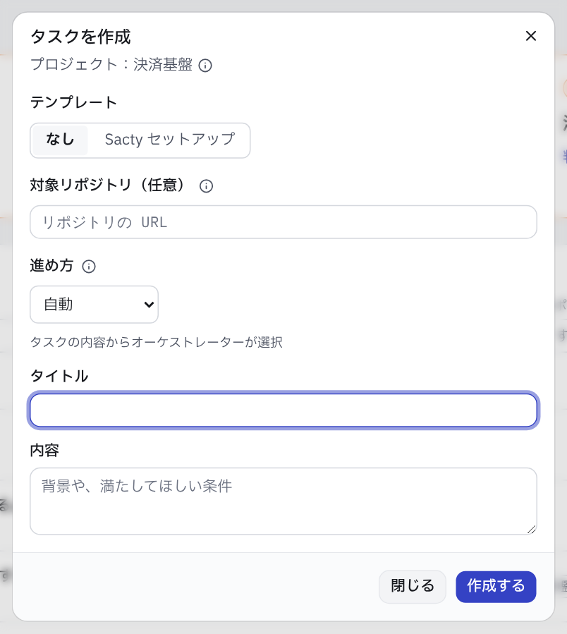
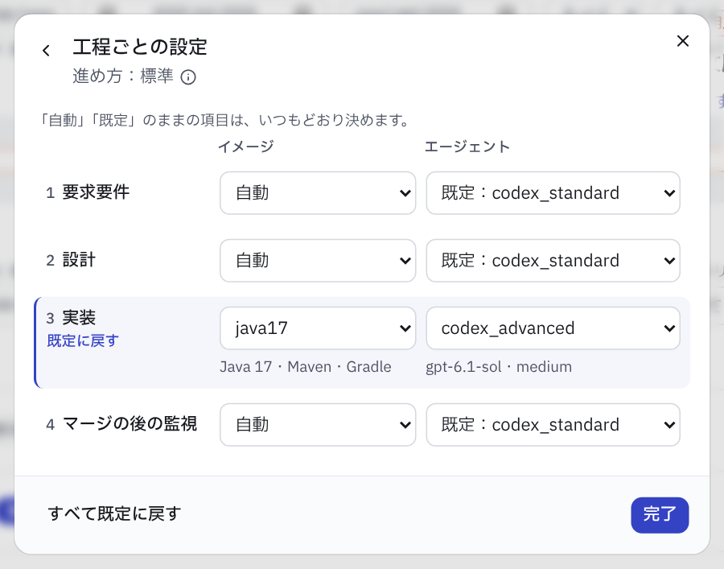
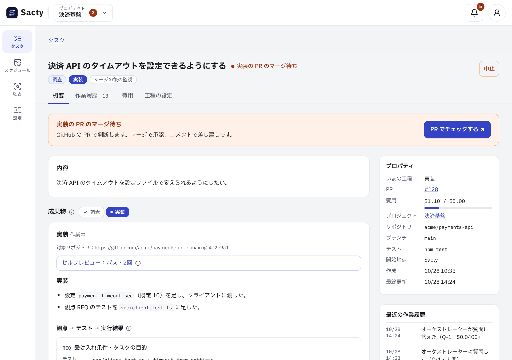
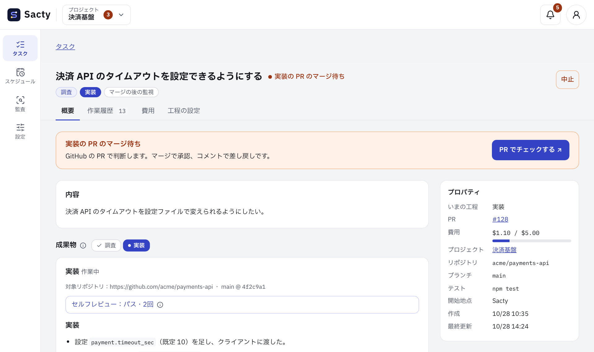
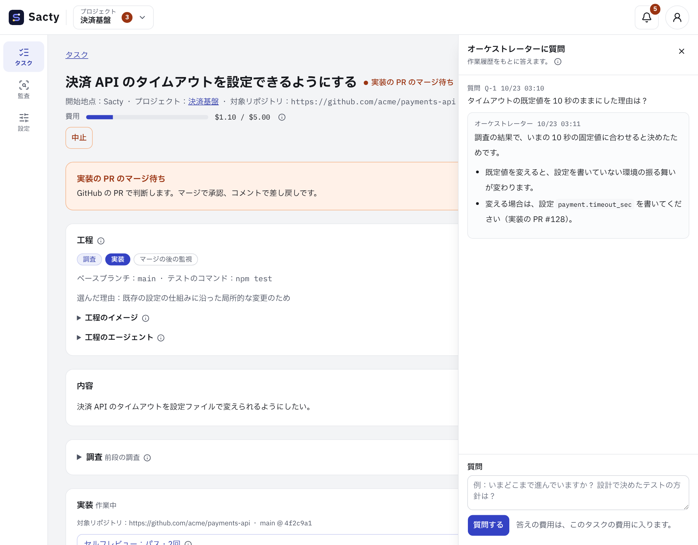
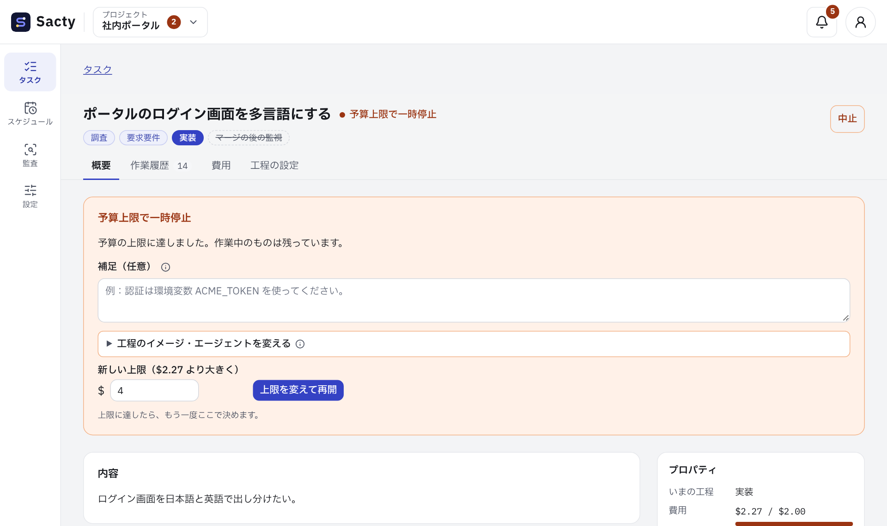
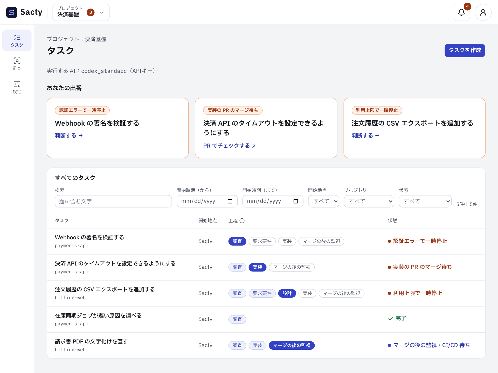

<!-- 対応するコード: apps/daemon/src/security.ts、apps/web/src/components/security-fixes.tsx、apps/web/src/components/derive-dialog.tsx、apps/daemon/src/config.ts、apps/web/src/components/task-detail.tsx、apps/daemon/src/service.ts、apps/daemon/src/repository.ts、apps/daemon/src/activity.ts、apps/daemon/src/pr-watcher.ts、apps/daemon/src/prompts.ts、packages/core/src/events.ts（StepKey・DEFAULT_DOCUMENTS_DIR）、apps/web/src/i18n/messages/task.ts、apps/daemon/src/task-templates.ts、apps/daemon/src/test-files.ts、apps/web/src/components/new-task-dialog.tsx、apps/web/src/components/task-step-settings.tsx、apps/web/src/components/implementation.tsx、apps/web/src/components/provenance.tsx、apps/web/src/components/task-list.tsx、apps/web/src/lib/task-filter.ts -->

**日本語** | [English](tasks.en.md)

# タスクを進める

タスクを作ると、オーケストレーターとゴールガーディアンが工程を進めます。
人間は承認ゲートでだけ判断します。

タスクは次のように進みます。


## タスクを作る

タスクの一覧の「タスクを作成」を押すと、次のダイアログが開きます。



- 画面でタスクを作るときは、プロジェクトの対象の中からリポジトリを選びます（[プロジェクトの設定](project-settings.md#対象)）。
  - リポジトリの候補は、「タスクを作成」を押してダイアログを開いたときに読みます。
    Org の対象は `gh` で GitHub に問い合わせるので、数秒かかることがあります。
  - 読んでいる間・読めなかったとき・候補が無いときは、ダイアログにそう出ます。
    どのときも、リポジトリの URL を入力すれば作れます。
- Issue・PR・チケットから取り込むこともできます（[取り込み](intake.md)）。
- リポジトリを選ばずにタスクを作ることもできます（調べもの・全体の設計・分割する大きなタスク）。
  オーケストレーターが、プロジェクトのコンテキスト（コンテキストリポジトリの規約・書き出しの接続先）と対象（リポジトリの一覧）から進め方を選びます。
  - コードを変えない仕事（調査だけ・設計だけ）は、リポジトリ無しのまま進め、sacty の画面で承認して完了します。
    PR やブランチは作りません。
    書き出し先があれば書き出します。
  - 分割する大きなタスクは、タスク分割で、子タスクごとに対象からリポジトリを選んで付けます（選んだ理由を残します）。
    統合レビューでは、子タスクのリポジトリごとにベースブランチの最新を読みます。
  - コードの変更が要り、分けないタスクは、オーケストレーターが対象からリポジトリを選び、用意してから工程を選び直します。
    選べなければ止まります。
    タスクの詳細で人がリポジトリを選んで再開できます。
- 「進め方」で、工程の組み合わせを選べます（下の「進め方を指定する」）。
  既定の「自動」では、オーケストレーターがタスクの内容から選びます。
- ベースブランチとテストのコマンドは、タスクの開始時にオーケストレーターがリポジトリを読んで決めます。
  テストの仕組みが無いリポジトリでは、テストを使わずに進めます（下の「テストの仕組みが無いリポジトリ」）。
- オーケストレーターは、要らない工程を省きます。
  - 依頼がはっきりしていて、既存の仕組みを使う小さな変更は、要求要件・設計を省いて実装から始めることがあります。
  - 工程が終わるごと（要求要件の承認の後など）に、残りの設計・再現の工程が要るかを見直し、要らない工程を飛ばします。
  - 飛ばした工程は、工程の並びに取り消し線で出ます。
    理由は作業履歴に出ます。
  - 飛ばした分は、ゴールガーディアンがタスクの目的（依頼の内容）から実装を最終レビューし、人は PR のマージで承認します。
- 開発のセットアップ（依存のインストール・ビルドなど）を実行するかは、工程で決まります。
  - 工程の選択と、コードや仕組みを読んで説明する調査では、実行しません。
    リポジトリの AGENTS.md などにセットアップの手順があっても、こちらを優先します。
  - 不具合の調査・再現・実装では、リポジトリの手順どおりセットアップします。

### 進め方を指定する

オーケストレーターの選び方と違う進め方にしたいときは、「タスクを作成」の「進め方」で組み合わせを選びます。
選ぶと、その下に工程の並びが出ます。

| 進め方 | 工程 | 使いどき |
| --- | --- | --- |
| 自動 | オーケストレーターが選ぶ | 既定 |
| 標準 | 要求要件 → 設計 → 実装 → マージの後の監視 | 振る舞いが複数ある・影響範囲が広い変更 |
| 設計を省く | 要求要件 → 実装 → マージの後の監視 | 小さく局所的な変更 |
| 直接実装 | 実装 → マージの後の監視 | 依頼がそのまま受け入れ条件になる変更 |
| 不具合の修正 | 再現 → 実装 → マージの後の監視 | テストで再現できる不具合 |
| 分割 | 要求要件 → 設計 → タスク分割 → 統合レビュー | 1つの PR に収まらない変更 |
| 調査だけ | 調査 | 質問・原因の調査・見積もり |
| レビューだけ | レビュー | 内容に書いた PR のレビュー |
| 文書作成 | 文書作成 | 手順書・ユーザーガイド・報告書などの原稿 |
| 作業のみ | 作業 | 外部サービスへの単発の変更 |
| 設計だけ | 要求要件 → 設計 | コードを変えない全体の設計 |
| セキュリティチェック | 調査 | 脆弱性・サプライチェーンの点検（下の「セキュリティチェックと対応」） |
| セキュリティ対応 | 調査 → 実装 → マージの後の監視 | 特定のセキュリティ上の問題を、最小限の変更で直す |

- 指定すると、オーケストレーターは組み合わせを選び直さず、工程が終わるごとの見直しでも工程を飛ばしません。
  ベースブランチ・テストのコマンド・イメージなどは、いつもどおりオーケストレーターが決めます（イメージとエージェントは、下の「工程ごとのイメージとエージェントを指定する」で指定もできます）。
- 「レビューだけ」は、対象リポジトリを選び、そのリポジトリの PR のリンクを題か内容に書いたときだけ選べます。
  そうでなければ、作成のときに理由が出ます。
  レビューでは PR のコードがエージェントのコンテナで動くので、信頼できない PR は選ばないでください（[PR のレビュー](intake.md#pr-のレビュー)）。
- リポジトリを選ばずに、実装する進め方（標準・直接実装など）を選ぶこともできます。
  オーケストレーターが対象からリポジトリを選んでから、指定した進め方で進めます。
- 指定した進め方は、タスクの詳細の「工程の設定」タブに出ます。
- 実装する進め方に、調査の工程はありません。
  コードの調べは、タスクの開始時の情報収集が行います（下の「タスクの開始時の情報収集」）。
  セキュリティ対応だけは、修正の範囲を決めるために、実装の前に調査があります。
- 「調査だけ」のタスクは、結果の形（表・章立て・項目など）を内容に書くと、その形で報告します。
  書かなければ、結論・根拠・関係する箇所・確認したいことの順で報告します。
- テンプレートを選んだときは、進め方を選べません。

#### 工程ごとのイメージとエージェントを指定する

進め方を選ぶと、工程の並びの下に「工程ごとに設定」が出ます。
押すと、ダイアログの中が工程ごとの設定に切り替わり、工程ごとにイメージとエージェントを選べます。



- イメージは、`images` の名前か `default`（既定のイメージ）を選びます（[イメージ](images.md)）。
  「自動」のままなら、いつもどおりプロジェクトの対象の指定かオーケストレーターが選びます。
- エージェントは、使えるエージェントの名前を選びます（[設定](config.md)）。
  「既定」のままなら、`step_agents`（無ければ `default_agent`）で決まるエージェントを使います。
  統合レビューは、ゴールガーディアンが行うので選べません。
- 選んだ工程には印が付き、「既定に戻す」で戻せます。
  「完了」か左上の戻るボタンで基本の入力に戻ります。
  基本の入力の工程の並びにも、指定した工程に印が付きます。
- 画面を切り替えても、入力中のタイトル・内容と選んだものは残ります。
  進め方を選び直しても、同じ工程の指定は残ります（今の進め方にある工程の分だけを使います）。
- 指定したイメージ・エージェントは、オーケストレーターの選択や `step_agents` より優先します。
  作成の後も、タスクの詳細の「工程のイメージ」「工程のエージェント」で変えられます（選んだ元に「作成時に人が指定」と出ます）。
- 進め方が「自動」のときと、テンプレートを選んだときは指定できません（工程が決まっていないため）。
- 候補を読めないとき（`config.yaml` を読めないなど）は、理由が出ます。
  そのときも、指定せずにタスクを作れます。

### テンプレート「Sacty セットアップ」

リポジトリを sacty で扱えるように、AI エージェント向けの設定を整えるタスクを、リポジトリを選ぶだけで作れます。

1. 「タスクを作成」の画面で、テンプレートの「Sacty セットアップ」を選びます。
2. 対象リポジトリを選んで「作成する」を押します。
   タイトル・内容は入力しません（sacty が決めます）。

作ったタスクは、通常のタスクと同じく、オーケストレーターが進め方を選び、承認・PR を経て進みます。
エージェントは次を検査し、足りないものを整える PR を作ります。

- エージェント向けの指示（AGENTS.md・CLAUDE.md など）
- テストの実行の仕方
  - テストの仕組みがまだ無ければ、無いことと、変更の確かめ方を書きます。
  - このタスクでは、言語やテストの仕組みを新しく入れません。
- テストに要るサービス（DB・モックなど）
- マージの後の監視のスキル `deployment-observer`（[マージの後の監視](deployment-watch.md#スキル)）
  - CI/CD のあるリポジトリで作ります（デプロイしていなくても作ります）。
    CI/CD が無ければ作りません。
  - 原本は `.agents/skills/deployment-observer/SKILL.md` です。
    Claude Code 用の `.claude/skills/deployment-observer` は、原本への相対のシンボリックリンクにします。
  - CI/CD の確認の仕方の reference（`references/ci.md`）も作ります。
    デプロイしていなければ、デプロイの確認を飛ばすことを書きます。

すでに整っていて変更が要らなければ、PR を作らずに、検査の結果を調査の結果として残して終えます（画面で承認して完了します）。
要求要件・設計・実装を進めた後に変更が要らないとわかったときも、PR を作りません。
実装の説明に検査の結果を残し、画面で承認して終えます（下の「実装に変更が無いとき」）。
テンプレートで作ったタスクは、一覧の「開始地点」・詳細のプロパティの「開始地点」・作業履歴の「タスクを作成」に、テンプレートの名前が出ます。

API からは、`POST /api/tasks` に `{"template": "sacty-setup", "projectId": "<プロジェクトの ID>", "repo": "<リポジトリの URL>"}` を送ります（`title`・`body` は渡しません）。
CLI にはタスクを作るコマンドがありません。

### テンプレート「ドキュメント構築」

ドキュメントが足りないリポジトリでは、エージェントがコンテキストを得られず、思ったとおりの成果物を作れないことがあります。
このテンプレートを選ぶと、実装からドキュメントを作り、エージェントがそれを参照する・直すためのスキルを置くタスクを、リポジトリを選ぶだけで作れます。

1. 「タスクを作成」の画面で、テンプレートの「ドキュメント構築」を選びます。
2. 対象リポジトリを選んで「作成する」を押します。
   タイトル・内容は入力しません（sacty が決めます）。

作ったタスクは、通常のタスクと同じく、オーケストレーターが進め方を選び、承認・PR を経て進みます。
エージェントは次のことをします。コードは変えません。

- 既存のドキュメント（README・docs・AGENTS.md など）を棚卸しし、その結果を PR の説明に表で書きます。
  既存のドキュメントは消さず・動かさず・書き直さずに、新しいドキュメントからリンクします。
  置き場所や形が決まっていれば、それに従います（無ければ `docs/` に置き、入口を `docs/README.md` にします）。
- 実装から、コードを少し読むだけではわからないこと（目的と用語・全体の構成・主な処理の流れ・データ・外部とのつなぎ・規約）を書きます。
  ビルドやテストの実行の仕方は、テンプレート「Sacty セットアップ」で整えます。
- 2つのスキルを作ります。
  原本は `.agents/skills/` の下に置き、Claude Code 用の `.claude/skills/` の下は原本への相対のシンボリックリンクにします。
  - `docs-lookup`：作業の前にドキュメントを探して読むためのスキルです。
  - `docs-update`：実装を変えたときに、同じ PR でドキュメントを直すためのスキルです。

レビューの負担を抑えるため、次のように進めます。

- 新しく作ったドキュメントの先頭には、状態 `AI 生成・未レビュー` が付きます。
  エージェントは、未レビューのドキュメントをコードで確かめてから使います。
  中身を確かめたら、`レビュー済み` に書き換えてください（エージェントに頼んでもかまいません）。
- コードで確かめられないことは `（未確認）` と書かれ、PR の説明に、短く答えられる質問として挙がります。
  すべてのドキュメントを読まなくても、質問に答え、全体の構成のドキュメントを確かめればよいようにしています。
- 最初の PR は、棚卸しの結果・入口・全体の構成・2つのスキルに絞ります。
  残りの項目は、入口に「未作成」として並びます。
  リポジトリが大きければ、オーケストレーターが領域ごとに子タスクに分ける（1つの領域で1つの PR）こともあります。

すでに整っていて変更が要らなければ、「Sacty セットアップ」と同じく、PR を作らずに調査の結果を残して終えます。

API からは、`POST /api/tasks` に `{"template": "docs-setup", "projectId": "<プロジェクトの ID>", "repo": "<リポジトリの URL>"}` を送ります。

## タスクの詳細の見方

タスクの詳細は、次のように表示されます。



- 題・状態・工程の並び・操作（一時停止・中止・再レビュー）・タブは、画面の上に固定され、スクロールしても見えます。
- 承認や判断を待っているとき・一時停止しているときの案内は、どのタブを開いていても、タブの下に出ます。
- タブで表示を切り替えます。

| タブ | 出すもの |
| --- | --- |
| 概要 | 中止したときの片付け・内容・成果物・PR・続きのタスクなど、そのタスクに関わる結果 |
| 作業履歴 | すべての作業履歴（新しい順。エージェントの実行の行から実行のログを開けます） |
| 費用 | 使った額と上限・工程ごとの費用・オーケストレーターのセッション |
| 工程の設定 | 工程と選んだ理由・ベースブランチ・テストのコマンド・書き出し先・工程のイメージ・工程のエージェント |
| 監査 | 監査の結果（完了したタスクだけ。まだ監査していなければ、その旨。[監査](audit.md)） |

- 開いたタブは URL（`?tab=activity` など）に残るので、リロードや共有をしても同じタブが開きます。
- 概要の「成果物」では、工程を選んで1つずつ読みます。最初は、いまの工程（作業中・承認待ち・最後に終えた工程）の成果物が出ます。
- 右の列の「プロパティ」には、いまの工程・PR・費用・プロジェクト・リポジトリ・ブランチ・テスト（テストのコマンド）・元のチケット・開始地点（テンプレートで作ったタスクなら、テンプレートの名前も）・関係するタスク（親タスク・再実行の元・続きの元・修正の元・元のレポート）・再実行したタスク・作成と最終更新の日時が出ます。
  PR・ブランチ・テスト・元のチケット・関係するタスク・再実行したタスクは、そのタスクにあるときだけ出ます。
  エラーの記録があるタスクでは、その下に「エラーレポート」が出ます（[エラーレポートを出す](troubleshooting.md#エラーレポートを出す)）。
  その下に、最近の作業履歴（5件）が出ます。

## タスクの開始時の情報収集

タスクが始まると、オーケストレーターが進め方を選ぶ前に、情報収集のエージェントがタスクに関係する情報を集めます。
チケットから取り込んだタスクなら、親のストーリー・エピック、リンクしたチケット、コメントにある URL まで辿り、集めた情報から作業するリポジトリを選んで、タスクの題と概要も書きます。
選べなかったときはタスクが止まり、タスクの画面でリポジトリを選んで再開できます（集めた情報は残り、題と概要だけを書き直します）。
使える MCP サーバー・外部 PF（文書・チャットなど）でも、タスクの語を探します。
対象リポジトリのコードも読み、タスクに関係するコードの場所といまの振る舞いをまとめに書きます。

- 作業するリポジトリが決まっているタスクは、情報収集の前にリポジトリを用意し、そのコードを読みます。
  用意できなければ、情報収集の前にタスクが止まります。
  テストの書き方（フレームワーク・実行のコマンド・置き場所・既存のテストの例）もまとめます。
  まとめにテストの書き方があっても、テストを書くとは限りません。
  テストの扱いは、オーケストレーターが決めます。
- 決まっていないタスク（リポジトリを指定せずに作ったタスク・リポジトリを選ぶ前のチケットのタスク）は、プロジェクトの対象から関係しそうなリポジトリをいくつか（多くても3つ）洗い出し、GitHub の読み取りの中継（`gh api`）でコードを読みます。
  読むには、プロジェクトの設定でそのホストの GitHub のアカウントを選んでおきます（[プロジェクトの設定の GitHub アカウント](project-settings.md#github-アカウント)）。
  読めなかったリポジトリと、リポジトリの一覧を読めなかった Org（認証切れ・権限不足など）は、読めなかった情報源としてまとめに書かれます。

- 集めた情報は、関係するものだけにまとめられ、タスクの詳細の「集めた情報」に出ます（工程が始まると折りたたまれます）。
  読めなかった情報源や、情報源の間の食い違いも書かれます。
- まとめは、オーケストレーター・すべての工程・ゴールガーディアンに渡されます。
  ゴールガーディアンは、これを背景の理解にだけ使い、判定の基準は承認した成果物のままです。
- 使う AI は `config.yaml` の `step_agents.gather` で選べます（書かなければオーケストレーターの AI。[config.yaml の設定](config.md#工程ごとのモデル)）。
  費用はタスクの予算に入り、工程ごとの費用の表の「情報収集」の行に出ます。
- まとめられなかったときは、タスクが一時停止します。
  再開すると集め直します。
- タスク分割の子タスクは集め直さず、親が集めた情報を内容に引き継ぎます。
- 情報収集は読むだけです。
  コードも変更しません。
  ゲートウェイの外部 PF は、`allow` に書き込みの API があっても、情報収集では GET・HEAD だけが通ります。
  MCP サーバーのツールは sacty では制限できないので、指示で読み取りの操作だけを使わせています。
  書き込みのツールを持つ MCP サーバーをコンテキストに入れているときは注意してください。
- 外部の文書やチャットを読ませるには、その接続先をゲートウェイの外部 PF かコンテキストの MCP サーバーに入れておきます（[ゲートウェイ](gateway.md)・[コンテキストリポジトリ](context.md)）。

## 文書作成と単発の外部作業

ユーザーガイド・手順書・議事録・翻訳の草稿などを作るときは、読者・目的・元の内容をタスクに書いてください。
リポジトリのコードをもとに手順書を作るときは、対象のリポジトリを選んでください（文書作成の工程がコードを読みます。リポジトリは変えません）。
オーケストレーターが別の進め方を選んでしまうときは、「進め方」で「文書作成」を選んでください。

- 「文書作成」で Markdown の原稿を確かめ、差し戻し・承認できます。
- オーケストレーターが書き出し先を選んだときだけ、承認の後に書き出します。
  選んだ接続先と理由は、タスクの詳細の「工程の設定」タブで確かめてください（[成果の書き出し](result-export.md)）。
- 書き出しに失敗しても、原稿は完了します。
  外部へ反映できたかも確かめてください。
- リポジトリの文書のファイルを変えたいときは、対象のリポジトリを選んでください。
  通常の実装・PR の承認で反映します。

文書作成の工程も、ほかの工程と同じく、プロジェクトのコンテキスト（規約・スキル・MCP サーバー）・外部の接続先・GitHub の読み取りを使えます。
外部の資料を使ってほしいときは、どの接続先の何を読むかをタスクの本文か差し戻しのコメントに書いてください。
ふつうは、成果物は原稿1つで、sacty の画面に出る原稿を承認します。
原稿は外部に直接書かず、承認の後に書き出します。

外部の文書を直接作ってほしい・直してほしいときは、タスクの本文にそう書いてください。
エージェントがその文書を直接書き、書いた文書が成果物になります。
成果物の文書は複数でもかまいません（例：「〇〇を含むページを探して、まとめて直してください」）。

- 「文書作成」には、文書ごとに直した後の内容が出ます。外部に直接書いた文書は「外部に直接書いたページ」に一覧で出ます。
- 差し戻すと、エージェントはそれらの文書を直します（同じ内容の別の文書は作りません）。対象の文書を足すよう差し戻すこともできます。
- 外部に直接書いた文書は、承認を待たずに、エージェントが書いた時点で外部に反映されます。承認の前に外部の文書が変わってよいときだけ、直接の編集を指示してください。
- 外部に直接書いた文書が成果物なので、承認の後に書き出しはしません。

作業の報告（作成した旨・エージェントの ID など）は、原稿にも外部にも書きません。

予定表や台帳、既存の外部のページを変えるときも、リポジトリを選ばずに依頼できます。
対象は、設定済みの接続先1つで行える、一意な対象への単発の変更です（差し戻しでやり直せません。直しながら進めたい外部の文書や、複数の文書をまとめて直すときは、上の文書作成で依頼してください）。
選んだ接続先とは別に、GitHub はいつも読めます（読むだけです。[ゲートウェイ](gateway.md#github-の読み取り)）。

1. 依頼に、対象の一意な ID/URL、変更の内容と前提、期待する結果を書いてください。
   オーケストレーターが、接続先・対象・依頼の内容・確かめ方を選びます。
   対象や接続先が足りないときは、実行を始める前に止まります。
2. 1つの「作業」工程で、依頼に従って1回実行します。
   別の準備の工程や、実行の前の承認はありません。
   タスクを始める前に、依頼の内容が正しいかを確かめてください。
3. 成功した結果の根拠を確かめ、結果を承認して完了します。
   失敗や結果不明は完了になりません。

工程を選んだ後は、タスクの詳細で、選んだ接続先と接続の方式・対象・依頼の内容・確かめ方を、読み取り専用で確かめられます。
この表示は実行の前の承認ゲートではなく、タスクの進行を止めません。

対象の情報が足りないときは、依頼に情報を補って、新しいタスクを作ってください。
実行を始める前に、選んだ接続先が使えなくなったときは、接続の設定を直してから再開できます。

実行が始まった後は差し戻せません。
中断・再起動・失敗の後の再開は拒否され、タスクは止まったままになります。
外部のサービスで実際の状態を確かめてからタスクを中止し、まだ行われていない変更だけを、新しいタスクとして依頼してください。
sacty はエージェントに、書き込みを1回だけ行い、変更の後に確かめるよう指示します。
ただし、外部のサービスの側で重複を防げるとは限りません。

GitHub の PR・Issue への返信も、作業として依頼できます（例「https://github.com/acme/app/pull/12 のレビューの指摘に返信して」）。
プロジェクトの設定で GitHub のアカウントを選んだホストが、接続先の候補になります。
エージェントは PR・Issue を読み、返信の内容を出力に書きます。
結果を承認すると、sacty が返信を投稿します（[PR と Issue へのコメント](#pr-と-issue-へのコメント)）。
コードの修正やプッシュはできません。
PR のコードを直すときは、リポジトリを選んでタスクを作ってください（[既存の PR を直す](#既存の-pr-を直す)）。

定期的な更新・監視や、複数の接続先をまたぐ長い業務の自動化は対象外です。
文書作成と外部の更新のように複数の成果が要る依頼は、確かめて承認できる単位に分けてください。

## 既存の PR を直す

人が作った PR のレビューの指摘に対応するなど、既存の PR そのものを直すときは、対象リポジトリを選び、その PR のリンクを題か内容に書いてタスクを作ります（例「https://github.com/acme/app/pull/12 のレビューの指摘に対応して」）。
オーケストレーターがその PR を直す依頼だと判断すると、sacty は PR を引き継ぎます。

- 実装は、その PR のブランチの先頭から始め、同じブランチにコミットを積みます。
  新しいブランチ・PR は作らず、PR の題・本文も変えません。
- PR にあるレビュー・コメント（sacty のレビューを含みます）は、各工程のエージェントへの指示に渡ります。
- 要求要件・設計の工程があっても PR にはせず、sacty の画面で承認します（引き継いだ PR に成果のファイルを混ぜないため）。
  この工程のエージェントが、PR の指摘に対応しないと判断したものは、理由とともに「確認したいこと」に出ます。対応したことの報告は書かせません。
- 実装は、その PR のマージで承認します。
  実装に渡さなかった指摘（実装を始めた後に付いたものなど）は、ほかの PR と同じく取り込んで直します。
- タスクの詳細の「工程の設定」タブに「引き継いで直す PR」が出ます。
- タスクを中止しても、PR は閉じず、ブランチも消しません（積んだコミットは残ります）。

次の PR は引き継げません。
新しい PR を作らないように、工程を決めずに止まります。
PR を確かめてから再開すると、工程の選択からやり直します。

- マージ済み・閉じられた PR
- フォークからの PR（sacty はフォークのブランチにプッシュできません）
- sacty のほかのタスクが作った・引き継いだ PR（sacty が作った PR の指摘は、作ったタスクが取り込んで直します）

作業の間に人が PR のブランチにコミットを積むと、sacty は強制プッシュせずに止まります。
タスクを中止し、新しいタスクにしてください。
PR を参考にするだけのタスク（例「12 番の PR と同じ直し方を、ほかのモジュールにもする」）は、今までどおり新しい PR を作ります。

## セキュリティチェックと対応

脆弱性やサプライチェーンの問題を、レポートで点検し、PR で直せます。

| 進め方 | 成果物 | 使いどき |
| --- | --- | --- |
| セキュリティチェック | レポート（画面で承認） | どこに問題があるかを点検したいとき |
| セキュリティ対応 | PR（マージで承認） | 特定の問題（CVE・GHSA・アラート・チェックの指摘）を直したいとき |

### セキュリティチェック

1. 「タスクを作成」で、テンプレートの「セキュリティチェック」を選び、対象リポジトリを選んで作成します。
   スケジュールタスクでこのテンプレートを選ぶと、定期的に点検できます（[スケジュールタスク](scheduled-tasks.md)）。
2. エージェントが、次の区分ごとに点検し、指摘のレポートを書きます。
   既定のイメージにある `osv-scanner`（依存の脆弱性）と `gitleaks`（秘密情報）を使います。
   - 依存の脆弱性
   - サプライチェーン（CI のワークフロー・依存の取得元とロックファイル・インストールのスクリプト・イメージのタグの固定）
   - コードの脆弱性
   - 秘密情報の混入（値は書かず、場所と種類だけを書きます）
   - 設定・IaC
3. レポートを読み、承認します（差し戻して直させることもできます）。
   道具が無くて確かめられなかった区分は、レポートに「確かめていない範囲」として出ます。

### レポートから対応のタスクを作る

承認したセキュリティチェックのタスクの詳細に「セキュリティ対応」の欄が出ます。
区分ごとに指摘が並ぶので、直したい区分の「対応のタスクを作る」を押します。

- 区分ごとに1つ、進め方「セキュリティ対応」のタスクを作ります。
  内容には、その区分の指摘だけが入ります。
- 作った区分には、作ったタスクへのリンクが出ます。
  同じ区分では、もう作れません。
- 対応のタスクの詳細のプロパティの「元のレポート」に、元のレポートへのリンクと区分が出ます。
- 区分をまたいで直したい・一部の指摘だけを直したいときは、[続きのタスク](#完了したタスクの続きのタスクを作る) を作り、内容に直す指摘を書いてください。

### セキュリティ対応

レポートから作るほか、「タスクを作成」で進め方「セキュリティ対応」を選び、内容に直したい問題（CVE の番号・アラートの URL など）を書いても作れます。

1. 調査で、エージェントが問題を確かめ、修正の範囲（変えてよいファイル・上げる依存・解消を確かめるコマンド）を決めます。
   範囲は承認しません。
2. 実装で、エージェントが範囲の中だけを、問題を解消する最小限の変更で直します。
   リファクタリング・整形・関係の無い修正は混ぜません。
3. sacty が差分を範囲と照らし、ゴールガーディアンが最小限の変更かを確かめます（観点 `SEC-MIN`）。
   範囲の外のファイルを変えた、またはロックファイルを除いて 300 行を超えて変えたときは不合格になり、実装をやり直します。
   回帰のテストのファイルは、範囲の外でも足せます（行の数には数えます）。
4. PR の本文に「修正の範囲（セキュリティ対応）」が出ます。
   差分が範囲に収まっているかを確かめて、マージで承認してください。
   既存の PR を直すタスク（[既存の PR を直す](#既存の-pr-を直す)）では PR の本文を変えないので、範囲はタスクの詳細の「調査」の結果で確かめてください。

- 範囲の外を変えないと直せないときは、エージェントが理由と広げるべき範囲を実装の説明に書きます。
  前段の調査には差し戻せないので、タスクを中止し、「再実行」の補足に広げる範囲を書いてやり直してください。
  再実行のタスクも「セキュリティ対応」で進みます。
- セキュリティチェック・セキュリティ対応のタスクの成果は、取り込み元の Issue・チケットにコメントしません。
  工程の出力にあるコメントの頼み（`sacty-github-comments`）も投稿しません。
- 公開リポジトリでも、ほかの実装と同じく PR を作ります。
  公開してよいかは、タスクを作る前に判断してください。

## PR と Issue へのコメント

工程のエージェントは GitHub を読めますが、書き込めません（[ゲートウェイ](gateway.md#github-の読み取り)）。
PR・Issue へのコメントが要るときは、エージェントが工程の出力にコメントの内容を書きます。
その工程の成果を人が承認した後に、sacty がプロジェクトの GitHub のアカウントで投稿します。
承認しなければ投稿しません。

- 投稿の内容は、承認の前に、成果の末尾の `sacty-github-comments` の JSON で確かめられます。
  差し戻して直した後に承認すると、直した版を投稿します。
- 投稿先は、プロジェクトの対象のリポジトリ（と、タスクの取り込み元・作業するリポジトリ）の PR・Issue だけです。
  それ以外の URL には投稿せず、理由を作業履歴に出します。
- コメントの末尾に、sacty のタスクで AI が書き、人が承認したことを添えます。
- 投稿の結果（コメントの URL・投稿できなかった理由）は、作業履歴に出ます。
  投稿できなくても、タスクは止まりません。
- レビューの工程は、これまでどおり、書いたレビューを sacty が PR に投稿します。

## テスト（検証）のコマンド

実装の検証では、オーケストレーターがリポジトリを読んで決めたテスト（検証）のコマンドを、ゴールガーディアンが最終レビューの中で実行します。
ゴールガーディアンは、実装の工程のイメージと、実装後のコードの写しを使います。
コマンドの出力の全体（単体・結合など、コマンドが実行するすべての種類のテスト）を確かめ、その結果と差分・コードから判定します。
sacty はテストを別に実行しません。

テストのコードが無いリポジトリでも、成果物を機械的に確かめる検証があれば、それを使います。

- 検証のコマンドには、CI・Makefile・pre-commit が実行しているもの、またはリポジトリの形から決まるもの（`kustomization.yaml` があれば `kustomize build` など）を使います。
  - Kubernetes のマニフェストのリポジトリなら `kustomize build`・`helm lint`・`kubeconform`
  - Terraform なら `terraform validate`
  - YAML なら `yamllint` など
- 決まったコマンドは、タスクの詳細の「工程の設定」タブの「テストのコマンド」と、右の列のプロパティの「テスト」に出ます。
- ゴールガーディアンが実行したテストのコマンド・終了コード・結果の抜粋は、実装の成果物の「ゴールガーディアンが実行したテスト」に出ます。
  PR の本文のテストの行にも「（ゴールガーディアンが実行。終了コード N）」と出ます。
- 次のときは、最終レビューは不合格になり、実装をやり直します（やり直しには、ゴールガーディアンが実行したテストの結果が渡ります）。
  - 終了コードが 0 だと、ゴールガーディアンが報告せず、失敗がすべて環境によるものだとも報告しなかったとき
  - 実装がテストを対応させていない観点があるとき
- 要求要件・設計を PR で承認するタスクでは、実装の PR に入る要求要件・設計のファイル（既定 `docs/sacty/<タスクの短い ID>/`）も、ゴールガーディアンの写しに PR と同じ内容で入ります。
  リポジトリ全体を対象にする検査（`prettier --check .` など）は PR と同じ中身で実行されるので、これらのファイルで失敗すると最終レビューが不合格になり、実装をやり直します。
  ファイルは sacty が置くもので、実装は書き換えられないため、検査の設定（`.prettierignore` など）をリポジトリの方針に合わせて直します（たとえば、置き場所が既定の `docs/sacty/` なら、それをまとめて対象外にします。置き場所を既定から変えていて、`docs` のように、ほかのファイルと共有する場所のときは、その全体は対象外にせず、タスクの ID のディレクトリに当たる範囲に限ります。タスクごとに行は足しません）。
- テストのコマンドのツールがイメージに無くて実行できなかったことだけを理由には、不合格にしません。
  ほかの失敗（ゴールガーディアンが申告したテストの失敗・lint のエラーなど）と観点は、ふつうどおり判定します。
  変更したファイルがすべて文書なら、止めずに進め、実行できなかった検証を「人が確かめること」に残します（[人が確かめること](#人が確かめること)）。
  文書でないファイルが変わっていれば、一時停止します（[検証のツールがイメージに無いとき](#検証のツールがイメージに無いとき)）。
- 文書・コメント・文言だけの変更のように、実行される振る舞いの無い観点は、テストを書かずに「差分で確かめる」と申告できます。
  ゴールガーディアンが、その観点の変更が振る舞いを変えないことを差分で確かめて判定します（振る舞いを変えるのにテストが無ければ不合格です）。
  実装の成果物には「テストなし・差分で確認（理由）」と出ます。
  スキル（SKILL.md）・AGENTS.md などエージェント向けの指示の文書も、エージェントを起動して確かめるテストを書かずに、差分で確かめます（スキルに含めるスクリプトなど、実行されるコードはテストを書きます）。
- 不具合の修正の再現の工程では、再現のエージェントが、書いたテストを自分で実行し、不具合のために失敗することを確かめて報告します。
  確かめたと報告しなかったときは、再現できなかったとして止まります。
  再現の手がかりを指摘に書いて差し戻すと、再現をやり直します。

### 実装の PR と CI

実装の工程が終わると、sacty は最終レビューの前に、実装の PR をドラフトで作ります。
CI でしか確かめられない振る舞い（ワークフローの修正など）も、ゴールガーディアンの判定に入ります。

1. sacty が実装をプッシュして、実装の PR をドラフトで作ります（やり直した実装は、同じ PR を更新します）。
   このときは、レビュー用のラベルを付けません。
   ドラフトの間は、レビュー・マージを待ってください。
2. sacty が PR の CI を待ちます。
   タスクの状態は「PR の CI を待っている」です。
   CI が無いリポジトリでは 5 分、CI が終わらないときは 60 分まで待ってから進みます。
3. ゴールガーディアンが、作業領域で実行したテストと PR の CI の結果を合わせて、最終レビューをします。
   - CI の失敗が変更によるものなら、不合格にして実装をやり直します。
   - 変更と関係の無い失敗（CI の環境・外部のサービス・秘密情報の不足など）なら、不合格にせず「人が確かめること」に入れます。
4. 合格したら、sacty がドラフトを外し、レビュー用のラベルを付けて、実装の承認待ちにします。

- リポジトリがドラフトの PR を使えない（GitHub のプランなど）ときは、ふつうの PR で同じように進めます。
- 実装に変更が無ければ、PR は作りません（[実装に変更が無いとき](#実装に変更が無いとき)）。
- 既存の PR を引き継ぐタスクでは、最終レビューに通ってから、引き継いだ PR に積みます（最終レビューの前には積みません）。
- PR をドラフトにする・外すには、プロジェクトの GitHub のアカウントに、PR を作るのと同じ権限が要ります。
  ドラフトを外せなかったときは、理由を出して止まります。
  原因を直してから「再開する」を押すと、ドラフトを外すところからやり直します。

### ベースブランチが進んだとき

別のタスクや人の PR が先にベースブランチ（main など）へマージされても、実装の PR がベースブランチと競合したままにならないよう、sacty が自動で対応します。

- sacty は、実装を始める前と、最終レビューの前に、ベースブランチの最新を実装の作業領域に取り込みます。
  差し戻しや PR の指摘で実装をやり直すときも、やり直す前に取り込みます。
  承認待ちの間は取り込みません。ベースブランチが進んだ PR を直すときは、差し戻すか PR に指摘を書いてください。
- 競合しなければ、そのまま取り込みます。PR には、ベースブランチの先頭を親に含むマージコミットが積まれます。
  ベースブランチ側の変更は、PR の差分には出ません。履歴は書き換えません（強制プッシュ・リベースはしません）。
- 競合したときは、競合したファイルに目印（`<<<<<<<`・`=======`・`>>>>>>>`）が残ります。
  sacty は、競合したファイルの一覧を実装のエージェントに渡して、両方の変更が生きるように解消させます。
  解消した内容が、マージコミットとして PR に積まれます。
- 目印が残ったまま実装が終わったときは、最終レビューに進まず、競合したファイルを渡して実装をやり直します。
  続けて 3 回解消できないときはタスクが一時停止し、競合したファイルが理由に出ます。
  目印が残った実装は、「レビューへ進める」ことはできません。「再開する」で、目印のあるファイルを渡して実装をやり直します。
- ベースブランチの最新を取得・マージできなかったとき（ネットワークの失敗など）は、理由を出して一時停止します。
  原因を直してから「再開する」を押すと、取り込みからやり直します。
- ベースブランチの取り込みには、ホストの git が 2.40 以上である必要があります。古いときは、その案内を出して止まります。
- 既存の PR を引き継ぐタスク（[既存の PR を直す](#既存の-pr-を直す)）は、人の PR のブランチに積むので、ベースブランチを取り込みません。

### 検証に続けて通らないとき

実装がテストか最終レビューに3回続けて通らないと、タスクは一時停止します。
ベースブランチとの競合の目印が残ったまま通らなかったときも、同じ3回で止まります（[ベースブランチが進んだとき](#ベースブランチが進んだとき)）。
タスクの詳細で、次のどちらかを選べます。

- 「再開する」：実装をやり直します。
- 「レビューへ進める」：PR を確かめて問題が無いと判断したら、最終レビューの不合格のまま、レビューへ進めます。
  sacty がドラフトを外し、レビュー用のラベルを付けて、実装の承認待ちにします。
  最終レビューはやり直しません。
  PR の本文には、人が不合格のまま進めたことと、不合格の理由が出ます。

### 人が確かめること

作業領域（コンテナ）では確かめられないことは、最終レビューを不合格にせず、人がマージの前に確かめる項目として残ります。

- 環境によるテストの失敗：変更を外しても同じように失敗するなど、失敗がすべて環境によるものだとゴールガーディアンが判断したときは、根拠を書いて、テストは通ったものとします。
  1件でも変更によるもの・判断できないものがあれば、これまでどおり不合格です。
- 作業領域では確かめられない受け入れの確かめ方：実機・特定の OS・入力方式などでの確認は、テストで確かめられる範囲（合成の入力など）で判定し、残りを人が確かめる項目にします。
  要求要件の工程でも、受け入れの確かめ方を「自動のテストで確かめること」と「人が確かめること」に分けて書きます。
  スキル・AGENTS.md などエージェント向けの指示の文書を書く・直すタスクでは、要求を文書に何が書かれているべきかで書き、受け入れの確かめ方は差分で文書の中身を確かめることにします。

- ツールが無くて実行できなかった検証：変更したファイルがすべて文書（`.md`・`.rst` など。`.txt` は依存やビルドの定義にも使われるので、文書とは見なしません）で、テストのコマンドのツールがイメージに無かったときは、タスクを止めずに進めます。
  実行できなかった検証は、ツールのある環境で実行して確かめる項目として残ります。
  コードなど文書でないファイルが1つでも変わっているときは、これまでどおり止まります（[検証のツールがイメージに無いとき](#検証のツールがイメージに無いとき)）。

この項目は、実装の PR の本文の「人が確かめること」のチェックリストと、タスクの詳細の最終レビューの「人が確かめること」に出ます。
既存の PR を引き継いだタスクでは PR の本文を変えないので、タスクの詳細の最終レビューで確かめてください。
ゴールガーディアンが実行したテストには「環境による失敗だけ」（ツールが無くて実行できなかったときは「<ツール> が無く実行できず」）と出ます。
確かめてから PR をマージしてください。

### 検証のツールがイメージに無いとき

テストのコマンドに書いたツール（`kubeconform` など）が、テストを実行するイメージ（実装の工程のイメージ）に入っていないと、ゴールガーディアンがそれを報告します。
タスクは実装をやり直さずに一時停止し、「テスト（検証）のコマンドに書いた … が、テストを実行するイメージ（…）に入っていません」と出ます。
案内のとおりにイメージを直してから、「再開する」を押してください。
再開すると、実装をやり直さずに、最終レビュー（テストの実行）からやり直します。

ただし、変更したファイルがすべて文書（`.md`・`.rst` など）のときは、止まりません。
タスクは最終承認へ進み、実行できなかった検証が「人が確かめること」に出ます（[人が確かめること](#人が確かめること)）。
コードなど文書でないファイルが1つでも変わっているときは、ここで止まります。

1. `config.yaml` の `images` で、そのイメージの `packages`（OS のパッケージ）か `run`（導入のコマンド）にツールを足します。
   既定のイメージで止まったときは、ツールを入れたイメージを `images` に足し、`description` にもツールの名前を書きます（[コンテナイメージ](images.md#言語ごとのイメージ)）。

   ```yaml
   images:
     k8s:
       description: kubectl・kustomize・helm・kubeconform
       base_image: registry.example.com/ci/k8s-tools:1.31
       run:
         - curl -fsSL https://downloads.example.com/kubeconform-linux-amd64.tar.gz -o /tmp/kubeconform.tar.gz
         - tar -xzf /tmp/kubeconform.tar.gz -C /usr/local/bin kubeconform
   ```

2. `npx sacty image build <名前>` でイメージを作り直します。
3. 新しく足したイメージなら、タスクの詳細の「工程のイメージ」で、実装の工程のイメージを変えます（[工程のイメージを変える](images.md#工程のイメージを変える)）。

テストのコマンドが決まっているタスクで、イメージを直さずに進めたいとき（検証をそのイメージで実行しなくてよいときなど）は、再開の欄の「テストの扱い」で、テストのコマンドを指定し直すか、テストなしで進めると決めて再開することもできます（選び方は [テストなしで進めずに止まったとき](#テストなしで進めずに止まったとき) と同じです。決めずに再開すると、止まった所から最終レビューをやり直します）。
テストなしで進めると、テストを実行せずに、ゴールガーディアンがタスクの目的から判定します。
不具合の修正では、テストなしを選べません。

テストの仕組みが無いリポジトリで、実装が用意したテストのコマンドで検証するタスク（[テストの仕組みが無いリポジトリ](#テストの仕組みが無いリポジトリ)）には、この欄は出ません。
止まったときの案内にも出ないので、イメージを直してから再開してください。

テストのコマンドに直接書いていないツール（`npm test` の中のスクリプトが使うツールなど）が見つからないときは、リポジトリの依存の問題として扱います。
ふつうのテストの失敗と同じく、実装をやり直します（このときも、テストを実行するのはゴールガーディアンです）。

## テストの仕組みが無いリポジトリ

README しかないリポジトリのように、テストの仕組みがそもそも無いリポジトリでも、タスクは止まらずに進みます。

- オーケストレーターは、パッケージの設定・Makefile・CI の設定・README などを調べ、テストの仕組みが見つからなければ、無いと判断した根拠を残します。
  エージェントのスキルを集めたリポジトリや、ドキュメントを置くだけのリポジトリも、これに当たります。
  タスクの詳細の「工程の設定」タブに「テストのコマンド：なし・目的から判定」と出て、横の補足の印（i）に根拠が出ます（作業履歴の「工程を決定」にも出ます）。
- 実装の検証では、テストを実行しません。
  ゴールガーディアンが、タスクの目的・要求要件（設計）と、実装後のコード・差分・実装の説明から、観点ごとに受け入れを判定します。
  通らなければ、テストのあるタスクと同じく実装をやり直し、3回続けて通らなければ一時停止します。
- 実装の成果物（タスクの詳細と実装の承認の画面）に「テストで検証していません」と出ます。
  PR の本文のテストの行にも「テストのコマンドが無いため、テストでは検証していません。目的から判定しました。」と根拠が入ります。
  テストで確かめていないので、承認の前に、変更の中身を自分で確かめてください。
- タスクがテストの仕組みを用意するもの（言語のセットアップなど）で、実装がテストを用意したときは、そのテストで検証してから、目的から判定します。
  - テストが通れば、画面に「実装で用意したテストで検証しました」と出ます。
  - 通らなければ「実装で用意したテストが通りませんでした」と出て、実装をやり直します。
  - 実装がテストのコマンドの申告（言語の名前が `sacty-test-command` のコードブロック）を正しく書かなかったとき（JSON として読めないときを含みます）は、エラーで一時停止します。
    再開すると実装をやり直します。
- テストに通らずに実装をやり直している間、前の実装のテストの結果と最終レビューは「前の提出の…」という見出しで出ます。
  横の補足の印には、今の提出ではまだ実行・判定していないことが出ます。
  これは今の実装の結果ではありません（テストの仕組みがあるタスクでも同じです）。
- 不具合の修正（再現 → 実装）は、再現をテストで確かめるので、テストの仕組みが無いリポジトリでは選びません。
  選ばれたときは止まります。

### テストなしで進めずに止まったとき

次のときは、テストなしでは進めずに一時停止します（理由がタスクの詳細に出ます）。
タスクを作り直す必要はありません。
タスクの詳細の再開の欄の「テストの扱い」で、次のどれかを選んで再開できます。

- **テストのコマンドを指定する**：リポジトリのテストを実行するコマンド（例 `npm ci && npm test`）を入れます。
  ゴールガーディアンが最終レビューの中で実行します。
- **テストなしで進める**：エージェントのスキルを集めたリポジトリや、ドキュメントを置くだけのリポジトリのように、テストを書かないリポジトリ向けです。
  理由を書くと、テストを実行せずに、ゴールガーディアンがタスクの目的から判定します。
  理由は、作業履歴・タスクの詳細・PR の本文に、人が決めた理由として残ります。
  不具合の修正では選べません。
- **決めずに再開する**：まだどの工程も始めていなければ、オーケストレーターが工程の選択からやり直します。
  同じ工程のまま進めて、費用をかけた後に同じ理由で止まることはありません。
  オーケストレーターがもう一度同じ判断をすると、また止まります。

| 止まった理由 | 直し方 |
| --- | --- |
| オーケストレーターがテストのコマンドを決められなかった（「テストのコマンドを決められませんでした」） | テストがあるなら、テストのコマンドを指定して再開してください。テストを書かないリポジトリなら、テストなしで進めてください。 |
| オーケストレーターはテストの仕組みが無いと判断したが、テストのように見えるファイルがあった（「テストのように見えるファイルがあります（…）」。見つけたファイルが出ます） | 見つけたファイルが**本当にテスト**なら、テストのコマンドを指定して再開してください。**テストではない**ファイル（テスト用ではないスクリプトなど）を誤って当てたときは、テストなしで進めてください（決めずに再開すると、同じ理由でまた止まりやすくなります）。 |
| ファイルが多すぎて、テストのファイルが無いことを確かめきれなかった（「ファイルが多く、…確かめきれませんでした」） | テストがあるなら、テストのコマンドを指定して再開してください。本当にテストが無いなら、テストなしで進めてください。 |
| 作業領域のディレクトリを読めず、確かめきれなかった（「作業領域のディレクトリ（…）を読めず（…）」。読めなかった場所と、`EACCES`（権限が無い）などのエラーが出ます） | 出る場所は、そのタスクの作業領域 `$SACTY_HOME/workspaces/<タスク ID>/repo/`（`SACTY_HOME` を変えていなければ `~/.sacty/workspaces/<タスク ID>/repo/`）からの相対のパスです（`.` は作業領域そのもの）。タスク ID は、タスクの詳細の画面の URL（`/tasks/<タスク ID>`）の末尾です。sacty を動かしているユーザーが、その場所を読めるか（ファイルの権限・ディスクの状態）を確かめて直してください。そのうえで、テストのコマンドを指定するか、テストなしで進めるを選んで再開してください。 |
| 不具合の修正を選んだ（「再現はテストで確かめるので、テストのコマンドが要ります」） | テストのコマンドを指定して再開してください（不具合の修正は、テストなしでは進められません）。テストなしで直したいときは、タスクを中止し、再実行で、直す内容を書いたふつうのタスクとしてやり直してください。 |

テストのように見えるファイルとして当たるのは、次のファイルです。

- `test`・`tests`・`__tests__` のディレクトリの中のファイル
- `*.test.*`・`*.spec.*`・`*_test.*`・`*_spec.*`・`test_*`・`*Test.*`・`Test*` のような名前のファイル

文書のファイル（`.md`・`.txt`・`.rst`・`.adoc` など）は当たりません（`tests/README.md` は当たりません）。

## 実装に変更が無いとき

実装の工程が何も変えなかった（すでに満たしていて変更が要らないと判断した）ときは、PR を作りません。
どのタスクでも同じです。

- タスクは「変更なしの実装の承認待ち」になります。
  承認の画面で、実装の説明（変更が要らない理由と根拠）・テストの結果・最終レビューを確かめてください。
- 変更なしでよければ「承認する」を押します。
  PR を作らずに「完了（変更なし）」になります。
- 変更が要るなら、指摘を書いて差し戻します。
  実装からやり直し、変更があれば PR を作ります。
- 要求要件・設計を PR で承認したタスクでは、タスクブランチは残ります（要らなければ GitHub で消してください）。
- すでに PR を作った後に、差し戻しで作り直した実装が何も変えなくなったときは、エラーで止まります。
  開いている PR をどうするか決めてから、中止するか、差し戻し直してください。

## PR での承認（要求要件・設計・実装）

実装の PR のマージを待っているタスクの詳細は、次のように表示されます。



人間の承認が要る工程（要求要件・設計・実装）は、対象のリポジトリへの PR で判断します。
承認はマージです。
PR を作った工程は、sacty の画面からは承認しません（画面は PR への案内と状況の表示です）。

承認待ちで、今の提出の PR が開いていれば、GitHub の PR を新しいタブで直接開けます（sacty の承認の画面を挟みません）。

- タスクの詳細・タスクの一覧の「あなたの出番」：「PR でチェックする ↗」を押します。
- ダッシュボードの「あなたの出番」・ヘッダーのお知らせ：タスクの題（末尾に ↗ が付きます）を押します。

PR をマージすれば、sacty の画面に戻らなくても、次の確認で承認として進みます。
次のときは、今までどおり sacty の承認の画面に案内します（タスクの詳細・一覧では「チェックする」「判断する」、ダッシュボード・お知らせでは ↗ の無いタスクの題）。

- PR の指摘の戻し先を人が選ぶときなど、エスカレーションのとき。
- PR がマージされずに閉じられた・まだ無いとき。

PR での承認は、次の順に進みます。

1. sacty が、ベースブランチの起点のコミットからタスクブランチ（`sacty/task-<タスクの短い ID>`）を作ります。
2. 要求要件を、ファイル（既定 `docs/sacty/<タスクの短い ID>/requirements.md`）にして、タスクブランチへの PR にします。
   マージされたら、要求要件の承認として記録し、次の工程に進みます。
3. 設計（テスト観点を含む。`design.md`）も同じく、タスクブランチへの PR にします。
4. 設計の PR がマージされたら、実装の工程に進みます。
   - 実装の工程が終わったら、最終レビューの前に、タスクブランチに実装を積み、タスクブランチからベースブランチへのドラフトの PR にします（CI が動きます）。
     実装がテストとゴールガーディアンの最終レビューに通ったら、ドラフトを外します（[実装の PR と CI](#実装の-pr-と-ci)）。
     実装の PR には、要求要件・設計のファイルも含まれます。
   - 実装の承認待ちになり、PR をマージすると実装の承認になって、マージの後の監視の工程に進みます。
     対象のリポジトリにスキルが無く、工程を飛ばしたときは、タスクが完了します。
   - マージの後の監視では、CI/CD とデプロイを sacty が見届け、終わるとタスクが完了します（[マージの後の監視](deployment-watch.md)）。

要求要件・設計・実装をすべて PR で承認するときのブランチと PR は、次のようになります（タスクの短い ID が 1a2b3c4d の例）。


- ファイルの置き場所は、リポジトリやプロジェクトのコンテキストの規約に決まっていれば、オーケストレーターがそれに従います。
- PR のレビュー・行へのコメント・通常のコメントを、指摘として取り込みます。
  - bot と sacty の投稿は除きます。
    ただし、その PR を取り込んだ sacty のレビューのタスクの投稿は含めます（[sacty が作った PR のレビュー](intake.md#sacty-が作った-pr-のレビュー)）。
  - 1分ごとに確かめ、最後のコメントから2分後に取り込みます。
  - ゴールガーディアンが、その工程のやり直し（同じ PR を更新）か、前の工程への差し戻しかを判断します。
    人の確認は挟みません。
    判断と理由は作業履歴と PR の欄に残ります。
  - 同じ工程への差し戻しが上限を超えたら、エスカレーションになります。
- 前の工程に戻したときは、マージ済みの PR は戻さず、タスクブランチに直しの PR を新しく作ります。
  直しがマージされたら、後ろの工程の PR を作り直します。
  開いていた前の PR は閉じます（実装の PR は、同じ PR を更新します）。
- マージされずに閉じられたときは、承認にせずに判断を待ちます。
  画面から差し戻すと、作り直した内容を新しい PR で出します。
- PR の中で直してからマージした（sacty の提出と違う内容でマージした）ときも、マージを承認として次の工程へ進みます。
  要求要件・設計は、人が直したファイルを承認した成果にします。
- 次のときは、要求要件・設計の PR を作りません。
  - 承認が要らない工程（再現・レビューなど）
  - 調査だけ・レビューだけ・不具合の修正（要求要件・設計の無いタスク）。
    調査だけのタスクは、画面で承認します。
  - PR での承認ができる前の版で、画面で要求要件・設計を提出したタスク。
    そのまま画面で承認します。
- タスク分割の子タスクは、それぞれ自分のタスクブランチを持ちます。
  親の要求要件・設計も親のタスクブランチへの PR で承認しますが、親のタスクブランチはベースブランチにはマージしません。
- PR の本文の形
  - 対象のリポジトリ（無ければ Org の公開の `.github` リポジトリ）に PR テンプレート（`pull_request_template.md`）があれば、その見出しの形で書きます。
    sacty が埋められない見出しは「該当なし」にします。
    チェックボックスにはチェックを付けません（レビューする人が付けます）。
  - テンプレートが無い・読めないときは、sacty の決まった形で書きます。
  - どちらにしたかは、タスクの画面の PR の欄の「本文」に出ます。
  - 探す場所・埋め方の詳しい規則は、[仕様書](../spec/approval.md#pr-の本文と-pr-テンプレート)を参照してください。

## オーケストレーターに質問する

タスクの詳細の「オーケストレーターに質問」（画面の右下の AI のアイコン）で、タスクの状況を質問できます。
質問と答えは、画面の右に開く欄に残ります。

質問欄に入力し、「質問する」ボタン、Ctrl + Enter、⌘ + Enter のいずれかで送信できます。
Enter と Shift + Enter は改行します。



- オーケストレーター（`step_agents.orchestrator` か `default_agent`）が、タスクの台帳（作業履歴・承認済みの成果物・工程の出力・判定・費用）と、用意済みなら対象リポジトリの起点のコード（使い捨ての写し）を読んで答えます。
- 各工程のエージェント・オーケストレーター自身などの、実行ごとのセッションログも読み取り専用で調べ、エージェントが実際に何をしたかも答えます。
  - ログは秘密情報を伏せたものです。
    Claude Code・Codex が書いた元のファイルも調べます。
  - 答えには、どの工程・どの実行のログかが書かれます。
  - ログの無い実行・上限で間を省いたログ・読めないログは、その旨を書いて答えます。
- 実行中の工程があれば、質問した時点までのその工程のログも調べます。
  処理が長引いているときに「いま何をしている？」「どこで時間がかかっている？」と聞くと、いまの様子を、いつの時点のものかを添えて答えます。
- 質問しても、工程や承認済みの内容は変わりません。
  作業中のタスクでも、作業を止めません。
- 答えの費用はタスクの費用に入ります。
  予算の上限に達したタスクでは質問できません。

## 要求要件・設計の読み方

要求要件・設計は、最初（要約があれば、その直後）に次の2つの節があります。
この2つの節を読めば、承認するかを決められるように書かせています。

| 節 | 中身 | すること |
| --- | --- | --- |
| 確認したいこと | あなたが決めないと確定できないこと。must（後で違うと分かると、それまでの作業が無駄になるもの。件数の上限なし）と should（後で違うと分かると、追加の作業が要るもの。最大 5 件）に分かれています。1件ごとに推奨の答えと理由があり、あなたが一番決めたいこと（依頼の目的に関わること）から順に並んでいます | 推奨の答えでよければ、そのまま承認します。違う答えにするなら、指摘に書いて差し戻します |
| 既定で決めたこと | 依頼に書かれていないが、エージェントが既存のコード・規約から決めたことのうち、あなたが異論を持ちうるもの（最大 5 件）。依頼の目的に関わる判断や、あなたに不利益が出うる既定（元に戻せない・使えなくなる、など）は、ここではなく「確認したいこと」に出します | 異論があるものだけ、指摘に書いて差し戻します |

本文には、要求要件・設計そのものだけを書かせています。
作業の経過・指摘への対応の報告・エージェント向けのメモは、本文に書かせません（指摘への対応は、本文とは別に、指摘ごとに記録されます）。
要求の ID（R-1 など）は、最初の提出では欠番なく振らせます。差し戻しで要求を消したときは、ID を詰めず、「R-5（削除：理由）」のように行を残します（指摘や承認済みの文書が ID で指しているため）。別の文書を参照する項目には、参照先の中身を1行で添えさせます。
エージェントは提出の前に、セルフレビューでこれらが残っていないかを確かめて直します。

要求要件・設計・文書・調査の結果は、初版を最小限に書かせています。
あなたがプロジェクトの前提を知っているものとして、判断と作業に要ることだけを書きます。
背景・一般論・既存のコードの説明、既存の仕組みがすでに保証していて今回の変更で変わらない振る舞い、今回の変更で起こりえない異常系は書きません。
要求要件・設計は、小さな変更なら 20 行ほど、大きな変更でも 60 行ほどが目安です。

詳しく書いてほしい所があれば、その所を指摘に書いて差し戻してください（例「異常系を詳しく」「移行の手順を書いて」）。
エージェントは、指摘した所だけを詳しくし、ほかの所は短いまま保ちます。
指摘で足した記述は、あとの直しでも消しません。

## 提出の前のセルフレビュー

要求要件・設計・実装の工程では、エージェントが提出の前に、既定のスキル `review-dispatch` で観点ごとにセルフレビューします。
`must` の指摘が無くなるまで直してから提出します（初回を含めて最大 5 回）。

成果物のカード・実装のカード・承認の画面に、結果が出ます。

| 表示 | 意味 |
| --- | --- |
| セルフレビュー：パス・n回 | `must` の指摘が無くなるまで直しました |
| セルフレビュー：パスしていません・n回・残った指摘 m件 | 上限まで直しても `must` の指摘が残りました。残った指摘を確かめてから判断してください |
| セルフレビューの記録がありません | エージェントが結果を報告しませんでした。成果物を自分で確かめてください |

セルフレビューの費用は、その工程の費用に入ります。

## 確かめる項目（出典の分類）

要求要件・設計の工程では、書いたエージェントとは別のエージェントが、項目（要求要件の `R-n`・テスト観点の `TV-n`）ごとの根拠を、次の3つに分けます。

| 区分 | 意味 |
| --- | --- |
| 引用 | タスク・チケット・あなたの指摘・承認済みの前の工程に書かれたことを、そのまま項目にしたもの |
| 導出 | 対になる異常系・調査の結果・既存のコードの規約から導いたもの |
| 推論 | それ以外。エージェントが自分で考えて足したもの |

成果物のカードと承認の画面に「確かめる項目：n件」が出ます。
確かめる項目は、推論と、引用なのに原文が入力に見つからない項目と、分類の無い項目です。
これらはあなたの意図に沿っていない可能性があるので、1件ずつ確かめてください。
引用と導出は「そのほか」に折りたたまれます。ざっと見るだけで構いません。

要求要件・設計を PR で承認するときは、PR の本文の「確かめる所」に同じ内容が出ます。

次のときは、すべての項目を確かめてください。

| 表示 | 意味 |
| --- | --- |
| サブエージェントを起動できず、書いたエージェントが自分で分類しました | 分類が甘くなっている可能性があります |
| 出典の分類の記録がありません。すべての項目を確かめてください | エージェントが分類を報告しなかった・読めなかったので、確かめる項目を絞れません |

## 工程のイメージを変える

タスクの詳細の「工程の設定」タブに、工程ごとのイメージと、選んだ元（「オーケストレーターが選択」「プロジェクトの対象の指定」「作成時に人が指定」「再実行で人が指定」「人が … から変更」「指定なし」など）が出ます。
普段は変えないので、見出しだけを出して閉じています（見出しを押すと開きます）。
工程に合わないイメージなら、そこで選び直せます。
変えたイメージは、その工程を次に実行するときから使います（実行中の工程は、次の実行から）。
一時停止したタスクを再開するとき（[一時停止・再開・中止](#一時停止再開中止)）と、承認の画面で差し戻すときも、「工程のイメージ・エージェントを変える」（開いて使います）で、イメージを一緒に選び直せます（[工程のエージェントを変える](#工程のエージェントを変える)）。
くわしくは [コンテナイメージ](images.md#工程のイメージを変える) をご覧ください。

## 工程のエージェントを変える

タスクの詳細の「工程の設定」タブの「工程のエージェント」で、工程ごとに使うエージェントを選び直せます。
選べるのは、使えるエージェント（sacty の既定と config.yaml の `agents` のうち、接続先と単価があるもの）です。
普段は変えないので、見出しだけを出して閉じています（設定から消えた名前を使っているときなど、確かめが要るときは開いて出します）。
たとえば、エラーで止まった・差し戻した工程だけを、より強いエージェント（[工程ごとのモデル](config.md#工程ごとのモデル)で書いた、強いモデル・リーズニングエフォートのもの）で実行し直せます。

- 変えたエージェントは、その工程を次に実行するときから使います。
  config.yaml の `step_agents` より優先します。
  ほかのタスクには効きません。
- 誰が・いつ・何から何に変えたかは、作業履歴に残ります。
- 承認の画面で差し戻すときも、「工程のイメージ・エージェントを変える」（開いて使います）で、やり直す工程とそれより後の工程のイメージ・エージェントを一緒に選び直せます。
  初めは今の設定が選ばれていて、差し戻したときだけ、変えた工程を記録します（承認では記録しません）。
- 一時停止したタスクを再開するときも、再開の欄で、まだ終わっていない工程のイメージ・エージェントを一緒に選び直せます（[一時停止・再開・中止](#一時停止再開中止)）。
- 選んだエージェントが使えなくなる（config.yaml から消した・単価を消したなど）と、その工程を実行するときに一時停止します。
  選び直してから再開してください。
- 統合レビュー（ゴールガーディアン）とオーケストレーターは、ここでは変えられません。

## 一時停止・再開・中止

予算の上限で止まったタスクの詳細には、累計の新しい上限の欄と「上限を変えて再開」が出ます。



- 予算の上限・AI の利用上限・認証エラー・エラーなどで止まったタスクは、原因を確かめてから画面で再開してください（予算は [config.yaml の設定](config.md#予算)）。
- 再開の欄では、再開と一緒に次のものを変えられます。
  - **補足（任意）**：エージェントに伝えたいこと（使う認証情報・避けてほしいやり方など）を書きます。
    タスクの内容の後に「補足（再開で人が足したもの）」として足され、オーケストレーターとこれから実行する工程が読みます。
    タスクの内容が長く、足せる補足が少ないときは、足せる長さが欄の下に出ます（再実行で直せる長さに収めるためです）。
    足せないときは欄が使えなくなるので、補足なしで再開するか、中止して再実行で内容を直してください。
  - **工程のイメージ・エージェントを変える**（開いて使います）：まだ終わっていない工程ごとに、イメージとエージェントを選び直せます。
    初めは今の設定が選ばれていて、変えた工程だけが記録され、その工程を次に実行するときから使います。
    テストの扱いを決めずに再開して工程の選択からやり直すときは、ここでは変えられません（工程が選び直された後に、タスクの詳細で変えてください）。
- 中止すると、sacty が作った開いている PR をすべて閉じ、タスクブランチ・工程のブランチを消します（人間が作ったブランチや PR には触れません）。
  中止したタスクは再開できません。
- 中止したタスクは、詳細の「再実行」から最初からやり直せます。
  - 開いた画面で、作業するリポジトリ（空欄ならリポジトリ無し）・イメージ・タイトル・内容を直し、補足を書けます。
  - sacty は、中止したタスクを引き継いだ新しいタスクを作ります。
    内容の後に、補足と前の試行の記録（工程の成果・差し戻しの指摘・質問と答え・止まった理由）を足して渡します。
  - チケットから取り込んだタスクは、チケットを引き継ぎ、読み直しません。
  - 再実行は1度だけです。
    再実行した後の中止したタスクには、作ったタスクへのリンクが出ます。
- 実装の PR を作っている途中に一時停止すると、PR を作り終えて実装の承認待ちになり、一時停止はしません（画面に、止めなかったことが出ます）。
  PR で判断するか、止めるなら中止してください。

## 完了したタスクの続きのタスクを作る

完了したタスクの成果をもとに、続きの作業（見つかった問題の対応・追加の改善など）を別のタスクとして進められます。
完了したタスクの詳細の「続きのタスク」の欄で「続きのタスクを作る」を押します。

- 開いた画面で、作業するリポジトリ（空欄ならリポジトリ無し）・進め方・タイトル・内容（続きで何をするか）を書きます。
  内容は必須です。
- sacty は、元のタスクを指す新しいタスクを作ります。
  内容の後に、元のタスクの記録（工程の成果・PR・最終レビュー・質問と答え）を足して渡します。
- 元のタスクは変わりません。
  1つのタスクから、いくつでも作れます。
  作ったタスクは「続きのタスク」の欄に並び、作ったタスクの詳細のプロパティの「続きの元」に元のタスクへのリンクが出ます。
- チケットや取り込み元（Issue・PR）は引き継ぎません（結果をチケットや Issue に返しません）。
- セキュリティチェック・セキュリティ対応のタスクからは、進め方を「セキュリティ対応」か「セキュリティチェック」にした続きだけを作れます（指定しなければ「セキュリティ対応」）。
  レポートの内容を公開の場所に出さないためです。

## タスクの一覧

プロジェクトのタスクの一覧は、次のように表示されます。



タスクの一覧の各行には、題の下に、作業するリポジトリの名前（`org/repo` の `repo` だけ）が出ます。
リポジトリがまだ決まっていないタスクには出ません（リポジトリを指定せずに作ったタスクは「リポジトリなし」）。
Issue・PR から取り込んだタスクは、開始地点の下にその番号（`#7` など）が出ます。

### タスクを探す・絞り込む

「すべてのタスク」の上の欄で、一覧を絞り込めます。
すべての条件に合うタスクだけが出ます。

| 項目 | 絞り込み方 |
| --- | --- |
| 検索 | 題にその文字を含むタスク（大文字と小文字は区別しません） |
| 開始時期（から）・（まで） | タスクを作った日がその間のタスク（両端の日を含みます。片方だけでも使えます） |
| 開始地点 | Sacty・GitHub Issue など、タスクを始めた場所 |
| リポジトリ | 作業するリポジトリ。「未定・リポジトリ無し」は、リポジトリがまだ決まっていないタスクです |
| 状態 | 終わっていない・あなたの出番・進行中・待ち・完了・中止 |

件数（「5件中 1件」など）が欄の右に出ます。
「条件をクリア」を押すと、すべてのタスクに戻ります。
条件は画面を開いている間だけ残ります（自動の更新では消えません。再読み込みや別のプロジェクトへの移動で消えます）。
「あなたの出番」のカードは絞り込みません。

## 画面の補足

画面の文は、いまの状態と次にすることだけを短く出します。
仕組みや理由は、見出し・項目の横の補足の印（i）にマウスを乗せると出ます。
キーボードでは Tab で印に止まると出て、スマホではタップで出ます。
Esc か外側を押すと閉じます。
補足が無い項目には印が出ません。

タスクの詳細の作業履歴で、差し戻しの行の「詳細」を押すと、差し戻したときに書いた指摘が出ます。
承認した後や、完了・中止した後でも、過去の指摘を読み返せます。

## 画面の自動の更新

ダッシュボード・タスクの一覧・タスクの詳細・ヘッダーのお知らせは、開いている間、3秒ごとに最新の状態を取り直して表示します。
タスクの状態によらず（タスクが無いとき・すべてが承認待ち・一時停止・完了のときも）取り直します。
そのため、取り込みで増えたタスク、ほかのタブや CLI での承認・再開、デーモンが拾って動き出したタスク、承認待ちになったタスクが、操作しなくても画面に出ます。

- 画面は読み直さず、変わった所だけを表示し直します。
  書きかけの質問・コメント・フォームの値、選んだもの、開いたダイアログや欄、フォーカス、スクロールの位置は、そのまま残ります。
- タブが隠れている間は問い合わせません。
  タブに戻ると、すぐに最新にします。
- デーモンに届かない間は、画面をそのまま残し、「デーモンに届きません」（ヘッダーは「更新が止まっています」）と表示します。
  表示は最後に取得した内容です。
  届くようになったら、また最新にし、この表示を消します。
- 承認の画面・プロジェクトの一覧（取り込みの状況）も、同じように読み直さずに最新にします。
  書きかけのコメントは消えません。
- 実行のログは、実行中、新しい行を自動で後ろに足します。
  - 読んでいる途中のスクロールの位置は動きません。
    一番下を見ているときだけ、新しい行についていきます。
  - 実行が終わった後に、エージェントの元のファイルの一覧を読めないときは、そのことと取り直していることを表示し、読めたら一覧を出します。
- Sacty の設定・プロジェクトの設定の画面は、自動では更新しません（ヘッダーのお知らせだけを更新します）。
  最新を見るときは、開き直すか、ブラウザで読み直してください。

## 更新前のバックアップと旧版への復帰

新しい種類の記録（文書作成・作業の工程を含むタスク、完了したタスクの監査と、その改修のタスクなど）を保存したデータベースは、それに対応していない旧版では読み込めず、起動に失敗します。

- 更新の前にデーモンを止め、データディレクトリ（環境変数 `SACTY_HOME` の指定先。未指定なら `~/.sacty`）をバックアップしてください。
- 旧版へ戻すときは、更新の前のバックアップを使ってください。
- 新しい工程の設定があるときは、設定も旧版に対応するものへ戻す必要があります。

バックアップを復元すると、それ以後に作ったタスクや進捗の履歴は戻りません。
戻す前のデータも別に保管し、失われる履歴を確かめてください。

- 予定表などに行った外部の変更は、元に戻りません。
- 監査の提案を採用して作った改修のタスクが、すでに PR を作っていることもあります。
- 外部の作業の開始の記録も、バックアップ以後のものは失われます。
  外部の実際の状態を確かめ、実施済みの変更を再実行しないでください。

## 以前の版のタスク（「PR作成」の工程があった版）

以前の版には、実装の後に「PR作成」（工程 `pr`。英語の画面では「Open PR」、承認の画面によっては「成果物チェック」）の工程がありました。
今の版では、この工程を無くし、実装の工程の中で PR を作って、実装の承認を待ちます。
以前の版のタスクは、そのままでは引き継げません。

- 以前の版で作った、「PR作成」の工程（`pr`）を含むタスクは、デーモンを起動したときに作業履歴から消えます。
  **処理中のタスク（実行中・承認待ち・一時停止など）も消えます。**
  タスク分割の親と子、マージの後の監視の修正のタスクと元のタスクは、どちらかが消えるときは一緒に消えます。
- 消えたタスクの件数と ID は、デーモンのログに出ます。
- GitHub のブランチと PR は、そのまま残ります。
  開いている PR を使わないなら、GitHub で閉じてください。
  続けたい作業は、新しいタスクとして作り直してください。
- `config.yaml` の `step_agents` に `pr` を書いていたら、消してください。
  書いたままだと設定の誤りになります。
  古いタスクがあるときは、それを消さずにデーモンが起動しません（ログに、設定の誤りと、消すよう案内が出ます）。
  消してから起動し直してください。

## 関係するページ

- [成果の書き出し](result-export.md)
- [マージの後の監視](deployment-watch.md)
- [通知](notifications.md)
- [困ったとき](troubleshooting.md)
