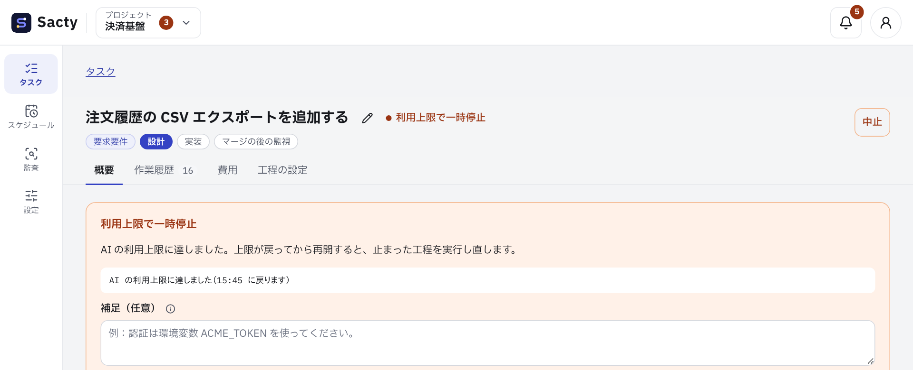

<!-- 対応するコード: packages/cli/src/index.ts、apps/daemon/src/config.ts（loadConfig）、apps/daemon/src/instance-lock.ts、apps/daemon/src/intake.ts、apps/daemon/src/secrets.ts、apps/daemon/src/host-mcp.ts、apps/daemon/src/services.ts、apps/daemon/src/notifier.ts、apps/daemon/src/error-report.ts、apps/web/src/components/error-report.tsx、apps/web/src/i18n/messages/labels.ts（SubagentNoticeImitated） -->

**日本語** | [English](troubleshooting.en.md)

# 困ったとき

よくある止まり方と、確かめることをまとめています。
節ごとの表の左の列から症状を探し、右の列の内容を確かめてください。
エラーで止まったタスクを人に見てもらうときは、エラーレポートを渡します（[エラーレポートを出す](#エラーレポートを出す)）。

## 起動・設定

| 症状 | 確かめること |
| --- | --- |
| `sacty up` が、ほかの sacty が動いていると言って終わる | 同じ `SACTY_HOME` で sacty が動いています。表示された接続先と PID の sacty を止めるか、別の `SACTY_HOME` とポートで起動してください（[はじめに](getting-started.md#データの置き場所)） |
| `--port and --daemon-port must be different` で終わる | `--port` と `--daemon-port` に違う番号を指定してください（[CLI](cli.md#sacty-up)） |
| 画面に設定ファイルの誤りが出る | 画面に出た項目（例 `providers.codex.auth.secret`）と理由を見て、`config.yaml` を直してください（[config.yaml の設定](config.md)）。ファイルが無ければ `npx sacty config init` で作ります |
| `sacty context preview` が、起動中の sacty が見つからないと言って終わる | 先に `npx sacty up` で起動してください（同じ `SACTY_HOME` で） |

## Docker・イメージ

| 症状 | 確かめること |
| --- | --- |
| 起動のときや画面の上に「エージェント用のイメージ（…）がありません」と出る | 出ているコマンド（`npx sacty image build` など）でイメージを作ってください。版を上げた後は、イメージの名前が変わるので作り直しが要ります。作ると、1 分ほどで表示が消えます |
| 「config.yaml の image（…）が、動いている Sacty の版のイメージ（…）と違います」と出る | Sacty を更新しても、`config.yaml` の `image`（または `images.<名前>.image`）が前の版のイメージの名前のままです。表示のとおりに書き換えてから、出ているコマンドでイメージを作ってください。1 分ほどで表示が消えます |
| 「Docker に接続できません」と出る | Docker（Docker Desktop など）を起動してください。起動すると、1 分ほどで確かめ直し、表示が消えます。接続できるまで、タスクを実行できません |
| 「docker コマンドが見つかりません」と出る | Docker をインストールし、`sacty up` を実行する端末で `docker` コマンドが使えるようにしてください（PATH に通す） |

## 秘密情報

| 症状 | 確かめること |
| --- | --- |
| 起動のときに、秘密情報を取り出せなかったと警告が出る | 警告に出た設定の秘密情報を用意してください（キーチェーンなら `npx sacty secret set <名前>`、1Password ならサインインと参照）。用意してから「Sacty の設定」の「秘密情報を取り出し直す」を押します（[秘密情報](secrets.md)） |
| 1Password の参照でタスクが止まった | `op signin`（または 1Password のアプリとの連携）でサインインしてから、タスクを再開してください |
| `sacty image build` で npm のトークンが無いと言われる | `npx sacty secret set <名前>` で保存してください（1Password の参照なら、サインインと参照を確かめます） |

## 取り込み・PR のレビュー

Issue・PR・チケットが取り込まれないときは、取り込めなかった理由が、プロジェクトの画面の「取り込めなかった対象」に出ていることがあります。

| 症状 | 確かめること |
| --- | --- |
| Issue が取り込まれない | 次のことを、順に確かめてください（[取り込み](intake.md)）。 1. 「Sacty の設定」の「Issue の取り込み」で、取り込むラベルを設定して On にしているか 2. プロジェクトの対象と GitHub アカウントを選んでいるか |
| チケットが取り込まれない | 次のことを、順に確かめてください（[JIRA のチケット](intake.md#jira-のチケット)）。 1. 「Sacty の設定」の「チケットの取り込み」で、ラベルを設定して On にしているか 2. チケットにそのラベルが付いていて、終わっていない（完了の状態でない）か 3. プロジェクトの設定の「チケットの取り込み先」に、接続先・種類・JIRA のプロジェクトのキーを書いているか 4. 接続先の PF（`config.yaml` の `gateway.platforms` か、コンテキストリポジトリの `platforms.yaml`）の、`upstream`・認証・`allow`（検索の API）の設定 なお、Issue の取り込むラベルと GitHub のアカウントは、チケットの取り込みには使いません |
| ラベルを付けた PR が取り込まれない | 次のことを、順に確かめてください（[PR のレビュー](intake.md#pr-のレビュー)）。 1. 「Sacty の設定」で、「PR のレビュー用のラベル」を保存して「レビュー用のラベルの PR を取り込む」を On にしているか 2. PR に付けたラベルが、その名前か（取り込むラベルの付いた PR は取り込みません） 3. PR が開いているか 4. その PR のタスクが、すでにできていないか（同じ PR は、どのプロジェクトのタスクでも、中止したタスクでも、二度取り込みません） 5. プロジェクトの対象と GitHub アカウントを選んでいるか なお、sacty が作った PR は、ラベルを付けても取り込みません（PR をレビューする子タスクがレビューします。[sacty が作った PR のレビュー](intake.md#sacty-が作った-pr-のレビュー)） |
| レビューを依頼された PR が取り込まれない | 次のことを、順に確かめてください（[PR のレビュー](intake.md#pr-のレビュー)）。 1. 「Sacty の設定」で、「自分にレビューが依頼された PR を取り込む」を On にしているか 2. レビューの依頼が、プロジェクトでそのホストに選んだ GitHub のアカウント本人への依頼か（チームへの依頼は取り込みません） |
| ラベルや依頼でレビューを頼んだのに、レビューが来ない | 次の順に進めてください（[レビューが止まったとき](intake.md#レビューが止まったとき)）。 1. タスクの一覧で、そのレビューのタスクが一時停止していないか確かめます。一時停止していれば、PR にも「Sacty のレビューが止まりました」というコメントが付いているはずです 2. 理由を確かめて、タスクの詳細の「再開する」を押します 再開してレビューを投稿すると、そのコメントは「解消済み」に変わります |

## タスクが止まる・進まない

一時停止したタスクの詳細には、止まった理由と「再開する」が出ます。

| 症状 | 確かめること |
| --- | --- |
| 「ベースブランチとの競合の目印が、N回続けて作業領域に残りました」で止まった | 競合したファイルが理由に出ます。「再開する」で、目印のあるファイルを渡して実装をやり直します（[ベースブランチが進んだとき](tasks.md#ベースブランチが進んだとき)） |
| 「実装の工程が、範囲を実装し終える前に終わりました」か「実装の工程が、実装し終えたかの申告が無いか読めないまま終わりました」で止まった | エージェントが残っていることを申告していれば、理由の下に 1 件ずつ出ます。「再開する」で、前の実行の続きから実装を続けます（続きから進められないときは、最初から実行し直します）。同じエージェントで進まないなら、再開の欄で実装のエージェントを変えてください（変えると、最初から実行し直します）（[実装が終わらないとき・やり直しで変更が無いとき](tasks.md#実装が終わらないときやり直しで変更が無いとき)） |
| 「実装の工程が、テストの対応していないテスト観点を残して終わりました」で止まった | テストが対応していない観点が理由に出ます。「再開する」で、前の実行の続きから実装を続けます（続きから進められないときは、最初から実行し直します）。同じエージェントで進まないなら、再開の欄で実装のエージェントを変えてください（変えると、最初から実行し直します）（[実装が終わらないとき・やり直しで変更が無いとき](tasks.md#実装が終わらないときやり直しで変更が無いとき)） |
| 分割案で「どの子タスクにも割り当てられず、統合レビューで確かめる観点にも挙げられていないテスト観点があります」で止まった | 「再開する」で、タスク分割をやり直します（[タスク分割の子タスクのテスト観点](tasks.md#タスク分割の子タスクのテスト観点)） |
| 「PR #N を、やり直しの実装が何も変えませんでした」で止まった | PR のレビューの指摘を確かめてください。直すべきなら再開し、当たらないなら PR を確かめてあなたが判断します（[実装が終わらないとき・やり直しで変更が無いとき](tasks.md#実装が終わらないときやり直しで変更が無いとき)） |
| 「断った理由を PR に返信し、AI のレビューに同じ内容を判定し直させましたが、指摘が残りました」で止まった | PR のレビューの指摘と、断った理由の返信を確かめてください。直すべきなら再開し（残った指摘を渡してやり直します）、当たらないなら PR を確かめてあなたが判断します（[実装が終わらないとき・やり直しで変更が無いとき](tasks.md#実装が終わらないときやり直しで変更が無いとき)） |
| 「案を人が決めた後、AI のレビューに同じ内容を判定し直させましたが、指摘が残りました」で止まった | PR のレビューの指摘を確かめてください。直すべきなら再開し（残った指摘を渡してやり直します）、当たらないなら PR を確かめてあなたが判断します（[実装が終わらないとき・やり直しで変更が無いとき](tasks.md#実装が終わらないときやり直しで変更が無いとき)） |
| 「担当（サブエージェント）を 1 件も起動しないレビューが、N 回続きました」で止まった | Sacty は、観点ごとの担当を起動せずに書かれたレビューを使わず、PR にも投稿しません。レビューの工程のエージェントを変えるなどしてから再開してください。再開すると、もう一度レビューします（[レビューが止まったとき](intake.md#レビューが止まったとき)） |
| 予算の上限で一時停止した | 画面で累計の新しい上限を入力して再開してください（[config.yaml の設定](config.md#予算)） |
| AI の利用上限で一時停止した | サブスクリプションの上限やレート制限が戻ってから再開してください。代わりのエージェントを書いておくと、止めずに切り替えます（[失敗したときの切り替え](config.md#失敗したときの切り替え)）。ゲートウェイのリトライの上限に達したときも同じです（[ゲートウェイ](gateway.md#ai-の呼び出しを中継する)） |
| 「エージェントの実行が N 分を超えたため止めました」で止まった | 作業に時間がかかる工程なら、`config.yaml` の `run_timeout` で上限を延ばしてから再開してください。延ばさずに再開することもできます（[実行の時間の上限で止まったとき](#実行の時間の上限で止まったとき)） |
| 大きな差分を扱う実行などが `exec /tini: argument list too long` で失敗する | 指示が大きすぎて、コマンドの引数の上限を超えていました。Sacty を最新版に更新してから、停止したタスクを再開してください（最新版は、指示を標準入力で渡すので、大きさの上限はありません） |
| 実装後のコードの写しを使う実行（PR の指摘の戻し先の判断・監査など）が `EACCES`（権限）で止まった | エージェントが作業領域に入れたツールに、読めないファイル（権限 0000 など）があったときの古い版の症状です。Sacty を最新版に更新してから再開してください。最新版は、読めないファイルを写しに入れずに進め、作業履歴に「読めないファイルが N 件あり、作業領域の写しには入れなかった」と残します |
| Codex × Bedrock などで `Reconnecting... error sending request` のまま進まない | 仮想マシンの中の Docker（Rancher Desktop など）では、`gateway.host_address` にホストに届くアドレスを書いてください（[ゲートウェイ](gateway.md#ホストのアドレス)） |
| ホストの MCP サーバーの準備ができないとタスクの一覧に出る | ホストでの認証ができるか、`command` と `env` を確かめてください。sacty は1分ごとに起動し直します（[ゲートウェイ](gateway.md#ホストで動かす-mcp-サーバー)） |
| `mcp.yaml` の MCP サーバーのコマンドがホストに見つからないと作業履歴に出る | `command` のサーバーは既定でホストで起動します。`npx`・`uvx` などをホストに入れるか、そのサーバーに `via_gateway: false` を書いてコンテナの中で起動してください（[コンテキストリポジトリ](context.md#コマンドの-mcp-サーバーホストで動かす)） |
| 作業履歴に「エージェントが、サブエージェントの完了の通知の形の文面をN件書いた」と出る | エージェントが、サブエージェント（レビューの担当など）の結果が届く前に、結果を自分で書いた恐れがあります。タスクは止まりません。その行から実行のログを開き、その実行の成果物とセルフレビューの結果を確かめてください。おかしければ、差し戻してやり直させます |
| コンテキストの誤りで工程が止まった | プロジェクトの設定の「コンテキストのプレビュー」か `npx sacty context preview` で、どの層のどのファイルのどの項目かを確かめてください（[コンテキストリポジトリ](context.md#合成の結果を確かめる)） |
| `images` に無いイメージの名前で止まった | `config.yaml` の `images` に足すか、プロジェクトの対象のイメージの指定を直してください（[コンテナイメージ](images.md#どのイメージで動くか)） |
| docker compose のサービスを起動できずに止まった | 理由に出た設定（`privileged`・ホストのネットワーク・作業領域の外のマウントなど）を使っていないか確かめてください（[docker compose のサービス](compose.md#使えない設定)） |
| MySQL などに `localhost` でつなげない | `127.0.0.1` と書くか、サービス名で接続してください（[docker compose のサービス](compose.md#localhost-のままでも届く)） |
| `ENOSPC`・`the volume holding /tmp is full` で止まった | Mac に空きがあっても、Docker の仮想ディスクが満杯のことがあります。次の順に進めてください。 1. `docker system df` で使用量を確かめます 2. `npx sacty image build` を実行します（古い版のイメージを片付けます） 3. それでも足りなければ、使っていないイメージを消し、`docker builder prune` を実行して、容量を空けます 4. タスクを再開します |

### 実行の時間の上限で止まったとき

「エージェントの実行が N 分を超えたため止めました」で止まったタスクは、次の手順で再開します。

1. 作業に時間がかかる工程なら、`config.yaml` の `run_timeout` で上限を延ばします（[config.yaml の設定](config.md#実行の上限run_timeout)）。
   延ばした上限は、次の実行から効きます。
   - 例：`roles: { implement: 90 }`
   - テストに時間がかかる PR のレビュー・再現なら、`test_minutes` か `roles: { review: 90 }`
2. タスクを再開します。

再開した後は、上限を延ばしても延ばさなくても、次のように進みます。

- 止めた実行のセッションの続きから進みます（同じエージェントで、セッションの記録がそろっているとき）。
  実装は、止める前の作業領域の変更も残ります。
- 続けられなければ（エージェントを変えた、記録が無いなど）、最初から実行し直します。
  作業履歴に、その理由が残ります。
- 何度止まっても、再開のたびに続きから進みます。
- 止めるまでに使った分は、読めた範囲で費用に入ります。
  読めなければ「不明」と出ます。

## 通知

| 症状 | 確かめること |
| --- | --- |
| Slack の通知が届かない | ダッシュボードか「Sacty の設定」の「Slack の通知」に出た理由を見てください。送れるかは、「Sacty の設定」の「テストの通知を送る」で確かめられます。以前の sacty でプロジェクトに設定した通知は使わないので、「Sacty の設定」で設定し直してください（[通知](notifications.md)） |
| メンションが届かない | 相手を @表示名ではなく ID（`U…`・`W…`・`S…`）で書いてください |
| 送り手の名前とアイコンが `Sacty` にならない | Slack のアプリのボットのトークンに `chat:write.customize` の権限を付けてください |

## エラーレポートを出す

エラーで止まったタスクを人に見てもらうときは、エラーレポートを渡してください。
タスクの詳細の右の列の「エラーレポート」は、エラーの記録があるタスクにだけ出ます。

1. 原因の見当を付けたいときは、先に「オーケストレーターに分析させる」を押します。
   分析が終わると時刻が出るので、それから次の手順に進んでください。
   分析の結果は、レポートの「オーケストレーターの分析」に入ります。
   分析の費用は、そのタスクの費用に入ります。
2. 「レポートをダウンロード」を押します。
   Sacty の処理・各工程のエージェントの動き・エラーの詳細をまとめた Markdown ファイル（`sacty-error-report-<タスクの短い ID>-<日時>.md`）がダウンロードされます。
   見出しは画面の言語です。

レポートはサーバーに送られません。
通信できない環境でも、ファイルとして渡せます。
大きさは 256KB までで、長い作業履歴は間を省きます。
秘密情報は伏せてありますが、タスクの内容・コードの一部・URL を含むので、渡す先に注意してください。
中身の詳細は [エラーレポート（仕様書）](../spec/error-report.md) にあります。

## 関係するページ

- [ユーザードキュメントの目次](README.md#目次)
